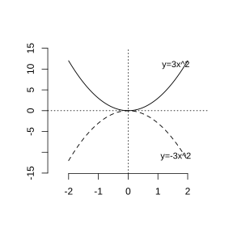
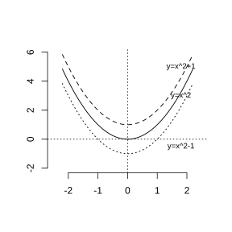
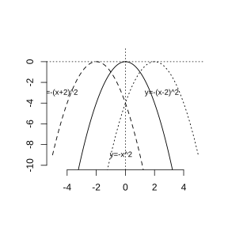
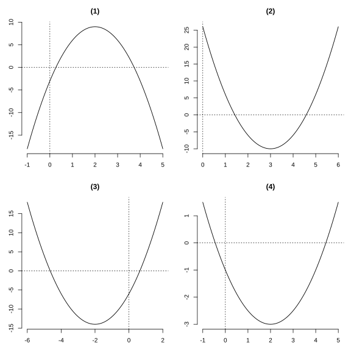
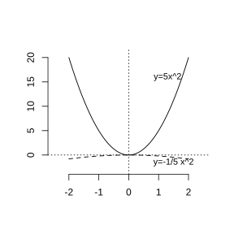
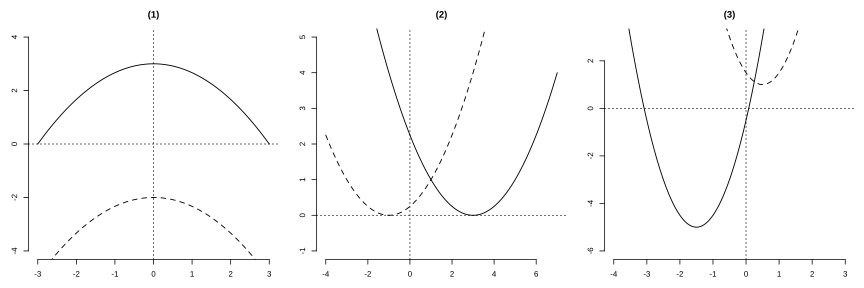
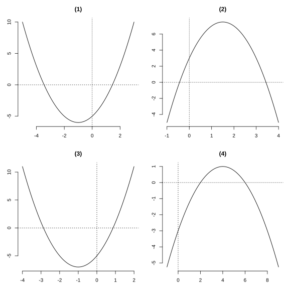

# 作业 134

> **结论 26.2.1** (抛物线 $y=ax^2$)  抛物线 $y=ax^2$ 的对称轴是 $y$ 轴, 顶点是原点. 当 $a>0$ 时开口向上, 顶点是最低点; 当 $a<0$ 时开口向下, 顶点是最高点. $\left|a\right|$ 越大, 抛物线的开口越小. $a>0$ 时 $x<0$ 时 $y$ 随 $x$ 增大而减小, $x>0$ 时 $y$ 随 $x$ 增大而增大; $a<0$ 时相反.
>
> **结论 26.2.2** (平移)  把抛物线 $y=ax^2$ 向上 ($k>0$) 或向下 ($k<0$) 平移 $\left|k\right|$ 个单位得到 $y=ax^2+k$; 向左 ($h<0$) 或向右 ($h>0$) 平移 $\left|h\right|$ 个单位得到 $y=a\left(x-h\right)^2$; 综合平移得到 $y=a\left(x-h\right)^2+k$.
>
> **结论 26.2.3** (抛物线 $y=a\left(x-h\right)^2+k$)  当 $a>0$ 时开口向上, 当 $a<0$ 时开口向下; 对称轴是 $x=h$; 顶点是 $\left(h,k\right)$. $a>0$ 时 $x=h$ 取最小值 $k$; $a<0$ 时 $x=h$ 取最大值 $k$.
>
> **结论 26.2.4** (抛物线 $y=ax^2+bx+c$)  配方得 $y=a\left(x+\frac b{2a}\right)^2+\frac{4ac-b^2}{4a}$, 对称轴是 $x=-\frac b{2a}$, 顶点是 $\left(-\frac b{2a},\frac{4ac-b^2}{4a}\right)$. $a>0$ 时 $x=-\frac b{2a}$ 取最小值 $\frac{4ac-b^2}{4a}$; $a<0$ 时取最大值.

### 练习一

(练习 26.2 第 1 题) 在同一平面直角坐标系中, 画出下列二次函数的图象:

(1) $y=3x^2$;

(2) $y=-3x^2$.

{width=50%}

### 解答 练习一

由**结论 26.2.1** (抛物线 $y=ax^2$), 两条抛物线的对称轴都是 $y$ 轴, 顶点都是原点. (1) $a=3>0$, 开口向上; (2) $a=-3<0$, 开口向下, 二者关于 $x$ 轴对称, 图象如图. $\blacksquare$

### 练习二

(练习 26.2 第 2 题) 说出下列抛物线的开口方向、对称轴和顶点, 以及随着 $x$ 的增大, $y$ 的变化情况:

(1) $y=4x^2$;

(2) $y=-4x^2$.

### 解答 练习二

由**结论 26.2.1** (抛物线 $y=ax^2$).

(1) $a=4>0$, 开口向上; 对称轴是 $y$ 轴; 顶点是原点 $\left(0,0\right)$, 为最低点. $x<0$ 时 $y$ 随 $x$ 增大而减小, $x>0$ 时 $y$ 随 $x$ 增大而增大.

(2) $a=-4<0$, 开口向下; 对称轴是 $y$ 轴; 顶点是原点 $\left(0,0\right)$, 为最高点. $x<0$ 时 $y$ 随 $x$ 增大而增大, $x>0$ 时 $y$ 随 $x$ 增大而减小. $\blacksquare$

### 练习三

(练习 26.2 第 3 题) 在同一平面直角坐标系中, 画出下列二次函数的图象: $y=x^2$, $y=x^2+1$, $y=x^2-1$. 指出三条抛物线的位置关系, 并分别指出它们的开口方向、对称轴和顶点.

{width=50%}

### 解答 练习三

由**结论 26.2.2** (平移), $y=x^2+1$ 是把 $y=x^2$ 向上平移 $1$ 个单位得到的, $y=x^2-1$ 是把 $y=x^2$ 向下平移 $1$ 个单位得到的, 三条抛物线形状相同, 仅上下位置不同. 三者 $a=1>0$, 开口都向上, 对称轴都是 $y$ 轴; 顶点分别为 $\left(0,0\right)$, $\left(0,1\right)$, $\left(0,-1\right)$. $\blacksquare$

### 练习四

(练习 26.2 第 4 题) 在同一平面直角坐标系中, 画出下列二次函数的图象: $y=-x^2$, $y=-\left(x+2\right)^2$, $y=-\left(x-2\right)^2$. 指出三条抛物线的位置关系, 并分别指出它们的开口方向、对称轴和顶点.

{width=50%}

### 解答 练习四

由**结论 26.2.2** (平移), $y=-\left(x+2\right)^2$ 是把 $y=-x^2$ 向左平移 $2$ 个单位得到的, $y=-\left(x-2\right)^2$ 是把 $y=-x^2$ 向右平移 $2$ 个单位得到的. 三者 $a=-1<0$, 开口都向下; 对称轴分别为 $x=0$, $x=-2$, $x=2$; 顶点分别为 $\left(0,0\right)$, $\left(-2,0\right)$, $\left(2,0\right)$. $\blacksquare$

### 练习五

(练习 26.2 第 5 题第 (1) 小题) 说出下列抛物线的开口方向、对称轴和顶点, 以及随着 $x$ 的增大, $y$ 的变化情况:

(1) $y=2\left(x+3\right)^2+5$;

(2) $y=-3\left(x-1\right)^2-2$;

(3) $y=4\left(x-3\right)^2+7$;

(4) $y=-5\left(x+2\right)^2-6$.

### 解答 练习五

由**结论 26.2.3** (抛物线 $y=a\left(x-h\right)^2+k$), 对照 $h,k$ 读出对称轴 $x=h$ 与顶点 $\left(h,k\right)$.

(1) $a=2>0$, 开口向上; 对称轴 $x=-3$; 顶点 $\left(-3,5\right)$, 为最低点. $x<-3$ 时 $y$ 随 $x$ 增大而减小, $x>-3$ 时 $y$ 随 $x$ 增大而增大.

(2) $a=-3<0$, 开口向下; 对称轴 $x=1$; 顶点 $\left(1,-2\right)$, 为最高点. $x<1$ 时 $y$ 随 $x$ 增大而增大, $x>1$ 时 $y$ 随 $x$ 增大而减小.

(3) $a=4>0$, 开口向上; 对称轴 $x=3$; 顶点 $\left(3,7\right)$, 为最低点. $x<3$ 时 $y$ 随 $x$ 增大而减小, $x>3$ 时 $y$ 随 $x$ 增大而增大.

(4) $a=-5<0$, 开口向下; 对称轴 $x=-2$; 顶点 $\left(-2,-6\right)$, 为最高点. $x<-2$ 时 $y$ 随 $x$ 增大而增大, $x>-2$ 时 $y$ 随 $x$ 增大而减小. $\blacksquare$

### 练习六

(练习 26.2 第 5 题第 (2) 小题) 说出下列二次函数的最大值或最小值:

(1) $y=2\left(x-3\right)^2+5$;

(2) $y=-\left(x+2\right)^2-2$.

### 解答 练习六

由**结论 26.2.3** (抛物线 $y=a\left(x-h\right)^2+k$).

(1) $a=2>0$, 开口向上, 当 $x=3$ 时 $y$ 取最小值 $5$, 无最大值.

(2) $a=-1<0$, 开口向下, 当 $x=-2$ 时 $y$ 取最大值 $-2$, 无最小值. $\blacksquare$

### 练习七

(练习 26.2 第 6 题) 先确定下列抛物线的开口方向、对称轴和顶点, 说出随着 $x$ 的增大, $y$ 的变化情况, 再描点画图:

(1) $y=-3x^2+12x-3$;

(2) $y=4x^2-24x+26$;

(3) $y=2x^2+8x-6$;

(4) $y=\frac12x^2-2x-1$.

{width=100%}

### 解答 练习七

由**结论 26.2.4** (抛物线 $y=ax^2+bx+c$), 对称轴 $x=-\frac b{2a}$, 顶点纵坐标 $\frac{4ac-b^2}{4a}$.

(1) $a=-3$, $b=12$, $c=-3$. 对称轴 $x=-\frac{12}{2\left(-3\right)}=2$, 顶点纵坐标 $\frac{4\left(-3\right)\left(-3\right)-144}{4\left(-3\right)}=\frac{36-144}{-12}=9$. 开口向下, 顶点 $\left(2,9\right)$, $x<2$ 时 $y$ 随 $x$ 增大而增大, $x>2$ 时减小.

(2) $a=4$, $b=-24$, $c=26$. 对称轴 $x=\frac{24}{8}=3$, 顶点纵坐标 $\frac{4\cdot4\cdot26-576}{16}=\frac{416-576}{16}=-10$. 开口向上, 顶点 $\left(3,-10\right)$.

(3) $a=2$, $b=8$, $c=-6$. 对称轴 $x=-\frac84=-2$, 顶点纵坐标 $\frac{4\cdot2\left(-6\right)-64}{8}=\frac{-48-64}{8}=-14$. 开口向上, 顶点 $\left(-2,-14\right)$.

(4) $a=\frac12$, $b=-2$, $c=-1$. 对称轴 $x=\frac{2}{1}=2$, 顶点纵坐标 $\frac{4\cdot\frac12\cdot\left(-1\right)-4}{2}=\frac{-2-4}{2}=-3$. 开口向上, 顶点 $\left(2,-3\right)$.

图象如图. $\blacksquare$

### 练习八

(练习 26.2 第 7 题) 求下列函数的最大值或最小值:

(1) $y=3x^2+2x$;

(2) $y=-2x^2+8x-8$.

### 解答 练习八

由**结论 26.2.4**, 在 $x=-\frac b{2a}$ 处取最值 $\frac{4ac-b^2}{4a}$.

(1) $a=3>0$, 当 $x=-\frac{2}{6}=-\frac13$ 时, 取最小值 $\frac{0-4}{12}=-\frac13$.

(2) $a=-2<0$, 当 $x=-\frac{8}{2\left(-2\right)}=2$ 时, 取最大值 $\frac{4\left(-2\right)\left(-8\right)-64}{-8}=\frac{64-64}{-8}=0$. $\blacksquare$

### 习题一

(习题 26.2 复习巩固第 1 题) 在同一平面直角坐标系中, 画出下列二次函数的图象, 并写出其开口方向、对称轴和顶点:

(1) $y=5x^2$;

(2) $y=-\frac15x^2$.

{width=50%}

### 解答 习题一

由**结论 26.2.1** (抛物线 $y=ax^2$), 二者对称轴都是 $y$ 轴, 顶点都是原点.

(1) $a=5>0$, 开口向上, $\left|a\right|$ 较大, 开口较窄.

(2) $a=-\frac15<0$, 开口向下, $\left|a\right|$ 较小, 开口较宽.

图象如图. $\blacksquare$

### 习题二

(习题 26.2 复习巩固第 2 题) 分别在同一平面直角坐标系中, 画出下列各组二次函数的图象, 并写出其对称轴和顶点:

(1) $y=-\frac13x^2+3$, $y=-\frac13x^2-2$;

(2) $y=\frac14\left(x-3\right)^2$, $y=\frac14\left(x+1\right)^2$;

(3) $y=2\left(x+\frac32\right)^2-5$, $y=2\left(x-\frac12\right)^2+1$.

{width=100%}

### 解答 习题二

由**结论 26.2.2** 与**结论 26.2.3**.

(1) 二者 $a=-\frac13$, 由上下平移得到, 对称轴都是 $y$ 轴, 顶点分别为 $\left(0,3\right)$ 和 $\left(0,-2\right)$.

(2) 二者 $a=\frac14$, 由左右平移得到, 对称轴分别为 $x=3$ 和 $x=-1$, 顶点分别为 $\left(3,0\right)$ 和 $\left(-1,0\right)$.

(3) 二者 $a=2$, 对称轴分别为 $x=-\frac32$ 和 $x=\frac12$, 顶点分别为 $\left(-\frac32,-5\right)$ 和 $\left(\frac12,1\right)$.

图象如图. $\blacksquare$

### 习题三

(习题 26.2 复习巩固第 3 题) 先确定下列抛物线的开口方向、对称轴和顶点, 再描点画图:

(1) $y=x^2+2x-5$;

(2) $y=-2x^2+6x+3$;

(3) $y=2x^2+4x-5$;

(4) $y=-\frac14x^2+2x-3$.

{width=100%}

### 解答 习题三

由**结论 26.2.4** 求对称轴 $x=-\frac b{2a}$ 与顶点.

(1) $a=1$, $b=2$, 对称轴 $x=-1$, 顶点纵坐标 $-1-2-5=-8$, 开口向上, 顶点 $\left(-1,-8\right)$.

(2) $a=-2$, $b=6$, 对称轴 $x=\frac64=\frac32$, 顶点 $\left(\frac32,\frac{15}2\right)$, 开口向下.

(3) $a=2$, $b=4$, 对称轴 $x=-1$, 顶点 $\left(-1,-7\right)$, 开口向上.

(4) $a=-\frac14$, $b=2$, 对称轴 $x=-\frac{2}{2\left(-1/4\right)}=4$, 顶点 $\left(4,1\right)$, 开口向下.

图象如图. $\blacksquare$

### 习题四

(习题 26.2 复习巩固第 4 题) 求下列二次函数的最大值或最小值:

(1) $y=5x^2+3x+2$;

(2) $y=-x^2+6x-3$;

(3) $y=-\frac12x^2-3x-\frac52$;

(4) $y=\frac14x^2-2x+5$.

### 解答 习题四

由**结论 26.2.4**, 在 $x=-\frac b{2a}$ 处取最值 $\frac{4ac-b^2}{4a}$.

(1) $a=5>0$, 当 $x=-\frac3{10}$ 时取最小值 $\frac{4\cdot5\cdot2-9}{20}=\frac{40-9}{20}=\frac{31}{20}$.

(2) $a=-1<0$, 当 $x=3$ 时取最大值 $\frac{4\left(-1\right)\left(-3\right)-36}{-4}=\frac{12-36}{-4}=6$.

(3) $a=-\frac12<0$, 当 $x=-\frac{-3}{2\left(-1/2\right)}=-3$ 时, 取最大值 $\frac{4\left(-1/2\right)\left(-5/2\right)-9}{4\left(-1/2\right)}=\frac{5-9}{-2}=2$.

(4) $a=\frac14>0$, 当 $x=-\frac{-2}{2\left(1/4\right)}=4$ 时, 取最小值 $\frac{4\cdot\frac14\cdot5-4}{1}=\frac{5-4}{1}=1$. $\blacksquare$

### 习题五

(习题 26.2 复习巩固第 5 题) 已知抛物线 $y=-\frac12x^2+bx+c$ 的顶点为 $\left(5,\frac{17}2\right)$, 求 $b,c$ 的值.

### 解答 习题五

由**结论 26.2.4**, 对称轴 $x=-\frac b{2a}$. 这里 $a=-\frac12$, 顶点横坐标为 $5$, 故

$$
-\frac{b}{2\left(-1/2\right)}=5,
$$

即 $b=5$. 再由顶点纵坐标为 $\frac{17}2$, 而 $x=5$ 时 $y=-\frac12\cdot25+5\cdot5+c=-\frac{25}2+25+c=\frac{25}2+c$, 令其等于 $\frac{17}2$, 得 $c=\frac{17}2-\frac{25}2=-4$. 故 $b=5$, $c=-4$. $\blacksquare$

### 习题六

(习题 26.2 综合运用第 6 题) 填空:

(1) 在平面直角坐标系中, 把抛物线 $y=-3\left(x-2\right)^2-5$ 先向上平移 $5$ 个单位长度, 再向左平移 $2$ 个单位长度, 所得抛物线对应的函数解析式为 $\_\_\_\_.$

(2) 在平面直角坐标系中, 把抛物线 $y=2x^2+4x+3$ 先向下平移 $1$ 个单位长度, 再向右平移 $1$ 个单位长度, 所得抛物线对应的函数解析式为 $\_\_\_\_.$

### 解答 习题六

由**结论 26.2.2** (平移).

(1) $y=-3\left(x-2\right)^2-5$ 向上平移 $5$ 个单位得 $y=-3\left(x-2\right)^2$, 再向左平移 $2$ 个单位得 $y=-3x^2$. 故填 $y=-3x^2$.

(2) $y=2x^2+4x+3=2\left(x+1\right)^2+1$, 向下平移 $1$ 个单位得 $y=2\left(x+1\right)^2$, 再向右平移 $1$ 个单位得 $y=2x^2$. 故填 $y=2x^2$. $\blacksquare$

### 习题七

(习题 26.2 综合运用第 7 题) 如图, 一名足球运动员在点 $A$ 处踢出任意球, 球的飞行路线是一条抛物线. 当球飞行到最高点时, 恰好击中 $2.44\ \text{m}$ 高的球门横梁上的点 $B$. 设位于点 $B$ 正下方的地面上的点为 $C$, 且 $AC=24.4\ \text{m}$. 求球的竖直高度 $y$ (单位: $\text{m}$) 关于它距离点 $A$ 的水平距离 $x$ (单位: $\text{m}$) 的函数解析式.

### 解答 习题七

以 $A$ 为原点, 地面所在直线为 $x$ 轴建立坐标系. 球在最高点击中 $B$, 而 $B$ 在 $C$ 正上方、$AC=24.4$, 故顶点为 $\left(24.4,2.44\right)$. 设抛物线为 $y=a\left(x-24.4\right)^2+2.44$. 它过点 $A\left(0,0\right)$, 代入得

$$
0=a\left(0-24.4\right)^2+2.44,
$$

解得 $a=-\frac{2.44}{24.4^2}=-\frac1{244}$. 故函数解析式为

$$
y=-\frac1{244}\left(x-24.4\right)^2+2.44. \blacksquare
$$

### 习题八

(习题 26.2 拓广探索第 8 题) 抛物线 $y=ax^2+bx+c$ 经过 $\left(-1,-22\right)$, $\left(0,-8\right)$, $\left(2,8\right)$ 三点, 求它的开口方向、对称轴和顶点.

### 解答 习题八

把三点代入 $y=ax^2+bx+c$. 代入 $\left(0,-8\right)$, 得 $c=-8$. 代入 $\left(-1,-22\right)$, 得 $a-b-8=-22$, 即 $a-b=-14$. 代入 $\left(2,8\right)$, 得 $4a+2b-8=8$, 即 $2a+b=8$.

两式相加, $3a=-6$, 故 $a=-2$, 进而 $b=8-2a=12$. 于是

$$
y=-2x^2+12x-8.
$$

$a=-2<0$, 开口向下. 由**结论 26.2.4**, 对称轴 $x=-\frac{12}{2\left(-2\right)}=3$, 顶点纵坐标 $-2\cdot9+36-8=10$. 故对称轴为直线 $x=3$, 顶点为 $\left(3,10\right)$. $\blacksquare$

### 习题九

(习题 26.2 拓广探索第 9 题) 如图, 在平面直角坐标系中, 点 $A$ 的坐标是 $\left(0,2\right)$. 在 $x$ 轴上任取一点 $M$, 连接 $AM$, 作线段 $AM$ 的垂直平分线 $l_1$, 过点 $M$ 作 $x$ 轴的垂线 $l_2$, 记 $l_1,l_2$ 的交点为 $P$. 多次改变点 $M$ 的位置得到相应的点 $P$, 用平滑曲线连接, 记为曲线 $l$.

(1) 对于曲线 $l$ 上任意一点 $P$, 线段 $PA$ 与 $PM$ 有什么关系?

(2) 设点 $P$ 的坐标是 $\left(x,y\right)$, 根据 (1) 的结论求 $x,y$ 满足的关系式, 并由此确定曲线 $l$ 是哪种曲线.

### 解答 习题九

(1) 因为 $P$ 在线段 $AM$ 的垂直平分线 $l_1$ 上, 由线段垂直平分线上的点到线段两端距离相等, 得

$$
PA=PM.
$$

(2) 设 $P\left(x,y\right)$. 因 $M$ 在 $x$ 轴上且 $PM\perp x$ 轴, 故 $M\left(x,0\right)$, 从而 $PM=\left|y\right|$. 又 $A\left(0,2\right)$, 由距离公式,

$$
PA=\sqrt{\left(x-0\right)^2+\left(y-2\right)^2}.
$$

由 (1) $PA=PM$, 得 $\sqrt{x^2+\left(y-2\right)^2}=\left|y\right|$. 两边平方, 得

$$
x^2+\left(y-2\right)^2=y^2,
$$

即 $x^2+y^2-4y+4=y^2$, 整理得 $y=\frac{x^2+4}{4}=\frac14x^2+1$. 这是一个二次函数, 故曲线 $l$ 是一条抛物线. $\blacksquare$
