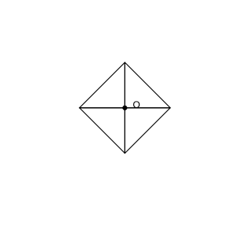

# 作业 145

> **定义 28.1.1** (图形的旋转)  把一个平面图形绕着平面内某一点 $O$ 转动一个角度, 叫作图形的旋转.
>
> **性质 28.1.1** (旋转的性质)  旋转前、后的图形全等; 对应点到旋转中心的距离相等; 对应点与旋转中心所连线段所成的角等于旋转角.
>
> **定义 28.2.1** (中心对称)  把一个图形绕着某一点旋转 $180^\circ$, 如果旋转后的图形能与另一个图形重合, 那么这两个图形关于这个点中心对称.
>
> **性质 28.2.1** (中心对称的性质)  成中心对称的两个图形, 对称点所连线段经过对称中心, 并且被对称中心平分.

### 活动一

(数学活动 活动 1 利用图形变化设计图案) 我们可以利用平移、轴对称和旋转中的一种进行图案设计, 还可以利用它们的组合进行图案设计. 如图, 以点 $O$ 为旋转中心, 将图形逆时针旋转 $90^\circ$ 三次作出图 3, 然后以 $l$ 为对称轴作出图 4, 平移图 4 就可以得到图 1 中的图案. 你能指出这个基本图形吗? 试说明图案的形成过程.

{width=50%}

### 解答 活动一

由**定义 28.1.1** (图形的旋转), **性质 28.1.1** (旋转的性质) 及**性质 28.2.1** (中心对称的性质).

图案的基本图形为图 2 中一个直角三角形 (或四分之一图形). 形成过程: 将基本图形绕点 $O$ 逆时针旋转 $90^\circ$, 连续旋转三次, 每次旋转角 $90^\circ$, 得到四个全等的图形, 组成图 3; 再以直线 $l$ 为对称轴作轴对称图形得到图 4; 最后将图 4 沿水平方向平移, 即得到重复排列的图案. $\blacksquare$
