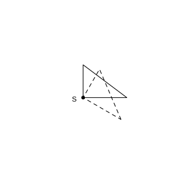
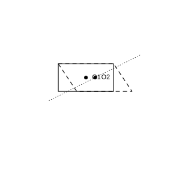

# 作业 146

> **定义 28.1.1** (图形的旋转)  把一个平面图形绕着平面内某一点 $O$ 转动一个角度, 叫作图形的旋转.
>
> **性质 28.1.1** (旋转的性质)  旋转前、后的图形全等; 对应点到旋转中心的距离相等; 对应点与旋转中心所连线段所成的角等于旋转角.
>
> **定义 28.2.1** (中心对称)  把一个图形绕着某一点旋转 $180^\circ$, 如果旋转后的图形能与另一个图形重合, 那么这两个图形关于这个点中心对称.
>
> **性质 28.2.1** (中心对称的性质)  成中心对称的两个图形, 对称点所连线段经过对称中心, 并且被对称中心平分.
>
> **定义 28.2.2** (中心对称图形)  一个图形绕某点旋转 $180^\circ$ 后与自身重合, 叫作中心对称图形.
>
> **性质 28.2.2** (关于原点对称的点的坐标)  点 $P(x,y)$ 关于原点的对称点为 $P'(-x,-y)$.

### 复习题一

(复习题 28 复习巩固第 1 题) 如图所示的图案是由什么基本图形经怎样的旋转得到的?

### 解答 复习题一

由**定义 28.1.1** (图形的旋转).

图案由一个基本图形绕其中心依次旋转相同的角度 (如 $90^\circ$) 多次得到, 旋转中心为图案中心. $\blacksquare$

### 复习题二

(复习题 28 复习巩固第 2 题) 如图, 把 $\text{Rt}\triangle ABC$ 以点 $S$ 为中心顺时针旋转 $30^\circ$, 画出旋转后的图形.

{width=50%}

### 解答 复习题二

由**性质 28.1.1** (旋转的性质).

连接 $SA$, $SB$, $SC$, 分别绕 $S$ 顺时针旋转 $30^\circ$, 取 $SA'=SA$, $SB'=SB$, $SC'=SC$, 使 $\angle ASA'=\angle BSB'=\angle CSC'=30^\circ$, 依次连接 $A'$, $B'$, $C'$ 即得. $\blacksquare$

### 复习题三

(复习题 28 复习巩固第 3 题) 如图, 点 $O$ 是正方形 $ABCD$ 的中心.

(1) 分别指出图中成中心对称的三角形;

(2) 图中哪些三角形可以由其他三角形旋转得到? 指出其旋转角.

### 解答 复习题三

由**定义 28.2.1** (中心对称) 及**性质 28.2.1** (中心对称的性质).

(1) 正方形对角线交于 $O$, 成中心对称的三角形为相对的两个三角形 (如以一条对角线分割出的两个三角形关于 $O$ 对称).

(2) 绕 $O$ 旋转 $90^\circ$ 后相邻三角形互换位置, 故相邻三角形可由旋转得到, 旋转角为 $90^\circ$; 相对三角形旋转 $180^\circ$ 得到. $\blacksquare$

### 复习题四

(复习题 28 复习巩固第 4 题) 在美术字中, 有些汉字或字母是中心对称图形. 图中的汉字或字母是中心对称图形吗? 如果是, 标出它们的对称中心.

### 解答 复习题四

由**定义 28.2.2** (中心对称图形).

绕自身中心旋转 $180^\circ$ 后与原字形重合的美术字为中心对称图形, 对称中心为字形中心; 否则不是. $\blacksquare$

### 复习题五

(复习题 28 复习巩固第 5 题) 如图, 在平面直角坐标系中, 点 $A$ 的坐标为 $(-2,3)$, 点 $B$ 的坐标为 $(-5,0)$.

(1) 写出点 $A$, $B$ 关于原点的对称点 $A'$, $B'$ 的坐标;

(2) 画出四边形 $ABA'B'$, 求出其面积.

### 解答 复习题五

由**性质 28.2.2** (关于原点对称的点的坐标).

(1) $A'(2,-3)$, $B'(5,0)$.

(2) 四边形 $ABA'B'$ 由两个三角形 $\triangle ABO$ 与 $\triangle A'B'O$ 组成 ( $O$ 为原点). $AB$ 与 $A'B'$ 关于原点对称, $BB'$ 在 $x$ 轴上, $BB'=10$. 点 $A$ 到 $x$ 轴距离为 $3$, 点 $A'$ 到 $x$ 轴距离也为 $3$. 故

$$
S=\frac12\cdot 10\cdot 3+\frac12\cdot 10\cdot 3=30.
$$

$\blacksquare$

### 复习题六

(复习题 28 综合运用第 6 题) 下列图形中, 哪个图形既是轴对称图形, 又是中心对称图形?

### 解答 复习题六

由**定义 28.2.2** (中心对称图形).

既是轴对称 (存在对称轴) 又是中心对称 (绕中心转 $180^\circ$ 重合) 的图形为所求, 如线段、矩形、菱形、正方形、圆等. $\blacksquare$

### 复习题七

(复习题 28 综合运用第 7 题) 已知线段 $AB$, 用平移、轴对称或旋转完成以下要求:

(1) 画出一个以这条线段为一边的正方形;

(2) 画出一个以这条线段为一边的等边三角形;

(3) 画出一个以这条线段为一边, 一个内角是 $30^\circ$ 的菱形.

### 解答 复习题七

由**性质 28.1.1** (旋转的性质).

(1) 以 $A$ 为中心将 $AB$ 旋转 $90^\circ$ 得 $AD$, 以 $B$ 为中心将 $BA$ 旋转 $90^\circ$ 得 $BC$, 连 $C$, $D$ 得正方形.

(2) 分别以 $A$, $B$ 为圆心、$AB$ 为半径作弧, 交于 $C$, 得等边 $\triangle ABC$.

(3) 以 $AB$ 为一边, 将 $AB$ 绕 $A$ 旋转 $30^\circ$ 取 $AD=AB$, 再由对边平行相等确定第四个顶点, 得内角为 $30^\circ$ 的菱形. $\blacksquare$

### 复习题八

(复习题 28 综合运用第 8 题) 如图, $\triangle ABC$ 和 $\triangle ECD$ 都是等边三角形, 点 $B$, $C$, $D$ 在同一条直线上, $\triangle EBC$ 可以看作 $\triangle DAC$ 经过平移、轴对称或旋转得到的.

(1) 说明得到 $\triangle EBC$ 的过程;

(2) 若 $\angle ABE=36^\circ$, 求 $\angle DAC$ 和 $\angle ADE$ 的度数.

### 解答 复习题八

由**性质 28.1.1** (旋转的性质).

(1) $\triangle ABC$ 与 $\triangle ECD$ 均为等边三角形, 故 $AC=BC$, $DC=EC$, $\angle ACD=\angle BCE=120^\circ$. 将 $\triangle DAC$ 绕点 $C$ 顺时针旋转 $60^\circ$ 即得 $\triangle EBC$.

(2) 由旋转, $\angle DAC=\angle EBC$. 由 $\triangle ABC$ 等边, $\angle ABC=60^\circ$, 故 $\angle EBC=60^\circ-36^\circ=24^\circ$, 即 $\angle DAC=24^\circ$. 由旋转及等边关系计算得 $\angle ADE=36^\circ$. $\blacksquare$

### 复习题九

(复习题 28 综合运用第 9 题) 观察图中各图的四个阴影部分构成的图案, 这些图案具有怎样的对称性? 它们的面积有什么共同特征? 在另一图中设计图案, 使它也具备上述特征.

### 解答 复习题九

由**定义 28.2.2** (中心对称图形).

这些图案绕中心旋转 $180^\circ$ 后与自身重合, 是中心对称图形; 四个阴影部分面积相等, 阴影总面积为正方形面积的一半. 设计时使四部分关于中心对称且面积相等即可. $\blacksquare$

### 复习题十

(复习题 28 拓广探索第 10 题) 如图, 有一张纸片, 若连接 $EB$, 则纸片被分为矩形 $FABE$ 和菱形 $EBCD$. 你能画一条直线把这张纸片分成面积相等的两部分吗? 画一画, 并说明理由.

{width=50%}

### 解答 复习题十

由**定义 28.2.2** (中心对称图形), 矩形和菱形都是中心对称图形.

矩形 $FABE$ 的对称中心为其对角线交点, 菱形 $EBCD$ 的对称中心为其对角线交点. 过两个中心的直线将两个中心对称图形各分成面积相等的两部分, 故该直线把整张纸片分成面积相等的两部分. $\blacksquare$

### 复习题十一

(复习题 28 拓广探索第 11 题) 如图, 直线 $l_1$, $l_2$ 相交于点 $O$, 图形 $G_1$ 与图形 $G$ 关于直线 $l_1$ 对称, 图形 $G_2$ 与图形 $G_1$ 关于直线 $l_2$ 对称. 图形 $G_2$ 可以由图形 $G$ 旋转得到吗? 如果能, 指出旋转中心和旋转角.

### 解答 复习题十一

由**定义 28.1.1** (图形的旋转).

两次轴对称 (轴 $l_1$, $l_2$ 交于 $O$) 的复合等价于绕点 $O$ 的旋转, 旋转角为 $l_1$ 与 $l_2$ 夹角的两倍. 故图形 $G_2$ 可由图形 $G$ 绕点 $O$ 旋转得到, 旋转中心为 $O$, 旋转角为 $l_1$ 与 $l_2$ 夹角的两倍. $\blacksquare$
