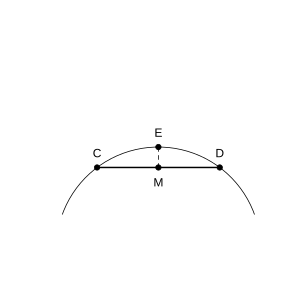

# 作业 148

> **性质 29.2.1** (圆的轴对称性)  圆是轴对称图形, 任何一条直径所在直线都是圆的对称轴.
>
> **定理 29.2.1** (垂径定理)  垂直于弦的直径平分弦, 并且平分弦所对的两条弧.
>
> **推论 29.2.1** (垂径定理推论)  平分弦 (不是直径) 的直径垂直于弦, 并且平分弦所对的两条弧.

### 练习一

(练习 29.2 第 1 题) 如图, 两个圆都以点 $O$ 为圆心, 大圆的弦 $AB$ 交小圆于 $C$, $D$ 两点. 求证 $AC=BD$.

### 解答 练习一

由**定理 29.2.1** (垂径定理).

过 $O$ 作 $OH\perp AB$ 于 $H$. 在大圆中, $OH$ 平分 $AB$, 故 $AH=BH$; 在小圆中, $OH$ 平分 $CD$, 故 $CH=DH$. 两式相减, $AH-CH=BH-DH$, 即 $AC=BD$. $\blacksquare$

### 练习二

(练习 29.2 第 2 题) 如图, 在 $\odot O$ 中, $AB$, $AC$ 为互相垂直且相等的两条弦, $OD\perp AB$, $OE\perp AC$, 垂足分别为 $D$, $E$. 求证: 四边形 $ADOE$ 是正方形.

### 解答 练习二

由**定理 29.2.1** (垂径定理).

$OD\perp AB$, $OE\perp AC$, 故 $\angle ADO=\angle AEO=90^\circ$, 又 $\angle DAE=90^\circ$, 四边形 $ADOE$ 为矩形. 由 $AB=AC$, 垂径定理得 $AD=\frac12 AB$, $AE=\frac12 AC$, 故 $AD=AE$. 矩形 $ADOE$ 邻边相等, 故为正方形. $\blacksquare$

### 练习三

(练习 29.2 第 3 题) 如图是一个隧道的横截面, 它的形状是以点 $O$ 为圆心的圆的一部分. 如果 $M$ 是 $\odot O$ 中弦 $CD$ 的中点, $EM$ 经过圆心 $O$ 交 $\odot O$ 于点 $E$, 且 $CD=4\,\text{m}$, $EM=6\,\text{m}$. 求 $\odot O$ 的半径长.

{width=50%}

### 解答 练习三

由**定理 29.2.1** (垂径定理), $EM\perp CD$, $M$ 为垂足.

设半径为 $R$, 则 $OC=R$, $OM=EM-R=6-R$, $CM=\frac12 CD=2$. 在 $\text{Rt}\triangle OMC$ 中,

$$
R^2=2^2+(6-R)^2=4+36-12R+R^2.
$$

化简得 $12R=40$, 故 $R=\frac{10}{3}\,\text{m}$. $\blacksquare$
