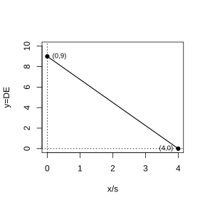

# 作业 163

> **定义 27.2.1** (相似三角形)  在 $\triangle ABC$ 和 $\triangle A'B'C'$ 中，如果 $\angle A=\angle A'$，$\angle B=\angle B'$，$\angle C=\angle C'$，且 $\frac{AB}{A'B'}=\frac{BC}{B'C'}=\frac{AC}{A'C'}=k$，则 $\triangle ABC\backsim\triangle A'B'C'$。

> **基本事实 27.2.1** (平行线分线段成比例)  两条直线被一组平行线所截，所得的对应线段成比例。

> **定理 27.2.1** (预备定理)  平行于三角形一边的直线和其他两边相交，所构成的三角形与原三角形相似。

> **判定定理 27.2.2** (SSS)  三边成比例的两个三角形相似。

> **判定定理 27.2.3** (SAS)  两边成比例且夹角相等的两个三角形相似。

> **判定定理 27.2.4** (AA)  两角分别相等的两个三角形相似。

> **判定定理 27.2.5** (HL)  斜边和一条直角边成比例的两个直角三角形相似。

> **性质 27.2.1** (对应线段)  相似三角形对应高的比、对应中线的比与对应角平分线的比都等于相似比；相似三角形对应线段的比等于相似比。

> **性质 27.2.2** (面积比)  相似三角形面积的比等于相似比的平方。

### 练习一

(练习 27.2 第 1 题) 如图，$AB\parallel CD\parallel EF$，$AF$ 与 $BE$ 相交于点 $G$，且 $AG=2$，$GD=1$，$DF=5$，求 $\frac{BC}{CE}$ 的值。

### 解答 练习一

由**基本事实 27.2.1** (平行线分线段成比例)，三条平行线截两条直线，对应线段成比例。

$$
\frac{BC}{CE}=\frac{AD}{DF}=\frac{AG+GD}{DF}=\frac{2+1}{5}=\frac{3}{5}.\ \blacksquare
$$

### 练习二

(练习 27.2 第 2 题) 如图，在 $\triangle ABC$ 中，$DE\parallel BC$，且 $AD=3$，$DB=2$。写出图中的相似三角形，并指出其相似比。

### 解答 练习二

由**定理 27.2.1** (预备定理)，$DE\parallel BC$，故 $\triangle ADE\backsim\triangle ABC$。

相似比为 $\frac{AD}{AB}=\frac{AD}{AD+DB}=\frac{3}{3+2}=\frac{3}{5}$。 $\blacksquare$

### 练习三

(练习 27.2 第 1 题) 根据下列条件，判断 $\triangle ABC$ 与 $\triangle A'B'C'$ 是否相似，并说明理由：

(1) $\angle A=40^\circ$，$AB=8\ \text{cm}$，$AC=15\ \text{cm}$，$\angle A'=40^\circ$，$A'B'=16\ \text{cm}$，$A'C'=30\ \text{cm}$；

(2) $AB=10\ \text{cm}$，$BC=8\ \text{cm}$，$AC=16\ \text{cm}$，$A'B'=16\ \text{cm}$，$B'C'=12.8\ \text{cm}$，$A'C'=25.6\ \text{cm}$。

### 解答 练习三

(1) $\angle A=\angle A'=40^\circ$，且

$$
\frac{AB}{A'B'}=\frac{8}{16}=\frac{1}{2},\quad\frac{AC}{A'C'}=\frac{15}{30}=\frac{1}{2}.
$$

两边成比例且夹角相等，由**判定定理 27.2.3** (SAS)，$\triangle ABC\backsim\triangle A'B'C'$。

(2)

$$
\frac{AB}{A'B'}=\frac{10}{16}=\frac{5}{8},\quad
\frac{BC}{B'C'}=\frac{8}{12.8}=\frac{5}{8},\quad
\frac{AC}{A'C'}=\frac{16}{25.6}=\frac{5}{8}.
$$

三边成比例，由**判定定理 27.2.2** (SSS)，$\triangle ABC\backsim\triangle A'B'C'$。 $\blacksquare$

### 练习四

(练习 27.2 第 2 题) 图中的两个三角形是否相似？为什么？(左边三角形三边为 $15,20,25$；右边三角形三边为 $27,36,45$。另一组图形中，$\triangle ABC$ 与 $\triangle EDC$ 在点 $C$ 处形成对顶角，$BC=54$，$CE=36$，$AC=45$，$CD=30$。)

### 解答 练习四

第一组：$\frac{15}{27}=\frac{5}{9}$，$\frac{20}{36}=\frac{5}{9}$，$\frac{25}{45}=\frac{5}{9}$，三边成比例，由**判定定理 27.2.2** (SSS)，相似。

第二组：$\angle ACB=\angle DCE$ (对顶角)，且 $\frac{BC}{CE}=\frac{54}{36}=\frac{3}{2}$，$\frac{AC}{CD}=\frac{45}{30}=\frac{3}{2}$，两边成比例且夹角相等，由**判定定理 27.2.3** (SAS)，相似。 $\blacksquare$

### 练习五

(练习 27.2 第 3 题) 要制作两个形状相同的三角形框架，其中一个三角形框架的三边长分别为 $4\ \text{cm}$，$5\ \text{cm}$ 和 $6\ \text{cm}$，另一个三角形框架的一边长为 $2\ \text{cm}$，它的另外两条边长应当是多少？你有几种制作方案？

### 解答 练习五

由**判定定理 27.2.2** (SSS)，两个三角形三边对应成比例则相似。边长 $2\ \text{cm}$ 可分别对应原三角形的三条边。

方案一：$2$ 对应 $4$，相似比 $\frac{1}{2}$，另两边为 $2.5\ \text{cm}$，$3\ \text{cm}$。

方案二：$2$ 对应 $5$，相似比 $\frac{2}{5}$，另两边为 $\frac{8}{5}\ \text{cm}$，$\frac{12}{5}\ \text{cm}$。

方案三：$2$ 对应 $6$，相似比 $\frac{1}{3}$，另两边为 $\frac{4}{3}\ \text{cm}$，$\frac{5}{3}\ \text{cm}$。

共三种方案。 $\blacksquare$

### 练习六

(练习 27.2 第 1 题) 底角相等的两个等腰三角形是否相似？顶角相等的两个等腰三角形呢？证明你的结论。

### 解答 练习六

设等腰三角形底角为 $\alpha$，则顶角为 $180^\circ-2\alpha$。

底角相等的两个等腰三角形，底角都为 $\alpha$，顶角都为 $180^\circ-2\alpha$，三角对应相等，由**判定定理 27.2.4** (AA)，相似。

顶角相等的两个等腰三角形，设顶角为 $\beta$，则底角都为 $\frac{180^\circ-\beta}{2}$，三角对应相等，由 AA，相似。 $\blacksquare$

### 练习七

(练习 27.2 第 2 题) 如图，$\text{Rt}\triangle ABC$ 中，$CD$ 是斜边 $AB$ 上的高。求证：(1) $\triangle ACD\backsim\triangle ABC$；(2) $\triangle CBD\backsim\triangle ABC$。

### 解答 练习七

(1) $CD\perp AB$，故 $\angle ADC=90^\circ=\angle ACB$，又 $\angle A$ 公共，由**判定定理 27.2.4** (AA)，$\triangle ACD\backsim\triangle ABC$。

(2) $\angle CDB=90^\circ=\angle ACB$，又 $\angle B$ 公共，由 AA，$\triangle CBD\backsim\triangle ABC$。 $\blacksquare$

### 练习八

(练习 27.2 第 3 题) 如果 $\text{Rt}\triangle ABC$ 的两条直角边分别为 $3$ 和 $4$，那么以 $3k$ 和 $4k$（$k$ 是正整数）为直角边的直角三角形一定与 $\text{Rt}\triangle ABC$ 相似吗？为什么？

### 解答 练习八

两个直角三角形直角相等，且

$$
\frac{3}{3k}=\frac{1}{k},\quad\frac{4}{4k}=\frac{1}{k}.
$$

两组直角边成比例，夹角均为 $90^\circ$，由**判定定理 27.2.3** (SAS)，一定相似。 $\blacksquare$

### 练习九

(练习 27.2 第 1 题) 判断正误：(1) 一个三角形的各边长扩大为原来的 $5$ 倍，这个三角形的角平分线也扩大为原来的 $5$ 倍；(2) 一个三角形的各边长扩大为原来的 $9$ 倍，这个三角形的面积也扩大为原来的 $9$ 倍。

### 解答 练习九

由**性质 27.2.1** 和**性质 27.2.2**。

(1) 相似比为 $5$，对应角平分线比等于相似比 $5$，正确。

(2) 相似比为 $9$，面积比等于相似比的平方，即 $81$ 倍，不是 $9$ 倍，错误。 $\blacksquare$

### 练习十

(练习 27.2 第 2 题) 如图，$\triangle ABC$ 与 $\triangle A'B'C'$ 相似，$AD$，$BE$ 是 $\triangle ABC$ 的高，$A'D'$，$B'E'$ 是 $\triangle A'B'C'$ 的高，求证 $\frac{AD}{A'D'}=\frac{BE}{B'E'}$。

### 解答 练习十

由**性质 27.2.1** (对应线段)，相似三角形对应高的比等于相似比 $k$。

$AD$ 与 $A'D'$ 是对应高，$BE$ 与 $B'E'$ 也是对应高，故

$$
\frac{AD}{A'D'}=k,\quad\frac{BE}{B'E'}=k,
$$

因此 $\frac{AD}{A'D'}=\frac{BE}{B'E'}$。 $\blacksquare$

### 练习十一

(练习 27.2 第 3 题) 在一张复印出来的纸上，一个三角形的一条边由原图中的 $2\ \text{cm}$ 变成了 $6\ \text{cm}$，放缩比例是多少？这个三角形的面积发生了怎样的变化？

### 解答 练习十一

放缩比例为 $6:2=3:1$，即相似比为 $3$。

由**性质 27.2.2** (面积比)，面积比为相似比的平方，即 $9$ 倍。 $\blacksquare$

### 练习十二

(练习 27.2 第 1 题) 在某一时刻，测得一根高为 $1.8\ \text{m}$ 的竹竿的影长为 $3\ \text{m}$，同时测得一栋楼的影长为 $90\ \text{m}$，这栋楼的高度是多少？

### 解答 练习十二

同一时刻物高与影长成比例。设楼高为 $h$，则

$$
\frac{h}{90}=\frac{1.8}{3}.
$$

$$
h=\frac{1.8\times90}{3}=54\ \text{m}.\ \blacksquare
$$

### 练习十三

(练习 27.2 第 2 题) 如图，测得 $BD=120\ \text{m}$，$DC=60\ \text{m}$，$EC=50\ \text{m}$，求河宽 $AB$。

### 解答 练习十三

$AB\perp BC$，$EC\perp BC$，故 $\triangle ABD\backsim\triangle ECD$ (AA)。

$$
\frac{AB}{EC}=\frac{BD}{DC}=\frac{120}{60}=2.
$$

$$
AB=2\times EC=2\times50=100\ \text{m}.\ \blacksquare
$$

### 习题一

(习题 27.2 复习巩固第 1 题) 有一块三角形的草地，它的一条边长为 $25\ \text{m}$。在图纸上，这条边的长为 $5\ \text{cm}$，其他两条边的长都为 $4\ \text{cm}$，求其他两边的实际长度。

### 解答 习题一

图纸与实际的相似比为 $5\ \text{cm}:25\ \text{m}=5:2500=1:500$。

其他两边图纸长 $4\ \text{cm}$，实际长度为 $4\times500=2000\ \text{cm}=20\ \text{m}$。 $\blacksquare$

### 习题二

(习题 27.2 复习巩固第 2 题) 根据下列条件，判断 $\triangle ABC$ 与 $\triangle A'B'C'$ 是否相似，并说明理由：

(1) $AB=10\ \text{cm}$，$BC=12\ \text{cm}$，$AC=15\ \text{cm}$，$A'B'=150\ \text{cm}$，$B'C'=180\ \text{cm}$，$A'C'=225\ \text{cm}$；

(2) $\angle A=70^\circ$，$\angle B=48^\circ$，$\angle A'=70^\circ$，$\angle C'=62^\circ$。

### 解答 习题二

(1) $\frac{10}{150}=\frac{1}{15}$，$\frac{12}{180}=\frac{1}{15}$，$\frac{15}{225}=\frac{1}{15}$，三边成比例，由**判定定理 27.2.2** (SSS)，相似。

(2) $\angle C=180^\circ-70^\circ-48^\circ=62^\circ=\angle C'$，又 $\angle A=\angle A'=70^\circ$，两角分别相等，由**判定定理 27.2.4** (AA)，相似。 $\blacksquare$

### 习题三

(习题 27.2 复习巩固第 3 题) 如图，(1) 判断两个三角形是否相似；(2) 求 $x$ 和 $y$ 的值。(第一组：两边成比例且夹角 $98^\circ$ 相等；第二组：$\angle 1=\angle 2$，两角对应相等。)

### 解答 习题三

(1) 第一组：两边比均为 $3:2$，夹角 $98^\circ$ 相等，由**判定定理 27.2.3** (SAS)，相似。

(2) 第二组：$\angle 1=\angle 2$，另有一组对应角相等，由**判定定理 27.2.4** (AA)，相似；对应边成比例可求出 $x,y$。 $\blacksquare$

### 习题四

(习题 27.2 复习巩固第 4 题) 如图，$\triangle ABC$ 中，$DE\parallel BC$，$EF\parallel AB$，求证 $\triangle ADE\backsim\triangle EFC$。

### 解答 习题四

$DE\parallel BC$，故 $\angle AED=\angle C$。

$EF\parallel AB$，故 $\angle A=\angle CEF$。

在 $\triangle ADE$ 和 $\triangle EFC$ 中，$\angle A=\angle CEF$，$\angle AED=\angle C$，由**判定定理 27.2.4** (AA)，$\triangle ADE\backsim\triangle EFC$。 $\blacksquare$

### 习题五

(习题 27.2 复习巩固第 5 题) 如图，$\triangle ABC$ 中，$DE\parallel FG\parallel BC$，找出图中所有的相似三角形。

### 解答 习题五

由**定理 27.2.1** (预备定理)，平行于三角形一边的直线截得的三角形与原三角形相似。

$DE\parallel BC$，故 $\triangle ADE\backsim\triangle ABC$；$FG\parallel BC$，故 $\triangle AFG\backsim\triangle ABC$。因此 $\triangle ADE\backsim\triangle AFG\backsim\triangle ABC$。 $\blacksquare$

### 习题六

(习题 27.2 复习巩固第 6 题) 如果把两条直角边分别为 $30\ \text{cm}$，$40\ \text{cm}$ 的直角三角形按相似比 $\frac{3}{5}$ 进行缩小，得到的直角三角形的两条直角边的长和面积各是多少？

### 解答 习题六

缩小后两条直角边分别为 $30\times\frac{3}{5}=18\ \text{cm}$ 和 $40\times\frac{3}{5}=24\ \text{cm}$。

面积为 $\frac{1}{2}\times18\times24=216\ \text{cm}^2$。 $\blacksquare$

### 习题七

(习题 27.2 综合运用第 7 题) 如图，$AD$ 是 $\text{Rt}\triangle ABC$ 斜边上的高。若 $AB=4\ \text{cm}$，$BC=10\ \text{cm}$，求 $BD$ 的长。

### 解答 习题七

在 $\text{Rt}\triangle ABC$ 中，$\angle BAC=90^\circ$，$AD\perp BC$。由**判定定理 27.2.4** (AA)，$\triangle ABD\backsim\triangle CBA$。

$$
\frac{AB}{BC}=\frac{BD}{AB}\Rightarrow AB^2=BD\cdot BC.
$$

$$
BD=\frac{AB^2}{BC}=\frac{16}{10}=1.6\ \text{cm}.\ \blacksquare
$$

### 习题八

(习题 27.2 综合运用第 8 题) 如图，比例规由长度相等的两脚 $AD$ 和 $BC$ 交叉构成。螺丝钉固定在刻度 $3$ 的地方，即 $OA=3OD$，$OB=3OC$，$A$，$B$ 分别在线段 $l$ 的两个端点上。这时 $CD$ 与 $AB$ 有什么关系？为什么？

### 解答 习题八

$\angle AOB=\angle DOC$ (对顶角)，且 $\frac{OA}{OD}=3=\frac{OB}{OC}$，由**判定定理 27.2.3** (SAS)，$\triangle OAB\backsim\triangle ODC$。

$$
\frac{AB}{CD}=\frac{OA}{OD}=3.
$$

故 $AB=3CD$。 $\blacksquare$

### 习题九

(习题 27.2 综合运用第 9 题) 如图，利用标杆 $BE$ 测量建筑物的高度。标杆 $BE$ 高 $1.2\ \text{m}$，测得 $AB=1.6\ \text{m}$，$BC=12.4\ \text{m}$，楼高 $CD$ 是多少？

### 解答 习题九

$BE\perp AC$，$CD\perp AC$，故 $BE\parallel CD$，$\triangle ABE\backsim\triangle ACD$ (AA)。

$$
\frac{BE}{CD}=\frac{AB}{AC}=\frac{1.6}{1.6+12.4}=\frac{1.6}{14}.
$$

$$
CD=\frac{1.2\times14}{1.6}=10.5\ \text{m}.\ \blacksquare
$$

### 习题十

(习题 27.2 综合运用第 10 题) 如图，为了测量一栋楼的高度，王青同学在她脚下放了一面镜子，然后向后退，直到她刚好在镜子中看到楼的顶部。这时 $\angle LMK$ 等于 $\angle SMT$ 吗？如果王青身高 $1.55\ \text{m}$，眼睛距地面 $1.50\ \text{m}$，量得 $LM=30\ \text{cm}$，$MS=2\ \text{m}$，这栋楼有多高？

### 解答 习题十

由光的反射定律，反射角等于入射角，故 $\angle LMK=\angle SMT$。

$\angle KLM=\angle TSM=90^\circ$，由**判定定理 27.2.4** (AA)，$\triangle KLM\backsim\triangle TSM$。

$$
\frac{KL}{TS}=\frac{LM}{SM}=\frac{0.3}{2}=\frac{3}{20}.
$$

$KL=1.50\ \text{m}$，故 $TS=1.50\times\frac{20}{3}=10\ \text{m}$。 $\blacksquare$

### 习题十一

(习题 27.2 综合运用第 11 题) 如图，四边形 $ABCD$ 是矩形，点 $F$ 在对角线 $AC$ 上运动，$EF\parallel BC$，$FG\parallel CD$，四边形 $AEFG$ 和四边形 $ABCD$ 一直保持相似吗？证明你的结论。

### 解答 习题十一

$EF\parallel BC\parallel AD$，$FG\parallel CD\parallel AB$。

在矩形 $ABCD$ 中，$\angle A=\angle B=\angle C=\angle D=90^\circ$。在四边形 $AEFG$ 中，$EF\parallel AG$，$FG\parallel AE$，故四个角也都为 $90^\circ$。

又 $\triangle AEF\backsim\triangle ABC$，$\triangle AFG\backsim\triangle ACD$，对应边比均为 $\frac{AF}{AC}$。

故四边形 $AEFG$ 与 $ABCD$ 对应角相等、对应边成比例，由**定义 27.1.3**，一直保持相似。 $\blacksquare$

### 习题十二

(习题 27.2 综合运用第 12 题) 如图，平行于 $BC$ 的直线 $DE$ 把 $\triangle ABC$ 分成面积相等的两部分，试确定点 $D$ (或 $E$) 的位置。

### 解答 习题十二

由**定理 27.2.1**，$DE\parallel BC$，故 $\triangle ADE\backsim\triangle ABC$。

由**性质 27.2.2**，$\frac{S_{\triangle ADE}}{S_{\triangle ABC}}=\left(\frac{AD}{AB}\right)^2=\frac{1}{2}$。

故 $\frac{AD}{AB}=\frac{1}{\sqrt{2}}=\frac{\sqrt{2}}{2}$，即 $D$ 在 $AB$ 上使 $AD:DB=\sqrt{2}:(2-\sqrt{2})$。 $\blacksquare$

### 习题十三

(习题 27.2 拓广探索第 13 题) 如图，$\triangle ABC$ 中，$CD$ 是边 $AB$ 上的高，且 $\frac{AD}{CD}=\frac{CD}{BD}$，求 $\angle ACB$ 的大小。

### 解答 习题十三

$CD\perp AB$，故 $\angle ADC=\angle CDB=90^\circ$。又 $\frac{AD}{CD}=\frac{CD}{BD}$，两边成比例且夹角相等，由**判定定理 27.2.3** (SAS)，$\triangle ACD\backsim\triangle CBD$。

故 $\angle ACD=\angle B$。

$$
\angle ACB=\angle ACD+\angle BCD=\angle B+\angle BCD=90^\circ.\ \blacksquare
$$

### 习题十四

(习题 27.2 拓广探索第 14 题) 如图，$\triangle ABC$ 中，$AB=8$，$AC=6$，$BC=9$。动点 $D$ 以每秒 $2$ 个单位长度的速度从点 $B$ 出发沿边 $BA$ 向点 $A$ 运动，此时直线 $DE\parallel BC$，交 $AC$ 于点 $E$。记 $x$ 秒时 $DE$ 的长度为 $y$，写出 $y$ 关于 $x$ 的函数解析式，并画出它的图象。

{width=50%}

### 解答 习题十四

$x$ 秒时 $BD=2x$，$AD=AB-BD=8-2x$。

由**定理 27.2.1**，$DE\parallel BC$，$\triangle ADE\backsim\triangle ABC$，故

$$
\frac{DE}{BC}=\frac{AD}{AB}=\frac{8-2x}{8}.
$$

$$
y=DE=9\cdot\frac{8-2x}{8}=9-\frac{9}{4}x.
$$

其中 $0\le x\le4$。图象为一条从 $(0,9)$ 到 $(4,0)$ 的线段。 $\blacksquare$

### 观察与猜想一

(观察与猜想 奇妙的分形图形) 谢尔宾斯基地毯和雪花曲线中大大小小的三角形之间有什么关系？

### 解答 观察与猜想一

谢尔宾斯基地毯由将正三角形四等分后挖去中间一个、再对剩余小三角形重复操作得到；雪花曲线由在等边三角形每条边中间向外作小等边三角形、再重复操作得到。两种图形中，局部与整体形状相同，即存在自相似性，大大小小的三角形彼此相似。这种具有自相似性的图形叫做分形图形。 $\blacksquare$

