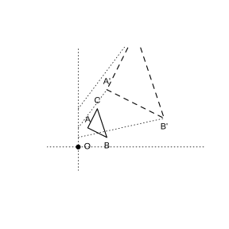
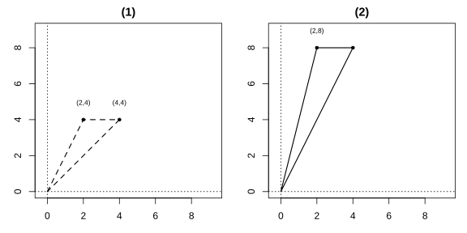
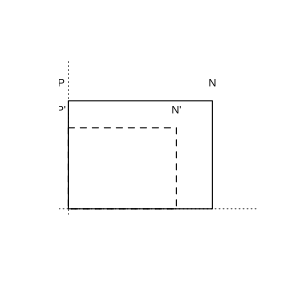

# 作业 164

> **定义 27.3.1** (位似图形)  如果两个图形上的点 $A,B,\ldots,P,\ldots$ 与另一个图形上的点 $A',B',\ldots,P',\ldots$ 分别对应，并且连线 $AA',BB',\ldots,PP',\ldots$ 都经过同一点 $O$，且 $\frac{OA'}{OA}=\frac{OB'}{OB}=\cdots=\frac{OP'}{OP}=\cdots$，那么这两个图形叫做位似图形，点 $O$ 是位似中心。位似图形是特殊的相似图形，对应边互相平行。

> **定义 27.3.2** (位似的坐标规律)  在平面直角坐标系中，如果以原点为位似中心，画出一个与原图形位似的图形，使它与原图形的相似比为 $k$，那么与原图形上的点 $(x,y)$ 对应的位似图形上的点的坐标为 $(kx,ky)$ 或 $(-kx,-ky)$。

### 练习一

(练习 27.3 第 1 题) 如图，$\triangle OAB$ 和 $\triangle OCD$ 是位似图形，$AB$ 与 $CD$ 平行吗？为什么？

### 解答 练习一

由**定义 27.3.1** (位似图形)，位似图形是特殊的相似图形，对应边互相平行。

$\triangle OAB$ 与 $\triangle OCD$ 位似，$AB$ 与 $CD$ 是对应边，故 $AB\parallel CD$。 $\blacksquare$

### 练习二

(练习 27.3 第 2 题) 如图，以点 $O$ 为位似中心，将 $\triangle ABC$ 按相似比 $3$ 放大。

{width=50%}

### 解答 练习二

由**定义 27.3.1**，连接 $OA,OB,OC$ 并延长，在延长线上取 $A',B',C'$ 使 $OA'=3OA$，$OB'=3OB$，$OC'=3OC$，顺次连接 $A',B',C'$，所得 $\triangle A'B'C'$ 即为所求放大后的三角形。 $\blacksquare$

### 练习三

(练习 27.3 第 1 题) 如图，把 $\triangle AOB$ 缩小后得到 $\triangle COD$，求 $\triangle COD$ 与 $\triangle AOB$ 的相似比。($A(2,4)$，$B(5,0)$，$C(1,2)$，$D(2.5,0)$。)

### 解答 练习三

由**定义 27.3.1** (位似图形)，相似比为对应点到位似中心距离之比。

$$
\frac{OC}{OA}=\frac{\sqrt{1^2+2^2}}{\sqrt{2^2+4^2}}=\frac{\sqrt{5}}{\sqrt{20}}=\frac{1}{2}.
$$

故相似比为 $\frac{1}{2}$。 $\blacksquare$

### 练习四

(练习 27.3 第 2 题) 如图，$\triangle ABO$ 三个顶点的坐标分别为 $A(4,-5)$，$B(6,0)$，$O(0,0)$。以原点 $O$ 为位似中心，把这个三角形按相似比 $2$ 放大，得到 $\triangle A'B'O'$。写出 $\triangle A'B'O'$ 三个顶点的坐标。

### 解答 练习四

由**定义 27.3.2** (位似的坐标规律)，以原点为位似中心、相似比 $k=2$，点 $(x,y)$ 对应 $(kx,ky)$ 或 $(-kx,-ky)$。

一组对应坐标为 $A'(8,-10)$，$B'(12,0)$，$O'(0,0)$；另一组为 $A''(-8,10)$，$B''(-12,0)$，$O''(0,0)$。 $\blacksquare$

### 习题一

(习题 27.3 复习巩固第 1 题) 如图，如果虚线图形与实线图形是位似图形，求它们的相似比并找出位似中心。

### 解答 习题一

由**定义 27.3.1** (位似图形)，对应顶点连线的交点为位似中心，对应边之比为相似比。图中虚线图形与实线图形对应顶点连线交于一点，该点即位似中心；对应边长度之比即为相似比。 $\blacksquare$

### 习题二

(习题 27.3 复习巩固第 2 题) 如图，以点 $P$ 为位似中心，将五角星的边长缩小为原来的 $\frac{1}{2}$。

### 解答 习题二

由**定义 27.3.1**，连接位似中心 $P$ 与五角星各顶点，在每条连线上取中点，顺次连接这些中点，所得五角星即为边长缩小为原来 $\frac{1}{2}$ 的位似图形。 $\blacksquare$

### 习题三

(习题 27.3 复习巩固第 3 题) $\triangle ABC$ 三个顶点的坐标分别为 $A(2,2)$，$B(4,2)$，$C(6,4)$。以原点 $O$ 为位似中心，将 $\triangle ABC$ 缩小得到 $\triangle DEF$，使 $\triangle DEF$ 与 $\triangle ABC$ 对应边的比为 $1:2$，这时 $\triangle DEF$ 各个顶点的坐标分别是多少？

### 解答 习题三

由**定义 27.3.2** (位似的坐标规律)，相似比 $k=\frac{1}{2}$，点 $(x,y)$ 对应 $\left(\frac{x}{2},\frac{y}{2}\right)$ 或 $\left(-\frac{x}{2},-\frac{y}{2}\right)$。

一组：$D(1,1)$，$E(2,1)$，$F(3,2)$。另一组：$D(-1,-1)$，$E(-2,-1)$，$F(-3,-2)$。 $\blacksquare$

### 习题四

(习题 27.3 综合运用第 4 题) 如图，正方形 $EFGH$，$IJKL$ 都是正方形 $ABCD$ 的位似图形，点 $P$ 是位似中心。(1) 哪个图形与正方形 $ABCD$ 的相似比为 $3$？(2) 正方形 $IJKL$ 是正方形 $EFGH$ 的位似图形吗？如果是，求相似比。(3) 正方形 $EFGH$ 与正方形 $ABCD$ 的相似比是多少？

### 解答 习题四

由**定义 27.3.1** (位似图形)。

(1) 正方形 $IJKL$ 最大，与 $ABCD$ 的相似比为 $3$。

(2) $IJKL$ 与 $EFGH$ 对应顶点连线都经过位似中心 $P$，且对应边平行，故 $IJKL$ 是 $EFGH$ 的位似图形。$IJKL$ 与 $ABCD$ 相似比为 $3$，$EFGH$ 与 $ABCD$ 相似比为 $\frac{3}{2}$，故 $IJKL$ 与 $EFGH$ 的相似比为 $\frac{3}{3/2}=2$。

(3) 正方形 $EFGH$ 与正方形 $ABCD$ 的相似比为 $\frac{3}{2}$。 $\blacksquare$

### 习题五

(习题 27.3 综合运用第 5 题) 如图，矩形 $AOBC$ 各点的坐标分别为 $A(0,3)$，$O(0,0)$，$B(4,0)$，$C(4,3)$。以原点 $O$ 为位似中心，将这个矩形按相似比 $\frac{1}{2}$ 缩小，写出新矩形各顶点的坐标。

### 解答 习题五

由**定义 27.3.2** (位似的坐标规律)，相似比 $k=\frac{1}{2}$。

新矩形顶点坐标为 $A'(0,1.5)$，$O'(0,0)$，$B'(2,0)$，$C'(2,1.5)$。 $\blacksquare$

### 习题六

(习题 27.3 综合运用第 6 题) 如图，图中的图案与 "A" 字图案 (虚线图案) 相比，发生了什么变化？对应点的坐标之间有什么关系？(虚线图案顶点为 $(2,4)$，$(4,4)$ 等；实线图案顶点为 $(2,8)$ 等。)

{width=100%}

### 解答 习题六

实线图案是虚线图案以原点为位似中心、相似比 $2$ 放大后的位似图形。对应点坐标由 $(x,y)$ 变为 $(2x,2y)$。 $\blacksquare$

### 习题七

(习题 27.3 拓广探索第 7 题) 如图，以点 $Q$ 为位似中心，画出与矩形 $MNPQ$ 的相似比为 $0.75$ 的一个图形。

{width=50%}

### 解答 习题七

由**定义 27.3.1** (位似图形)，以 $Q$ 为位似中心，连接 $QM,QN,QP$，在各连线上取对应点 $M',N',P'$ 使 $QM'=0.75\,QM$，$QN'=0.75\,QN$，$QP'=0.75\,QP$，顺次连接 $M',N',P',Q$，所得矩形即为所求。 $\blacksquare$

### 信息技术应用一

(信息技术应用 探索位似的性质) (1) 度量位似图形对应边的比，它与相似比 $k$ 有什么关系？(2) 以 $O$ 为原点，对应点的横、纵坐标之比与 $k$ 有什么关系？(3) 度量 $OA,OA',OB,OB',OC,OC'$，你有什么发现？

### 解答 信息技术应用一

由**定义 27.3.1** 和**定义 27.3.2**。

(1) 对应边的比等于相似比 $k$。

(2) 以 $O$ 为原点时，对应点横坐标之比和纵坐标之比都等于 $k$。

(3) $\frac{OA'}{OA}=\frac{OB'}{OB}=\frac{OC'}{OC}=k$，即位似中心到对应点的距离之比等于相似比。 $\blacksquare$

