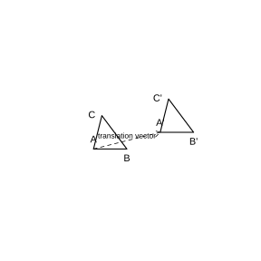
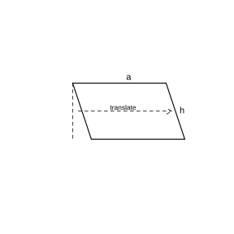
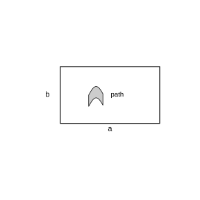

# 作业 33

> **定义 7.4.1** (平移)  在平面内, 将一个图形按某一方向移动一定的距离, 这样的图形运动叫作平移. 平移的方向不限于水平或竖直, 可沿平面内任何方向.
>
> **性质 7.4.1** (平移的性质)  (1) 平移前后新图形与原图形的形状和大小完全相同; (2) 新图形中的每一点都是由原图形中某一点移动后得到的 (对应点), 连接各组对应点的线段平行 (或在同一条直线上) 且相等.

### 练习一

(练习 7.4 第 1 题) 在方格纸中平移三角形 $ABC$, 使点 $A$ 移到点 $M$, 点 $B$ 和点 $C$ 应移到什么位置? 再次平移三角形, 使点 $A$ 由点 $M$ 移到点 $N$. 分别画出两次平移后的三角形. 如果直接平移三角形 $ABC$, 使点 $A$ 移到点 $N$, 平移后的三角形和前面第二次平移后得到的三角形位置相同吗?

{width=50%}

### 解答 练习一

由**性质 7.4.1** (平移的性质), 平移时图形上每一点都按同一方向移动同一距离, 连接各组对应点的线段平行且相等.

点 $A$ 移到点 $M$, 即按 $\boldsymbol{AM}$ 的方向和距离平移. 因而点 $B$ 沿与 $\boldsymbol{AM}$ 相同的方向、移动相同距离得到其对应点, 点 $C$ 同理. 连接三点即得第一次平移后的三角形.

再使点 $A$ (此时在 $M$) 移到点 $N$, 即按 $\boldsymbol{MN}$ 的方向和距离再平移一次, 得第二次平移后的三角形.

直接把三角形 $ABC$ 平移使点 $A$ 移到点 $N$, 平移向量为 $\boldsymbol{AN}$. 由向量加法, $\boldsymbol{AN}=\boldsymbol{AM}+\boldsymbol{MN}$, 即先平移 $\boldsymbol{AM}$ 再平移 $\boldsymbol{MN}$ 的合效果与直接平移 $\boldsymbol{AN}$ 相同. 故直接平移所得三角形与第二次平移后得到的三角形位置相同. $\blacksquare$

### 练习二

(练习 7.4 第 2 题) 如图, 经过平移, 四边形 $ABCD$ 的顶点 $A$ 移到点 $A'$. 画出平移后的四边形 $A'B'C'D'$.

### 解答 练习二

由**性质 7.4.1** (平移的性质), 连接各组对应点的线段平行且相等.

连接 $AA'$, 分别过点 $B$, $C$, $D$ 作 $AA'$ 的平行线, 并在其上截取 $BB'=CC'=DD'=AA'$, 得对应点 $B'$, $C'$, $D'$. 顺次连接 $A'B'C'D'$, 即得平移后的四边形. $\blacksquare$

### 练习三

(练习 7.4 第 3 题) 利用平移, 绘制出如图所示的图案.

### 解答 练习三

由**性质 7.4.1** (平移的性质), 选定一个基本图形, 沿某方向重复平移相同距离, 即可得到带状图案; 再沿另一不平行方向重复平移, 即可铺满平面. 按此方法绘制即可. $\blacksquare$

### 习题一

(习题 7.4 复习巩固第 1 题) 图中的图案分别可以由什么图形平移形成?

### 解答 习题一

由**定义 7.4.1** (平移) 与**性质 7.4.1** (平移的性质), 图案中完全相同的基本图形沿一定方向重复排列即由平移形成. 找出图中重复出现的最小基本图形, 即为平移形成整个图案的基本图形. $\blacksquare$

### 习题二

(习题 7.4 复习巩固第 2 题) 如图, 将三角形 $ABC$ 沿 $BC$ 方向平移至三角形 $DEF$, 找出图中平行的线段和相等的线段.

### 解答 习题二

由**性质 7.4.1** (平移的性质), 平移前后新图形与原图形形状大小完全相同, 连接各组对应点的线段平行且相等.

对应点为 $A$ 与 $D$, $B$ 与 $E$, $C$ 与 $F$. 平行的线段: 对应点连线 $AD\parallel BE\parallel CF$, 以及对应边 $AB\parallel DE$, $AC\parallel DF$. 相等的线段: 对应边 $AB=DE$, $BC=EF$, $AC=DF$, 以及对应点连线 $AD=BE=CF$. $\blacksquare$

### 习题三

(习题 7.4 复习巩固第 3 题) 将四边形 $ABCD$ 沿箭头方向平移 $1\,\text{cm}$, 画出平移后的四边形 $A'B'C'D'$.

### 解答 习题三

由**性质 7.4.1** (平移的性质), 沿箭头方向把各顶点都移动 $1\,\text{cm}$.

分别过 $A$, $B$, $C$, $D$ 作与箭头平行且长为 $1\,\text{cm}$ 的线段, 得对应点 $A'$, $B'$, $C'$, $D'$, 顺次连接即得平移后的四边形 $A'B'C'D'$. $\blacksquare$

### 习题四

(习题 7.4 综合运用第 4 题) 用平移方法说明怎样得出平行四边形的面积公式 $S=ah$.

{width=50%}

### 解答 习题四

由**性质 7.4.1** (平移的性质), 平移不改变图形的形状和大小.

如图, 设平行四边形的底为 $a$, 高为 $h$. 从平行四边形一侧剪下一个直角三角形, 把它沿底边方向平移到另一侧, 恰好补成一个长方形. 这个长方形的长为 $a$, 宽为 $h$.

由平移不改变图形面积, 平行四边形的面积等于拼成的长方形面积, 即

$$
S=ah.
$$

故平行四边形的面积公式为 $S=ah$. $\blacksquare$

### 习题五

(习题 7.4 综合运用第 5 题) 如图, 有一个由 $4$ 个三角形组成的图形, 通过平移, 你能用它组成什么图案? 试一试, 把你的图案与同学交流一下.

### 解答 习题五

由**性质 7.4.1** (平移的性质), 把这个由 $4$ 个三角形组成的基本图形沿不同方向重复平移, 可拼成带状或铺满平面的图案. 动手拼摆并与同学交流即可. $\blacksquare$

### 习题六

(习题 7.4 拓广探索第 6 题) 如图, 在一块长为 $a\,\text{m}$, 宽为 $b\,\text{m}$ 的长方形草地上, 有一条弯曲的小路, 小路的左边线向右平移 $1\,\text{m}$ 就是它的右边线. 求这块草地青草覆盖的面积.

{width=50%}

### 解答 习题六

由**性质 7.4.1** (平移的性质), 平移不改变图形的形状和大小.

小路左边线向右平移 $1\,\text{m}$ 就是右边线, 说明小路在任何横截方向上的宽度都是 $1\,\text{m}$. 把小路两侧的草地向中间平移拼合, 可拼成一个新的长方形: 宽仍为 $b$, 长减少 $1$, 即为 $a-1$.

由平移不改变面积, 青草覆盖面积等于拼合后长方形的面积:

$$
S=(a-1)b=ab-b\quad(\text{m}^2).
$$

故这块草地青草覆盖的面积为 $(ab-b)\,\text{m}^2$. $\blacksquare$

### 探究与发现一

(探究与发现 利用平移设计图案) 通过平移一个图形, 不仅可以绘制带状的图案, 还可以绘制覆盖整个平面的美丽图案 (例如荷兰艺术家埃舍尔的作品、蜂巢、织物上的图案等). 你知道图中的图案是怎样生成的吗? 图 (1) 中的图案是由其中一个"鸟"形图案平移得到的. 试说一说每个图案中的基本图形是怎样得到的, 并利用平移设计几幅美丽的图案.

### 解答 探究与发现一

由**定义 7.4.1** (平移) 与**性质 7.4.1** (平移的性质), 绘制这类图案时, 先选定一个基本图形, 把它先按某一方向重复移动一定距离, 再按另一个与之前不平行的方向重复移动一定距离, 即可得到一幅可无限延展的图案.

图中的"鸟"形基本图形借助正方形上的平移 (上移到下、下移到上、左移到右、右移到左) 画出, 这种平移从一处移到另一处, 能保证图案平移后互相吻合、不留缝隙. 再对这个基本图形作两个方向的重复平移, 即铺满整个平面. 自己选定基本图形, 按上述两个方向平移重复, 即可设计出美丽图案. $\blacksquare$
