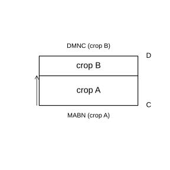
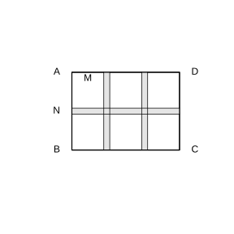

# 作业 47

> **方法 10.3.1** (列方程组解应用题)  审题设两个未知数, 找出两个等量关系, 列出二元一次方程组, 解方程组, 检验并作答.

### 练习一

(练习 10.3 第 1 题) 某超市分别以 $5$ 元每支, $7$ 元每支购进甲, 乙两种节能灯, 共付款 $50$ 元; 又以同样价格购进甲种节能灯 $12$ 支, 乙种节能灯 $4$ 支, 共付款 $88$ 元. 甲, 乙两种节能灯每支的进价分别是多少?

### 解答 练习一

设甲种每支 $x$ 元, 乙种每支 $y$ 元. 由**方法 10.3.1** (列方程组解应用题), 依题意

$$
\begin{cases}
3x+5y=50,\\
12x+4y=88.
\end{cases}
$$

第一式乘 $4$: $12x+20y=200$, 与第二式相减: $16y=112$, $y=7$, 代回 $3x+35=50$, $x=5$. 故甲种每支 $5$ 元, 乙种每支 $7$ 元. $\blacksquare$

### 练习二

(练习 10.3 第 2 题) 《西游记》和《水浒传》是我国古典文学名著. 买 $2$ 本《西游记》和 $3$ 本《水浒传》共付 $151$ 元, 买 $4$ 本《西游记》和 $2$ 本《水浒传》共付 $178$ 元. 每本《西游记》和《水浒传》各多少元?

### 解答 练习二

设每本《西游记》$x$ 元, 《水浒传》$y$ 元. 依题意

$$
\begin{cases}
2x+3y=151,\\
4x+2y=178.
\end{cases}
$$

第一式乘 $2$: $4x+6y=302$, 与第二式相减: $4y=124$, $y=31$, 代回 $2x+93=151$, $x=29$. 故每本《西游记》$29$ 元, 《水浒传》$31$ 元. $\blacksquare$

### 练习三

(练习 10.3 第 3 题) 某城市 5 月份收到的餐厨垃圾和建筑垃圾中, 可利用的餐厨垃圾每吨需处理费 $240$ 元, 可利用的建筑垃圾每吨需处理费 $150$ 元. 该月共支付处理费 $7020$ 元; 6 月份收到的可利用餐厨垃圾和建筑垃圾分别增加了 $60\ \text{t}$ 和 $30\ \text{t}$, 共支付处理费 $8520$ 元. 求 5 月份收到的可利用餐厨垃圾和建筑垃圾各多少吨.

### 解答 练习三

设 5 月份餐厨垃圾 $x\ \text{t}$, 建筑垃圾 $y\ \text{t}$. 依题意

$$
\begin{cases}
240x+150y=7020,\\
300x+180y=8520.
\end{cases}
$$

化简: $8x+5y=234$, $5x+3y=142$. 前式乘 $3$, 后式乘 $5$ 相减: $x=8$, 代回 $40+3y=142$, $y=34$. 故餐厨垃圾 $8\ \text{t}$, 建筑垃圾 $34\ \text{t}$. $\blacksquare$

### 练习四

(练习 10.3 第 4 题) 如图, 一块长 $200\ \text{m}$, 宽 $100\ \text{m}$ 的长方形土地, 现要把这两块土地分别种植甲, 乙两种作物, 使甲, 乙两种作物的总产量的比是 $3:4$. 甲, 乙两种作物的单位面积产量的比是 $1:2$. 现把这块土地沿另一方向 (横向) 划分为两个长方形 $DMNC$ 和 $MABN$, 分别种植甲, 乙两种作物. 求 $AM$ 的长.

{width=50%}

### 解答 练习四

设 $AM=y\ \text{m}$. 横向划分后, 长方形 $MABN$ (种甲) 的长为 $200\ \text{m}$, 宽为 $AM$, 面积为 $200y$; 长方形 $DMNC$ (种乙) 的长为 $200\ \text{m}$, 宽为 $100-y$, 面积为 $200\left(100-y\right)$.

甲, 乙单位面积产量之比为 $1:2$, 故总产量之比为

$$
\frac{200y\cdot1}{200\left(100-y\right)\cdot2}=\frac{3}{4}.
$$

化简 $\frac{y}{2\left(100-y\right)}=\frac{3}{4}$, 即 $4y=6\left(100-y\right)$, 解得 $y=60$. 故 $AM=60\ \text{m}$. $\blacksquare$

### 练习五

(练习 10.3 第 5 题) 如图是一个 $3\times3$ 的方阵, 已知它的每行, 每列及对角线上三个数之和都相等, 求 $x$, $y$ 的值.

| $2x$ | $3$ | $2$ |
|------|-----|-----|
|  | $x+2y$ | $-3$ |
|  |  | $4y$ |

### 解答 练习五

由**方法 10.3.1** (列方程组解应用题), 设方阵其余位置依次为 $d,e,g,h$. 第一行三数之和为 $2x+3+2=2x+5$, 即每行每列对角线之和均为 $2x+5$.

主对角线 $2x+\left(x+2y\right)+4y=2x+5$, 得 $x+6y=5$.

第三列 $2+\left(-3\right)+4y=2x+5$, 得 $4y-1=2x+5$, 即 $x-2y=-3$.

联立: $x+6y=5$, $x-2y=-3$, 相减得 $8y=8$, $y=1$, 代回 $x+6=5$, $x=-1$. 故 $x=-1$, $y=1$. $\blacksquare$

### 练习六

(练习 10.3 第 6 题) 一段河道需要治理, 已知甲工程队每天可治理 $12\ \text{m}$, 乙工程队每天可治理 $8\ \text{m}$. 若先由甲工程队治理一段时间, 剩下的由乙工程队治理, 共需 $20$ 天完成, 河道共长 $180\ \text{m}$. 甲, 乙两工程队分别治理了多少米?

### 解答 练习六

设甲治理 $x\ \text{m}$, 乙治理 $y\ \text{m}$. 依题意

$$
\begin{cases}
x+y=180,\\
\frac{x}{12}+\frac{y}{8}=20.
\end{cases}
$$

代入 $x=180-y$ 并乘 $24$: $2\left(180-y\right)+3y=480$, 即 $y=120$, $x=60$. 故甲治理 $60\ \text{m}$, 乙治理 $120\ \text{m}$. $\blacksquare$

### 练习七

(练习 10.3 第 7 题) 已知 $2$ 辆大车与 $3$ 辆小车一次可以运货 $15.5\ \text{t}$; $5$ 辆大车与 $6$ 辆小车一次可以运货 $35\ \text{t}$. 求 $3$ 辆大车与 $5$ 辆小车一次可以运货多少吨.

### 解答 练习七

设大车每辆一次运 $x\ \text{t}$, 小车每辆一次运 $y\ \text{t}$. 依题意

$$
\begin{cases}
2x+3y=15.5,\\
5x+6y=35.
\end{cases}
$$

第一式乘 $2$: $4x+6y=31$, 与第二式相减: $x=4$, 代回 $8+3y=15.5$, $y=2.5$.

故 $3$ 辆大车与 $5$ 辆小车一次运货 $3\times4+5\times2.5=12+12.5=24.5\ \text{t}$. $\blacksquare$

### 练习八

(练习 10.3 第 8 题) 某旅游区有 $20$ 名游客乘坐缆车, 买往返票和单程票共付款 $1180$ 元. 已知往返票每张 $80$ 元, 单程票每张 $45$ 元. 买往返票和单程票各多少张?

### 解答 练习八

设往返票 $x$ 张, 单程票 $y$ 张. 依题意

$$
\begin{cases}
x+y=20,\\
80x+45y=1180.
\end{cases}
$$

代入 $y=20-x$: $80x+45\left(20-x\right)=1180$, 即 $35x=280$, $x=8$, $y=12$. 故往返票 $8$ 张, 单程票 $12$ 张. $\blacksquare$

### 练习九

(练习 10.3 第 9 题) 从甲地到乙地有一段上坡路与一段平路. 如果保持上坡每小时走 $3\ \text{km}$, 平路每小时走 $4\ \text{km}$, 下坡每小时走 $5\ \text{km}$, 那么从甲地到乙地需 $54\ \text{min}$, 从乙地到甲地需 $42\ \text{min}$. 甲地到乙地全程是多少千米?

### 解答 练习九

设上坡路长 $x\ \text{km}$, 平路长 $y\ \text{km}$. 从甲到乙: 上坡 $x$, 平路 $y$; 从乙到甲: 原上坡变为下坡. 依题意

$$
\begin{cases}
\frac{x}{3}+\frac{y}{4}=\frac{54}{60},\\
\frac{x}{5}+\frac{y}{4}=\frac{42}{60}.
\end{cases}
$$

两式相减: $x\left(\frac{1}{3}-\frac{1}{5}\right)=0.9-0.7=0.2$, 即 $\frac{2}{15}x=0.2$, $x=1.5$. 代回 $\frac{1.5}{3}+\frac{y}{4}=0.9$, 得 $\frac{y}{4}=0.4$, $y=1.6$.

全程为 $1.5+1.6=3.1\ \text{km}$. $\blacksquare$

### 习题一

(习题 10.3 复习巩固第 1 题) 解下列方程组:

(1) $\begin{cases}3x-y=5,\\5y-1=3x+5;\end{cases}$

(2) $\begin{cases}\frac{2x}{3}+\frac{3y}{4}=\frac{17}{12},\\\frac{x}{6}-\frac{y}{2}=-\frac{1}{3}.\end{cases}$

### 解答 习题一

(1) 由第一式 $y=3x-5$, 代入第二式 $5y-3x=6$: $5\left(3x-5\right)-3x=6$, 即 $12x=31$, $x=\frac{31}{12}$, $y=\frac{11}{4}$.

(2) 第一式乘 $12$: $8x+9y=17$; 第二式乘 $6$: $x-3y=-2$, 即 $x=3y-2$. 代入: $8\left(3y-2\right)+9y=17$, 即 $33y=33$, $y=1$, $x=1$. $\blacksquare$

### 习题二

(习题 10.3 复习巩固第 2 题) 一个户外运动俱乐部的成员完成了两天的徒步运动. 两天的徒步时间分别为 $8\ \text{h}$ 和 $10\ \text{h}$, 共走了 $98\ \text{km}$, 且第一天比第二天少走 $2\ \text{km}$. 这个俱乐部的成员两天徒步的平均速度各是多少?

### 解答 习题二

设第一天走 $x\ \text{km}$, 第二天走 $y\ \text{km}$. 依题意

$$
\begin{cases}
x+y=98,\\
y-x=2.
\end{cases}
$$

解得 $x=48$, $y=50$. 第一天平均速度 $\frac{48}{8}=6\ \text{km/h}$, 第二天平均速度 $\frac{50}{10}=5\ \text{km/h}$. $\blacksquare$

### 习题三

(习题 10.3 复习巩固第 3 题)《算法统宗》: 一房七客多七客, 一房九客一房空. 店有多少间客房, 来了多少房客?

### 解答 习题三

设客房 $x$ 间, 房客 $y$ 人. 依题意

$$
\begin{cases}
7x+7=y,\\
9\left(x-1\right)=y.
\end{cases}
$$

$7x+7=9x-9$, 得 $x=8$, $y=63$. 故客房 $8$ 间, 房客 $63$ 人. $\blacksquare$

### 习题四

(习题 10.3 复习巩固第 4 题) 某港口码头使用 A, B 两种型号的机器人搬运货物. 在 $24\ \text{h}$ 内, $3$ 台 A 型机器人和 $2$ 台 B 型机器人共搬运货物 $450\ \text{t}$, 且每台 A 型机器人比 B 型机器人多搬运 $25\ \text{t}$. 每台 A 型, B 型机器人 $24\ \text{h}$ 的搬运量分别是多少?

### 解答 习题四

设每台 A 型 $24\ \text{h}$ 搬运 $x\ \text{t}$, B 型 $y\ \text{t}$. 依题意

$$
\begin{cases}
x=y+25,\\
3x+2y=450.
\end{cases}
$$

代入: $3\left(y+25\right)+2y=450$, 即 $5y=375$, $y=75$, $x=100$. 故 A 型 $100\ \text{t}$, B 型 $75\ \text{t}$. $\blacksquare$

### 习题五

(习题 10.3 综合运用第 5 题) 如图, 学校规划在一块长 $18\ \text{m}$, 宽 $13\ \text{m}$ 的长方形场地 $ABCD$ 上, 分别设计与 $AD$, $AB$ 平行的横向和纵向通道, 其余部分铺上草皮. 如果通道的宽度相等, 六块草坪的形状, 大小相同, 其中一块草坪的两边 $AM:AN=8:9$, 那么通道的宽是多少?

{width=50%}

### 解答 习题五

设通道宽为 $d\ \text{m}$, 每块草坪宽为 $w\ \text{m}$, 高为 $h\ \text{m}$. 横向有 $2$ 条纵向通道, 纵向有 $1$ 条横向通道. 由题意 $AM:AN=w:h=8:9$, 设 $w=8k$, $h=9k$.

场地宽 $18\ \text{m}$: $3w+2d=18$; 场地高 $13\ \text{m}$: $2h+d=13$.

代入: $24k+2d=18$, $18k+d=13$. 由第二式 $d=13-18k$, 代入第一式: $24k+2\left(13-18k\right)=18$, 即 $-12k=-8$, $k=\frac{2}{3}$, 故 $d=13-18\times\frac{2}{3}=1$. 通道宽为 $1\ \text{m}$. $\blacksquare$

### 习题六

(习题 10.3 综合运用第 6 题) 一家广告公司制作展板, 宣传册, 横幅, 其中宣传册的数量是展板的 $5$ 倍. 制作每件产品所需时间和所获利润如下表: 展板每件 $1\ \text{h}$, 利润 $60$ 元; 宣传册每件 $0.2\ \text{h}$, 利润 $3.5$ 元; 横幅每件 $0.5\ \text{h}$, 利润 $20$ 元. 若制作三种产品共需 $25\ \text{h}$, 所获利润为 $975$ 元, 求这三种产品的总件数.

### 解答 习题六

设展板 $x$ 件, 则宣传册 $5x$ 件, 横幅 $z$ 件. 依题意

$$
\begin{cases}
x+0.2\cdot5x+0.5z=25,\\
60x+3.5\cdot5x+20z=975.
\end{cases}
$$

化简: $2x+0.5z=25$, 即 $z=50-4x$; $77.5x+20z=975$. 代入: $77.5x+20\left(50-4x\right)=975$, 即 $-2.5x=-25$, $x=10$, $z=10$. 宣传册 $50$ 件.

总件数为 $10+50+10=70$ 件. $\blacksquare$

### 习题七

(习题 10.3 综合运用第 7 题) 某文具店销售 A, B 两种型号毛笔: A 型不超过 $20$ 支按零售价, 超过部分每支低 $0.4$ 元; B 型不超过 $15$ 支按零售价, 超过部分每支低 $0.6$ 元. 某小组 $20$ 名同学, 每人买 $1$ 支 A 型和 $2$ 支 B 型, 共付 $325$ 元; 每人买 $2$ 支 A 型和 $1$ 支 B 型, 共付 $309$ 元. A, B 型毛笔零售价各多少?

### 解答 习题七

设 A 型零售价 $a$ 元, B 型零售价 $b$ 元.

第一种买法: 共 $20$ 支 A 型 (恰好不超过 $20$, 全按零售价), $40$ 支 B 型 (超过 $15$, 其中 $15$ 支按 $b$, $25$ 支按 $b-0.6$). 费用 $20a+15b+25\left(b-0.6\right)=325$, 即 $a+2b=17$.

第二种买法: 共 $40$ 支 A 型 (其中 $20$ 支按 $a$, $20$ 支按 $a-0.4$), $20$ 支 B 型 (其中 $15$ 支按 $b$, $5$ 支按 $b-0.6$). 费用 $20a+20\left(a-0.4\right)+15b+5\left(b-0.6\right)=309$, 即 $2a+b=16$.

联立: $a+2b=17$, $2a+b=16$, 解得 $a=5$, $b=6$. 故 A 型零售价 $5$ 元, B 型零售价 $6$ 元. $\blacksquare$

### 习题八

(习题 10.3 综合运用第 8 题) 一家超市账目: 某天卖出 $39$ 支牙刷和 $21$ 盒牙膏, 收入 $396$ 元; 另一天以同样价格卖出 $52$ 支牙刷和 $28$ 盒牙膏, 收入 $518$ 元. 这个记录是否有误?

### 解答 习题八

设牙刷每支 $x$ 元, 牙膏每盒 $y$ 元. 依题意

$$
\begin{cases}
39x+21y=396,\\
52x+28y=518.
\end{cases}
$$

第一式除以 $3$: $13x+7y=132$. 第二式除以 $4$: $13x+7y=129.5$.

两式左边相同而右边 $132\ne129.5$, 矛盾, 故记录有误. $\blacksquare$

### 习题九

(习题 10.3 拓广探索第 9 题) 编一道符合实际意义的应用题, 使其中的未知数满足方程组 $\begin{cases}2x+3y=21,\\3x+4y=29.\end{cases}$ 并解决这个问题.

### 解答 习题九

示例: 买 $2$ 支钢笔和 $3$ 本笔记本共 $21$ 元, 买 $3$ 支钢笔和 $4$ 本笔记本共 $29$ 元, 求钢笔和笔记本单价.

设钢笔 $x$ 元, 笔记本 $y$ 元. 第一式乘 $3$: $6x+9y=63$; 第二式乘 $2$: $6x+8y=58$; 相减得 $y=5$, 代回 $2x+15=21$, $x=3$. 故钢笔每支 $3$ 元, 笔记本每本 $5$ 元. $\blacksquare$
