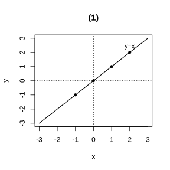
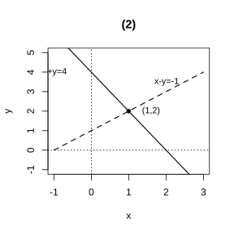

# 作业 49

> **定义 10.1.3** (二元一次方程的解)  使二元一次方程两边的值相等的两个未知数的值.
>
> **定义 10.1.4** (二元一次方程组的解)  二元一次方程组的两个方程的公共解.
>
> **方法 10.3.1** (列方程组解应用题)  设未知数, 找等量关系, 列方程组, 求解检验.

### 活动一

(数学活动 活动 1 第 1 题) 在平面直角坐标系中, 标出一些以方程 $x-y=0$ 的解为坐标的点, 过这些点中任意两点作直线, 你有什么发现? 在这条直线上任取一点, 这个点的坐标是方程 $x-y=0$ 的解吗?

{width=50%}

### 解答 活动一

由**定义 10.1.3** (二元一次方程的解), 方程 $x-y=0$ 即 $y=x$, 其解有无穷多组, 例如 $\left(0,0\right)$, $\left(1,1\right)$, $\left(-1,-1\right)$, $\left(2,2\right)$ 等.

把这些解作为坐标描在坐标系中, 发现它们都在同一条直线上, 这条直线就是 $y=x$ (第一, 三象限的角平分线). 由直线的确定性, 过其中任意两点所作的直线都是这一条.

在这条直线上任取一点, 其横坐标与纵坐标相等, 即满足 $x-y=0$, 故该点坐标仍是方程 $x-y=0$ 的解. $\blacksquare$

### 活动二

(数学活动 活动 1 第 2 题) 根据上题结论, 在同一平面直角坐标系中画出二元一次方程组

$$
\begin{cases}
2x+y=4,\\
x-y=-1
\end{cases}
$$

中两个二元一次方程的图象, 由图象得出这个方程组的解.

{width=50%}

### 解答 活动二

方程 $2x+y=4$ 即 $y=4-2x$, 取两点 $\left(0,4\right)$, $\left(2,0\right)$ 连线; 方程 $x-y=-1$ 即 $y=x+1$, 取两点 $\left(0,1\right)$, $\left(1,2\right)$ 连线.

由**定义 10.1.4** (二元一次方程组的解), 方程组的解是两方程的公共解, 在图象上即两直线的交点. 两直线交于 $\left(1,2\right)$, 故方程组的解为 $\begin{cases}x=1,\\y=2.\end{cases}$

代入检验: $2\times1+2=4$, $1-2=-1$, 均成立. $\blacksquare$

### 活动三

(数学活动 活动 2 第 1 题) 汽车前轮轮胎行驶 $60000\ \text{km}$ 报废, 后轮轮胎行驶 $80000\ \text{km}$ 报废. 如果在轮胎使用寿命内只交换一次前, 后轮轮胎, 那么应在行驶里程达到多少时交换, 能使两对轮胎同时报废? 并求报废时的总行驶里程.

### 解答 活动三

设行驶 $x\ \text{km}$ 时交换, 报废时总里程为 $y\ \text{km}$. 由**方法 10.3.1** (列方程组解应用题), 前轮在前 $x\ \text{km}$ 作前轮, 后 $y-x\ \text{km}$ 作后轮; 后轮在前 $x\ \text{km}$ 作后轮, 后 $y-x\ \text{km}$ 作前轮.

前轮总磨损: $\frac{x}{60000}+\frac{y-x}{80000}=1$.

后轮总磨损: $\frac{x}{80000}+\frac{y-x}{60000}=1$.

两式相减得 $\frac{x}{60000}+\frac{y-x}{80000}=\frac{x}{80000}+\frac{y-x}{60000}$, 化简得 $y=2x$.

代入第一式: $\frac{x}{60000}+\frac{x}{80000}=1$, 即 $\frac{7x}{240000}=1$, 得 $x=\frac{240000}{7}\approx34286\ \text{km}$, $y=\frac{480000}{7}\approx68571\ \text{km}$.

故应在约 $34286\ \text{km}$ 时交换, 报废时总里程约 $68571\ \text{km}$. $\blacksquare$
