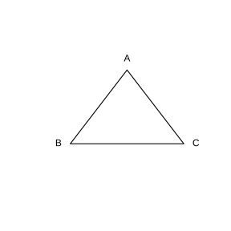
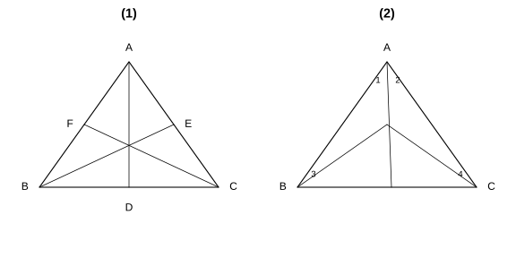
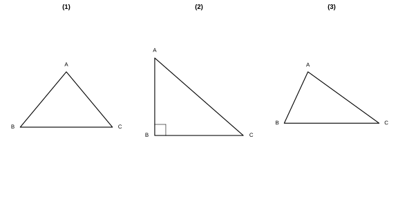
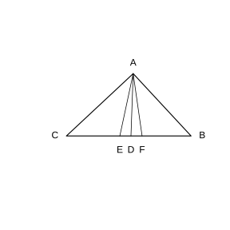
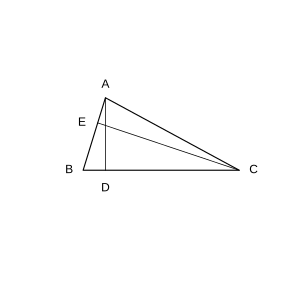
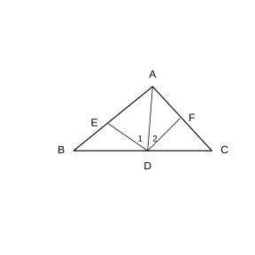

# 作业 62

> **结论 13.2.1** (三角形三边关系)  三角形任意两边的和大于第三边, 任意两边的差小于第三边. 反之, 三条线段中任意两条的和大于第三条时, 它们才能组成三角形.
>
> **结论 13.2.2** (三角形的稳定性)  三角形木架的形状不会改变, 三角形是具有稳定性的图形.
>
> **定义 13.2.1** (三角形的中线)  连接三角形的顶点和它所对边的中点所得的线段叫作三角形的中线. 一个三角形有三条中线, 它们相交于一点, 该点叫作三角形的重心.
>
> **定义 13.2.2** (三角形的角平分线)  三角形的一个角的平分线交这个角所对的边于一点, 顶点与该交点间的线段叫作三角形的角平分线. 三条角平分线相交于一点.
>
> **定义 13.2.3** (三角形的高)  从三角形的顶点向它所对的边所在直线画垂线, 顶点与垂足间的线段叫作三角形的高.
>
> **结论 13.2.3** (高的位置)  锐角三角形的三条高都在三角形内部; 直角三角形有两条高恰好是它的两条直角边; 钝角三角形有两条高在三角形外部, 两个垂足落在边的延长线上.

### 练习一

(练习 13.2 第 1 题) 下列长度的三条线段能否组成三角形? 为什么?

(1) $3$, $4$, $8$;

(2) $5$, $6$, $11$;

(3) $5$, $6$, $10$.

### 解答 练习一

由**结论 13.2.1** (三角形三边关系), 三条线段能组成三角形当且仅当任意两条线段的和大于第三条线段.

(1) $3+4=7<8$, 不满足两边的和大于第三边, 故不能组成三角形.

(2) $5+6=11$, 不大于 $11$, 故不能组成三角形.

(3) $5+6=11>10$, $5+10=15>6$, $6+10=16>5$, 任意两边的和都大于第三边, 故能组成三角形. $\blacksquare$

### 练习二

(练习 13.2 第 2 题) 一根 $4\ \text{dm}$ 长的木条和两根 $1\ \text{dm}$ 长的木条, 能否组成一个等腰三角形? 两根 $4\ \text{dm}$ 长的木条和一根 $1\ \text{dm}$ 长的木条呢?

### 解答 练习二

由**结论 13.2.1** (三角形三边关系) 检验两种情形.

第一种情形三边长为 $4$, $1$, $1$: $1+1=2<4$, 不满足两边的和大于第三边, 故不能组成等腰三角形.

第二种情形三边长为 $4$, $4$, $1$: $4+1=5>4$, $4+4=8>1$, 满足三边关系, 故能组成等腰三角形. $\blacksquare$

### 练习三

(练习 13.2 第 1 题) 如图, 过 $\triangle ABC$ 的顶点 $C$ 分别画出它的中线、角平分线和高.

{width=50%}

### 解答 练习三

由**定义 13.2.1** (中线), 取边 $AB$ 的中点, 连接该中点与顶点 $C$, 即得 $AB$ 边上的中线.

由**定义 13.2.2** (角平分线), 作 $\angle C$ 的平分线交边 $AB$ 于一点, 顶点 $C$ 与该交点间的线段即为角平分线.

由**定义 13.2.3** (高), 从顶点 $C$ 向对边 $AB$ 所在直线作垂线, 顶点 $C$ 与垂足间的线段即为 $AB$ 边上的高. 三者均已在图中画出. $\blacksquare$

### 练习四

(练习 13.2 第 2 题) 填空题.

(1) 如图 (1), $AD$, $BE$, $CF$ 是 $\triangle ABC$ 的三条中线, 则 $BD=\;\_\_\;$, $AE=\frac{1}{2}\;\_\_\;$, $AB=2\;\_\_\;$;

(2) 如图 (2), $AD$, $BE$, $CF$ 是 $\triangle ABC$ 的三条角平分线, 则 $\angle 1=\;\_\_\;$, $\angle 3=\frac{1}{2}\;\_\_\;$, $\angle ACB=2\;\_\_\;$.

{width=100%}

### 解答 练习四

由**定义 13.2.1** (中线), 中线把对边分成相等的两段; 由**定义 13.2.2** (角平分线), 角平分线把该角分成两个相等的角.

(1) $D$ 是 $BC$ 的中点, 故 $BD=DC$; $E$ 是 $AC$ 的中点, 故 $AE=\frac{1}{2}AC$; $F$ 是 $AB$ 的中点, 故 $AB=2AF$.

(2) $AD$ 平分 $\angle BAC$, 故 $\angle 1=\angle 2$; $BE$ 平分 $\angle ABC$, 故 $\angle 3=\frac{1}{2}\angle ABC$; $CF$ 平分 $\angle ACB$, 故 $\angle ACB=2\angle 4$. $\blacksquare$

### 习题一

(习题 13.2 复习巩固第 1 题) 三角形的三边长分别为 $2$, $7$, $a$, 则 $a$ 的取值范围是 $\;\_\_\;$.

### 解答 习题一

由**结论 13.2.1** (三角形三边关系), 第三边 $a$ 应满足另两边的和大于 $a$ 且另两边的差小于 $a$.

$$
7-2<a<7+2.
$$

即 $a$ 的取值范围是 $5<a<9$. $\blacksquare$

### 习题二

(习题 13.2 复习巩固第 2 题) 长为 $100\ \text{cm}$, $70\ \text{cm}$, $50\ \text{cm}$, $30\ \text{cm}$ 的四根木条, 选其中三根组成三角形, 有几种选法? 为什么?

### 解答 习题二

由**结论 13.2.1** (三角形三边关系), 从四根中任取三根检验:

取 $100$, $70$, $50$: $70+50=120>100$, 能组成三角形;

取 $100$, $70$, $30$: $70+30=100$, 不能组成三角形;

取 $100$, $50$, $30$: $50+30=80<100$, 不能组成三角形;

取 $70$, $50$, $30$: $50+30=80>70$, 能组成三角形.

故共有 $2$ 种选法. $\blacksquare$

### 习题三

(习题 13.2 复习巩固第 3 题) 对于下面每个三角形, 分别过顶点 $A$ 画出它的中线、角平分线和高.

{width=100%}

### 解答 习题三

由**定义 13.2.1** (中线), 取对边 $BC$ 的中点, 连接顶点 $A$ 与该中点即得中线; 由**定义 13.2.2** (角平分线), 作 $\angle A$ 的平分线交 $BC$ 即得角平分线; 由**定义 13.2.3** (高), 从顶点 $A$ 向对边 $BC$ 所在直线作垂线即得高.

对锐角三角形 (1), 中线、角平分线、高都在三角形内部; 对直角三角形 (2), 其中一条高与直角边重合; 对钝角三角形 (3), 高的垂足落在边 $BC$ 的延长线上. 三者已在图中分别画出. $\blacksquare$

### 习题四

(习题 13.2 复习巩固第 4 题) 如图, 在 $\triangle ABC$ 中, $AE$ 是中线, $AD$ 是角平分线, $AF$ 是高. 填空:

(1) $BE=\;\_\_\;=\frac{1}{2}\;\_\_\;$;

(2) $\angle BAD=\;\_\_\;=\frac{1}{2}\;\_\_\;$;

(3) $\angle AFB=\;\_\_\;=90^\circ$;

(4) 若 $BC=8$, $AF=5$, 则 $S_{\triangle ABC}=\;\_\_\;$, $S_{\triangle ABE}=\;\_\_\;$.

{width=50%}

### 解答 习题四

由**定义 13.2.1** (中线), $E$ 是 $BC$ 的中点; 由**定义 13.2.2** (角平分线), $AD$ 平分 $\angle BAC$; 由**定义 13.2.3** (高), $AF\perp BC$.

(1) $BE=EC=\frac{1}{2}BC$.

(2) $\angle BAD=\angle CAD=\frac{1}{2}\angle BAC$.

(3) $\angle AFB=\angle AFC=90^\circ$.

(4) $S_{\triangle ABC}=\frac{1}{2}\cdot BC\cdot AF=\frac{1}{2}\times8\times5=20$. 又 $BE=\frac{1}{2}BC=4$, 且以 $BE$ 为底时高同为 $AF$, 故 $S_{\triangle ABE}=\frac{1}{2}\cdot BE\cdot AF=\frac{1}{2}\times4\times5=10$. $\blacksquare$

### 习题五

(习题 13.2 综合运用第 5 题) 一个等腰三角形的一边长为 $6$, 周长为 $20$, 求其他两边的长.

### 解答 习题五

该边 $6$ 可能是腰, 也可能是底边, 分两种情形讨论, 并用**结论 13.2.1** (三角形三边关系) 检验.

若 $6$ 为腰, 则底边长为 $20-2\times6=8$, 三边长为 $6$, $6$, $8$. 由 $6+6=12>8$, 能组成三角形.

若 $6$ 为底边, 则腰长为 $\frac{20-6}{2}=7$, 三边长为 $7$, $7$, $6$. 由 $7+6=13>7$, 能组成三角形.

故其他两边的长为 $6$ 和 $8$, 或 $7$ 和 $7$. $\blacksquare$

### 习题六

(习题 13.2 综合运用第 6 题)

(1) 已知等腰三角形的一边长为 $5$, 一边长为 $6$, 求它的周长;

(2) 已知等腰三角形的一边长为 $4$, 一边长为 $9$, 求它的周长.

### 解答 习题六

由**结论 13.2.1** (三角形三边关系) 对两种情形检验.

(1) 若 $5$ 为腰, 三边长为 $5$, $5$, $6$, 由 $5+5=10>6$, 周长为 $5+5+6=16$. 若 $6$ 为腰, 三边长为 $6$, $6$, $5$, 由 $6+5=11>6$, 周长为 $6+6+5=17$. 故周长为 $16$ 或 $17$.

(2) 若 $4$ 为腰, 三边长为 $4$, $4$, $9$, 由 $4+4=8<9$, 不能组成三角形. 若 $9$ 为腰, 三边长为 $9$, $9$, $4$, 由 $9+4=13>9$, 周长为 $9+9+4=22$. 故周长为 $22$. $\blacksquare$

### 习题七

(习题 13.2 拓广探索第 7 题) 如图, 在 $\triangle ABC$ 中, 若 $AB=2$, $BC=4$, 则 $\triangle ABC$ 的高 $AD$ 与 $CE$ 的比是多少? (提示: 利用三角形的面积公式.)

{width=50%}

### 解答 习题七

由**定义 13.2.3** (高), $AD$ 是边 $BC$ 上的高, $CE$ 是边 $AB$ 上的高. 同一三角形的面积可以用两组底高分别表示.

$$
S_{\triangle ABC}=\frac{1}{2}\cdot BC\cdot AD=\frac{1}{2}\cdot AB\cdot CE.
$$

代入 $BC=4$, $AB=2$, 得 $4\cdot AD=2\cdot CE$, 即 $CE=2AD$. 故

$$
AD:CE=1:2.
$$

$\blacksquare$

### 习题八

(习题 13.2 拓广探索第 8 题) 如图, 在 $\triangle ABC$ 中, $AD$ 是它的角平分线, $DE\parallel AC$, $DE$ 交 $AB$ 于点 $E$, $DF\parallel AB$, $DF$ 交 $AC$ 于点 $F$. 图中 $\angle 1$ 与 $\angle 2$ 有什么关系? 为什么?

{width=50%}

### 解答 习题八

$\angle 1=\angle 2$. 理由如下.

由 $DE\parallel AC$, 直线 $AD$ 截这组平行线所得的内错角相等, 故 $\angle 1=\angle DAC$.

由 $DF\parallel AB$, 直线 $AD$ 截这组平行线所得的内错角相等, 故 $\angle 2=\angle BAD$.

又由**定义 13.2.2** (角平分线), $AD$ 平分 $\angle BAC$, 故 $\angle BAD=\angle DAC$.

综上, $\angle 1=\angle DAC=\angle BAD=\angle 2$, 即 $\angle 1=\angle 2$. $\blacksquare$
