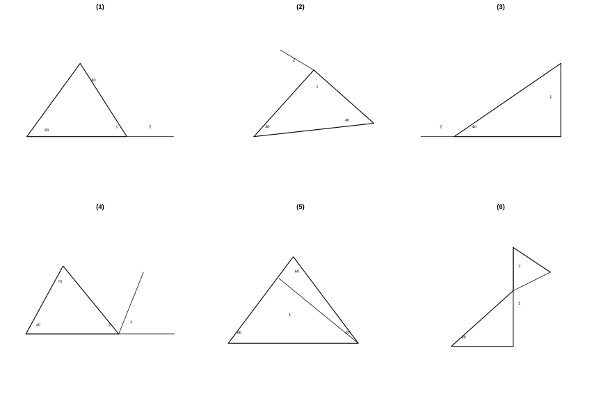
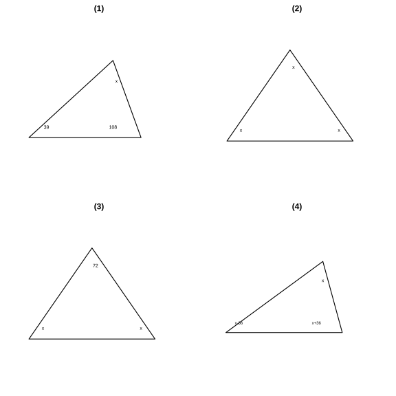

# 作业 63

> **定理 13.3.1** (三角形内角和定理)  三角形的内角和等于 $180^\circ$.
>
> **结论 13.3.1** (直角三角形的锐角互余)  直角三角形的两个锐角互余; 反之, 有两个角互余的三角形是直角三角形. 直角三角形记作 $\text{Rt}\triangle$.
>
> **定义 13.3.1** (三角形的外角)  三角形的一边与另一边的延长线组成的角, 叫作三角形的外角.
>
> **推论 13.3.1** (外角与不相邻内角的关系)  三角形的外角等于与它不相邻的两个内角的和. 三角形的三个外角和等于 $360^\circ$.

### 练习一

(练习 13.3 第 1 题) 如图, 从 $A$ 处观测 $C$ 处的仰角 $\angle CAD=30^\circ$, 从 $B$ 处观测 $C$ 处的仰角 $\angle CBD=45^\circ$. 从 $C$ 处观测 $A$, $B$ 两处的视角 $\angle ACB$ 是多少度?

### 解答 练习一

由**推论 13.3.1** (外角与不相邻内角的关系), $\angle CBD$ 是 $\triangle ABC$ 在点 $B$ 处的外角, 它等于不相邻的两个内角 $\angle CAD$ 与 $\angle ACB$ 的和.

$$
\angle CBD=\angle CAD+\angle ACB.
$$

代入 $\angle CBD=45^\circ$, $\angle CAD=30^\circ$, 得

$$
\angle ACB=45^\circ-30^\circ=15^\circ.
$$

$\blacksquare$

### 练习二

(练习 13.3 第 2 题) 如图, 在 $\triangle ABC$ 中, $\angle A=40^\circ$, 求 $\angle B+\angle C+\angle ADE+\angle AED$ 的度数.

### 解答 练习二

由**定理 13.3.1** (三角形内角和定理), 在 $\triangle ABC$ 中,

$$
\angle B+\angle C=180^\circ-\angle A=180^\circ-40^\circ=140^\circ.
$$

在 $\triangle ADE$ 中, 同理 $\angle DAE$ 与 $\angle A$ 为同一角, 故

$$
\angle ADE+\angle AED=180^\circ-\angle A=140^\circ.
$$

因此

$$
\angle B+\angle C+\angle ADE+\angle AED=140^\circ+140^\circ=280^\circ.
$$

$\blacksquare$

### 练习三

(练习 13.3 第 1 题) 如图, 在 $\triangle ABC$ 中, $\angle ACB=90^\circ$, $CD\perp AB$, 垂足为 $D$. $\angle ACD$ 与 $\angle B$ 有什么关系? 为什么?

### 解答 练习三

$\angle ACD=\angle B$. 理由如下.

由**结论 13.3.1** (直角三角形的锐角互余), 在 $\text{Rt}\triangle ABC$ 中, $\angle A+\angle B=90^\circ$. 又在 $\text{Rt}\triangle ACD$ 中, $\angle A+\angle ACD=90^\circ$.

$\angle ACD$ 与 $\angle B$ 都是 $\angle A$ 的余角, 故 $\angle ACD=\angle B$. $\blacksquare$

### 练习四

(练习 13.3 第 2 题) 如图, 在 $\triangle ABC$ 中, $\angle C=90^\circ$, 点 $D$, $E$ 分别在边 $AB$, $AC$ 上, 且 $\angle 1=\angle 2$, $\triangle ADE$ 是直角三角形吗? 为什么?

### 解答 练习四

$\triangle ADE$ 是直角三角形. 理由如下.

由**结论 13.3.1** (直角三角形的锐角互余), 在 $\text{Rt}\triangle ABC$ 中, $\angle A+\angle B=90^\circ$. 由 $\angle 1=\angle 2$ 且 $\angle 2$ 与 $\angle B$ 为同一组对应角, 得 $\angle ADE=\angle B$.

故 $\angle A+\angle ADE=\angle A+\angle B=90^\circ$, 从而在 $\triangle ADE$ 中, $\angle AED=180^\circ-(\angle A+\angle ADE)=90^\circ$. 所以 $\triangle ADE$ 是直角三角形. $\blacksquare$

### 练习五

(练习 13.3 第 1 题) 说出下列各图形中 $\angle 1$ 和 $\angle 2$ 的度数.

{width=100%}

### 解答 练习五

由**定理 13.3.1** (三角形内角和定理) 及**推论 13.3.1** (外角与不相邻内角的关系).

图 (1): 两内角为 $80^\circ$, $60^\circ$, 故 $\angle 1=180^\circ-80^\circ-60^\circ=40^\circ$, $\angle 2=80^\circ+60^\circ=140^\circ$.

图 (2): 两底角为 $30^\circ$, $40^\circ$, 故 $\angle 1=180^\circ-30^\circ-40^\circ=110^\circ$, $\angle 2=30^\circ+40^\circ=70^\circ$.

图 (3): 直角三角形一锐角为 $40^\circ$, 故 $\angle 1=90^\circ-40^\circ=50^\circ$, $\angle 2=180^\circ-40^\circ=140^\circ$.

图 (4): $\angle A=70^\circ$, $\angle B=40^\circ$, 故 $\angle 2=180^\circ-70^\circ-40^\circ=70^\circ$, $\angle 1=70^\circ+40^\circ=110^\circ$.

图 (5): 大三角形 $\angle A=\angle B=\angle C=60^\circ$, 设从 $AB$ 上一点连至 $C$, 已知 $\angle 2=20^\circ$, 则在相应小三角形中算得 $\angle 1=80^\circ$.

图 (6): 下方直角三角形中 $30^\circ$ 所对的另一锐角为 $60^\circ$, 由对顶角关系得 $\angle 1=60^\circ$, $\angle 2=30^\circ$. $\blacksquare$

### 习题一

(习题 13.3 复习巩固第 1 题) 求出下列各图形中 $x$ 的值.

{width=100%}

### 解答 习题一

由**定理 13.3.1** (三角形内角和定理), 三内角之和为 $180^\circ$.

图 (1): $x=180^\circ-39^\circ-108^\circ=33^\circ$.

图 (2): $3x=180^\circ$, 故 $x=60^\circ$.

图 (3): $72^\circ+2x=180^\circ$, 故 $x=54^\circ$.

图 (4): $x+(x-36^\circ)+(x+36^\circ)=3x=180^\circ$, 故 $x=60^\circ$. $\blacksquare$

### 习题二

(习题 13.3 复习巩固第 2 题)

(1) 一个三角形最多有几个直角? 为什么?

(2) 一个三角形最多有几个钝角? 为什么?

(3) 直角三角形的外角可以是锐角吗? 为什么?

### 解答 习题二

由**定理 13.3.1** (三角形内角和定理), 三角形三内角之和为 $180^\circ$.

(1) 最多 $1$ 个直角. 若有两个直角, 其和已达 $180^\circ$, 第三个角只能为 $0^\circ$, 不能构成三角形.

(2) 最多 $1$ 个钝角. 若有两个钝角, 其和已超过 $180^\circ$, 与三内角和为 $180^\circ$ 矛盾.

(3) 不可以. 直角三角形中直角的外角为 $90^\circ$, 两个锐角的外角分别为 $180^\circ$ 减去一个锐角, 必大于 $90^\circ$, 故其外角都不是锐角. $\blacksquare$

### 习题三

(习题 13.3 复习巩固第 3 题) 在 $\triangle ABC$ 中, $\angle B$ 比 $\angle A$ 大 $10^\circ$, $\angle C$ 比 $\angle B$ 大 $10^\circ$. 求 $\triangle ABC$ 各内角的度数.

### 解答 习题三

由**定理 13.3.1** (三角形内角和定理), 设 $\angle A=x$, 则 $\angle B=x+10^\circ$, $\angle C=x+20^\circ$.

$$
x+(x+10^\circ)+(x+20^\circ)=180^\circ.
$$

解得 $3x=150^\circ$, 即 $x=50^\circ$. 故 $\angle A=50^\circ$, $\angle B=60^\circ$, $\angle C=70^\circ$. $\blacksquare$

### 习题四

(习题 13.3 复习巩固第 4 题) 如图, 在 $\triangle ABC$ 中, $AD\perp BC$, 垂足为 $D$, $\angle 1=\angle 2$, $\angle C=65^\circ$. 求 $\angle BAC$ 的度数.

### 解答 习题四

在 $\text{Rt}\triangle ADC$ 中, 由**结论 13.3.1** (直角三角形的锐角互余),

$$
\angle DAC=90^\circ-\angle C=90^\circ-65^\circ=25^\circ.
$$

在 $\text{Rt}\triangle ADB$ 中, $\angle ADB=90^\circ$, 故 $\angle 1+\angle 2=90^\circ$. 由 $\angle 1=\angle 2$, 得 $\angle 1=45^\circ$.

因此

$$
\angle BAC=\angle 1+\angle DAC=45^\circ+25^\circ=70^\circ.
$$

$\blacksquare$

### 习题五

(习题 13.3 综合运用第 5 题) 如图, $AB\parallel CD$, $\angle A=40^\circ$, $\angle D=45^\circ$. 求 $\angle 1$ 和 $\angle 2$ 的度数.

### 解答 习题五

由 $AB\parallel CD$, 直线 $AC$ 截这组平行线所得内错角相等, 故 $\angle 1=\angle A=40^\circ$. 同理, 直线 $BD$ 截得 $\angle DBA=\angle D=45^\circ$.

在 $\triangle AOB$ 中, 由**定理 13.3.1** (三角形内角和定理),

$$
\angle 2=180^\circ-\angle A-\angle DBA=180^\circ-40^\circ-45^\circ=95^\circ.
$$

故 $\angle 1=40^\circ$, $\angle 2=95^\circ$. $\blacksquare$

### 习题六

(习题 13.3 综合运用第 6 题) 如图, $AB\parallel CD$, $AE$ 与 $CD$ 相交于点 $O$, $\angle A=45^\circ$, $\angle C=\angle E$. 求 $\angle C$ 的度数.

### 解答 习题六

由 $AB\parallel CD$, 直线 $AE$ 截得内错角相等, 故 $\angle COE=\angle A=45^\circ$.

在 $\triangle COE$ 中, 由**定理 13.3.1** (三角形内角和定理) 及 $\angle C=\angle E$,

$$
2\angle C+45^\circ=180^\circ.
$$

解得 $\angle C=67.5^\circ$. $\blacksquare$

### 习题七

(习题 13.3 综合运用第 7 题) 如图, $B$ 处在 $A$ 处的南偏西 $45^\circ$ 方向, $C$ 处在 $A$ 处的南偏东 $15^\circ$ 方向, $C$ 处在 $B$ 处的北偏东 $80^\circ$ 方向. 求 $\angle ACB$ 的度数.

### 解答 习题七

在点 $A$ 处, 正南方向为基准, $B$ 在其西 $45^\circ$, $C$ 在其东 $15^\circ$, 故

$$
\angle BAC=45^\circ+15^\circ=60^\circ.
$$

点 $A$ 与点 $B$ 的南北方向线互相平行, 由内错角相等, 从 $B$ 看 $A$ 为北偏东 $45^\circ$. 又 $C$ 在 $B$ 的北偏东 $80^\circ$, 故

$$
\angle ABC=80^\circ-45^\circ=35^\circ.
$$

由**定理 13.3.1** (三角形内角和定理),

$$
\angle ACB=180^\circ-\angle BAC-\angle ABC=180^\circ-60^\circ-35^\circ=85^\circ.
$$

$\blacksquare$

### 习题八

(习题 13.3 综合运用第 8 题) 如图, 在 $\triangle ABC$ 中, $D$ 是边 $AB$ 上一点, $E$ 是边 $AC$ 上一点, $BE$, $CD$ 相交于点 $F$, $\angle A=62^\circ$, $\angle ACD=35^\circ$, $\angle ABE=20^\circ$. 求 $\angle BDC$ 和 $\angle BFD$ 的度数.

### 解答 习题八

由**推论 13.3.1** (外角与不相邻内角的关系), $\angle BDC$ 是 $\triangle ADC$ 在点 $D$ 处的外角, 故

$$
\angle BDC=\angle A+\angle ACD=62^\circ+35^\circ=97^\circ.
$$

在 $\triangle BDF$ 中, $\angle BDF=\angle BDC=97^\circ$, $\angle DBF=\angle ABE=20^\circ$. 由**定理 13.3.1** (三角形内角和定理),

$$
\angle BFD=180^\circ-\angle BDF-\angle DBF=180^\circ-97^\circ-20^\circ=63^\circ.
$$

$\blacksquare$

### 习题九

(习题 13.3 综合运用第 9 题) 如图, 在 $\triangle ABC$ 中, $\angle A=100^\circ$, $\angle 1=\angle 2$, $\angle 3=\angle 4$. 求 $x$ 的值.

### 解答 习题九

由**定理 13.3.1** (三角形内角和定理),

$$
\angle B+\angle C=180^\circ-\angle A=80^\circ.
$$

由 $\angle 1=\angle 2$, 得 $\angle B=2\angle 2$; 由 $\angle 3=\angle 4$, 得 $\angle C=2\angle 4$. 故

$$
2\angle 2+2\angle 4=80^\circ,\quad \angle 2+\angle 4=40^\circ.
$$

在含 $x$ 的三角形中,

$$
x=180^\circ-(\angle 2+\angle 4)=180^\circ-40^\circ=140^\circ.
$$

$\blacksquare$

### 习题十

(习题 13.3 拓广探索第 10 题) 如图, $AB\parallel CD$, $\angle BAE=\angle DCE=45^\circ$. 填空.

### 解答 习题十

由 $AB\parallel CD$, 直线 $AE$, $CE$ 截出的同旁内角之和为 $180^\circ$, 故

$$
\angle 1+45^\circ+\angle 2+45^\circ=180^\circ.
$$

从而

$$
\angle 1+\angle 2=180^\circ-90^\circ=90^\circ.
$$

在 $\triangle AEC$ 中, 由**定理 13.3.1**, $\angle E=180^\circ-(\angle 1+\angle 2)=90^\circ$.

故依次填 $180^\circ$, $90^\circ$, $90^\circ$. $\blacksquare$

### 习题十一

(习题 13.3 拓广探索第 11 题) 如图, $CE$ 是 $\triangle ABC$ 的外角 $\angle ACD$ 的平分线, 且 $CE$ 交 $BA$ 的延长线于点 $E$. 求证 $\angle BAC=\angle B+2\angle E$.

### 解答 习题十一

由**推论 13.3.1** (外角与不相邻内角的关系), $\angle BAC$ 是 $\triangle ACE$ 在点 $A$ 处的外角, 故

$$
\angle BAC=\angle ACE+\angle E.
$$

又 $\angle ACD$ 是 $\triangle ABC$ 的外角, 故

$$
\angle ACD=\angle B+\angle BAC.
$$

由 $CE$ 平分 $\angle ACD$, 得 $\angle ACD=2\angle ACE$. 代入上式:

$$
2\angle ACE=\angle B+\angle BAC.
$$

将 $\angle ACE=\angle BAC-\angle E$ 代入:

$$
2(\angle BAC-\angle E)=\angle B+\angle BAC,
$$

化简得 $\angle BAC=\angle B+2\angle E$. $\blacksquare$

### 阅读与思考一

(阅读与思考 为什么要证明) 观察、试验是发现数学结论的重要途径, 但由于观察可能有误差、试验对象数量有限且未必具有一般性, 由观察、试验得到的结论未必正确. 因此一个数学命题是否正确, 必须经过推理论证才能确认, 证明是确认数学结论的必要步骤.
