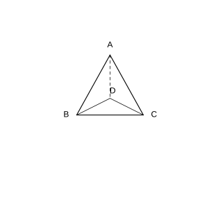

# 作业 64

> **结论 13.1.1** (三角形三边关系)  三角形任意两边的和大于第三边, 任意两边的差小于第三边.
>
> **定理 13.3.1** (三角形内角和定理)  三角形的内角和等于 $180^\circ$.
>
> **结论 数学活动一** (三角剖分)  把一个多边形用连接它的不相邻顶点且不在内部相交的线段划分为若干个三角形, 叫作多边形的三角剖分. $n$ 边形的三角剖分得到 $n-2$ 个三角形, 不同剖分方法数 $D_n$ 满足 $\frac{D_{n+1}}{D_n}=\frac{4n-6}{n}$ ($D_3=1$).

### 活动一

(数学活动 活动 1 搭等边三角形) 取一些等长的磁力棒. 用 $3$ 根磁力棒能组成 $1$ 个等边三角形, 用 $6$ 根磁力棒能组成 $4$ 个等边三角形吗? 用 $9$ 根磁力棒最多能组成几个等边三角形? (提示: 可以考虑立体图形.)

{width=50%}

### 解答 活动一

在平面内, $3$ 根磁力棒最多只能围成 $1$ 个等边三角形. 若考虑立体图形, 把 $6$ 根等长磁力棒搭成一个正四面体, 它有 $6$ 条棱和 $4$ 个面, 而每个面都是等边三角形, 故 $6$ 根磁力棒能组成 $4$ 个等边三角形.

在此基础上继续拼接, 用 $9$ 根磁力棒最多可搭出更多的等边三角形面, 正四面体及拼接结构能给出 $5$ 个及以上的等边三角形. 动手验证可知, 借助立体结构能显著多于平面拼法. $\blacksquare$

### 活动二

(数学活动 活动 2 第 1 题) 试着将一个四边形、五边形、六边形进行三角剖分, 分别能剖分出多少个三角形? $n$ 边形呢?

### 解答 活动二

四边形用 $1$ 条对角线可剖分为 $2$ 个三角形; 五边形可剖分为 $3$ 个; 六边形可剖分为 $4$ 个.

每增加一条边, 三角剖分出的三角形个数增加 $1$. 故 $n$ 边形可剖分出 $n-2$ 个三角形. $\blacksquare$

### 活动三

(数学活动 活动 2 第 2 题) 将一个四边形进行三角剖分, 你有多少种剖分方法? 五边形呢? 利用 $\frac{D_{n+1}}{D_n}=\frac{4n-6}{n}$ ($D_3=1$) 验证, 并计算六边形、七边形的三角剖分方法数.

### 解答 活动三

由 $D_3=1$, 依次计算:

$$
\frac{D_4}{D_3}=\frac{4\times3-6}{3}=2,\quad D_4=2;
$$

$$
\frac{D_5}{D_4}=\frac{4\times4-6}{4}=\frac{5}{2},\quad D_5=5;
$$

$$
\frac{D_6}{D_5}=\frac{4\times5-6}{5}=\frac{14}{5},\quad D_6=14;
$$

$$
\frac{D_7}{D_6}=\frac{4\times6-6}{6}=3,\quad D_7=42.
$$

故四边形有 $2$ 种剖分方法, 五边形有 $5$ 种, 六边形有 $14$ 种, 七边形有 $42$ 种. $\blacksquare$
