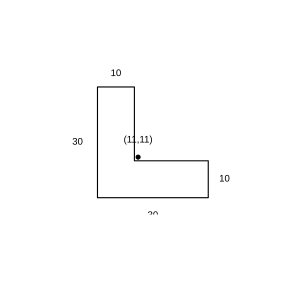

# 作业 66

> **定义 13.2.1** (三角形的重心)  三角形的三条中线相交于一点, 该点叫作三角形的重心, 匀质三角形薄板的重心就位于此点.
>
> **结论 综合与实践一** (简单图形的重心)  匀质线段的重心为它的中点; 正方形、长方形、平行四边形等中心对称图形的重心为其对称中心 (对角线交点); 三角形的重心为三条中线的交点.
>
> **结论 综合与实践二** (组合图形的重心)  把组合图形分割成若干已知重心位置的简单图形, 设第 $i$ 部分的面积为 $S_i$, 重心坐标为 $\left(x_i,y_i\right)$, 则整体重心坐标为
>
> $$
> \bar x=\frac{\sum S_i x_i}{\sum S_i},\quad \bar y=\frac{\sum S_i y_i}{\sum S_i}.
> $$

### 探究一

(综合与实践 第 1 题) 用一个支点顶住一个三角形匀质薄板, 使其在支点上保持平衡. 三角形匀质薄板的重心位置与三角形的重心位置有什么关系?

### 解答 探究一

由**结论 综合与实践一** (简单图形的重心), 匀质三角形薄板的重心就是三角形三条中线的交点. 当薄板在支点上恰好保持平衡时, 支点与薄板接触的点正是该三角形的重心. 两者位置重合. $\blacksquare$

### 探究二

(综合与实践 第 2 题) 怎样确定线段、正方形、长方形、平行四边形等常见几何图形的重心位置? 它们的重心位置有什么共同特点?

### 解答 探究二

由**结论 综合与实践一** (简单图形的重心), 线段的重心为其中点; 正方形、长方形、平行四边形都是中心对称图形, 其重心为它们的对称中心, 即两条对角线的交点.

这些图形都是轴对称或中心对称的简单图形, 其重心都落在图形的对称中心或中线交点上. 三角形虽不是中心对称图形, 但重心仍落在三条中线的交点, 即图形的几何中心处. $\blacksquare$

### 探究三

(综合与实践 第 3 题) 把一个图形分成两部分, 设两部分的面积为 $S_1$, $S_2$, 重心坐标为 $\left(x_1,y_1\right)$, $\left(x_2,y_2\right)$, 试写出整体重心坐标与两部分重心坐标之间的数量关系.

### 解答 探究三

由**结论 综合与实践二** (组合图形的重心), 整体重心的横、纵坐标分别为两部分重心坐标按面积加权的平均值:

$$
\bar x=\frac{S_1 x_1+S_2 x_2}{S_1+S_2},\quad \bar y=\frac{S_1 y_1+S_2 y_2}{S_1+S_2}.
$$

当两部分面积相等时, $\bar x=\frac{x_1+x_2}{2}$, $\bar y=\frac{y_1+y_2}{2}$, 即重心位于两部分重心连线的中点. $\blacksquare$

### 探究四

(综合与实践 第 4 题) 求图中 “L” 形角钢横截面 (外轮廓 $30\ \text{cm}\times30\ \text{cm}$, 壁厚 $10\ \text{cm}$) 的重心位置.

{width=50%}

### 解答 探究四

建立平面直角坐标系, 取横截面的左下角为原点, 两边沿坐标轴正方向. 将 L 形分割为两个矩形:

竖矩形: 宽 $10\ \text{cm}$, 高 $30\ \text{cm}$, 面积 $S_1=300\ \text{cm}^2$, 重心 $\left(x_1,y_1\right)=\left(5,15\right)$.

横矩形 (底部扣除重叠部分): 长 $20\ \text{cm}$, 宽 $10\ \text{cm}$, 面积 $S_2=200\ \text{cm}^2$, 重心 $\left(x_2,y_2\right)=\left(20,5\right)$.

由**结论 综合与实践二** (组合图形的重心),

$$
\bar x=\frac{S_1 x_1+S_2 x_2}{S_1+S_2}=\frac{300\times5+200\times20}{300+200}=\frac{5500}{500}=11,
$$

$$
\bar y=\frac{S_1 y_1+S_2 y_2}{S_1+S_2}=\frac{300\times15+200\times5}{500}=\frac{5500}{500}=11.
$$

故该 L 形横截面的重心位于距两外边缘均为 $11\ \text{cm}$ 处. $\blacksquare$
