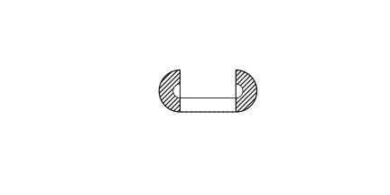

# 作业 93

> **定义 18.1.2** (分式的基本性质)  $\frac{A}{B}=\frac{A\cdot C}{B\cdot C}=\frac{A\div C}{B\div C}$ ($C\ne0$).

> **定义 18.2.1** (分式的乘法法则)  $\frac{a}{b}\cdot\frac{c}{d}=\frac{ac}{bd}$.

> **定义 18.2.2** (分式的除法法则)  $\frac{a}{b}\div\frac{c}{d}=\frac{ad}{bc}$.

> **定义 18.3.1** (同分母分式的加减法)  $\frac{a}{c}\pm\frac{b}{c}=\frac{a\pm b}{c}$.

> **定义 18.3.2** (异分母分式的加减法)  $\frac{a}{b}\pm\frac{c}{d}=\frac{ad\pm bc}{bd}$.

> **定义 18.5.2** (解分式方程的检验)  将整式方程的解代入最简公分母, 不为 $0$ 则是原方程的解, 否则不是.

### 复习题一

(复习题 复习巩固第 1 题) 下列各式中, 哪些是整式? 哪些是分式?

$\frac{x}{3}$, $\frac{1}{n}$, $\frac{1}{a+5}$, $\frac{a+5}{15}$, $\frac{z}{x^2 y}$, $\frac{2ab}{(a+b)^2}$.

### 解答 复习题一

整式: $\frac{x}{3}$, $\frac{a+5}{15}$.

分式: $\frac{1}{n}$, $\frac{1}{a+5}$, $\frac{z}{x^2 y}$, $\frac{2ab}{(a+b)^2}$. $\blacksquare$

### 复习题二

(复习题 复习巩固第 2 题) 计算:

(1) $\frac{s-2 t}{3 s}\cdot\frac{6 s^2}{s+2 t}$;

(2) $\frac{x-y}{x+y}\div(x-y)^2$;

(3) $\frac{2 a}{a+1}+\frac{2}{a+1}$;

(4) $\frac{u-2 v}{u+2 v}-\frac{2}{u^2-4 v^2}$;

(5) $(x^{-2} y^3)^{-3}$;

(6) $\left(-\frac{3 x}{y^3 z}\right)^2$.

### 解答 复习题二

(1) $\frac{(s-2t)\cdot6s^2}{3s(s+2t)}=\frac{2s(s-2t)}{s+2t}$.

(2) $\frac{x-y}{x+y}\cdot\frac{1}{(x-y)^2}=\frac{1}{(x+y)(x-y)}=\frac{1}{x^2-y^2}$.

(3) $\frac{2a+2}{a+1}=\frac{2(a+1)}{a+1}=2$.

(4) $\frac{(u-2v)^2-2}{(u+2v)(u-2v)}=\frac{u^2-4uv+4v^2-2}{u^2-4v^2}$.

(5) $(x^{-2} y^3)^{-3}=x^6 y^{-9}=\frac{x^6}{y^9}$.

(6) $\left(-\frac{3x}{y^3 z}\right)^2=\frac{9x^2}{y^6 z^2}$. $\blacksquare$

### 复习题三

(复习题 复习巩固第 3 题) 计算:

(1) $\frac{2 m}{3 n}\cdot\left(\frac{3 n}{p}\right)^2\div\frac{m n}{p^2}$;

(2) $a^2 b^3\cdot(a b^2)^{-2}$;

(3) $\frac{x^2-16}{x^2+8 x+16}+\frac{x}{x-4}$;

(4) $\left(\frac{p q^2}{r}\right)^3\div\frac{2 p r^2}{r+12 q}$;

(5) $1\div\left(2 x+1-\frac{x^2}{x}\right)$;

(6) $\frac{a-b}{a}\div\left(a-\frac{2 a b-b^2}{a}\right)$;

(7) $1-\frac{a+b}{a+2 b}\div\frac{a^2-b^2}{a^2+4 a b+4 b^2}$;

(8) $\left(x-y+\frac{4 x y}{x-y}\right)\left(x+y-\frac{4 x y}{x+y}\right)$.

### 解答 复习题三

(1) $\frac{2m}{3n}\cdot\frac{9n^2}{p^2}\cdot\frac{p^2}{mn}=\frac{6n}{n}=6$.

(2) $a^2 b^3\cdot a^{-2} b^{-4}=b^{-1}=\frac1b$.

(3) $\frac{(x+4)(x-4)}{(x+4)^2}+\frac{x}{x-4}=\frac{x-4}{x+4}+\frac{x}{x-4}=\frac{(x-4)^2+x(x+4)}{(x+4)(x-4)}=\frac{2x^2-4x+16}{x^2-16}$.

(4) $\frac{p^3 q^6}{r^3}\cdot\frac{r+12q}{2pr^2}=\frac{p^2 q^6(r+12q)}{2r^5}$.

(5) $1\div(2x+1-x)=1\div(x+1)=\frac{1}{x+1}$.

(6) $\frac{a-b}{a}\div\frac{a^2-2ab+b^2}{a}=\frac{a-b}{a}\cdot\frac{a}{(a-b)^2}=\frac{1}{a-b}$.

(7) $1-\frac{a+b}{a+2b}\cdot\frac{(a+2b)^2}{(a+b)(a-b)}=1-\frac{a+2b}{a-b}=\frac{a-b-a-2b}{a-b}=-\frac{3b}{a-b}$.

(8) $\frac{(x-y)^2+4xy}{x-y}\cdot\frac{(x+y)^2-4xy}{x+y}=\frac{(x+y)^2}{x-y}\cdot\frac{(x-y)^2}{x+y}=(x+y)(x-y)=x^2-y^2$. $\blacksquare$

### 复习题四

(复习题 复习巩固第 4 题) 解下列方程:

(1) $\frac{5 x+2}{x^2+x}=\frac{3}{x+1}$;

(2) $\frac{2 x}{2 x-5}-\frac{2}{2 x+5}=1$.

### 解答 复习题四

(1) 乘 $x(x+1)$: $5x+2=3x$, $2x=-2$, $x=-1$. 检验 $x+1=0$, 原方程无解.

(2) 乘 $(2x-5)(2x+5)$: $2x(2x+5)-2(2x-5)=(2x-5)(2x+5)$, $4x^2+10x-4x+10=4x^2-25$, $6x=-35$, $x=-\frac{35}{6}$. 检验成立. $\blacksquare$

### 复习题五

(复习题 综合运用第 5 题) $x$ 满足什么条件时下列式子有意义?

(1) $\frac{x-2}{2 x+1}-\frac{1}{x-2}$;

(2) $\frac{3 x}{x+2}\div\frac{x-2}{2 x-3}$.

### 解答 复习题五

各分母及除式不为 $0$.

(1) $2x+1\ne0$, $x-2\ne0$, 即 $x\ne-\frac12$ 且 $x\ne2$.

(2) $x+2\ne0$, $x-2\ne0$, $2x-3\ne0$, 即 $x\ne-2,2,\frac32$. $\blacksquare$

### 复习题六

(复习题 综合运用第 6 题) (1) 当 $x$ 取什么值时, 分式 $\frac{3x-6}{2x+1}$ 的值为 $0$?

(2) 当 $x$ 取什么值时, 分式 $\frac{2x+1}{x^2}$ 的值为正?

(3) 当 $x$ 取什么值时, 分式 $\frac{x-2}{x^2}$ 的值为负?

### 解答 复习题六

(1) 分子 $3x-6=0$ 且分母 $2x+1\ne0$, 得 $x=2$.

(2) $x^2>0$ (恒成立, $x\ne0$), 需 $2x+1>0$, 即 $x>-\frac12$ 且 $x\ne0$.

(3) $x^2>0$ ($x\ne0$), 需 $x-2<0$, 即 $x<2$ 且 $x\ne0$. $\blacksquare$

### 复习题七

(复习题 综合运用第 7 题) 什么情况下 $2(x+1)^{-1}$ 与 $3(x-2)^{-1}$ 的值相等?

### 解答 复习题七

$$\frac{2}{x+1}=\frac{3}{x-2}.$$

$2(x-2)=3(x+1)$, $2x-4=3x+3$, $x=-7$. 检验 $x+1\ne0$, $x-2\ne0$, 成立. 故当 $x=-7$ 时两式相等. $\blacksquare$

### 复习题八

(复习题 综合运用第 8 题) (1) 先化简, 再求值: $\frac{x^2-1}{x^2-2x+1}\div\frac{x+1}{x-1}\cdot\frac{1-x}{1+x}$, 其中 $x=\frac12$;

(2) 当 $x=-3.2$ 时, 求 $\frac{x^2-4x+4}{x^2-4}\div\frac{x-2}{x^2+2x+3}$ 的值.

### 解答 复习题八

(1) $\frac{(x+1)(x-1)}{(x-1)^2}\cdot\frac{x-1}{x+1}\cdot\frac{1-x}{1+x}=\frac{1-x}{1+x}$. 代入 $x=\frac12$, 得 $\frac{1-\frac12}{1+\frac12}=\frac13$.

(2) $\frac{(x-2)^2}{(x+2)(x-2)}\cdot\frac{x^2+2x+3}{x-2}=\frac{x^2+2x+3}{x+2}$. 代入 $x=-3.2$, 得 $\frac{10.24-6.4+3}{-1.2}=\frac{6.84}{-1.2}=-5.7$. $\blacksquare$

### 复习题九

(复习题 综合运用第 9 题) 某工厂现在平均每天比原计划多生产 $50$ 台机器, 现在生产 $600$ 台机器所需时间与原计划生产 $450$ 台机器所需时间相同. 现在平均每天生产多少台机器?

### 解答 复习题九

设现在每天生产 $x$ 台, 原计划 $(x-50)$ 台.

$$\frac{600}{x}=\frac{450}{x-50}.$$

$600(x-50)=450x$, $600x-30000=450x$, $150x=30000$, $x=200$. 检验成立.

故现在平均每天生产 $200$ 台. $\blacksquare$

### 复习题十

(复习题 综合运用第 10 题) 一台收割机的工作效率相当于一个农民工作效率的 $150$ 倍, 用这台机器收割 $10\ \text{hm}^2$ 小麦比 $100$ 个农民人工收割这些小麦要少用 $1\ \text{h}$. 这台收割机每小时收割多少公顷小麦?

### 解答 复习题十

设农民每小时收割 $x\ \text{hm}^2$, 收割机 $150x$.

$$\frac{10}{100x}-\frac{10}{150x}=1.$$

$$\frac{1}{10x}-\frac{1}{15x}=1,\quad \frac{3-2}{30x}=1,\quad x=\frac{1}{30}.$$

收割机每小时 $150x=5\ \text{hm}^2$. $\blacksquare$

### 复习题十一

(复习题 综合运用第 11 题) 一辆汽车开往距离出发地 $180\ \text{km}$ 的目的地, 出发后第一小时内按原计划的速度匀速行驶, 一小时后以原来速度的 $1.5$ 倍匀速行驶, 并比原计划提前 $40\ \text{min}$ 到达目的地. 求第一小时的行驶速度.

### 解答 复习题十一

设第一小时速度为 $x\ \text{km/h}$. 原计划用时 $\frac{180}{x}$. 实际用时 $1+\frac{180-x}{1.5x}$. 提前 $\frac{2}{3}\ \text{h}$:

$$\frac{180}{x}-\left(1+\frac{180-x}{1.5x}\right)=\frac23.$$

$$\frac{180}{x}-1-\frac{120}{x}+\frac{2}{3}=\frac23,\quad \frac{60}{x}-1=0,\quad x=60.$$

检验成立. 故第一小时速度为 $60\ \text{km/h}$. $\blacksquare$

### 复习题十二

(复习题 拓广探索第 12 题) 如图, 运动场两端的半圆形跑道外径为 $R$, 内径为 $r$, 中间为直跑道, 整个跑道总面积为 $S$, 试用含 $S,R,r$ 的式子表示直跑道的长 $a$.

{width=50%}

### 解答 复习题十二

两端半圆合为一个圆环, 面积 $\pi(R^2-r^2)$; 两条直跑道面积为 $2a(R-r)$ (每条宽 $R-r$). 总面积

$$S=\pi(R^2-r^2)+2a(R-r)=(R-r)[\pi(R+r)+2a].$$

解得

$$a=\frac{\frac{S}{R-r}-\pi(R+r)}{2}.$$

$\blacksquare$

### 复习题十三

(复习题 拓广探索第 13 题) (1) 式子 $\frac{a}{bc}+\frac{b}{ca}+\frac{c}{ab}$ 的值能否为 $0$? 为什么?

(2) 式子 $\frac{a-b}{(b-c)(c-a)}+\frac{b-c}{(a-b)(c-a)}+\frac{c-a}{(a-b)(b-c)}$ 的值能否为 $0$? 为什么?

### 解答 复习题十三

(1) 通分: $\frac{a^2+b^2+c^2}{abc}$. 若值为 $0$, 需 $a^2+b^2+c^2=0$, 即 $a=b=c=0$, 与分母 $abc\ne0$ 矛盾. 故不能为 $0$.

(2) 通分, 公分母 $(a-b)(b-c)(c-a)$:

分子 $=(a-b)^2+(b-c)^2+(c-a)^2$. 若值为 $0$, 需 $a=b=c$, 与分母不为 $0$ 矛盾. 故不能为 $0$. $\blacksquare$
