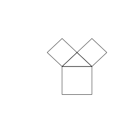

# Assignment 101

> **Theorem 20.1.1** (Pythagorean Theorem)   In a right triangle, the sum of the squares of the two legs equals the square of the hypotenuse. If the two legs of a right triangle are \(a,b\) and the hypotenuse is \(c\), then \(a^{2}+b^{2}=c^{2}\).

### Activity 1

(Mathematics Activity, Activity 1, Problem 1)

Figure 1(1) looks like a tree and is called a "Pythagorean tree". To draw this pattern, one first draws a figure as in Figure 2 (a right triangle and two small squares on its two legs), then, based on the two small squares, draws two figures of the same shape on top of each, as in Figure 3. Repeating this and finally filling in colors yields the "Pythagorean tree". Explain the mathematics behind each step.

{width=50%}

Each time two new small squares "grow", a right triangle is drawn with the side of the existing square on the hypotenuse as its hypotenuse, and then two new squares are drawn on the two legs.

By **Theorem 20.1.1**, the sum of the areas of the two new small squares equals the area of the old square.

Thus two still smaller squares grow on each existing square; the areas shrink level by level while maintaining the relation "the sum of the areas of the two small squares equals the area of the previous-level square", and infinite repetition forms a self-similar tree pattern.

\(\blacksquare\)

(Mathematics Activity, Activity 1, Problem 2)

Draw in the same way and repeat the process many times on the newly generated figures, and an infinitely growing tree pattern is formed. Try to create a pattern related to the Pythagorean theorem and explain the mathematical secret it contains.

Take an isosceles right triangle with its two legs on top of the same square.

Each time the process is repeated on the two small squares, the side length of the two small squares is \(\frac{\sqrt{2}}{2}\) times that of the previous level, and their area is half of the previous level.

By **Theorem 20.1.1**, the sum of the areas of the two new squares at each level equals the area of its parent square.

Therefore the sum of the areas of all the outermost small squares equals exactly the area of the original square — this is the mathematical secret of "area conservation" in the Pythagorean tree pattern.

\(\blacksquare\)
