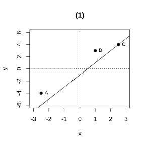
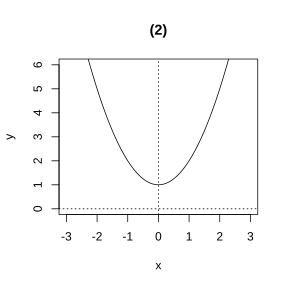
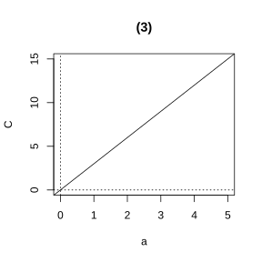
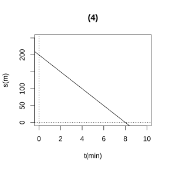
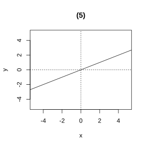
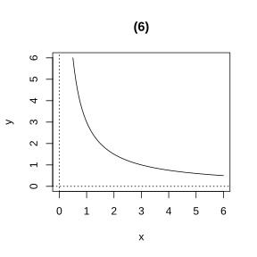
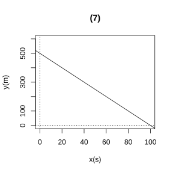

# Assignment 109

> **Definition 22.2.1** (Graph of a Function)  Generally, for a function, if each pair of corresponding values of the independent variable and the function is taken as the x- and y-coordinates of a point, then the figure formed by these points in the coordinate plane is the graph of the function.
>
> **Conclusion 22.2.2** (Steps for Plotting a Graph by the Point-Plotting Method)  Step 1, make a table — list some values of the independent variable and their corresponding function values; Step 2, plot points — in the plane rectangular coordinate system, take the independent variable value as the x-coordinate and the corresponding function value as the y-coordinate, and plot the points corresponding to the table values; Step 3, join the points — in order of increasing x-coordinate, connect the plotted points with a smooth curve.
>
> **Conclusion 22.2.3** (Three Ways of Representing a Function)  Analytic method: express the functional relation by a mathematical expression; Tabular method: list the corresponding values of the independent variable and the function in a table; Graphical method: express the functional relation by a graph.

### Exercise 1

(Exercise 22.2, Problem 1) (1) Draw the graph of the function $y=2x-1$;

(2) Determine whether points $A\left(-2.5, -4\right)$, $B\left(1, 3\right)$, $C\left(2.5, 4\right)$ lie on the graph of $y=2x-1$.

### Solution to Exercise 1

(1) By **Conclusion 22.2.2** (Steps for Plotting a Graph by the Point-Plotting Method), make a table:

| $x$ | $\cdots$ | $-2$ | $-1$ | $0$ | $1$ | $2$ | $\cdots$ |
|---|---|---|---|---|---|---|---|
| $y=2x-1$ | $\cdots$ | $-5$ | $-3$ | $-1$ | $1$ | $3$ | $\cdots$ |

Plot points $\left(x, y\right)$ in the plane rectangular coordinate system and connect them with a smooth curve, obtaining a straight line.

{width=50%}

(2) By **Definition 22.2.1** (Graph of a Function), the coordinates of a point on the graph satisfy the analytic expression.

Substitute $x=-2.5$ into $y=2x-1$: $y=2\times\left(-2.5\right)-1=-6 \neq -4$, so point $A\left(-2.5, -4\right)$ is not on the graph.

Substitute $x=1$ into $y=2x-1$: $y=2\times1-1=1 \neq 3$, so point $B\left(1, 3\right)$ is not on the graph.

Substitute $x=2.5$ into $y=2x-1$: $y=2\times2.5-1=4$, which matches the y-coordinate of point $C$, so point $C\left(2.5, 4\right)$ is on the graph. $\blacksquare$

### Exercise 2

(Exercise 22.2, Problem 2) (1) Draw the graph of the function $y=x^2+1$.

(2) Observing the graph of $y=x^2+1$, when $x<0$, does $y$ increase as $x$ increases or does $y$ decrease as $x$ increases? What about when $x>0$?

### Solution to Exercise 2

(1) By **Conclusion 22.2.2** (Steps for Plotting a Graph by the Point-Plotting Method), make a table:

| $x$ | $\cdots$ | $-2$ | $-1$ | $0$ | $1$ | $2$ | $\cdots$ |
|---|---|---|---|---|---|---|---|
| $y=x^2+1$ | $\cdots$ | $5$ | $2$ | $1$ | $2$ | $5$ | $\cdots$ |

Plot points in the plane rectangular coordinate system and connect them with a smooth curve, obtaining an upward-opening curve.

{width=50%}

(2) From the graph, when $x<0$, the curve descends from left to right, i.e. $y$ decreases as $x$ increases; when $x>0$, the curve rises from left to right, i.e. $y$ increases as $x$ increases. $\blacksquare$

### Exercise 3

(Exercise 22.2, Problem 1) A landscaping team is greening a park and takes a break in the middle. The functional relation between the greened area $S$ and the working time $t$ is shown in the figure.

(1) Before the break, how long did the team work? What was the greened area?

(2) How long was the break?

(3) After the break, how much area did the team green per hour?

### Solution to Exercise 3

By **Definition 22.2.1** (Graph of a Function), the x-coordinate of a point on the graph is the working time $t$, and the y-coordinate is the greened area $S$.

(1) From the graph, from $t=0$ to $t=1\ \text{h}$, the greened area increases from $0$ to $60\ \text{m}^2$, so the team was working. Thus before the break the team worked for $1\ \text{h}$, and the greened area was $60\ \text{m}^2$.

(2) From $t=1\ \text{h}$ to $t=2\ \text{h}$, the greened area stays at $60\ \text{m}^2$; the graph is a segment parallel to the $t$-axis, showing the team was resting. Thus the break lasted $2-1=1\ \text{h}$.

(3) From $t=2\ \text{h}$ to $t=4\ \text{h}$, the greened area increases from $60\ \text{m}^2$ to $160\ \text{m}^2$. After the break the team worked $4-2=2\ \text{h}$ and greened $160-60=100\ \text{m}^2$. Thus the area greened per hour is $100 \div 2 = 50\ \text{m}^2/\text{h}$. $\blacksquare$

### Exercise 4

(Exercise 22.2, Problem 2) As shown in the figure, this is the graph of temperature versus time for Beijing and Shanghai on a certain day.

(1) During this day, when do Beijing and Shanghai have the same temperature?

(2) During this day, during which periods is Shanghai warmer than Beijing? During which periods is it colder?

(3) What other information can you get from the graph?

### Solution to Exercise 4

By **Definition 22.2.1** (Graph of a Function), the intersection of the two curves means the two places have the same temperature at that time.

(1) From the graph, the temperature curves of Beijing and Shanghai intersect at $7{:}00$ and $12{:}00$, so during this day at $7{:}00$ and $12{:}00$ the two places have the same temperature.

(2) Between $7{:}00$ and $12{:}00$, Shanghai's curve is above Beijing's, so Shanghai is warmer during this period; between $0{:}00$ and $7{:}00$ and between $12{:}00$ and $24{:}00$, Shanghai's curve is below Beijing's, so Shanghai is colder during these two periods.

(3) From the graph, Beijing's highest temperature this day is about $10\,^\circ\text{C}$ and lowest about $-3\,^\circ\text{C}$; Shanghai's highest is about $18\,^\circ\text{C}$ and lowest about $6\,^\circ\text{C}$; Shanghai is overall warmer than Beijing. $\blacksquare$

### Exercise 5

(Exercise 22.2, Problem 3) As shown in the figure, construct a problem scenario whose functional relation can be represented by the graph.

### Solution to Exercise 5

By **Definition 22.2.1** (Graph of a Function), the graph shows the distance from home $y$ (unit: m) versus time $t$ (unit: min): it takes about $15\ \text{min}$ to go from $0$ to $1000\ \text{m}$, there is a stop in the middle, then return home.

Construct the scenario: Xiao Ming leaves home, walks at a steady pace for $15\ \text{min}$ to a library $1000\ \text{m}$ from home, stays there for a while reading, then walks steadily home. Here $y$ is Xiao Ming's distance from home and $t$ is time. $\blacksquare$

### Exercise 6

(Exercise 22.2, Problem 1) Use the tabular and analytic methods to represent the interior angle sum $m$ (unit: degrees) of an $n$-gon as a function of the number of sides $n$.

### Solution to Exercise 6

By the polygon interior angle sum formula, the interior angle sum of an $n$-gon is $\left(n-2\right)\times180^\circ$.

By **Conclusion 22.2.3** (Three Ways of Representing a Function), analytic method: $m=\left(n-2\right)\times180$, where $n \geq 3$ and $n$ is an integer.

Tabular method:

| $n$ | $3$ | $4$ | $5$ | $6$ | $7$ | $\cdots$ |
|---|---|---|---|---|---|---|
| $m$ | $180$ | $360$ | $540$ | $720$ | $900$ | $\cdots$ |

$\blacksquare$

### Exercise 7

(Exercise 22.2, Problem 2) Use the analytic and graphical methods to represent the perimeter $C$ of an equilateral triangle as a function of its side length $a$.

### Solution to Exercise 7

An equilateral triangle has three equal sides, so its perimeter is three times the side length.

By **Conclusion 22.2.3** (Three Ways of Representing a Function), analytic method: $C=3a$, where $a>0$.

Graphical method: in the plane rectangular coordinate system, take $a$ as the x-coordinate and $C$ as the y-coordinate, and draw the ray of $C=3a$ for $a>0$.

{width=50%}

$\blacksquare$

### Exercise 8

(Exercise 22.2, Problem 3) A boat moves at a steady speed along a straight line toward a dock. At $0\ \text{min}$, $2\ \text{min}$, $4\ \text{min}$, $6\ \text{min}$, the distances from the boat to the dock are measured as $200\ \text{m}$, $150\ \text{m}$, $100\ \text{m}$, $50\ \text{m}$. Is the distance $s$ (unit: m) from the boat to the dock a function of time $t$ (unit: min)? If so, write the analytic expression, draw the graph, and calculate how long it takes the boat to reach the dock.

### Solution to Exercise 8

By **Definition 22.1.2** (Function), for each definite value of time $t$, the distance $s$ from the boat to the dock has a unique definite value, so $s$ is a function of $t$.

The boat moves at a steady speed of $\left(200-150\right)\div 2 = 25\ \text{m/min}$. The initial distance is $200\ \text{m}$, so the analytic expression is

$$
s = 200 - 25t \quad \left(0 \leq t \leq 8\right).
$$

{width=50%}

When the boat reaches the dock, $s=0$, i.e. $200-25t=0$, giving $t=8\ \text{min}$. Thus the boat takes $8\ \text{min}$ to reach the dock. $\blacksquare$

### Problem 1

(Exercise 22.2, Review and Consolidation, Problem 1) Draw the graphs of the following functions:

(1) $y=0.5x$;

(2) $y=\frac{3}{x}\ \left(x>0\right)$.

### Solution to Problem 1

(1) By **Conclusion 22.2.2** (Steps for Plotting a Graph by the Point-Plotting Method), make a table, plot and join points; the graph of $y=0.5x$ is a straight line through the origin.

{width=50%}

(2) Make a table, plot and join points; the graph of $y=\frac{3}{x}\ \left(x>0\right)$ is a curve in the first quadrant.

{width=50%}

$\blacksquare$

### Problem 2

(Exercise 22.2, Review and Consolidation, Problem 2) Which of the following curves represent $y$ as a function of $x$?

### Solution to Problem 2

By **Definition 22.1.2** (Function), for each definite value of $x$, $y$ has a unique definite value corresponding to it. Draw a line perpendicular to the $x$-axis; if it intersects the curve at only one point, then $y$ is a function of $x$.

(1) A line perpendicular to the $x$-axis meets the curve at only one point, so $y$ is a function of $x$.

(2) There is a line perpendicular to the $x$-axis meeting the curve at two points, so $y$ is not a function of $x$.

(3) A line perpendicular to the $x$-axis meets the curve at only one point, so $y$ is a function of $x$.

(4) There is a line perpendicular to the $x$-axis meeting the curve at two points, so $y$ is not a function of $x$. $\blacksquare$

### Problem 3

(Exercise 22.2, Review and Consolidation, Problem 3) A "clepsydra" (water clock) is an ancient timekeeping device; its inner wall has graduations, it holds a fixed amount of water, and water leaks out through a small hole at the bottom; people read the time from the water level. Let $x$ be the leaking time and $y$ be the height from the bottom of the vessel to the water surface. Which of the following graphs best represents the relation between $y$ and $x$? (Ignore the effect of the changing water amount on pressure.)

### Solution to Problem 3

As described, water leaks out at a steady rate, so the height $y$ from the bottom to the water surface decreases uniformly as the leaking time $x$ increases. Initially the water height is maximal and gradually decreases to $0$.

Thus the graph that best represents $y$ vs $x$ is: a segment starting at some point on the positive y-axis, sloping down to the right, and finally meeting the x-axis (i.e. option (2)). $\blacksquare$

### Problem 4

(Exercise 22.2, Review and Consolidation, Problem 4) It is known that Liu Wei's home, the stadium, and the stationery store lie on the same straight line. The graph below depicts: Liu Wei runs from home to the stadium, exercises there for a while, then walks to the stationery store to buy pens, then strolls home. In the graph, $x$ is time and $y$ is Liu Wei's distance from home.

(1) How far is the stadium from Liu Wei's home? How long did it take him to get there?

(2) How far is the stadium from the stationery store?

(3) How long did Liu Wei stay at the stationery store?

(4) What was Liu Wei's average speed walking home from the stationery store?

### Solution to Problem 4

By **Definition 22.2.1** (Graph of a Function), the x-coordinate is time $x$, and the y-coordinate is distance from home $y$.

(1) From the y-coordinate, the stadium is $2.5\ \text{km}$ from home; from the x-coordinate, it took Liu Wei $15\ \text{min}$ to reach the stadium.

(2) The distance from the stadium to the stationery store is $2.5-1.5=1\ \text{km}$.

(3) Liu Wei stayed at the stationery store for $100-65=35\ \text{min}$.

(4) The stationery store is $1.5\ \text{km}$ from home, and the walk home took $100-65=35\ \text{min}$. The average speed is $1.5\div35=\frac{3}{70}\ \text{km/min}$. $\blacksquare$

### Problem 5

(Exercise 22.2, Comprehensive Application, Problem 5) For a shot-put athlete, under the same release height and release speed, the release angle (within a certain range) and the maximum throwing distance are given in the table below.

| Release angle | $38^\circ$ | $39^\circ$ | $40^\circ$ | $41^\circ$ | $42^\circ$ |
|---|---|---|---|---|---|
| Maximum distance/m | $21.70$ | $21.78$ | $21.85$ | $21.89$ | $21.91$ |

(1) Let the release angle be $x^\circ$ and the maximum distance be $y\ \text{m}$. Is $y$ a function of $x$? Why?

(2) From the table, as the release angle increases, how does the maximum distance change?

### Solution to Problem 5

(1) By **Definition 22.1.2** (Function), for each definite value of the release angle $x$, the maximum distance $y$ has a unique definite value, so $y$ is a function of $x$.

(2) From the table, as the release angle increases from $38^\circ$ to $42^\circ$, the maximum distance increases from $21.70\ \text{m}$ to $21.91\ \text{m}$; that is, the maximum distance increases with the release angle, but the rate of increase gradually slows. $\blacksquare$

### Problem 6

(Exercise 22.2, Comprehensive Application, Problem 6) A bank deposit has an annual interest rate of $2\%$; $10000$ yuan of principal is invested. If the annual interest is not compounded into the principal, find the analytic expression for the sum of principal and interest $y$ (unit: yuan) as a function of the number of years $x$, and calculate the sum after $4$ years.

### Solution to Problem 6

The annual interest is $10000 \times 2\% = 200$ yuan. The total interest after $x$ years is $200x$ yuan.

The sum of principal and interest equals principal plus interest, so the analytic expression is

$$
y = 10000 + 200x.
$$

When $x=4$, $y=10000+200\times4=10800$ yuan. Thus after $4$ years the sum is $10800$ yuan. $\blacksquare$

### Problem 7

(Exercise 22.2, Comprehensive Application, Problem 7) A square has side length $3$; if the side length increases by $x$, its area increases by $y$. Find the analytic expression for $y$ as a function of $x$, and present in a table the values of $y$ when $x$ equals $1$, $2$, $3$, $4$.

### Solution to Problem 7

The original square has side $3$ and area $9$. After the side increases by $x$, the side is $3+x$ and the area is $\left(3+x\right)^2$.

The area increase is $y=\left(3+x\right)^2-9=x^2+6x$.

When $x=1$, $y=1+6=7$; when $x=2$, $y=4+12=16$; when $x=3$, $y=9+18=27$; when $x=4$, $y=16+24=40$.

| $x$ | $1$ | $2$ | $3$ | $4$ |
|---|---|---|---|---|
| $y$ | $7$ | $16$ | $27$ | $40$ |

$\blacksquare$

### Problem 8

(Exercise 22.2, Comprehensive Application, Problem 8) Cars A and B travel in the same direction along a straight road at speeds $20\ \text{m/s}$ and $25\ \text{m/s}$. Car A is currently $500\ \text{m}$ ahead of car B; let $x\ \text{s}$ ($0 \leq x \leq 100$) later the distance between them be $y\ \text{m}$. Represent the relation between $y$ and $x$ by an analytic expression and a graph.

### Solution to Problem 8

After $x$ seconds, car A has traveled $20x\ \text{m}$ and car B $25x\ \text{m}$. Initially car A is $500\ \text{m}$ ahead, so the distance between them is

$$
y = 500 + 20x - 25x = 500 - 5x \quad \left(0 \leq x \leq 100\right).
$$

{width=50%}

$\blacksquare$

### Problem 9

(Exercise 22.2, Extension and Exploration, Problem 9) Two cars, A and B, depart from city $A$ for city $B$. Throughout the trip, the distance $y$ traveled from city $A$ versus the time $t$ is shown in the figure.

(1) From city $A$ to city $B$, how many kilometers did each car travel?

(2) Which car departed first? Which arrived at city $B$ first?

(3) What were the average speeds of the two cars?

(4) What other information can you get from the graph?

### Solution to Problem 9

By **Definition 22.2.1** (Graph of a Function), the y-coordinate is the distance $y$ from city $A$, and the x-coordinate is the time $t$.

(1) From the graph, both cars reach city $B$, and the distance traveled is $300\ \text{km}$.

(2) Car A departed at $5{:}00$ and car B at $6{:}00$, so car A departed first. Car A arrived at $10{:}00$ and car B at $9{:}00$, so car B arrived at city $B$ first.

(3) Car A traveled for $10{:}00-5{:}00=5\ \text{h}$, average speed $300\div5=60\ \text{km/h}$. Car B traveled for $9{:}00-6{:}00=3\ \text{h}$, average speed $300\div3=100\ \text{km/h}$.

(4) From the graph, car B catches up with car A at $7{:}30$, at which time both have traveled the same distance from city $A$. $\blacksquare$
