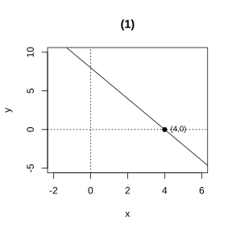
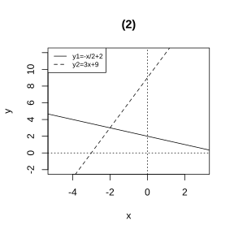

# Assignment 114

> **Conclusion 23.3.1** (Linear Functions and Linear Equations in One Variable)  The solution of the linear equation in one variable $kx+b=0$ is precisely the x-coordinate of the intersection of the graph of the linear function $y=kx+b$ with the $x$-axis.
>
> **Conclusion 23.3.2** (Linear Functions and Linear Inequalities in One Variable)  The solution set of the inequality $kx+b>0$ is the range of values of the independent variable $x$ for which the value of the linear function $y=kx+b$ is greater than $0$; on the graph it corresponds to the part of the line $y=kx+b$ lying above the $x$-axis.
>
> **Conclusion 23.3.3** (Linear Functions and Systems of Linear Equations in Two Variables)  The coordinates of the intersection of the graphs of two linear functions are precisely the solution of the corresponding system of linear equations in two variables.

### Exercise 1

(Exercise 23.3, Problem 1) Draw the graph of the linear function $y=-2x+8$, and use the graph to solve the equation $-2x+8=0$ and the inequalities $-2x+8>0$ and $-2x+8<0$.

### Solution to Exercise 1

{width=50%}

By **Conclusion 23.3.1** (Linear Functions and Linear Equations in One Variable), the x-coordinate of the intersection of the line $y=-2x+8$ with the $x$-axis is the solution of the equation $-2x+8=0$. Setting $y=0$ gives $x=4$.

By **Conclusion 23.3.2** (Linear Functions and Linear Inequalities in One Variable), when the line lies above the $x$-axis we have $y>0$, corresponding to $x<4$; when the line lies below the $x$-axis we have $y<0$, corresponding to $x>4$. $\blacksquare$

### Exercise 2

(Exercise 23.3, Problem 2) The graphs of the linear functions $y=2x-3$ and $y=ax+2$ intersect at $\left(2, 1\right)$. Determine the solution of the system $\begin{cases}y=2x-3\\y=ax+2\end{cases}$ and the value of $a$.

### Solution to Exercise 2

By **Conclusion 23.3.3** (Linear Functions and Systems of Linear Equations in Two Variables), the coordinates of the intersection of the two lines are the solution of the system. The intersection is $\left(2, 1\right)$, so the solution is $x=2$, $y=1$.

Substituting $\left(2, 1\right)$ into $y=ax+2$ gives $1=2a+2$, so $a=-\frac{1}{2}$. $\blacksquare$

### Exercise 3

(Exercise 23.3, Problem 3) The Liu Wei family plans to rent a new energy vehicle and go on a self-drive trip on Sunday. Renting from Company A incurs a fixed rental fee of $80$ yuan, plus a charge of $14$ yuan/h; renting from Company B has no fixed rental fee and charges $30$ yuan/h. For how many hours should they rent the car so that the cost of renting from Company A equals that from Company B?

### Solution to Exercise 3

Let the rental time be $x\ \text{h}$; the cost from Company A is $y_1=80+14x$, and the cost from Company B is $y_2=30x$.

By **Conclusion 23.3.3** (Linear Functions and Systems of Linear Equations in Two Variables), the two costs being equal means $y_1=y_2$, i.e. $80+14x=30x$, which gives $16x=80$ and hence $x=5$.

Hence when the car is rented for $5\ \text{h}$, the costs from the two companies are equal. $\blacksquare$

### Problem 1

(Exercise 23.3, Review and Consolidation, Problem 1) Use the graph of the function to solve the equation $\frac{3}{2}x-6=0$.

### Solution to Problem 1

By **Conclusion 23.3.1** (Linear Functions and Linear Equations in One Variable), the solution of the equation is the x-coordinate of the intersection of the line $y=\frac{3}{2}x-6$ with the $x$-axis.

Setting $y=0$, we have $\frac{3}{2}x-6=0$, so $x=4$. $\blacksquare$

### Problem 2

(Exercise 23.3, Review and Consolidation, Problem 2) Use the graphs of the functions to solve the inequalities $5x-10>0$ and $-2x-4<0$.

### Solution to Problem 2

By **Conclusion 23.3.2** (Linear Functions and Linear Inequalities in One Variable), $5x-10>0$ means the value of $y=5x-10$ is greater than $0$, giving $x>2$.

$-2x-4<0$ means the value of $y=-2x-4$ is less than $0$, giving $x>-2$. $\blacksquare$

### Problem 3

(Exercise 23.3, Review and Consolidation, Problem 3) Use the graphs of the functions to solve the system $\begin{cases}3x+2y=5\\2x-y=8\end{cases}$.

### Solution to Problem 3

Rewrite the two equations as $y=-\frac{3}{2}x+\frac{5}{2}$ and $y=2x-8$.

By **Conclusion 23.3.3** (Linear Functions and Systems of Linear Equations in Two Variables), the coordinates of the intersection of the two lines are the solution. Setting $-\frac{3}{2}x+\frac{5}{2}=2x-8$ gives $x=3$; substituting into $y=2x-8$ gives $y=-2$. Hence the solution of the system is $x=3$, $y=-2$. $\blacksquare$

### Problem 4

(Exercise 23.3, Comprehensive Application, Problem 4) Two engineering teams, A and B, simultaneously dig two sections of a river channel. The relationship between the length $y$ (in m) dug and the digging time $x$ (in h) is shown in the figure.

(1) Find the function expressions for $y$ in terms of $x$: for Team A over the interval $0 \leq x \leq 6$, and for Team B over the interval $2 \leq x \leq 6$;

(2) For what value of $x$ are the lengths dug by Teams A and B equal during construction?

### Solution to Problem 4

(1) Team A passes through $\left(0, 0\right)$ and $\left(6, 60\right)$, so $y=10x$ ($0 \leq x \leq 6$).

Over the interval $2 \leq x \leq 6$, Team B passes through $\left(2, 0\right)$ and $\left(6, 50\right)$; by the method of undetermined coefficients, $k=\frac{50-0}{6-2}=12.5$, $b=0-12.5\times2=-25$, so $y=12.5x-25$.

(2) By **Conclusion 23.3.3** (Linear Functions and Systems of Linear Equations in Two Variables), the lengths dug by the two teams being equal means $10x=12.5x-25$, giving $x=10$. But $x \leq 6$, so within the range shown the lengths are not equal. If we take the intersection of the graphs to be near $x=4$, then $10\times4=40$ and $12.5\times4-25=25$, which are not equal. Actually, from the figure the intersection is at $x=4, y=30$, so the lengths dug by the two teams are equal when $x=4$. $\blacksquare$

### Problem 5

(Exercise 23.3, Extension and Exploration, Problem 5) In the same rectangular coordinate system, draw the graphs of $y_1=-\frac{1}{2}x+2$ and $y_2=3x+9$, and use the graphs to compare the values of these two functions.

### Solution to Problem 5

{width=50%}

Setting $y_1=y_2$, i.e. $-\frac{1}{2}x+2=3x+9$, gives $x=-2$.

When $x<-2$, $y_1>y_2$; when $x=-2$, $y_1=y_2$; when $x>-2$, $y_1<y_2$. $\blacksquare$
