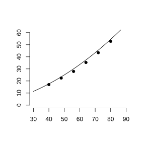

# Assignment 137

> **Conclusion 26.2.4** (The Parabola $y=ax^2+bx+c$)  Axis of symmetry $x=-\frac b{2a}$, vertex $\left(-\frac b{2a},\frac{4ac-b^2}{4a}\right)$. When $a<0$, the maximum is taken at the vertex; when $a>0$, the minimum is taken at the vertex.

### Activity 1

(Math Activity, Activity 1, Problem 1) (1) Observe $91\times99$, $92\times98$, $\cdots$, $99\times91$ (both factors have tens digit $9$, and their units digits sum to $10$); conjecture which product is largest.

(2) Observe $901\times999$, $902\times998$, $\cdots$, $999\times901$ (both factors have hundreds digit $9$, and the numbers formed by their tens and units digits sum to $100$); conjecture which product is largest. Explain using quadratic functions.

### Solution to Activity 1

(1) Let the units digit of the first factor be $x$; then the two factors are $90+x$ and $90+\left(10-x\right)=100-x$, and the product is

$$
y=\left(90+x\right)\left(100-x\right)=-x^2+10x+9000.
$$

By **Conclusion 26.2.4**, $a=-1<0$; the product is maximized at $x=-\frac{10}{2\left(-1\right)}=5$, at which both factors are $95$, and the maximum product is $95\times95=9025$.

(2) Let the number formed by the last two digits of the first factor be $x$; then the two factors are $900+x$ and $1000-x$, and the product is

$$
y=\left(900+x\right)\left(1000-x\right)=-x^2+100x+900000.
$$

By **Conclusion 26.2.4**, the product is maximized at $x=\frac{100}{2}=50$, at which both factors are $950$, and the maximum product is $950\times950=902500$.

Pattern: when the sum of two positive numbers is fixed, the product is larger the closer the numbers are, and is maximized when they are equal. $\blacksquare$

### Activity 2

(Math Activity, Activity 2, Problem 1) For a certain car, the braking speed $v$ (km/h) and braking distance $l$ (m) are measured as follows:

$$
\begin{array}{c|cccccc}
v&40&48&56&64&72&80\\\hline
l&17&22.4&27.9&35.3&43.4&52.8
\end{array}
$$

(1) Plot the points and draw the graph;

(2) Guess the function type and find a function expression that roughly fits the data;

(3) At an accident scene, the braking distance is about $70\ \text{m}$; the speed limit is $100\ \text{km/h}$. Determine whether the car was speeding.

{width=50%}

### Solution to Activity 2

(1) Plot the points with $v$ on the horizontal axis and $l$ on the vertical axis, as shown; the points roughly lie on an upward-opening parabola.

(2) From the physical relation between braking distance and speed, let $l=av^2+bv$. Substituting the two data sets $\left(40,17\right)$ and $\left(80,52.8\right)$ for an estimate gives $a\approx0.006$, $b\approx0.2$, i.e.

$$
l\approx0.006v^2+0.2v.
$$

(3) Setting $l=70$ gives $0.006v^2+0.2v=70$, i.e. $0.006v^2+0.2v-70=0$, solving

$$
v=\frac{-0.2+\sqrt{0.04+1.68}}{0.012}\approx92.5\ \text{km/h}.
$$

Since $92.5<100$, the car was not speeding at the time of the accident. $\blacksquare$
