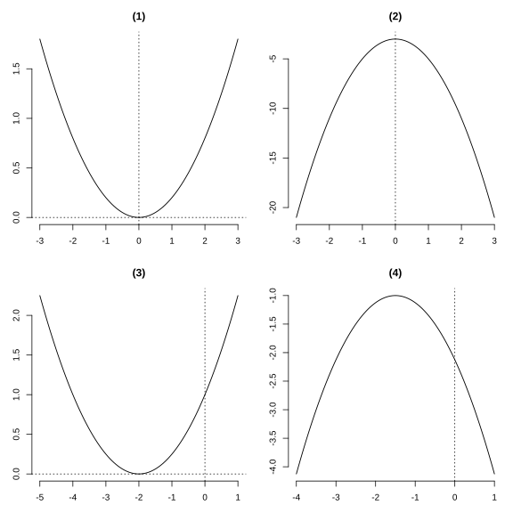
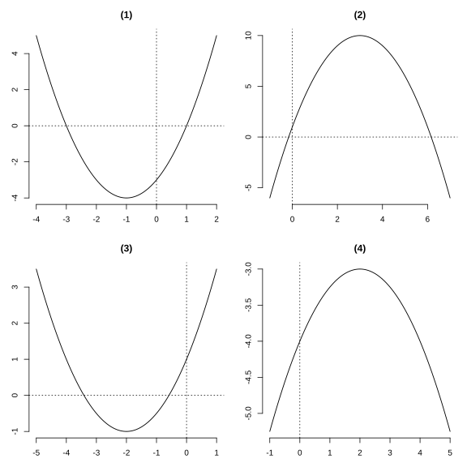
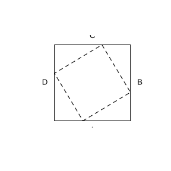

# Assignment 138

> **Definition 26.1.1** (Quadratic Function)  A function of the form $y=ax^2+bx+c$ ($a,b,c$ are constants, $a\ne0$) is called a quadratic function.
>
> **Conclusion 26.2.4** (The Parabola $y=ax^2+bx+c$)  Axis of symmetry $x=-\frac b{2a}$, vertex $\left(-\frac b{2a},\frac{4ac-b^2}{4a}\right)$. When $a>0$, the minimum is taken at the vertex; when $a<0$, the maximum is taken at the vertex.
>
> **Conclusion 26.3.1** (Quadratic Function and Quadratic Equation)  The horizontal coordinate of a common point between the parabola $y=ax^2+bx+c$ and the $x$-axis is a real root of the equation $ax^2+bx+c=0$.

### Review Problem 1

(Review, Review and Consolidation, Problem 1) A city spent $1500$ ten-thousand yuan on landscaping last year; starting this year, it plans to increase annual spending by the same percentage $x$ each year for three consecutive years. Write the function expression for next year's spending in terms of $x$.

### Solution to Review Problem 1

Last year's spending was $1500$ ten-thousand yuan; this year it is $1500(1+x)$; next year it grows again on this year's basis, hence

$$
y=1500(1+x)^2.
$$

Expanding gives $y=1500x^2+3000x+1500$. $\blacksquare$

### Review Problem 2

(Review, Review and Consolidation, Problem 2) Multiple choice.

(1) Which of the following points lies on the parabola $y=x^2-4x-4$? ( )

(A) $(4,4)$　(B) $(3,-1)$　(C) $(-2,-8)$　(D) $\left(-\frac12,-\frac74\right)$

(2) Which of the following parabolas has axis of symmetry $x=-2$? ( )

(A) $y=-2x^2-2$　(B) $y=2x^2-2$　(C) $y=-\frac12(x+2)^2$　(D) $y=2(x-2)^2$

### Solution to Review Problem 2

(1) Substitute each point's horizontal coordinate. For (D), at $x=-\frac12$, $y=\frac14-4\left(-\frac12\right)-4=\frac14+2-4=-\frac74$, matching the vertical coordinate. Hence choose (D).

(2) By **Conclusion 26.2.3**, $y=a(x-h)^2$ has axis of symmetry $x=h$. Among the options, only (C) $y=-\frac12(x+2)^2=-\frac12(x-(-2))^2$ has axis of symmetry $x=-2$. Hence choose (C). $\blacksquare$

### Review Problem 3

(Review, Review and Consolidation, Problem 3) First determine the opening direction, axis of symmetry, and vertex of the following parabolas, then plot points and draw the graphs:

(1) $y=\frac15x^2$;

(2) $y=-2x^2-3$;

(3) $y=\frac14(x+2)^2$;

(4) $y=-\frac12\left(x+\frac32\right)^2-1$.

{width=100%}

### Solution to Review Problem 3

By **Conclusion 26.2.1** and **Conclusion 26.2.3**.

(1) $a=\frac15>0$, opens upward; axis of symmetry $x=0$; vertex $(0,0)$.

(2) $a=-2<0$, opens downward; axis of symmetry $x=0$; vertex $(0,-3)$.

(3) $a=\frac14>0$, opens upward; axis of symmetry $x=-2$; vertex $(-2,0)$.

(4) $a=-\frac12<0$, opens downward; axis of symmetry $x=-\frac32$; vertex $\left(-\frac32,-1\right)$.

The graphs are as shown. $\blacksquare$

### Review Problem 4

(Review, Review and Consolidation, Problem 4) First determine the opening direction, axis of symmetry, and vertex of the following parabolas, then plot points and draw the graphs:

(1) $y=x^2+2x-3$;

(2) $y=1+6x-x^2$;

(3) $y=\frac12x^2+2x+1$;

(4) $y=-\frac14x^2+x-4$.

{width=100%}

### Solution to Review Problem 4

By **Conclusion 26.2.4**, find the axis of symmetry and vertex.

(1) $a=1$, $b=2$; axis of symmetry $x=-1$; vertex $(-1,-4)$; opens upward.

(2) $a=-1$, $b=6$; axis of symmetry $x=3$; vertex $(3,10)$; opens downward.

(3) $a=\frac12$, $b=2$; axis of symmetry $x=-2$; vertex $(-2,-1)$; opens upward.

(4) $a=-\frac14$, $b=1$; axis of symmetry $x=2$; vertex $(2,-3)$; opens downward.

The graphs are as shown. $\blacksquare$

### Review Problem 5

(Review, Review and Consolidation, Problem 5) Find the maximum or minimum value of the following quadratic functions:

(1) $y=x^2+3x-1$;

(2) $y=-2x^2-6x+5$.

### Solution to Review Problem 5

By **Conclusion 26.2.4**, the extremum is taken at the vertex.

(1) $a=1>0$; when $x=-\frac32$, the minimum $\frac{4\cdot1\cdot(-1)-9}{4}=-\frac{13}{4}$ is taken.

(2) $a=-2<0$; when $x=-\frac{-6}{2(-2)}=-\frac32$, the maximum $\frac{4(-2)\cdot5-36}{4(-2)}=\frac{-40-36}{-8}=\frac{19}2$ is taken. $\blacksquare$

### Review Problem 6

(Review, Review and Consolidation, Problem 6) Using the function graphs, find approximate values of the roots of the following equations (rounded to one decimal place):

(1) $2x^2-3x-1=0$;

(2) $x^2+5x-4=0$.

### Solution to Review Problem 6

By **Conclusion 26.3.1**, use the quadratic formula to find the roots.

(1) $x=\frac{3\pm\sqrt{9+8}}4=\frac{3\pm\sqrt{17}}4$, i.e. $x\approx1.8$ or $x\approx-0.3$.

(2) $x=\frac{-5\pm\sqrt{25+16}}2=\frac{-5\pm\sqrt{41}}2$, i.e. $x\approx0.7$ or $x\approx-5.7$. $\blacksquare$

### Review Problem 7

(Review, Comprehensive Application, Problem 7) A water jet from a pipe of height $1\ \text{m}$ reaches height $h=-5t^2+12t+1$ in the air.

(1) After leaving the pipe, how long until the water falls back to its starting height?

(2) What is the maximum height reached by the water in the air?

### Solution to Review Problem 7

(1) The starting height is $h=1$; setting $h=1$ gives $-5t^2+12t+1=1$, i.e. $t(-5t+12)=0$, solving $t=0$ (at ejection) or $t=\frac{12}5=2.4\ \text{s}$. Hence it takes $2.4\ \text{s}$ to fall back to the starting height.

(2) By **Conclusion 26.2.4**, $a=-5<0$; the maximum is taken at $t=\frac{12}{10}=1.2$, with $h_{\max}=-5\times1.2^2+12\times1.2+1=8.2\ \text{m}$. $\blacksquare$

### Review Problem 8

(Review, Comprehensive Application, Problem 8) After landing, an aircraft's taxiing distance is $y=60t-1.5t^2$. How far does it taxi to stop? How far does it taxi in the last $4\ \text{s}$?

### Solution to Review Problem 8

The aircraft stops when the taxiing distance reaches its maximum, corresponding to the vertex. By **Conclusion 26.2.4**, $a=-1.5<0$; it stops at $t=\frac{60}{3}=20\ \text{s}$, at which

$$
y_{\max}=60\times20-1.5\times400=600\ \text{m}.
$$

The last $4\ \text{s}$ is from $t=16$ to $t=20$, and the distance taxied is

$$
y(20)-y(16)=600-(60\times16-1.5\times256)=600-576=24\ \text{m}.
$$

Hence after landing it taxis $600\ \text{m}$ to a stop, and taxis $24\ \text{m}$ in the last $4\ \text{s}$. $\blacksquare$

### Review Problem 9

(Review, Comprehensive Application, Problem 9) As shown, points $E,F,G,H$ lie on the four sides of square $ABCD$ respectively, and quadrilateral $EFGH$ is also a square. The large square has side $12\ \text{m}$. Where should $E$ be placed to minimize the area of square $EFGH$?

{width=50%}

### Solution to Review Problem 9

Let $AE=x$; by symmetry, the four corner right triangles are congruent, with legs $x$ and $12-x$. The square of the side of small square $EFGH$ is $x^2+(12-x)^2$, and its area is

$$
S=x^2+(12-x)^2=2x^2-24x+144.
$$

By **Conclusion 26.2.4**, $a=2>0$; the minimum is taken at $x=\frac{24}{4}=6$, with $S_{\min}=36$. Hence when $E$ is the midpoint of side $AB$, the area of square $EFGH$ is minimized. $\blacksquare$

### Review Problem 10

(Review, Comprehensive Application, Problem 10) As shown, alongside a wall $12\ \text{m}$ long, a fence of length $33\ \text{m}$ encloses a rectangular flower bed with one side against the wall and a divider fence in the middle. What should $AB,BC$ be to maximize the flower bed's area? What is the maximum area?

### Solution to Review Problem 10

Let $AB$ be perpendicular to the wall, with length $x$; the fence consists of three sides in the $AB$ direction and one side in the $BC$ direction, hence $3x+BC=33$, i.e. $BC=33-3x$. The wall is $12\ \text{m}$ long, so $BC\le12$, i.e. $x\ge7$.

The area is $S=x(33-3x)=-3x^2+33x$. By **Conclusion 26.2.4**, the vertex is at $x=\frac{33}{6}=5.5$; since $x\ge7$ lies to the right of the vertex, $S$ decreases as $x$ increases. Hence the maximum is at $x=7$, with $BC=33-21=12$ and maximum area $S=7\times12=84\ \text{m}^2$. That is, $AB=7\ \text{m}$, $BC=12\ \text{m}$. $\blacksquare$

### Review Problem 11

(Review, Comprehensive Application, Problem 11) A commodity costs $35$ yuan per unit; at $50$ yuan per unit, $210$ units are sold per month. Each $1$ yuan increase in price reduces monthly sales by $7$ units (price not above $70$ yuan). Let the price increase per unit be $x$ yuan, and monthly profit be $y$ yuan.

(1) Find the function expression for $y$ in terms of $x$ and the range of the independent variable;

(2) At what price is monthly profit maximized? What is the maximum monthly profit?

(3) When monthly profit is $3500$ yuan, what should the price be? In what price range is monthly profit at least $3500$ yuan?

### Solution to Review Problem 11

(1) After increasing price by $x$ yuan, profit per unit is $(50+x-35)=(15+x)$ yuan, and monthly sales volume is $(210-7x)$ units, hence

$$
y=(15+x)(210-7x)=-7x^2+105x+3150,
$$

where $0\le x\le20$ (price not above $70$ yuan, i.e. $x\le20$).

(2) By **Conclusion 26.2.4**, the vertex is at $x=\frac{105}{14}=7.5$; since $x$ is a positive integer, take $x=7$ or $x=8$. Then $y=22\times161=3542$ or $23\times154=3542$. Hence monthly profit is maximized at price $57$ yuan or $58$ yuan, with maximum $3542$ yuan.

(3) Setting $y=3500$ gives $-7x^2+105x+3150=3500$, i.e. $x^2-15x+50=0$, i.e. $(x-5)(x-10)=0$, solving $x=5$ or $x=10$, corresponding to prices $55$ yuan or $60$ yuan. Since the parabola opens downward, monthly profit is at least $3500$ yuan when $55\le$ price $\le60$. $\blacksquare$

### Review Problem 12

(Review, Comprehensive Application, Problem 12) A rectangle has perimeter $36\ \text{cm}$; rotating it about one side forms a cylinder. What should the two adjacent sides be to maximize the cylinder's lateral surface area?

### Solution to Review Problem 12

Let the adjacent sides be $a,b$; then $a+b=18$. Rotating about side $a$, the cylinder's base radius is $b$ and its height is $a$, and the lateral surface area is

$$
S=2\pi b\cdot a=2\pi ab.
$$

By **Conclusion 26.2.4**, $ab$ is maximized when $a=b$ (for fixed sum, product is maximized when equal), hence $a=b=9$. That is, when both adjacent sides are $9\ \text{cm}$, the cylinder's lateral surface area is maximized. $\blacksquare$

### Review Problem 13

(Review, Extension and Exploration, Problem 13) A route's length is measured $n$ times, giving $x_1,x_2,\cdots,x_n$. Using $x$ as an approximation, for what value of $x$ is $(x-x_1)^2+(x-x_2)^2+\cdots+(x-x_n)^2$ minimized? Which common statistic is this value?

### Solution to Review Problem 13

Expanding,

$$
S=\sum_{i=1}^n(x-x_i)^2=nx^2-2x\sum_{i=1}^n x_i+\sum_{i=1}^n x_i^2.
$$

This is a quadratic function in $x$, with $n>0$ opening upward. By **Conclusion 26.2.4**, when

$$
x=\frac{2\sum x_i}{2n}=\frac{x_1+x_2+\cdots+x_n}{n}
$$

$S$ is minimized. This value is precisely the arithmetic mean of the $n$ measurements. $\blacksquare$
