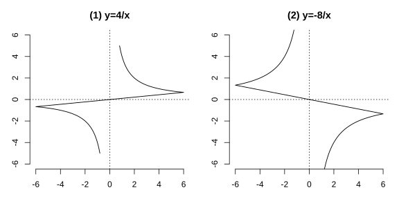

# Assignment 140

> **Definition 27.1.1** (Inverse Proportional Function)  A function of the form $y=\frac kx$ ($k$ is a constant, $k\ne0$) is called an inverse proportional function, with independent variable $x\ne0$.
>
> **Conclusion 27.2.1** (Graph and Properties of Inverse Proportional Function)  The graph of $y=\frac kx$ is a hyperbola consisting of two branches. When $k>0$, the two branches lie in the first and third quadrants respectively, and within each quadrant $y$ decreases as $x$ increases; when $k<0$, the two branches lie in the second and fourth quadrants respectively, and within each quadrant $y$ increases as $x$ increases.

### Exercise 1

(Exercise 27.2, Problem 1) The graph shown in the figure corresponds to which function expression? ( )

(A) $y=5x$　(B) $y=2x+3$　(C) $y=\frac4x$　(D) $y=-\frac2x$

{width=100%}

### Solution to Exercise 1

The curve in the figure is a hyperbola lying in the first and third quadrants, so $k>0$, eliminating (A)(B) (which are lines) and (D) ($k<0$). The curve passes through $\left(1,4\right)$, which satisfies $y=\frac4x$. Hence choose (C). $\blacksquare$

### Exercise 2

(Exercise 27.2, Problem 2) The graph of $y=\frac kx$ lies in the second and fourth quadrants; then $k$ $\_\_\_\_0$; within each quadrant, as $x$ increases, $y$ $\_\_\_\_$.

### Solution to Exercise 2

By **Conclusion 27.2.1**, when the graph lies in the second and fourth quadrants, $k<0$, and within each quadrant $y$ increases as $x$ increases. Hence fill in $<$ and increasing respectively. $\blacksquare$

### Exercise 3

(Exercise 27.2, Problem 3) The graph of an inverse proportional function passes through $A\left(2,6\right)$.

(1) In which quadrants does the graph lie? Within each quadrant, how does $y$ change as $x$ increases?

(2) Are points $B\left(3,4\right)$, $C\left(2\frac12,-3\frac15\right)$, $D\left(2,-6\right)$ on this function's graph?

### Solution to Exercise 3

Let $y=\frac kx$; substituting $A\left(2,6\right)$ gives $k=2\times6=12$.

(1) $k=12>0$; by **Conclusion 27.2.1**, the graph lies in the first and third quadrants, and within each quadrant $y$ decreases as $x$ increases.

(2) Check whether the product of each point's coordinates equals $k=12$. $B\left(3,4\right)$: $3\times4=12$, on the graph; $C\left(\frac52,-\frac{16}5\right)$: $\frac52\times\left(-\frac{16}5\right)=-8\ne12$, not on the graph; $D\left(2,-6\right)$: $2\times\left(-6\right)=-12\ne12$, not on the graph. $\blacksquare$

### Exercise 4

(Exercise 27.2, Problem 4) One branch of the graph of $y=\frac{m+2}{x}$ lies in the second quadrant. In which quadrant does the other branch lie? What is the range of the constant $m$?

### Solution to Exercise 4

By **Conclusion 27.2.1**, one branch in the second quadrant means $k=m+2<0$, so the other branch must lie in the fourth quadrant, and $m+2<0$, i.e. $m<-2$. $\blacksquare$

### Exercise 5

(Exercise 27.2, Problem 5) Points $A\left(1,y_1\right)$ and $B\left(2,y_2\right)$ lie on the graph of $y=-\frac2x$; compare $y_1,y_2$.

### Solution to Exercise 5

$k=-2<0$; by **Conclusion 27.2.1**, within each quadrant $y$ increases as $x$ increases. Here $x_1=1<x_2=2$, and both points lie in the fourth quadrant, hence $y_1<y_2$. Direct computation: $y_1=-2$, $y_2=-1$, also giving $y_1<y_2$. $\blacksquare$

### Problem 1

(Exercise 27.2, Review and Consolidation, Problem 1) In which quadrants does the graph of $y=-\frac2x$ lie?

### Solution to Problem 1

$k=-2<0$; by **Conclusion 27.2.1**, the graph is a hyperbola lying in the second and fourth quadrants. $\blacksquare$

### Problem 2

(Exercise 27.2, Review and Consolidation, Problem 2) Fill in the blanks:

(1) If the graph of an inverse proportional function lies in the first and third quadrants, then $k$ $\_\_\_\_0$, and within each quadrant $y$ $\_\_\_\_$ as $x$ increases;

(2) If the graph lies in the second and fourth quadrants, then $k$ $\_\_\_\_0$, and within each quadrant $y$ $\_\_\_\_$ as $x$ increases;

(3) If point $\left(1,3\right)$ lies on the graph of $y=\frac kx$, then $k=\_\_\_\_$, and within each quadrant $y$ $\_\_\_\_$ as $x$ increases.

### Solution to Problem 2

By **Conclusion 27.2.1**.

(1) First and third quadrants correspond to $k>0$, with $y$ decreasing as $x$ increases.

(2) Second and fourth quadrants correspond to $k<0$, with $y$ increasing as $x$ increases.

(3) $k=1\times3=3>0$, with $y$ decreasing as $x$ increases. $\blacksquare$

### Problem 3

(Exercise 27.2, Review and Consolidation, Problem 3) Making an open rectangular box with base area $20\ \text{cm}^2$, what function describes the relation between one side $y$ of the base rectangle and its adjacent side $x$? In which quadrant does the graph roughly lie?

### Solution to Problem 3

From base area $xy=20$, $y=\frac{20}{x}$. Since side length $x>0$, the graph is only the first-quadrant branch of the hyperbola $y=\frac{20}{x}$. $\blacksquare$

### Problem 4

(Exercise 27.2, Comprehensive Application, Problem 4) Point $\left(-2,-4\right)$ lies on the graph of $y=\frac kx$.

(1) When $y<4$, find the range of $x$;

(2) Points $A\left(-3,y_1\right)$, $B\left(-5,y_2\right)$, $C\left(4,y_3\right)$ lie on this graph; compare $y_1,y_2,y_3$.

### Solution to Problem 4

Substituting $\left(-2,-4\right)$ gives $k=\left(-2\right)\times\left(-4\right)=8$, i.e. $y=\frac8x$.

(1) When $x>0$, $y>0$; setting $\frac8x<4$ gives $x>2$. When $x<0$, $y<0<4$, which always holds. Hence $x<0$ or $x>2$.

(2) By **Conclusion 27.2.1**, $k=8>0$, and within each quadrant $y$ decreases as $x$ increases. $A,B$ both lie in the third quadrant, with $-3>-5$, hence $y_1<y_2<0$. $C$ lies in the first quadrant, with $y_3>0$. Altogether, $y_1<y_2<y_3$. $\blacksquare$

### Problem 5

(Exercise 27.2, Comprehensive Application, Problem 5) The graphs of the direct proportional function $y=-x$ and the inverse proportional function $y=\frac kx$ intersect at a point whose vertical coordinate is $2$.

(1) When $x=3$, find the value of $y=\frac kx$;

(2) When $-3<x<-1$, find the range of $y=\frac kx$.

### Solution to Problem 5

The intersection's vertical coordinate is $2$; substituting into $y=-x$ gives $x=-2$, i.e. the intersection is $\left(-2,2\right)$. Substituting into $y=\frac kx$ gives $k=\left(-2\right)\times2=-4$, i.e. $y=-\frac4x$.

(1) When $x=3$, $y=-\frac43$.

(2) $k=-4<0$; in the second quadrant $y$ increases as $x$ increases. When $x=-3$, $y=\frac43$; when $x=-1$, $y=4$. Hence $\frac43<y<4$. $\blacksquare$

### Problem 6

(Exercise 27.2, Extension and Exploration, Problem 6) In the same rectangular coordinate system, what relation holds between the quadrants of the graphs of $y=kx$ and $y=\frac kx$ ($k\ne0$)?

### Solution to Problem 6

When $k>0$, the graph of $y=kx$ is a line through the origin in the first and third quadrants, and the two branches of $y=\frac kx$ also lie in the first and third quadrants. When $k<0$, both graphs lie in the second and fourth quadrants. Hence the two graphs lie in the same quadrants. $\blacksquare$

### Problem 7

(Exercise 27.2, Extension and Exploration, Problem 7) One branch of the graph of $y=\frac{a-1}{x}$ lies in the first quadrant.

(1) In which quadrant does the other branch lie? What is the range of the constant $a$?

(2) Take arbitrary points $A\left(x_1,y_1\right)$ and $B\left(x_2,y_2\right)$ on the graph; if $y_1>y_2$, what is the relation between $x_1$ and $x_2$?

### Solution to Problem 7

(1) One branch in the first quadrant; by **Conclusion 27.2.1**, $k=a-1>0$, so the other branch lies in the third quadrant, and $a>1$.

(2) $k>0$; within each quadrant $y$ decreases as $x$ increases. If $A,B$ lie on the same branch and $y_1>y_2$, then $x_1<x_2$. $\blacksquare$
