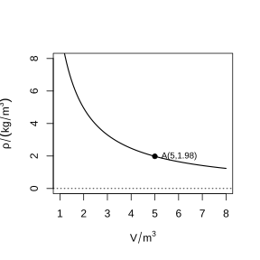
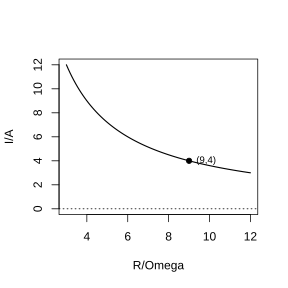

# Assignment 159

> **Definition 26.2.1** (Modeling with Inverse Proportional Functions in Real-World Problems)  When the product of two variables is a nonzero constant, i.e. $xy=k$ ($k\ne0$), the two variables are in an inverse proportional function relationship.

> **Definition 26.2.2** (Principle of the Lever)  the resistance $\times$ the resistance arm $=$ the effort $\times$ the effort arm, i.e. $F_1l_1=F_2l_2$.

> **Definition 26.2.3** (Electrical Relations)  The power $P$, voltage $U$, and resistance $R$ of an electrical appliance satisfy $PR=U^2$, i.e. $P=\frac{U^2}{R}$.

### Exercise 1

(Exercise 26.2, Problem 1) A glassware manufacturing company wants to make a conical funnel with a volume of $1\ \text{L}$ ($1\ \text{L}=1\ \text{dm}^3$).

(1) What is the functional relationship between the area $S$ (unit: $\text{dm}^2$) of the funnel opening and the depth $d$ (unit: $\text{dm}$) of the funnel?

(2) If the area of the funnel opening is $100\ \text{cm}^2$, what is the depth of the funnel?

### Solution to Exercise 1

The volume of a cone is $V=\frac{1}{3}Sd$.

(1) From $V=1\ \text{dm}^3$, we get $\frac{1}{3}Sd=1$, i.e. $Sd=3$, so

$$
S=\frac{3}{d}.
$$

(2) $100\ \text{cm}^2=1\ \text{dm}^2$; substituting into $S=\frac{3}{d}$ gives $1=\frac{3}{d}$, so $d=3\ \text{dm}$. $\blacksquare$

### Exercise 2

(Exercise 26.2, Problem 2) A driver drives from Place A to Place B and arrives at the destination in $6\ \text{h}$ at an average speed of $80\ \text{km/h}$.

(1) When he returns along the same road at a constant speed, what is the functional relationship between the speed $v$ and the time $t$ of the car?

(2) If the driver must return to Place A within $4\ \text{h}$, what is the minimum average speed on the return trip?

### Solution to Exercise 2

(1) The distance between Place A and Place B is $80\times6=480\ \text{km}$. From $vt=480$, we get

$$
v=\frac{480}{t}.
$$

(2) When $t=4$, $v=\frac{480}{4}=120\ \text{km/h}$. By **Definition 26.2.1**, $v$ increases as $t$ decreases, so to return within $4\ \text{h}$, the average speed must be at least $120\ \text{km/h}$. $\blacksquare$

### Exercise 3

(Exercise 26.2, Problem 3) The main structure of a newly built residential building has been completed, and only the exterior surface of the building needs to be tiled. The area of the building's exterior surface is $5\times10^3\ \text{m}^2$.

(1) What is the functional relationship between the number of tiles $n$ needed and the area $S$ (unit: $\text{m}^2$) of each tile?

(2) To make the residential building look more attractive, the architect decides to use gray, white, and blue tiles. Each tile has an area of $80\ \text{cm}^2$, and the ratio of the numbers of gray, white, and blue tiles used is $2:2:1$. How many tiles of each color are needed?

### Solution to Exercise 3

(1) The total area equals the number of tiles times the area of each tile, i.e. $nS=5\times10^3$, so

$$
n=\frac{5000}{S}.
$$

(2) Each tile has area $80\ \text{cm}^2=0.008\ \text{m}^2$; substituting gives $n=\frac{5000}{0.008}=625000$ tiles. The ratio of gray : white : blue is $2:2:1$, totaling $5$ parts, each part being $625000\div5=125000$ tiles. Thus $250000$ gray tiles, $250000$ white tiles, and $125000$ blue tiles are needed. $\blacksquare$

### Problem 1

(Problem 26.2, Review and Consolidation, Problem 1) Give an example of an inverse proportional function used in everyday life.

### Solution to Problem 1

By **Definition 26.2.1** (Modeling with Inverse Proportional Functions in Real-World Problems), when the distance is fixed, the average speed is inversely proportional to the travel time, i.e. $v=\frac{s}{t}$, where the distance $s$ is a constant. For example, the Beijing–Shanghai railway has a total length of $1463\ \text{km}$, and the average train speed $v$ is inversely proportional to the total travel time $t$. $\blacksquare$

### Problem 2

(Problem 26.2, Review and Consolidation, Problem 2) An agricultural university plans to build a rectangular experimental field with an area of $2\times10^6\ \text{m}^2$.

(1) What is the function expression for the length $y$ (unit: $\text{m}$) of the experimental field in terms of the width $x$ (unit: $\text{m}$)?

(2) If the ratio of the length to the width of the experimental field is $2:1$, what are the length and width of the field?

### Solution to Problem 2

(1) The area of the rectangle is $xy=2\times10^6$, so

$$
y=\frac{2\times10^6}{x}.
$$

(2) From $y:x=2:1$, we get $y=2x$. Substituting into $xy=2\times10^6$ gives $2x^2=2\times10^6$, $x^2=10^6$, $x=1000\ \text{m}$, $y=2000\ \text{m}$. $\blacksquare$

### Problem 3

(Problem 26.2, Review and Consolidation, Problem 3) Xiao Yan's family used a prepaid electricity card to buy $1000\ \text{kW·h}$ of electricity. What is the functional relationship between the number of days $m$ this electricity will last and the average daily electricity usage $n$ of Xiao Yan's family? If the family uses $4\ \text{kW·h}$ of electricity per day on average, how long will this electricity last?

### Solution to Problem 3

The total electricity equals the number of days times the daily usage, i.e. $mn=1000$, so $m=\frac{1000}{n}$.

When $n=4$, $m=\frac{1000}{4}=250$ days. $\blacksquare$

### Problem 4

(Problem 26.2, Review and Consolidation, Problem 4) It is known that the current $I$ (unit: $\text{A}$) through a closed circuit and the resistance $R$ (unit: $\Omega$) of the circuit are in an inverse proportional function relationship. Fill in the following table (round results to two decimal places):

$$
\begin{array}{c|ccccc}
I/\text{A} & 1 & 2 & 3 & 4 & 5\\ \hline
R/\Omega & & & & &
\end{array}
$$

$$
\begin{array}{c|ccccccc}
R/\Omega & 20 & 25 & 30 & 50 & 65 & 80 & 90\\ \hline
I/\text{A} & & & & & & &
\end{array}
$$

### Solution to Problem 4

By **Definition 26.2.3** (Electrical Relations), $IR=U$, where $U$ is constant. From the table, when $R=20$, $I=5$ (at the intersection of the two tables), we get $U=100\ \text{V}$, so $I=\frac{100}{R}$.

First row: $I=1\Rightarrow R=100$; $I=2\Rightarrow R=50$; $I=3\Rightarrow R\approx33.33$; $I=4\Rightarrow R=25$; $I=5\Rightarrow R=20$.

Second row: $R=20\Rightarrow I=5$; $R=25\Rightarrow I=4$; $R=30\Rightarrow I\approx3.33$; $R=50\Rightarrow I=2$; $R=65\Rightarrow I\approx1.54$; $R=80\Rightarrow I=1.25$; $R=90\Rightarrow I\approx1.11$. $\blacksquare$

### Problem 5

(Problem 26.2, Review and Consolidation, Problem 5) Given that the distance between Place A and Place B is $s$ (unit: $\text{km}$), and a car travels at a constant speed from Place A to Place B, the graph of the travel time $t$ (unit: $\text{h}$) of the car as a function of the speed $v$ (unit: $\text{km/h}$) is ( ).

(A) an increasing curve through the origin; (B) a straight line through the origin; (C) a decreasing hyperbola branch in the first quadrant; (D) two hyperbola branches in the first and third quadrants.

### Solution to Problem 5

From $vt=s$, with $s$ constant, we get $t=\frac{s}{v}$, $v>0$, $t>0$.

By **Definition 26.1.2**, $k=s>0$, so the graph is the branch of the hyperbola in the first quadrant, decreasing as $v$ increases. So choose (C). $\blacksquare$

### Problem 6

(Problem 26.2, Comprehensive Application, Problem 6) A sealed container holds a fixed mass of carbon dioxide. As the volume $V$ (unit: $\text{m}^3$) of the container changes, the density $\rho$ (unit: $\text{kg/m}^3$) of the gas changes accordingly. It is known that the density $\rho$ and the volume $V$ are in an inverse proportional function relationship; its graph is shown in the figure and passes through the point $A(5,1.98)$.

(1) Find the function expression for the density $\rho$ in terms of the volume $V$;

(2) When $V=9\ \text{m}^3$, find the density $\rho$ of the carbon dioxide.

{width=50%}

### Solution to Problem 6

Let $\rho=\frac{k}{V}$. Substituting $A(5,1.98)$ gives $1.98=\frac{k}{5}$, so $k=9.9$.

(1) $\rho=\frac{9.9}{V}$.

(2) When $V=9$, $\rho=\frac{9.9}{9}=1.1\ \text{kg/m}^3$. $\blacksquare$

### Problem 7

(Problem 26.2, Comprehensive Application, Problem 7) The Red Star granary needs to put $1200\ \text{t}$ of corn from the drying yard into storage.

(1) What is the functional relationship between the time $d$ (unit: days) required to put the corn into storage and the average storage rate $v$ (unit: $\text{t}/$day)?

(2) It is known that the granary has $60$ workers, and at most $300\ \text{t}$ of corn can be put into storage per day. Estimate the minimum number of days needed to complete the storage of the corn.

(3) After the granary workers have worked continuously for two days, the weather forecast says it will rain in the next few days. The granary decides to put all the remaining corn into storage the next day. At least how many additional workers are needed?

### Solution to Problem 7

(1) From $dv=1200$, we get $d=\frac{1200}{v}$.

(2) When $v=300$, $d=\frac{1200}{300}=4$ days.

(3) In two days, $2\times300=600\ \text{t}$ has been put into storage, leaving $600\ \text{t}$. Each worker stores $300\div60=5\ \text{t}$ per day. To store $600\ \text{t}$ in one day requires $600\div5=120$ people; there are already $60$ people, so at least $60$ additional workers are needed. $\blacksquare$

### Problem 8

(Problem 26.2, Extension and Exploration, Problem 8) It is known that the voltage of a storage battery is constant. When the battery is in use, the current $I$ (unit: $\text{A}$) and the resistance $R$ (unit: $\Omega$) are in an inverse proportional function relationship; its graph is shown in the figure and passes through the point $(9,4)$.

(1) Write the expression of this inverse proportional function;

(2) What is the voltage of the storage battery?

(3) Complete the following table: the $I$ values corresponding to $R=3,4,5,6,7,8,9,10$;

(4) If the current limit of an appliance powered by this storage battery cannot exceed $10\ \text{A}$, what range should the variable resistance of the appliance be controlled within?

{width=50%}

### Solution to Problem 8

Let $I=\frac{U}{R}$. Substituting $(9,4)$ gives $4=\frac{U}{9}$, so $U=36$.

(1) $I=\frac{36}{R}$.

(2) The battery voltage is $36\ \text{V}$.

(3) $R=3\Rightarrow I=12$; $4\Rightarrow9$; $5\Rightarrow7.2$; $6\Rightarrow6$; $7\Rightarrow\frac{36}{7}\approx5.14$; $8\Rightarrow4.5$; $9\Rightarrow4$; $10\Rightarrow3.6$.

(4) From $I\le10$, i.e. $\frac{36}{R}\le10$, we get $R\ge3.6\ \Omega$. Thus the variable resistance should be controlled at no less than $3.6\ \Omega$. $\blacksquare$

### Problem 9

(Problem 26.2, Extension and Exploration, Problem 9) The fuel tank of a car has a capacity of $70\ \text{L}$. Xiao Wang fills the tank and drives from the county town to the provincial capital $300\ \text{km}$ away to pick up a guest, and immediately returns along the same road after picking up the guest. Please answer the following questions:

(1) After the tank is full, what is the functional relationship between the total distance $s$ (unit: $\text{km}$) the car travels and the average fuel consumption $b$ (unit: $\text{L/km}$)?

(2) Xiao Wang drives to the provincial capital at an average fuel consumption of $0.1\ \text{L}$ per kilometer. On the return trip, because of rain, Xiao Wang slows down, and the average fuel consumption per kilometer doubles. If Xiao Wang continues to drive at this speed, can he return to the county town without refueling? If not, how much more fuel is needed at least?

### Solution to Problem 9

(1) The total distance times the fuel consumption per kilometer equals the total fuel, i.e. $sb=70$, so $s=\frac{70}{b}$.

(2) To the provincial capital is $300\ \text{km}$, consuming $0.1\times300=30\ \text{L}$, leaving $70-30=40\ \text{L}$ in the tank. The return trip doubles the fuel consumption to $0.2\ \text{L/km}$, and the $300\ \text{km}$ return trip requires $0.2\times300=60\ \text{L}$. Since $40<60$, he cannot return to the county town; at least $60-40=20\ \text{L}$ more fuel is needed. $\blacksquare$

### Reading and Reflection 1

(Reading and Reflection: Inverse Proportional Relationships in Life) (1) Use the inverse proportional relationship between pressure and contact area to explain why a knife becomes sharper when its blade is ground thinner, and why heavy tanks and excavators are fitted with wide, long tracks.

(2) Use the inverse proportional relationship between gas pressure and volume to explain why overloaded vehicles are prone to tire blowouts.

### Solution to Reading and Reflection 1

By **Definition 26.2.1**, the pressure is $p=\frac{F}{S}$; when the force $F$ is fixed, $p$ and $S$ are inversely proportional.

(1) When the blade is ground thinner, the contact area $S$ between the blade and the object decreases; from $p=\frac{F}{S}$, at fixed force $F$ the pressure $p$ increases, making the knife sharper. Tank tracks are wide and long, increasing the contact area $S$ and reducing the pressure on the ground, so that the tank does not sink into soft ground.

(2) For a fixed mass of gas at constant temperature, the pressure $p$ and the volume $V$ are inversely proportional, i.e. $pV$ is constant. When a vehicle is overloaded, the tires are compressed and deformed, the volume $V$ of the gas inside the tires decreases, and the pressure $p$ increases; exceeding the tire's load limit causes a blowout. $\blacksquare$
