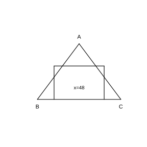

# Assignment 166

> **Definition 27.1.3** (Similar Polygons)  Two polygons with the same number of sides, whose corresponding angles are equal and whose corresponding sides are proportional, are similar; the ratio of corresponding sides is called the similarity ratio.

> **Criterion Theorem 27.2.2** (SSS)  Two triangles whose three sides are proportional are similar.

> **Criterion Theorem 27.2.4** (AA)  Two triangles with two pairs of corresponding angles equal are similar.

> **Property 27.2.2** (Area Ratio)  The ratio of the areas of similar triangles equals the square of the similarity ratio.

> **Definition 27.3.1** (Homothetic Figures)  Two figures whose corresponding vertices' connecting lines meet at the same point $O$ and whose corresponding sides are proportional, have their corresponding sides parallel to each other.

### Review Problem 1

(Review Problem 27, Review and Consolidation, Problem 1) As shown in the figure, quadrilateral $EFGH$ is similar to quadrilateral $KLMN$. Find the angles $\angle E$, $\angle G$, $\angle N$ and the values of $x,y,z$. (In $EFGH$, $\angle E=143^\circ$, $EF=4$, $FG=6$, $GH=10$, $EH=x$; in $KLMN$, $\angle L=67^\circ$, $\angle M=107^\circ$, $KL=10$, $LM=y$, $MN=z$, $KN=35$.)

### Solution to Review Problem 1

By **Definition 27.1.3** (Similar Polygons), $EFGH\backsim KLMN$, the corresponding angles are equal, and the corresponding sides are proportional.

The similarity ratio is $\frac{EF}{KL}=\frac{4}{10}=\frac{2}{5}$.

$\angle E=\angle K=143^\circ$, $\angle G=\angle M=107^\circ$. The sum of interior angles of a quadrilateral is $360^\circ$, so $\angle H=\angle N=360^\circ-143^\circ-67^\circ-107^\circ=43^\circ$.

$$
\frac{FG}{LM}=\frac{2}{5}\Rightarrow\frac{6}{y}=\frac{2}{5}\Rightarrow y=15.
$$

$$
\frac{GH}{MN}=\frac{2}{5}\Rightarrow\frac{10}{z}=\frac{2}{5}\Rightarrow z=25.
$$

$$
\frac{EH}{KN}=\frac{2}{5}\Rightarrow\frac{x}{35}=\frac{2}{5}\Rightarrow x=14.
$$

Thus $\angle E=143^\circ$, $\angle G=107^\circ$, $\angle N=43^\circ$, $x=14$, $y=15$, $z=25$. $\blacksquare$

### Review Problem 2

(Review Problem 27, Review and Consolidation, Problem 2) The side lengths of $\triangle ABC$ are $5$, $12$, and $13$. The shortest side of the similar triangle $\triangle DEF$ is $15$. Find the other two side lengths and the perimeter of $\triangle DEF$.

### Solution to Review Problem 2

The similarity ratio is $\frac{15}{5}=3$.

The other two side lengths are $12\times3=36$ and $13\times3=39$.

The perimeter is $15+36+39=90$. $\blacksquare$

### Review Problem 3

(Review Problem 27, Review and Consolidation, Problem 3) Based on the conditions marked in the figure, determine whether the two triangles in the figure are similar, and find the values of $x$ and $y$. (First group: $\angle 1=\angle 2$, two pairs of corresponding angles equal; second group: two sides proportional and the included angle equal.)

### Solution to Review Problem 3

By **Criterion Theorem 27.2.4** (AA) and **Criterion Theorem 27.2.3** (SAS), the two triangles in each group are similar. The corresponding sides are proportional, from which $x,y$ can be found. $\blacksquare$

### Review Problem 4

(Review Problem 27, Review and Consolidation, Problem 4) Li Hua wants to place an advertisement in a newspaper. A rectangular block of $10\ \text{cm}\times5\ \text{cm}$ costs $180$ yuan in advertising fees. If he enlarges each side of the block to $3$ times the original, how much advertising fee must he pay (assuming the advertising fee per square centimeter is the same)?

### Solution to Review Problem 4

The area of the original block is $10\times5=50\ \text{cm}^2$. Enlarging each side to $3$ times the original enlarges the area to $9$ times the original, i.e. $450\ \text{cm}^2$.

The advertising fee is proportional to the area, so he must pay $180\times9=1620$ yuan. $\blacksquare$

### Review Problem 5

(Review Problem 27, Review and Consolidation, Problem 5) Reduce the figure shown so that the ratio of corresponding segments before and after reduction is $2:1$.

### Solution to Review Problem 5

By **Definition 27.3.1** (Homothetic Figures), take a center of homothety outside or inside the figure, connect the center to each vertex, take on the connecting lines points at half the distance from each vertex to the center as corresponding points, and connect them in order; the resulting figure is the reduced figure, with the ratio of corresponding segments being $2:1$. $\blacksquare$

### Review Problem 6

(Review Problem 27, Comprehensive Application, Problem 6) A student's seat is $6\ \text{m}$ from the blackboard. How large should the teacher write the characters on the blackboard so that when the student looks at the characters on the blackboard, the perception is the same as when looking at the characters in a textbook $30\ \text{cm}$ away (the size of small-size-four characters in the textbook is about $0.42\ \text{cm}\times0.42\ \text{cm}$)?

### Solution to Review Problem 6

The same perception means the same viewing angle, and the character size is proportional to the distance.

The distance ratio is $6\ \text{m}:30\ \text{cm}=600:30=20:1$.

The size of the characters on the blackboard should be $0.42\times20=8.4\ \text{cm}$, i.e. $8.4\ \text{cm}\times8.4\ \text{cm}$. $\blacksquare$

### Review Problem 7

(Review Problem 27, Comprehensive Application, Problem 7) It is known that the outer diameter of a part is $a$. A crossing caliper (with two arms $AC$ and $BD$ of equal length) is used to measure the inner hole diameter $AB$ of the part. If $OA:OC=OB:OD=n$, and $CD=b$ is measured, find $AB$ and the part thickness $x$.

### Solution to Review Problem 7

$\angle AOB=\angle COD$ (vertical angles), and $\frac{OA}{OC}=\frac{OB}{OD}=n$; by **Criterion Theorem 27.2.3** (SAS), $\triangle OAB\backsim\triangle OCD$.

$$
\frac{AB}{CD}=\frac{OA}{OC}=n\Rightarrow AB=nb.
$$

The outer diameter of the part is $a$, and the thickness is $x=\frac{a-AB}{2}=\frac{a-nb}{2}$. $\blacksquare$

### Review Problem 8

(Review Problem 27, Comprehensive Application, Problem 8) As shown in the figure, $CD$ is a chord of $\odot O$, $AB$ is a diameter, and $CD\perp AB$ with foot $P$. Prove that $PC^2=PA\cdot PB$.

### Solution to Review Problem 8

Connect $AC$ and $BC$. Since $AB$ is a diameter, $\angle ACB=90^\circ$. Also $CD\perp AB$, so $\angle APC=\angle CPB=90^\circ$.

In $\triangle ACP$ and $\triangle CBP$, $\angle A+\angle B=90^\circ$, $\angle ACP+\angle A=90^\circ$, so $\angle ACP=\angle B$. By **Criterion Theorem 27.2.4** (AA), $\triangle ACP\backsim\triangle CBP$.

$$
\frac{PC}{PB}=\frac{PA}{PC}\Rightarrow PC^2=PA\cdot PB.\ \blacksquare
$$

### Review Problem 9

(Review Problem 27, Comprehensive Application, Problem 9) As shown in the figure, $AD\perp BC$ with foot $D$, $BE\perp AC$ with foot $E$, $AD$ and $BE$ intersect at point $F$, and $ED$ is connected. Find a pair of similar triangles in the figure and explain the reason for their similarity.

### Solution to Review Problem 9

$\angle AEF=\angle BDF=90^\circ$, $\angle AFE=\angle BFD$ (vertical angles); by **Criterion Theorem 27.2.4** (AA), $\triangle AEF\backsim\triangle BDF$. $\blacksquare$

### Review Problem 10

(Review Problem 27, Comprehensive Application, Problem 10) As shown in the figure, the three sides of $\triangle ABC$ and the three sides of $\triangle A'B'C'$ satisfy $A'B'\parallel AB$, $B'C'\parallel BC$, $A'C'\parallel AC$, and $OB=3OB'$. What is the relationship between the area of $\triangle ABC$ and the area of $\triangle A'B'C'$?

### Solution to Review Problem 10

By **Definition 27.3.1** (Homothetic Figures), the corresponding sides are parallel and the connecting lines meet at $O$, so the two triangles are homothetic, with similarity ratio $\frac{OB}{OB'}=3$.

By **Property 27.2.2** (Area Ratio), the area ratio is the square of the similarity ratio, i.e. $9$.

Thus $S_{\triangle ABC}=9S_{\triangle A'B'C'}$. $\blacksquare$

### Review Problem 11

(Review Problem 27, Extension and Exploration, Problem 11) As shown in the figure, a piece of material is in the shape of an acute triangle $ABC$, with side $BC=120\ \text{mm}$ and altitude $AD=80\ \text{mm}$. It is machined into a square part, with one side of the square lying on $BC$ and the other two vertices lying on $AB$ and $AC$, respectively. What is the side length of this square part?

{width=50%}

### Solution to Review Problem 11

Let the side length of the square be $x$. The top side of the square is parallel to $BC$, and the small triangle cut off is similar to $\triangle ABC$.

The altitude of the small triangle is $80-x$, and its base is $x$. Since the ratio of corresponding altitudes of similar triangles equals the similarity ratio:

$$
\frac{80-x}{80}=\frac{x}{120}.
$$

$$
120(80-x)=80x\Rightarrow 9600=200x\Rightarrow x=48\ \text{mm}.\ \blacksquare
$$

### Review Problem 12

(Review Problem 27, Extension and Exploration, Problem 12) To find the height $AB$ of a mountain peak on an island, sighting poles $CD$ and $EF$ are erected at points $D$ and $F$; both poles are $3$ zhang high, $D$ and $F$ are $1000$ bu apart ($1$ zhang $=10$ chi, $1$ bu $=6$ chi), and $AB$, $CD$, and $EF$ lie in the same plane. From point $G$, $123$ bu back from pole $CD$, the summit $A$ and the top $C$ of the pole are visible in a straight line; from point $H$, $127$ bu back from pole $EF$, the summit $A$ and the top $E$ of the pole are visible in a straight line. What are the height $AB$ of the peak and its horizontal distance $BD$ from pole $CD$, in bu?

### Solution to Review Problem 12

The pole height is $3$ zhang $=30$ chi $=5$ bu. Let $AB=h$, $BD=d$.

By similar triangles, from point $G$: $\frac{h-5}{d+123}=\frac{5}{123}$. From point $H$: $\frac{h-5}{d+1000+127}=\frac{5}{127}$.

Dividing the two equations to eliminate $h-5$:

$$
\frac{d+1127}{d+123}=\frac{127}{123}.
$$

$$
123(d+1127)=127(d+123)\Rightarrow 123d+138621=127d+15621.
$$

$$
4d=123000\Rightarrow d=30750\ \text{步}.
$$

Substituting into $\frac{h-5}{30750+123}=\frac{5}{123}$:

$$
h-5=\frac{5\times30873}{123}=1255.
$$

$$
h=1255+5=1260\ \text{步}.
$$

Thus the peak height is $AB=1260$ bu, and the horizontal distance is $BD=30750$ bu. $\blacksquare$

