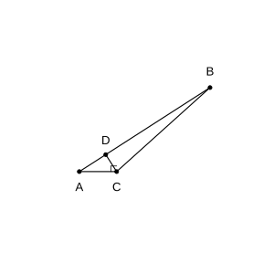
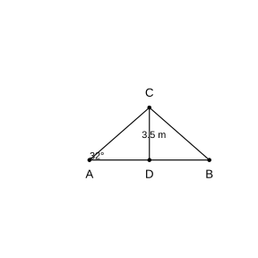
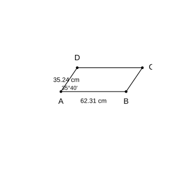

# Assignment 167

> **Definition 28.1.1** (Sine)  In $\text{Rt}\triangle ABC$, $\angle C=90^{\circ}$, we call the ratio of the opposite side to the hypotenuse of the acute angle $A$ the sine of $\angle A$, denoted $\sin A$, i.e.
>
> $$\sin A=\frac{\angle A\text{ 的对边}}{\text{斜边}}=\frac{a}{c}.$$
>
> **Definition 28.1.2** (Cosine)  In $\text{Rt}\triangle ABC$, $\angle C=90^{\circ}$, we call the ratio of the adjacent side to the hypotenuse of the acute angle $A$ the cosine of $\angle A$, denoted $\cos A$, i.e.
>
> $$\cos A=\frac{\angle A\text{ 的邻边}}{\text{斜边}}=\frac{b}{c}.$$
>
> **Definition 28.1.3** (Tangent)  In $\text{Rt}\triangle ABC$, $\angle C=90^{\circ}$, we call the ratio of the opposite side to the adjacent side of the acute angle $A$ the tangent of $\angle A$, denoted $\tan A$, i.e.
>
> $$\tan A=\frac{\angle A\text{ 的对边}}{\angle A\text{ 的邻边}}=\frac{a}{b}.$$
>
> The sine, cosine, and tangent of $\angle A$ are all trigonometric functions of the acute angle $\angle A$.
>
> **Conclusion 28.1.1** (Determinacy of Acute Angle Trigonometric Function Values)  In $\text{Rt}\triangle ABC$, when the measure of the acute angle $A$ is fixed, regardless of the size of the right triangle, the ratio of the opposite side to the hypotenuse, the ratio of the adjacent side to the hypotenuse, and the ratio of the opposite side to the adjacent side of $\angle A$ are all fixed values.
>
> **Conclusion 28.1.2** (Trigonometric Function Values of Special Angles)  
>
> | Acute angle $A$ | $30^{\circ}$ | $45^{\circ}$ | $60^{\circ}$ |
> |---|---|---|---|
> | $\sin A$ | $\frac{1}{2}$ | $\frac{\sqrt{2}}{2}$ | $\frac{\sqrt{3}}{2}$ |
> | $\cos A$ | $\frac{\sqrt{3}}{2}$ | $\frac{\sqrt{2}}{2}$ | $\frac{1}{2}$ |
> | $\tan A$ | $\frac{\sqrt{3}}{3}$ | $1$ | $\sqrt{3}$ |

### Exercise 1

(Exercise 28.1, Problem 1) As shown in the figure, in $\text{Rt}\triangle ABC$, $\angle C=90^{\circ}$, find the values of $\sin A$ and $\sin B$.

(1) $AC=5$, $BC=3$;

(2) $AC=1$, $AB=\sqrt{5}$.

### Solution to Exercise 1

By **Definition 28.1.1** (Sine), $\sin A$ equals the ratio of the opposite side to the hypotenuse of $\angle A$, and $\sin B$ equals the ratio of the opposite side to the hypotenuse of $\angle B$.

(1) In $\text{Rt}\triangle ABC$, $\angle C=90^{\circ}$, $AC=5$, $BC=3$. By the Pythagorean theorem,

$$AB=\sqrt{AC^{2}+BC^{2}}=\sqrt{25+9}=\sqrt{34}.$$

Thus

$$\sin A=\frac{BC}{AB}=\frac{3}{\sqrt{34}}=\frac{3\sqrt{34}}{34},\quad \sin B=\frac{AC}{AB}=\frac{5}{\sqrt{34}}=\frac{5\sqrt{34}}{34}.$$

(2) In $\text{Rt}\triangle ABC$, $\angle C=90^{\circ}$, $AC=1$, $AB=\sqrt{5}$. By the Pythagorean theorem,

$$BC=\sqrt{AB^{2}-AC^{2}}=\sqrt{5-1}=2.$$

Thus

$$\sin A=\frac{BC}{AB}=\frac{2}{\sqrt{5}}=\frac{2\sqrt{5}}{5},\quad \sin B=\frac{AC}{AB}=\frac{1}{\sqrt{5}}=\frac{\sqrt{5}}{5}.\ \blacksquare$$

### Exercise 2

(Exercise 28.1, Problem 2) In $\text{Rt}\triangle ABC$, $\angle C=90^{\circ}$, $\angle A=60^{\circ}$. Find the value of $\sin A$.

### Solution to Exercise 2

By **Conclusion 28.1.2** (Trigonometric Function Values of Special Angles), $\sin 60^{\circ}=\frac{\sqrt{3}}{2}$.

Thus $\sin A=\sin 60^{\circ}=\frac{\sqrt{3}}{2}$. $\blacksquare$

### Exercise 3

(Exercise 28.1, Problem 1) Find the sine, cosine, and tangent of the two acute angles in each of the following right triangles.

(1) $AB=13$, $AC=12$, $\angle C=90^{\circ}$;

(2) $BC=3$, $AC=2$, $\angle C=90^{\circ}$.

### Solution to Exercise 3

By **Definition 28.1.1** (Sine), **Definition 28.1.2** (Cosine), and **Definition 28.1.3** (Tangent), first use the Pythagorean theorem to find the unknown side, then substitute into the definitions.

(1) In $\text{Rt}\triangle ABC$, $\angle C=90^{\circ}$, $AB=13$, $AC=12$, so

$$BC=\sqrt{AB^{2}-AC^{2}}=\sqrt{169-144}=5.$$

Therefore

$$\sin A=\frac{BC}{AB}=\frac{5}{13},\quad \cos A=\frac{AC}{AB}=\frac{12}{13},\quad \tan A=\frac{BC}{AC}=\frac{5}{12};$$

$$\sin B=\frac{AC}{AB}=\frac{12}{13},\quad \cos B=\frac{BC}{AB}=\frac{5}{13},\quad \tan B=\frac{AC}{BC}=\frac{12}{5}.$$

(2) In $\text{Rt}\triangle ABC$, $\angle C=90^{\circ}$, $BC=3$, $AC=2$, so

$$AB=\sqrt{AC^{2}+BC^{2}}=\sqrt{4+9}=\sqrt{13}.$$

Therefore

$$\sin A=\frac{BC}{AB}=\frac{3}{\sqrt{13}}=\frac{3\sqrt{13}}{13},\quad \cos A=\frac{AC}{AB}=\frac{2}{\sqrt{13}}=\frac{2\sqrt{13}}{13},\quad \tan A=\frac{BC}{AC}=\frac{3}{2};$$

$$\sin B=\frac{AC}{AB}=\frac{2}{\sqrt{13}}=\frac{2\sqrt{13}}{13},\quad \cos B=\frac{BC}{AB}=\frac{3}{\sqrt{13}}=\frac{3\sqrt{13}}{13},\quad \tan B=\frac{AC}{BC}=\frac{2}{3}.\ \blacksquare$$

### Exercise 4

(Exercise 28.1, Problem 2) In $\text{Rt}\triangle ABC$, $\angle C=90^{\circ}$. If each side length is enlarged to $2$ times the original, do the sine, cosine, and tangent of $\angle A$ change? Explain your reasoning.

### Solution to Exercise 4

By **Conclusion 28.1.1** (Determinacy of Acute Angle Trigonometric Function Values), the trigonometric function values of an acute angle depend only on the size of the angle, not on the side lengths of the right triangle.

After each side length is enlarged to $2$ times the original, the ratio of the three sides of the new triangle to the original is unchanged, i.e. the two triangles are similar, so the size of $\angle A$ is unchanged. By **Definition 28.1.1**, **Definition 28.1.2**, and **Definition 28.1.3**, $\sin A$, $\cos A$, $\tan A$ are each the ratio of two sides; after all sides are multiplied by $2$, the ratios are unchanged, so the sine, cosine, and tangent of $\angle A$ all remain unchanged. $\blacksquare$

### Exercise 5

(Exercise 28.1, Problem 1) Find the value of each of the following expressions:

(1) $1-2\sin 30^{\circ}\cos 30^{\circ}$;

(2) $3\tan 30^{\circ}-\tan 45^{\circ}+2\sin 60^{\circ}$;

(3) $\left(\cos^{2}30^{\circ}+\sin^{2}30^{\circ}\right)\times\tan 60^{\circ}$.

### Solution to Exercise 5

By **Conclusion 28.1.2** (Trigonometric Function Values of Special Angles), substitute the function values of the special angles and compute.

(1) Substituting $\sin 30^{\circ}=\frac{1}{2}$, $\cos 30^{\circ}=\frac{\sqrt{3}}{2}$:

$$1-2\sin 30^{\circ}\cos 30^{\circ}=1-2\times\frac{1}{2}\times\frac{\sqrt{3}}{2}=1-\frac{\sqrt{3}}{2}.$$

(2) Substituting $\tan 30^{\circ}=\frac{\sqrt{3}}{3}$, $\tan 45^{\circ}=1$, $\sin 60^{\circ}=\frac{\sqrt{3}}{2}$:

$$3\tan 30^{\circ}-\tan 45^{\circ}+2\sin 60^{\circ}=3\times\frac{\sqrt{3}}{3}-1+2\times\frac{\sqrt{3}}{2}=\sqrt{3}-1+\sqrt{3}=2\sqrt{3}-1.$$

(3) Since $\cos^{2}30^{\circ}+\sin^{2}30^{\circ}=\left(\frac{\sqrt{3}}{2}\right)^{2}+\left(\frac{1}{2}\right)^{2}=\frac{3}{4}+\frac{1}{4}=1$, we have

$$\left(\cos^{2}30^{\circ}+\sin^{2}30^{\circ}\right)\times\tan 60^{\circ}=1\times\sqrt{3}=\sqrt{3}.\ \blacksquare$$

### Exercise 6

(Exercise 28.1, Problem 2) In $\text{Rt}\triangle ABC$, $\angle C=90^{\circ}$, $BC=\sqrt{7}$, $AC=\sqrt{21}$. Find the measures of $\angle A$ and $\angle B$.

### Solution to Exercise 6

By **Definition 28.1.3** (Tangent), $\tan A=\frac{BC}{AC}=\frac{\sqrt{7}}{\sqrt{21}}=\frac{\sqrt{7}}{\sqrt{3}\cdot\sqrt{7}}=\frac{1}{\sqrt{3}}=\frac{\sqrt{3}}{3}$.

By **Conclusion 28.1.2** (Trigonometric Function Values of Special Angles), $\tan 30^{\circ}=\frac{\sqrt{3}}{3}$, so $\angle A=30^{\circ}$.

Also, since the two acute angles are complementary, $\angle B=90^{\circ}-\angle A=60^{\circ}$. $\blacksquare$

### Exercise 7

(Exercise 28.1, Problem 1) Use a calculator to find the following acute angle trigonometric function values:

(1) $\sin 20^{\circ}$, $\cos 70^{\circ}$; $\sin 35^{\circ}$, $\cos 55^{\circ}$; $\sin 15^{\circ}32'$, $\cos 74^{\circ}28'$;

(2) $\tan 3^{\circ}8'$, $\tan 80^{\circ}25'43''$.

### Solution to Exercise 7

Using a calculator:

(1) $\sin 20^{\circ}\approx 0.3420$, $\cos 70^{\circ}\approx 0.3420$; $\sin 35^{\circ}\approx 0.5736$, $\cos 55^{\circ}\approx 0.5736$; $\sin 15^{\circ}32'\approx 0.2678$, $\cos 74^{\circ}28'\approx 0.2678$.

From this we see that $\sin\alpha=\cos\left(90^{\circ}-\alpha\right)$, i.e. the sine of an acute angle equals the cosine of its complementary angle.

(2) $\tan 3^{\circ}8'\approx 0.0545$, $\tan 80^{\circ}25'43''\approx 5.930$. $\blacksquare$

### Exercise 8

(Exercise 28.1, Problem 2) Given the following acute angle trigonometric function values, use a calculator to find the measures of the corresponding acute angles:

(1) $\sin A=0.6275$, $\sin B=0.0547$;

(2) $\cos A=0.6252$, $\cos B=0.1659$;

(3) $\tan A=4.8425$, $\tan B=0.8816$.

### Solution to Exercise 8

Using a calculator to find the inverse trigonometric functions:

(1) $\angle A\approx 38.87^{\circ}\approx 38^{\circ}52'$, $\angle B\approx 3.14^{\circ}\approx 3^{\circ}8'$.

(2) $\angle A\approx 51.30^{\circ}\approx 51^{\circ}18'$, $\angle B\approx 80.44^{\circ}\approx 80^{\circ}26'$.

(3) $\angle A\approx 78.34^{\circ}\approx 78^{\circ}20'$, $\angle B\approx 41.40^{\circ}\approx 41^{\circ}24'$. $\blacksquare$

### Problem 1

(Problem 28.1, Review and Consolidation, Problem 1) Find the sine, cosine, and tangent of $\angle A$ and $\angle B$ in the figure, respectively.

(1) $\angle C=90^{\circ}$, $BC=2$, $AB=6$;

(2) $\angle C=90^{\circ}$, $AC=6$, $BC=2$;

(3) $\angle C=90^{\circ}$, $AC=\sqrt{2}$, $AB=\sqrt{6}$.

### Solution to Problem 1

By **Definition 28.1.1**, **Definition 28.1.2**, and **Definition 28.1.3**, first use the Pythagorean theorem to find the unknown side, then substitute.

(1) $AC=\sqrt{AB^{2}-BC^{2}}=\sqrt{36-4}=\sqrt{32}=4\sqrt{2}$. Thus

$$\sin A=\frac{BC}{AB}=\frac{1}{3},\ \cos A=\frac{AC}{AB}=\frac{2\sqrt{2}}{3},\ \tan A=\frac{BC}{AC}=\frac{2}{4\sqrt{2}}=\frac{\sqrt{2}}{4};$$

$$\sin B=\frac{AC}{AB}=\frac{2\sqrt{2}}{3},\ \cos B=\frac{BC}{AB}=\frac{1}{3},\ \tan B=\frac{AC}{BC}=2\sqrt{2}.$$

(2) $AB=\sqrt{AC^{2}+BC^{2}}=\sqrt{36+4}=\sqrt{40}=2\sqrt{10}$. Thus

$$\sin A=\frac{BC}{AB}=\frac{2}{2\sqrt{10}}=\frac{\sqrt{10}}{10},\ \cos A=\frac{AC}{AB}=\frac{6}{2\sqrt{10}}=\frac{3\sqrt{10}}{10},\ \tan A=\frac{BC}{AC}=\frac{1}{3};$$

$$\sin B=\frac{AC}{AB}=\frac{3\sqrt{10}}{10},\ \cos B=\frac{BC}{AB}=\frac{\sqrt{10}}{10},\ \tan B=\frac{AC}{BC}=3.$$

(3) $BC=\sqrt{AB^{2}-AC^{2}}=\sqrt{6-2}=2$. Thus

$$\sin A=\frac{BC}{AB}=\frac{2}{\sqrt{6}}=\frac{\sqrt{6}}{3},\ \cos A=\frac{AC}{AB}=\frac{\sqrt{2}}{\sqrt{6}}=\frac{\sqrt{3}}{3},\ \tan A=\frac{BC}{AC}=\frac{2}{\sqrt{2}}=\sqrt{2};$$

$$\sin B=\frac{AC}{AB}=\frac{\sqrt{3}}{3},\ \cos B=\frac{BC}{AB}=\frac{\sqrt{6}}{3},\ \tan B=\frac{AC}{BC}=\frac{\sqrt{2}}{2}.\ \blacksquare$$

### Problem 2

(Problem 28.1, Review and Consolidation, Problem 2) In $\text{Rt}\triangle ABC$, $\angle C=90^{\circ}$. When $\angle A$ is determined, is its sine determined accordingly? What about the cosine? The tangent? Why?

### Solution to Problem 2

By **Conclusion 28.1.1** (Determinacy of Acute Angle Trigonometric Function Values), when the measure of the acute angle $A$ is fixed, regardless of the size of the right triangle, the ratio of the opposite side to the hypotenuse, the ratio of the adjacent side to the hypotenuse, and the ratio of the opposite side to the adjacent side of $\angle A$ are all fixed values.

Thus when $\angle A$ is determined, $\sin A$, $\cos A$, and $\tan A$ are all uniquely determined accordingly. $\blacksquare$

### Problem 3

(Problem 28.1, Review and Consolidation, Problem 3) Find the value of each of the following expressions:

(1) $\sin 45^{\circ}+\frac{\sqrt{2}}{2}$;

(2) $\sin 45^{\circ}\cos 60^{\circ}-\cos 45^{\circ}$;

(3) $\cos^{2}45^{\circ}+\tan 60^{\circ}\cos 30^{\circ}$;

(4) $\frac{1-\cos 30^{\circ}}{\sin 60^{\circ}}+\tan 30^{\circ}$.

### Solution to Problem 3

By **Conclusion 28.1.2** (Trigonometric Function Values of Special Angles), substitute and compute.

(1) $\sin 45^{\circ}=\frac{\sqrt{2}}{2}$, so the expression $=\frac{\sqrt{2}}{2}+\frac{\sqrt{2}}{2}=\sqrt{2}$.

(2) The expression $=\frac{\sqrt{2}}{2}\times\frac{1}{2}-\frac{\sqrt{2}}{2}=\frac{\sqrt{2}}{4}-\frac{\sqrt{2}}{2}=-\frac{\sqrt{2}}{4}$.

(3) The expression $=\left(\frac{\sqrt{2}}{2}\right)^{2}+\sqrt{3}\times\frac{\sqrt{3}}{2}=\frac{1}{2}+\frac{3}{2}=2$.

(4) The expression $=\frac{1-\frac{\sqrt{3}}{2}}{\frac{\sqrt{3}}{2}}+\frac{\sqrt{3}}{3}=\frac{2-\sqrt{3}}{\sqrt{3}}+\frac{\sqrt{3}}{3}=\frac{2\sqrt{3}-3}{3}+\frac{\sqrt{3}}{3}=\sqrt{3}-1$. $\blacksquare$

### Problem 4

(Problem 28.1, Review and Consolidation, Problem 4) Use a calculator to find the sine, cosine, and tangent of $\angle A$ in the figure.

(1) $\angle C=90^{\circ}$, $BC=1.7$, $AC=2.4$;

(2) $\angle C=90^{\circ}$, $AC=2$, $BC=1.5$;

(3) $\angle C=90^{\circ}$, $AB=2.6$, $AC=2.2$.

### Solution to Problem 4

Use the Pythagorean theorem to find the unknown side, then compute using **Definition 28.1.1**, **Definition 28.1.2**, and **Definition 28.1.3**.

(1) $AB=\sqrt{1.7^{2}+2.4^{2}}=\sqrt{2.89+5.76}=\sqrt{8.65}\approx 2.941$. Thus

$$\sin A\approx\frac{1.7}{2.941}\approx 0.578,\quad \cos A\approx\frac{2.4}{2.941}\approx 0.816,\quad \tan A=\frac{1.7}{2.4}\approx 0.708.$$

(2) $AB=\sqrt{2^{2}+1.5^{2}}=\sqrt{4+2.25}=\sqrt{6.25}=2.5$. Thus

$$\sin A=\frac{1.5}{2.5}=0.6,\quad \cos A=\frac{2}{2.5}=0.8,\quad \tan A=\frac{1.5}{2}=0.75.$$

(3) $BC=\sqrt{AB^{2}-AC^{2}}=\sqrt{2.6^{2}-2.2^{2}}=\sqrt{6.76-4.84}=\sqrt{1.92}\approx 1.386$. Thus

$$\sin A\approx\frac{1.386}{2.6}\approx 0.533,\quad \cos A=\frac{2.2}{2.6}\approx 0.846,\quad \tan A\approx\frac{1.386}{2.2}\approx 0.630.\ \blacksquare$$

### Problem 5

(Problem 28.1, Review and Consolidation, Problem 5) Given the following acute angle trigonometric function values, use a calculator to find the measures of acute angles $A$ and $B$:

(1) $\sin A=0.7$, $\sin B=0.01$;

(2) $\cos A=0.15$, $\cos B=0.8$;

(3) $\tan A=2.4$, $\tan B=0.5$.

### Solution to Problem 5

Using a calculator to find the inverse trigonometric functions:

(1) $\angle A\approx 44.43^{\circ}\approx 44^{\circ}26'$, $\angle B\approx 0.57^{\circ}\approx 0^{\circ}34'$.

(2) $\angle A\approx 81.37^{\circ}\approx 81^{\circ}22'$, $\angle B\approx 36.87^{\circ}\approx 36^{\circ}52'$.

(3) $\angle A\approx 67.38^{\circ}\approx 67^{\circ}23'$, $\angle B\approx 26.57^{\circ}\approx 26^{\circ}34'$. $\blacksquare$

### Problem 6

(Problem 28.1, Comprehensive Application, Problem 6) As shown in the figure, in $\text{Rt}\triangle ABC$, $CD$ is the altitude to the hypotenuse $AB$, and $\angle A\ne 45^{\circ}$. Which of the following ratios is not equal to $\sin A$? ( )

(A) $\frac{CD}{AC}$

(B) $\frac{BD}{CB}$

(C) $\frac{CB}{AB}$

(D) $\frac{CD}{CB}$

{width=50%}

### Solution to Problem 6

By **Definition 28.1.1** (Sine), in $\text{Rt}\triangle ABC$, $\sin A=\frac{CB}{AB}$, so (C) equals $\sin A$.

In $\text{Rt}\triangle ACD$, $\angle ADC=90^{\circ}$, $\sin A=\frac{CD}{AC}$, so (A) equals $\sin A$.

Since $CD$ is the altitude to the hypotenuse $AB$, $\angle BCD+\angle B=90^{\circ}$, and also $\angle A+\angle B=90^{\circ}$, so $\angle BCD=\angle A$. In $\text{Rt}\triangle BCD$, $\sin\angle BCD=\frac{BD}{CB}$, i.e. $\sin A=\frac{BD}{CB}$, so (B) equals $\sin A$.

However, $\frac{CD}{CB}=\cos\angle BCD=\cos A$, which is not equal to $\sin A$. So choose (D). $\blacksquare$

### Problem 7

(Problem 28.1, Comprehensive Application, Problem 7) As shown in the figure, a gable (isosceles triangle) steel frame of height $3.5\ \text{m}$ and base angle $32^{\circ}$ is to be welded. About how long a steel is needed (round the result to two decimal places)?

{width=50%}

### Solution to Problem 7

The steel frame is the isosceles triangle $ABC$, with $CD$ as the center post, $CD\perp AB$, $CD=3.5\ \text{m}$, $\angle A=\angle B=32^{\circ}$, $AD=DB$.

In $\text{Rt}\triangle ACD$, by **Definition 28.1.1** (Sine),

$$\sin A=\frac{CD}{AC}\implies AC=\frac{CD}{\sin 32^{\circ}}=\frac{3.5}{\sin 32^{\circ}}\approx\frac{3.5}{0.5299}\approx 6.605\ \text{m}.$$

By **Definition 28.1.3** (Tangent),

$$\tan A=\frac{CD}{AD}\implies AD=\frac{CD}{\tan 32^{\circ}}=\frac{3.5}{\tan 32^{\circ}}\approx\frac{3.5}{0.6249}\approx 5.601\ \text{m}.$$

The total length of steel is $AC+BC+AB=2AC+2AD\approx 2\times 6.605+2\times 5.601\approx 24.41\ \text{m}$. $\blacksquare$

### Problem 8

(Problem 28.1, Comprehensive Application, Problem 8) As shown in the figure, the lengths of two adjacent sides of a parallelogram board are $62.31\ \text{cm}$ and $35.24\ \text{cm}$, and the angle between them is $35^{\circ}40'$. Find the area of this board (round the result to two decimal places).

{width=50%}

### Solution to Problem 8

In parallelogram $ABCD$, $AB=62.31\ \text{cm}$, $AD=35.24\ \text{cm}$, $\angle A=35^{\circ}40'$.

Draw $DE\perp AB$ through $D$, with foot $E$. In $\text{Rt}\triangle ADE$, by **Definition 28.1.1** (Sine),

$$DE=AD\cdot\sin A=35.24\times\sin 35^{\circ}40'.$$

$35^{\circ}40'=35.67^{\circ}$, $\sin 35.67^{\circ}\approx 0.5830$, so $DE\approx 35.24\times 0.5830\approx 20.55\ \text{cm}$.

The area is $S=AB\cdot DE\approx 62.31\times 20.55\approx 1280.47\ \text{cm}^{2}$. $\blacksquare$

### Problem 9

(Problem 28.1, Extension and Exploration, Problem 9) Use a calculator to find the following acute angle trigonometric function values and fill in the table:

| Acute angle $A$ | $15^{\circ}$ | $18^{\circ}$ | $20^{\circ}$ | $22^{\circ}$ | $\cdots$ | $80^{\circ}$ | $82^{\circ}$ | $84^{\circ}$ |
|---|---|---|---|---|---|---|---|---|
| $\sin A$ | | | | | $\cdots$ | | | |
| $\cos A$ | | | | | $\cdots$ | | | |
| $\tan A$ | | | | | $\cdots$ | | | |

As the measure of the acute angle $A$ continuously increases, what is the trend of change of $\sin A$? What about $\cos A$? What about $\tan A$?

### Solution to Problem 9

Using a calculator: $\sin 15^{\circ}\approx 0.259$, $\sin 18^{\circ}\approx 0.309$, $\sin 20^{\circ}\approx 0.342$, $\sin 22^{\circ}\approx 0.375$, $\sin 80^{\circ}\approx 0.985$, $\sin 82^{\circ}\approx 0.990$, $\sin 84^{\circ}\approx 0.995$; $\cos 15^{\circ}\approx 0.966$, $\cos 18^{\circ}\approx 0.951$, $\cos 20^{\circ}\approx 0.940$, $\cos 22^{\circ}\approx 0.927$, $\cos 80^{\circ}\approx 0.174$, $\cos 82^{\circ}\approx 0.139$, $\cos 84^{\circ}\approx 0.105$; $\tan 15^{\circ}\approx 0.268$, $\tan 18^{\circ}\approx 0.325$, $\tan 20^{\circ}\approx 0.364$, $\tan 22^{\circ}\approx 0.404$, $\tan 80^{\circ}\approx 5.671$, $\tan 82^{\circ}\approx 7.115$, $\tan 84^{\circ}\approx 9.514$.

By **Definition 28.1.1**, **Definition 28.1.2**, and **Definition 28.1.3**, within the range of acute angles, as the angle increases, the opposite side $a$ relatively increases and the adjacent side $b$ relatively decreases; hence $\sin A$ increases as the angle increases, $\cos A$ decreases as the angle increases, and $\tan A$ increases as the angle increases. $\blacksquare$

### Problem 10

(Problem 28.1, Extension and Exploration, Problem 10) In $\text{Rt}\triangle ABC$, $\angle C=90^{\circ}$. What is the relationship between the sine and cosine of $\angle A$? (Hint: use the definition of the acute angle trigonometric functions and the Pythagorean theorem.)

### Solution to Problem 10

By **Definition 28.1.1** (Sine) and **Definition 28.1.2** (Cosine), $\sin A=\frac{a}{c}$, $\cos A=\frac{b}{c}$.

By the Pythagorean theorem $a^{2}+b^{2}=c^{2}$, so

$$\sin^{2}A+\cos^{2}A=\frac{a^{2}}{c^{2}}+\frac{b^{2}}{c^{2}}=\frac{a^{2}+b^{2}}{c^{2}}=\frac{c^{2}}{c^{2}}=1.$$

Also, from $\sin A=\frac{a}{c}$, $\cos A=\frac{b}{c}$, we get $\frac{\sin A}{\cos A}=\frac{a}{b}=\tan A$.

Thus $\sin^{2}A+\cos^{2}A=1$, and $\tan A=\frac{\sin A}{\cos A}$. $\blacksquare$

### Reading and Reflection 1

(Reading and Reflection: An Ancient \"Trigonometric Table\") The chord corresponding to an arc of radius $r$ and central angle $\theta$ has length $l$. Express $l$ in terms of $r$ and $\theta$, and explain the relationship between this chord table and the sine function.

### Solution to Reading and Reflection 1

Let the center be $O$, the chord be $AB$, and the central angle $\angle AOB=\theta$. Draw $OC\perp AB$ at $C$; then $C$ is the midpoint of $AB$, and $\angle AOC=\frac{\theta}{2}$.

In $\text{Rt}\triangle AOC$, by **Definition 28.1.1** (Sine),

$$\sin\frac{\theta}{2}=\frac{AC}{OA}=\frac{l/2}{r}.$$

Thus

$$l=2r\sin\frac{\theta}{2}.$$

When $r$ is fixed, the chord table gives the corresponding values of $\theta$ and $l$; from the above we can find the value of $\sin\frac{\theta}{2}=\frac{l}{2r}$, so the chord table is effectively a sine function table with $\alpha=\frac{\theta}{2}$ as the independent variable. $\blacksquare$
