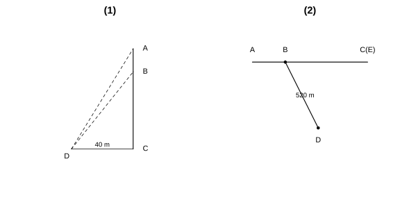
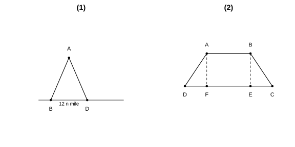
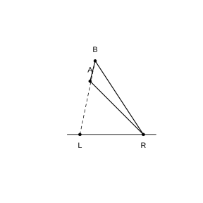
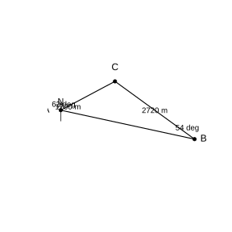

# Assignment 168

> **Definition 28.2.1** (Solving a Right Triangle)  In a right triangle, apart from the right angle, there are five elements in all, namely the three sides and the two acute angles. The process of finding the remaining unknown elements from the known elements of the right triangle is called solving a right triangle.
>
> **Conclusion 28.2.1** (Relationships Among the Elements of a Right Triangle)  In $\text{Rt}\triangle ABC$, where $\angle C$ is the right angle and the sides opposite $\angle A$, $\angle B$, $\angle C$ are $a$, $b$, $c$, respectively:
>
> (1) Relationship of the three sides: $a^{2}+b^{2}=c^{2}$ (the Pythagorean theorem);
>
> (2) Relationship of the two acute angles: $\angle A+\angle B=90^{\circ}$;
>
> (3) Relationship between sides and angles: $\sin A=\frac{a}{c}$, $\cos A=\frac{b}{c}$, $\tan A=\frac{a}{b}$ ($A$ may be replaced by $B$, while $a$ and $b$ are interchanged at the same time).
>
> Knowing any two of these elements (at least one of which is a side), one can find the remaining three unknown elements.
>
> **Conclusion 28.2.2** (Angle of Elevation and Angle of Depression)  Among the angles formed by the line of sight and the horizontal line, the angle above the horizontal line is called the angle of elevation, and the angle below the horizontal line is called the angle of depression.

### Exercise 1

(Exercise 28.2, Problem 1) In $\text{Rt}\triangle ABC$, $\angle C=90^{\circ}$, solve the right triangle according to the following conditions:

(1) $c=30$, $b=20$;

(2) $\angle B=72^{\circ}$, $c=14$;

(3) $\angle B=30^{\circ}$, $a=\sqrt{7}$.

### Solution to Exercise 1

By **Conclusion 28.2.1** (Relationships Among the Elements of a Right Triangle), use the Pythagorean theorem, the complementarity of acute angles, and trigonometric functions respectively.

(1) By the Pythagorean theorem $a=\sqrt{c^{2}-b^{2}}=\sqrt{900-400}=\sqrt{500}=10\sqrt{5}$.

$\cos A=\frac{b}{c}=\frac{20}{30}=\frac{2}{3}$; using a calculator, $\angle A\approx 48.19^{\circ}$, $\angle B=90^{\circ}-\angle A\approx 41.81^{\circ}$.

(2) $\angle A=90^{\circ}-72^{\circ}=18^{\circ}$. $a=c\cos B=14\times\cos 72^{\circ}\approx 14\times 0.3090\approx 4.33$, $b=c\sin B=14\times\sin 72^{\circ}\approx 14\times 0.9511\approx 13.32$.

(3) $\angle A=90^{\circ}-30^{\circ}=60^{\circ}$. From $\tan B=\frac{b}{a}$, $b=a\tan 30^{\circ}=\sqrt{7}\times\frac{\sqrt{3}}{3}=\frac{\sqrt{21}}{3}$. From $\cos B=\frac{a}{c}$, $c=\frac{a}{\cos 30^{\circ}}=\frac{\sqrt{7}}{\sqrt{3}/2}=\frac{2\sqrt{21}}{3}$. $\blacksquare$

### Exercise 2

(Exercise 28.2, Problem 1) As shown in the figure, a flagpole $AB$ stands on a building $BC$. From point $D$, $40\ \text{m}$ from $BC$, the angle of elevation to the top $A$ of the flagpole is $50^{\circ}$, and the angle of elevation to the bottom $B$ of the flagpole is $45^{\circ}$. Find the height of the flagpole (round to one decimal place).

{width=100%}

### Solution to Exercise 2

Let the horizontal distance from $D$ to the building be $DC=40\ \text{m}$. In $\text{Rt}\triangle BDC$, $\angle BDC=45^{\circ}$; by **Definition 28.1.3** (Tangent),

$$BC=DC\cdot\tan 45^{\circ}=40\times 1=40\ \text{m}.$$

In $\text{Rt}\triangle ADC$, $\angle ADC=50^{\circ}$,

$$AC=DC\cdot\tan 50^{\circ}\approx 40\times 1.1918\approx 47.67\ \text{m}.$$

The flagpole height is $AB=AC-BC\approx 47.67-40=7.7\ \text{m}$. $\blacksquare$

### Exercise 3

(Exercise 28.2, Problem 2) As shown in the figure, a road is being cut through a mountain along the direction $AC$. From a point $B$ on $AC$, take $\angle ABD=140^{\circ}$, $BD=520\ \text{m}$, $\angle D=50^{\circ}$. Then how far from $D$ should the excavation point $E$ on the other side be so that the three points $A$, $C$, $E$ lie on a straight line (round to one decimal place)?

### Solution to Exercise 3

Since $A$, $C$, $E$ are collinear and $\angle ABD=140^{\circ}$, $\angle DBE=180^{\circ}-140^{\circ}=40^{\circ}$.

In $\triangle BDE$, $\angle DBE=40^{\circ}$, $\angle BDE=50^{\circ}$, so $\angle BED=180^{\circ}-40^{\circ}-50^{\circ}=90^{\circ}$; i.e. $\triangle BDE$ is a right triangle with $\angle E=90^{\circ}$.

In $\text{Rt}\triangle BDE$, by **Definition 28.1.1** (Sine),

$$\sin\angle DBE=\frac{DE}{BD}\implies DE=BD\cdot\sin 40^{\circ}\approx 520\times 0.6428\approx 334.3\ \text{m}.$$

Thus the excavation point $E$ is about $334.3\ \text{m}$ from $D$. $\blacksquare$

### Exercise 4

(Exercise 28.2, Problem 1) As shown in the figure, there is an island $A$ in the sea, and within $8\ \text{n mile}$ around it there are reefs. A fishing boat sails from west to east. At point $B$, the island $A$ is measured to be in the direction $60^{\circ}$ east of north; after sailing $12\ \text{n mile}$ to point $D$, the island $A$ is measured to be in the direction $30^{\circ}$ east of north. If the fishing boat continues due east without changing course, is there a danger of striking a reef?

{width=100%}

### Solution to Exercise 4

Draw $AE\perp BD$ through $A$ at $E$; then $AE$ is the shortest distance from the island to the course.

By the conditions, $\angle ABD=90^{\circ}-60^{\circ}=30^{\circ}$, $\angle ADE=90^{\circ}-30^{\circ}=60^{\circ}$.

In $\text{Rt}\triangle ABE$, $BE=AE/\tan 30^{\circ}=AE\sqrt{3}$.

In $\text{Rt}\triangle ADE$, $DE=AE/\tan 60^{\circ}=AE/\sqrt{3}$.

Also $BE-DE=BD=12$, so $AE\sqrt{3}-AE/\sqrt{3}=12$, i.e. $AE\cdot\frac{3-1}{\sqrt{3}}=12$, $AE=6\sqrt{3}\approx 10.39\ \text{n mile}$.

Since $AE\approx 10.39>8$, the fishing boat continuing due east is in no danger of striking a reef. $\blacksquare$

### Exercise 5

(Exercise 28.2, Problem 2) As shown in the figure, the cross-section of a dam is trapezoid $ABCD$, with $AF=DE=6\ \text{m}$. The slope grade $i=1:1.5$ refers to the ratio of the vertical height $AF$ to the horizontal width $BF$ of the slope face, and the slope grade $i=1:3$ refers to the ratio of $DE$ to $CE$. Based on the data in the figure, find:

(1) the measures of the slope angles $\alpha$ and $\beta$;

(2) the length of the slope $AB$ (round to one decimal place).

### Solution to Exercise 5

(1) The grade $i=\tan\alpha$. For slope $AB$, $i=1:1.5$, i.e. $\tan\alpha=\frac{1}{1.5}=\frac{2}{3}$; using a calculator, $\alpha\approx 33.69^{\circ}$.

For slope $DC$, $i=1:3$, i.e. $\tan\beta=\frac{1}{3}$; using a calculator, $\beta\approx 18.43^{\circ}$.

(2) In $\text{Rt}\triangle ABF$, $AF=6\ \text{m}$, $\sin\alpha=\frac{AF}{AB}$, so $AB=\frac{AF}{\sin\alpha}=\frac{6}{\sin 33.69^{\circ}}\approx\frac{6}{0.5547}\approx 10.8\ \text{m}$. $\blacksquare$

### Problem 1

(Problem 28.2, Review and Consolidation, Problem 1) In $\text{Rt}\triangle ABC$, $\angle C=90^{\circ}$, solve the right triangle according to the following conditions:

(1) $c=8$, $\angle A=30^{\circ}$;

(2) $b=7$, $\angle A=15^{\circ}$;

(3) $a=5$, $b=12$.

### Solution to Problem 1

Solve by **Conclusion 28.2.1**.

(1) $\angle B=90^{\circ}-30^{\circ}=60^{\circ}$. $a=c\sin A=8\times\frac{1}{2}=4$, $b=c\cos A=8\times\frac{\sqrt{3}}{2}=4\sqrt{3}$.

(2) $\angle B=90^{\circ}-15^{\circ}=75^{\circ}$. From $\tan A=\frac{a}{b}$, $a=b\tan 15^{\circ}\approx 7\times 0.2679\approx 1.88$. From $\cos A=\frac{b}{c}$, $c=\frac{b}{\cos 15^{\circ}}\approx\frac{7}{0.9659}\approx 7.25$.

(3) $c=\sqrt{a^{2}+b^{2}}=\sqrt{25+144}=13$. $\tan A=\frac{5}{12}$, giving $\angle A\approx 22.62^{\circ}$, $\angle B\approx 67.38^{\circ}$. $\blacksquare$

### Problem 2

(Problem 28.2, Review and Consolidation, Problem 2) As shown in the figure, the span $BC=10\ \text{m}$ of a factory-roof gable (isosceles triangle), and $\angle B=36^{\circ}$. Find the length of the center post $AD$ ($D$ is the midpoint of the base) and the rafter $AB$ (round to one decimal place).

### Solution to Problem 2

In the isosceles triangle $ABC$, $AD\perp BC$, and $D$ is the midpoint of $BC$, so $BD=\frac{BC}{2}=5\ \text{m}$.

In $\text{Rt}\triangle ABD$, by **Definition 28.1.3** (Tangent), $AD=BD\cdot\tan 36^{\circ}\approx 5\times 0.7265\approx 3.6\ \text{m}$.

By **Definition 28.1.2** (Cosine), $\cos B=\frac{BD}{AB}$, so $AB=\frac{BD}{\cos 36^{\circ}}\approx\frac{5}{0.8090}\approx 6.2\ \text{m}$. $\blacksquare$

### Problem 3

(Problem 28.2, Review and Consolidation, Problem 3) As shown in the figure, an aircraft at point $A$ in the air detects a target $C$; at this moment the flight altitude is $AC=1200\ \text{m}$, and the angle of depression from the aircraft to the ground control station $B$ is $\alpha=16^{\circ}31'$. Find the distance between the aircraft $A$ and the control station $B$ (round to an integer).

### Solution to Problem 3

In $\text{Rt}\triangle ABC$, $\angle C=90^{\circ}$, $AC=1200\ \text{m}$, angle of depression $\alpha=16^{\circ}31'\approx 16.52^{\circ}$. By the equality of alternate interior angles, $\angle ABC=\alpha$.

By **Definition 28.1.1** (Sine), $\sin\alpha=\frac{AC}{AB}$, so $AB=\frac{AC}{\sin\alpha}=\frac{1200}{\sin 16.52^{\circ}}\approx\frac{1200}{0.2843}\approx 4221\ \text{m}$. $\blacksquare$

### Problem 4

(Problem 28.2, Review and Consolidation, Problem 4) A help signal from a sailing boat is received from a lighthouse $55\ \text{m}$ above sea level; the angle of depression from the lighthouse to the boat is $21^{\circ}$. How far is the boat from the lighthouse at this moment (round to an integer)?

### Solution to Problem 4

In the right triangle, the lighthouse height $55\ \text{m}$ is the opposite side, the angle of depression is $21^{\circ}$, and the straight-line distance from the boat to the lighthouse is the hypotenuse.

By **Definition 28.1.1** (Sine), $\sin 21^{\circ}=\frac{55}{d}$, so $d=\frac{55}{\sin 21^{\circ}}\approx\frac{55}{0.3584}\approx 153\ \text{m}$. $\blacksquare$

### Problem 5

(Problem 28.2, Review and Consolidation, Problem 5) As shown in the figure, trees are planted on a hillside; the required spacing (the horizontal distance between two adjacent trees) is $5.5\ \text{m}$. The inclination angle of the slope is measured to be $24^{\circ}$. Find the distance along the slope between two adjacent trees (round to one decimal place).

### Solution to Problem 5

The horizontal distance $5.5\ \text{m}$ is the adjacent side, the slope distance is the hypotenuse, and the slope angle is $24^{\circ}$.

By **Definition 28.1.2** (Cosine), $\cos 24^{\circ}=\frac{5.5}{d}$, so $d=\frac{5.5}{\cos 24^{\circ}}\approx\frac{5.5}{0.9135}\approx 6.0\ \text{m}$. $\blacksquare$

### Problem 6

(Problem 28.2, Comprehensive Application, Problem 6) In $\text{Rt}\triangle ABC$, $\angle C=90^{\circ}$.

(1) Given $\angle A$ and $c$, write out the process of solving $\text{Rt}\triangle ABC$;

(2) Given $\angle A$ and $a$, write out the process of solving $\text{Rt}\triangle ABC$;

(3) Given $a$ and $c$, write out the process of solving $\text{Rt}\triangle ABC$.

### Solution to Problem 6

By **Conclusion 28.2.1** (Relationships Among the Elements of a Right Triangle).

(1) $\angle B=90^{\circ}-\angle A$. $a=c\sin A$, $b=c\cos A$.

(2) $\angle B=90^{\circ}-\angle A$. From $\sin A=\frac{a}{c}$, $c=\frac{a}{\sin A}$. $b=\sqrt{c^{2}-a^{2}}$, or $b=\frac{a}{\tan A}$.

(3) Find $\angle A$ from $\sin A=\frac{a}{c}$. $\angle B=90^{\circ}-\angle A$. $b=\sqrt{c^{2}-a^{2}}$. $\blacksquare$

### Problem 7

(Problem 28.2, Comprehensive Application, Problem 7) As shown in the figure, the base of a pyramid is a square of side $130\ \text{m}$, and each lateral face makes an angle of $65^{\circ}$ with the base. How high was this pyramid originally (round to an integer)?

### Solution to Problem 7

The square base of the pyramid has side $130\ \text{m}$, and the lateral faces make an angle of $65^{\circ}$ with the base. The height $h$ and the distance $d=\frac{130}{2}=65\ \text{m}$ from the center of the base to a side form a right triangle, with the dihedral angle between the lateral face and the base being $65^{\circ}$.

By **Definition 28.1.3** (Tangent), $\tan 65^{\circ}=\frac{h}{65}$, so $h=65\times\tan 65^{\circ}\approx 65\times 2.1445\approx 139\ \text{m}$. $\blacksquare$

### Problem 8

(Problem 28.2, Comprehensive Application, Problem 8) As shown in the figure, a launch vehicle is launched from point $L$ on the ground. When the rocket reaches point $A$, the distance $AR$ measured from a radar station at point $R$ on the ground is $6\ \text{km}$, with an angle of elevation of $43^{\circ}$; $1\ \text{s}$ later the rocket reaches point $B$, at which time the measured angle of elevation is $45.54^{\circ}$. What is the average speed of this rocket from $A$ to $B$ (round to two decimal places)?

{width=50%}

### Solution to Problem 8

Let the horizontal distance $LR$ be $d$. In $\text{Rt}\triangle ALR$, $AR=6\ \text{km}$, $\angle ARL=43^{\circ}$.

$AL=AR\cdot\sin 43^{\circ}=6\times\sin 43^{\circ}\approx 6\times 0.6820\approx 4.092\ \text{km}$.

$LR=AR\cdot\cos 43^{\circ}=6\times\cos 43^{\circ}\approx 6\times 0.7314\approx 4.388\ \text{km}$.

In $\text{Rt}\triangle BLR$, $\angle BRL=45.54^{\circ}$, $BL=LR\cdot\tan 45.54^{\circ}\approx 4.388\times 1.0198\approx 4.475\ \text{km}$.

$AB=BL-AL\approx 4.475-4.092=0.383\ \text{km}=383\ \text{m}$.

The average speed $=\frac{383}{1}=383.00\ \text{m/s}$. $\blacksquare$

### Problem 9

(Problem 28.2, Comprehensive Application, Problem 9) As shown in the figure, to facilitate pedestrians crossing the road, an overpass $5\ \text{m}$ high is to be built. Given that the slope grade of the overpass is $1:1.5$, calculate the length of the slope $AB$ (round to an integer).

### Solution to Problem 9

The grade $i=1:1.5$, i.e. the ratio of vertical height to horizontal width is $1:1.5$. The vertical height is $5\ \text{m}$, so the horizontal width $=5\times 1.5=7.5\ \text{m}$.

By the Pythagorean theorem, the slope length is $AB=\sqrt{5^{2}+7.5^{2}}=\sqrt{25+56.25}=\sqrt{81.25}\approx 9\ \text{m}$. $\blacksquare$

### Problem 10

(Problem 28.2, Extension and Exploration, Problem 10) There is a small island $P$ in the sea, and within a circular sea area centered at $P$ with radius $16\sqrt{2}\ \text{n mile}$ there are reefs. A ship sails from west to east; at point $A$ the island $P$ is measured to be in the direction $60^{\circ}$ east of north, and $AP=32\ \text{n mile}$. If the ship continues due east, is there a danger of striking a reef? If there is danger, at how many degrees east of south should the ship sail from point $A$ to safely pass through this sea area?

### Solution to Problem 10

Draw $PH\perp$ the course (due east) through $P$ at $H$. At point $A$, $P$ is $60^{\circ}$ east of north, i.e. the angle between $AP$ and due east is $30^{\circ}$.

$PH=AP\cdot\sin 30^{\circ}=32\times\frac{1}{2}=16\ \text{n mile}$.

The reef radius is $16\sqrt{2}\approx 22.63\ \text{n mile}$. Since $PH=16<16\sqrt{2}$, the ship continuing due east is in danger of striking a reef.

Suppose the ship sails in a direction $\theta$ east of south to pass safely, i.e. the distance from the course leaving $A$ to $P$ equals the reef radius $16\sqrt{2}$. The new course passes through $A$; let its angle with due east be $\varphi$ (toward the south). The distance from the new course to $P$ is $d=AP\cdot\sin\left(30^{\circ}-\varphi\right)$.

Setting $d=16\sqrt{2}$, i.e. $32\sin\left(30^{\circ}-\varphi\right)=16\sqrt{2}$, $\sin\left(30^{\circ}-\varphi\right)=\frac{\sqrt{2}}{2}$. Hence $30^{\circ}-\varphi=45^{\circ}$ (impossible), or $30^{\circ}-\varphi=135^{\circ}$ (impossible).

Actually, the critical course from $A$ that avoids the reef circle is a tangent to the circle. The angle between the tangent and $AP$ satisfies $\sin\psi=\frac{16\sqrt{2}}{32}=\frac{\sqrt{2}}{2}$, so $\psi=45^{\circ}$. The original direction was $60^{\circ}$ east of north (i.e. $30^{\circ}$ north of due east); it must be deflected $45^{\circ}-30^{\circ}=15^{\circ}$ toward the south, i.e. sailing in the direction $45^{\circ}$ east of south passes safely. $\blacksquare$

### Problem 11

(Problem 28.2, Extension and Exploration, Problem 11) Based on the positions of the triangular region marked in the figure, calculate the area of the triangular region (round to an integer). In the figure: triangle $ABC$, $AC=1700\ \text{m}$; at $A$, $C$ is measured to be in the direction $62^{\circ}$ east of north; $BC=2720\ \text{m}$; at $B$, $C$ is measured to be in the direction $54^{\circ}$ west of north.

{width=50%}

### Solution to Problem 11

Set up a coordinate system with $A$ as the origin, east as the positive $x$-axis and north as the positive $y$-axis.

$C$ is in the direction $62^{\circ}$ east of north from $A$, at distance $1700\ \text{m}$, so

$$x_C=1700\sin 62^{\circ}\approx 1700\times 0.88295=1501.0,$$

$$y_C=1700\cos 62^{\circ}\approx 1700\times 0.46947=798.1.$$

$C$ is in the direction $54^{\circ}$ west of north from $B$, at distance $2720\ \text{m}$, so

$$x_C-x_B=-2720\sin 54^{\circ}\approx-2720\times 0.80902=-2200.6,$$

$$y_C-y_B=2720\cos 54^{\circ}\approx 2720\times 0.58779=1598.8.$$

Therefore $x_B=x_C+2200.6\approx 3701.6$, $y_B=y_C-1598.8\approx-800.7$.

Using the area-from-coordinates formula:

$$S=\frac{1}{2}\left|x_A\left(y_B-y_C\right)+x_B\left(y_C-y_A\right)+x_C\left(y_A-y_B\right)\right|$$

$$=\frac{1}{2}\left|0+3701.6\times 798.1+1501.0\times 800.7\right|$$

$$=\frac{1}{2}\left|2954300+1201800\right|\approx 2078050\ \text{m}^{2}.$$

That is, the area of the triangular region is about $2078050\ \text{m}^{2}$. $\blacksquare$

### Reading and Reflection 1

(Reading and Reflection: The Height of a Hillside) How does measuring the height of a dam differ from measuring the height of a mountain? How can the idea of \"turning curves into straight lines, using the straight to replace the curved\" be used to measure mountain height?

### Solution to Reading and Reflection 1

The slope face of a dam is straight; the dam slope, the dam height, and the horizontal line form a right triangle. Measure the slope angle $\alpha$ and the slope length $l$, and the dam height can be computed directly from $h=l\sin\alpha$.

A hillside is \"curved\" and cannot be simply reduced to a single right triangle. The solution is to break the hillside into pieces, dividing it into several small segments, each approximated as a straight line; measure the slope length $l_{i}$ of each segment, measure the corresponding slope angle $\alpha_{i}$, compute the height of that segment $h_{i}=l_{i}\sin\alpha_{i}$, then sum the pieces together, $h=\sum h_{i}$, to obtain the mountain height. This approach of \"breaking into pieces and summing the pieces\" and \"turning curves into straight lines, using the straight to replace the curved\" embodies the basic idea of calculus. $\blacksquare$
