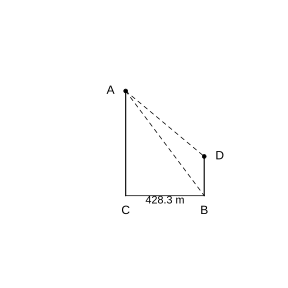
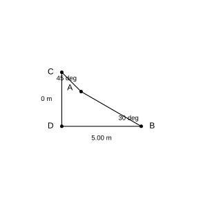
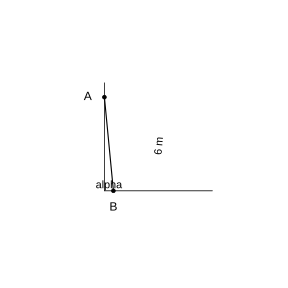
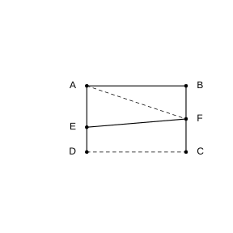

# Assignment 170

> **Definition 28.1.1** (Sine)  $\sin A=\frac{a}{c}$.
>
> **Definition 28.1.2** (Cosine)  $\cos A=\frac{b}{c}$.
>
> **Definition 28.1.3** (Tangent)  $\tan A=\frac{a}{b}$.
>
> **Conclusion 28.1.2** (Trigonometric Function Values of Special Angles)  $\sin 30^{\circ}=\frac{1}{2}$, $\cos 30^{\circ}=\frac{\sqrt{3}}{2}$, $\tan 30^{\circ}=\frac{\sqrt{3}}{3}$; $\sin 45^{\circ}=\frac{\sqrt{2}}{2}$, $\cos 45^{\circ}=\frac{\sqrt{2}}{2}$, $\tan 45^{\circ}=1$; $\sin 60^{\circ}=\frac{\sqrt{3}}{2}$, $\cos 60^{\circ}=\frac{1}{2}$, $\tan 60^{\circ}=\sqrt{3}$.
>
> **Conclusion 28.2.1** (Relationships Among the Elements of a Right Triangle)  $a^{2}+b^{2}=c^{2}$; $\angle A+\angle B=90^{\circ}$; $\sin A=\frac{a}{c}$, $\cos A=\frac{b}{c}$, $\tan A=\frac{a}{b}$.

### Review Problem 1

(Review Problem, Review and Consolidation, Problem 1) In $\text{Rt}\triangle ABC$, $\angle C=90^{\circ}$, $a=2$, $c=6$. Find the values of $\sin A$, $\cos A$, and $\tan A$.

### Solution to Review Problem 1

By the Pythagorean theorem, $b=\sqrt{c^{2}-a^{2}}=\sqrt{36-4}=\sqrt{32}=4\sqrt{2}$.

By **Definition 28.1.1**, **Definition 28.1.2**, and **Definition 28.1.3**:

$$\sin A=\frac{a}{c}=\frac{2}{6}=\frac{1}{3},\quad \cos A=\frac{b}{c}=\frac{4\sqrt{2}}{6}=\frac{2\sqrt{2}}{3},\quad \tan A=\frac{a}{b}=\frac{2}{4\sqrt{2}}=\frac{\sqrt{2}}{4}.\ \blacksquare$$

### Review Problem 2

(Review Problem, Review and Consolidation, Problem 2) In $\triangle ABC$, $\angle C=90^{\circ}$, $\cos A=\frac{\sqrt{3}}{2}$, $AC=4\sqrt{3}$. Find the length of $BC$.

### Solution to Review Problem 2

By **Definition 28.1.2** (Cosine), $\cos A=\frac{AC}{AB}=\frac{\sqrt{3}}{2}$, so $AB=\frac{AC}{\cos A}=\frac{4\sqrt{3}}{\sqrt{3}/2}=8$.

By the Pythagorean theorem, $BC=\sqrt{AB^{2}-AC^{2}}=\sqrt{64-48}=\sqrt{16}=4$. $\blacksquare$

### Review Problem 3

(Review Problem, Review and Consolidation, Problem 3) Find the value of each of the following expressions:

(1) $\sqrt{2}\cos 45^{\circ}-\tan 45^{\circ}$;

(2) $\sqrt{3}\sin 60^{\circ}+\tan 60^{\circ}-2\cos^{2}30^{\circ}$.

### Solution to Review Problem 3

By **Conclusion 28.1.2** (Trigonometric Function Values of Special Angles).

(1) $\sqrt{2}\times\frac{\sqrt{2}}{2}-1=1-1=0$.

(2) $\sqrt{3}\times\frac{\sqrt{3}}{2}+\sqrt{3}-2\times\left(\frac{\sqrt{3}}{2}\right)^{2}=\frac{3}{2}+\sqrt{3}-\frac{3}{2}=\sqrt{3}$. $\blacksquare$

### Review Problem 4

(Review Problem, Review and Consolidation, Problem 4) Use a calculator to find the value of each of the following expressions:

(1) $\cos 76^{\circ}39'+\sin 17^{\circ}52'$;

(2) $\sin 57^{\circ}18'-\tan 22^{\circ}30'$;

(3) $\tan 83^{\circ}6'-\cos 4^{\circ}59'$;

(4) $\tan 12^{\circ}30'-\sin 15^{\circ}$.

### Solution to Review Problem 4

Using a calculator:

(1) $\cos 76^{\circ}39'\approx 0.231$, $\sin 17^{\circ}52'\approx 0.307$, and the sum is about $0.538$.

(2) $\sin 57^{\circ}18'\approx 0.841$, $\tan 22^{\circ}30'\approx 0.414$, and the difference is about $0.427$.

(3) $\tan 83^{\circ}6'\approx 8.26$, $\cos 4^{\circ}59'\approx 0.996$, and the difference is about $7.26$.

(4) $\tan 12^{\circ}30'\approx 0.222$, $\sin 15^{\circ}\approx 0.259$, and the difference is about $-0.037$. $\blacksquare$

### Review Problem 5

(Review Problem, Review and Consolidation, Problem 5) Given the following trigonometric function values of acute angles, use a calculator to find the measure of the acute angle $A$:

(1) $\cos A=0.7651$;

(2) $\sin A=0.9343$;

(3) $\tan A=35.26$;

(4) $\tan A=0.707$.

### Solution to Review Problem 5

(1) $\angle A\approx 40.08^{\circ}\approx 40^{\circ}5'$.

(2) $\angle A\approx 69.09^{\circ}\approx 69^{\circ}5'$.

(3) $\angle A\approx 88.37^{\circ}\approx 88^{\circ}22'$.

(4) $\angle A\approx 35.27^{\circ}\approx 35^{\circ}16'$. $\blacksquare$

### Review Problem 6

(Review Problem, Review and Consolidation, Problem 6) The base angle of an isosceles triangle is $30^{\circ}$, and the length of a leg is $2\sqrt{3}$. Find its perimeter.

### Solution to Review Problem 6

Let the leg length of the isosceles triangle be $l=2\sqrt{3}$, with base angle $30^{\circ}$. Draw the altitude $h$ to the base; then

$$h=l\sin 30^{\circ}=2\sqrt{3}\times\frac{1}{2}=\sqrt{3}.$$

Half the base $=l\cos 30^{\circ}=2\sqrt{3}\times\frac{\sqrt{3}}{2}=3$, and the base length $=6$.

The perimeter $=2l+$ the base $=2\times 2\sqrt{3}+6=4\sqrt{3}+6$. $\blacksquare$

### Review Problem 7

(Review Problem, Review and Consolidation, Problem 7) From a ship, when the angle of elevation to the top of a $42\ \text{m}$-high lighthouse on the shore is measured to be $33^{\circ}$, how far is the ship from the shore (round to an integer)?

### Solution to Review Problem 7

In the right triangle, the lighthouse height $42\ \text{m}$ is the opposite side, the angle of elevation is $33^{\circ}$, and the horizontal distance from the ship to the shore is the adjacent side.

By **Definition 28.1.3** (Tangent), $\tan 33^{\circ}=\frac{42}{d}$, so $d=\frac{42}{\tan 33^{\circ}}\approx\frac{42}{0.6494}\approx 65\ \text{m}$. $\blacksquare$

### Review Problem 8

(Review Problem, Comprehensive Application, Problem 8) As shown in the figure, the horizontal distance $BC$ between two buildings is $428.3\ \text{m}$. From point $A$, the angle of depression $\alpha$ to point $D$ is measured to be $35^{\circ}12'$, and the angle of depression $\beta$ to point $C$ is measured to be $43^{\circ}24'$. Find the heights of the two buildings (round to one decimal place).

{width=50%}

### Solution to Review Problem 8

Let the taller building be $AC=H$ and the shorter building be $BD=h$. The horizontal distance is $BC=428.3\ \text{m}$.

The angle of depression $\beta=43^{\circ}24'\approx 43.4^{\circ}$ from $A$ to $C$, so

$$H=BC\cdot\tan\beta=428.3\times\tan 43.4^{\circ}\approx 428.3\times 0.9455\approx 404.9\ \text{m}.$$

The angle of depression $\alpha=35^{\circ}12'\approx 35.2^{\circ}$ from $A$ to $D$; the height difference between $A$ and $D$ is

$$H-h=BC\cdot\tan\alpha=428.3\times\tan 35.2^{\circ}\approx 428.3\times 0.7064\approx 302.6\ \text{m}.$$

Thus $h=404.9-302.6=102.3\ \text{m}$.

The heights of the two buildings are about $404.9\ \text{m}$ and $102.3\ \text{m}$, respectively. $\blacksquare$

### Review Problem 9

(Review Problem, Comprehensive Application, Problem 9) The shape of the wing of a certain model of aircraft is shown in the figure. Based on the data in the figure, calculate the lengths of $AC$, $BD$, and $AB$ (round to two decimal places). In the figure: quadrilateral $CDBA$, where $CD$ is the left vertical side, $CD=3.40\ \text{m}$; $DB$ is the lower horizontal side, $DB=5.00\ \text{m}$; at $C$, $\angle DCA=45^{\circ}$; at $B$, $\angle DBA=30^{\circ}$.

{width=50%}

### Solution to Review Problem 9

Taking $D$ as the origin, the direction $DB$ as the $x$-axis and the direction $DC$ as the $y$-axis, then $D=(0,0)$, $C=(0,3.40)$, $B=(5.00,0)$.

The upper edge $CA$ through $C$ makes an angle of $45^{\circ}$ with the vertical, so its slope is $-1$, and its equation is $y=3.40-x$.

The edge $BA$ through $B$ makes an angle of $30^{\circ}$ with the horizontal, sloping up to the left, and its equation is $y=\frac{5.00-x}{\sqrt{3}}$.

Eliminating: $3.40-x=\frac{5.00-x}{\sqrt{3}}$.

$$x=\frac{3.40\sqrt{3}-5.00}{\sqrt{3}-1}\approx\frac{5.889-5.00}{0.732}\approx 1.214.$$

$$y=3.40-1.214=2.186.$$

Thus $A=(1.214,2.186)$.

$$AC=\frac{x}{\cos 45^{\circ}}=\frac{1.214}{0.7071}\approx 1.72\ \text{m}.$$

$$BD=5.00\ \text{m}.$$

$$AB=\frac{5.00-1.214}{\cos 30^{\circ}}=\frac{3.786}{0.8660}\approx 4.37\ \text{m}.\ \blacksquare$$

### Review Problem 10

(Review Problem, Comprehensive Application, Problem 10) As shown in the figure, for a person to safely climb to the top of a ladder leaning against a wall, the angle $\alpha$ between the ladder and the ground should generally satisfy $50^{\circ}\le\alpha\le 75^{\circ}$. There is now a ladder of length $6\ \text{m}$.

(1) Using this ladder, what is the highest wall height that can be safely climbed (round to one decimal place)?

(2) When the foot of the ladder is $2.4\ \text{m}$ from the wall, what is $\alpha$ in degrees (round to an integer)? At this time, can the person safely use this ladder?

{width=50%}

### Solution to Review Problem 10

(1) The maximum climb height corresponds to the maximum angle $\alpha=75^{\circ}$. By **Definition 28.1.1** (Sine),

$$h=6\sin 75^{\circ}\approx 6\times 0.9659\approx 5.8\ \text{m}.$$

(2) The foot of the ladder is $2.4\ \text{m}$ from the wall, i.e. the adjacent side $=2.4$ and the hypotenuse $=6$. By **Definition 28.1.2** (Cosine),

$$\cos\alpha=\frac{2.4}{6}=0.4,\quad \alpha\approx 66.42^{\circ}\approx 66^{\circ}.$$

Since $50^{\circ}\le 66^{\circ}\le 75^{\circ}$, the person can safely use this ladder at this time. $\blacksquare$

### Review Problem 11

(Review Problem, Comprehensive Application, Problem 11) As shown in the figure, one side $AD$ of rectangle $ABCD$ is folded so that point $D$ lands at point $F$ on side $BC$. Given the crease $AE=5\sqrt{5}\ \text{cm}$, and $\tan\angle EFC=\frac{3}{4}$.

(1) What is the relationship between $\triangle AFB$ and $\triangle FEC$?

(2) Find the perimeter of rectangle $ABCD$.

{width=50%}

### Solution to Review Problem 11

By the folding property, $AF=AD$, $EF=DE$, $\angle AFE=\angle D=90^{\circ}$.

(1) Since $\angle AFE=90^{\circ}$, $\angle AFB+\angle EFC=90^{\circ}$. In $\text{Rt}\triangle AFB$, $\angle AFB+\angle BAF=90^{\circ}$, so $\angle BAF=\angle EFC$. Also $\angle B=\angle C=90^{\circ}$, so $\triangle AFB\sim\triangle FEC$.

(2) In $\text{Rt}\triangle EFC$, $\tan\angle EFC=\frac{EC}{FC}=\frac{3}{4}$. Let $EC=3k$, $FC=4k$; then $EF=5k$.

$DE=EF=5k$, $CD=DE+EC=5k+3k=8k$, so $AB=8k$.

From $\triangle AFB\sim\triangle FEC$, the similarity ratio $=\frac{AB}{FC}=\frac{8k}{4k}=2$. Hence $AF=2\cdot EF=10k$, $BF=2\cdot EC=6k$.

$AD=AF=10k$, $BC=BF+FC=6k+4k=10k$.

In $\text{Rt}\triangle ADE$, $AE=\sqrt{AD^{2}+DE^{2}}=\sqrt{100k^{2}+25k^{2}}=\sqrt{125}\,k=5\sqrt{5}\,k$.

From $AE=5\sqrt{5}$, we get $k=1$. Thus $AB=8\ \text{cm}$, $BC=10\ \text{cm}$.

The rectangle perimeter $=2(8+10)=36\ \text{cm}$. $\blacksquare$

### Review Problem 12

(Review Problem, Comprehensive Application, Problem 12) In $\square ABCD$, given $AB$, $BC$, and their included angle $\angle B$ ($\angle B$ is an acute angle), can the area $S$ of $\square ABCD$ be found? If so, express $S$ in terms of $AB$, $BC$, and their included angle $\angle B$.

### Solution to Review Problem 12

Yes. Draw $AE\perp BC$ through $A$ at $E$. In $\text{Rt}\triangle ABE$, by **Definition 28.1.1** (Sine), $AE=AB\cdot\sin B$.

The parallelogram area is $S=BC\cdot AE=AB\cdot BC\cdot\sin B$. $\blacksquare$

### Review Problem 13

(Review Problem, Extension and Exploration, Problem 13) It is known that the radius of a circle is $R$.

(1) Find the perimeter and area of the regular $n$-gon inscribed in this circle;

(2) As the number of sides of a regular polygon inscribed in a circle increases, what is the trend of change of the perimeter (and area) of the regular polygon?

### Solution to Review Problem 13

(1) The central angle subtended by each side of the regular $n$-gon inscribed in the circle is $\frac{2\pi}{n}$. The side length is $a_{n}=2R\sin\frac{\pi}{n}$.

The perimeter is $P_{n}=na_{n}=2nR\sin\frac{\pi}{n}$.

Area: the regular $n$-gon can be divided into $n$ congruent isosceles triangles, each of area $\frac{1}{2}R^{2}\sin\frac{2\pi}{n}$.

$$S_{n}=\frac{n}{2}R^{2}\sin\frac{2\pi}{n}.$$

(2) As $n$ increases, $\sin\frac{\pi}{n}\approx\frac{\pi}{n}$, so $P_{n}\to 2\pi R$ (the circumference of the circle); $\sin\frac{2\pi}{n}\approx\frac{2\pi}{n}$, so $S_{n}\to\pi R^{2}$ (the area of the circle). That is, as the number of sides increases, the perimeter of the regular polygon approaches the circumference of the circle, and the area approaches the area of the circle. $\blacksquare$

### Review Problem 14

(Review Problem, Extension and Exploration, Problem 14) As shown in the figure, in an acute triangle $\triangle ABC$, investigate the relationship among $\frac{a}{\sin A}$, $\frac{b}{\sin B}$, and $\frac{c}{\sin C}$.

### Solution to Review Problem 14

Draw the altitude $h_{a}$ to side $BC$ through $A$. In $\text{Rt}\triangle ABH$, $h_{a}=c\sin B$; in $\text{Rt}\triangle ACH$, $h_{a}=b\sin C$. Hence $c\sin B=b\sin C$, i.e. $\frac{b}{\sin B}=\frac{c}{\sin C}$.

Similarly, drawing the altitude to side $AC$ through $B$, we get $c\sin A=a\sin C$, i.e. $\frac{a}{\sin A}=\frac{c}{\sin C}$.

Thus

$$\frac{a}{\sin A}=\frac{b}{\sin B}=\frac{c}{\sin C}.\ \blacksquare$$
