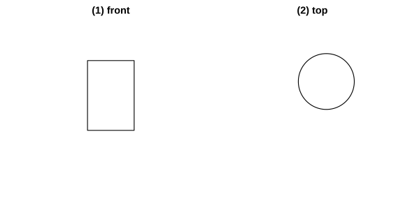
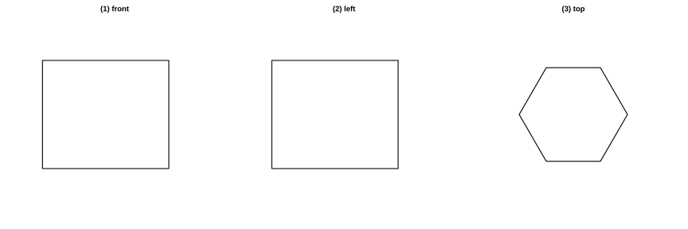

# Assignment 171

> **Definition 29.1.1** (Projection)  The shadow obtained by shining light on an object and projecting it onto a certain plane (the ground, a wall, etc.) is called the projection of the object; the shining light rays are called projection lines, and the plane on which the projection lies is called the projection plane.
>
> **Definition 29.1.2** (Parallel Projection)  The projection formed by parallel light rays is called parallel projection. For example, the shadow (a solar shadow) formed when an object is illuminated by sunlight is parallel projection.
>
> **Definition 29.1.3** (Central Projection)  The projection formed by light rays emitted from a single point (a point light source) is called central projection. For example, the shadow formed when an object is illuminated by the light emitted from a light bulb.
>
> **Definition 29.1.4** (Orthogonal Projection)  The projection produced when the projection lines are perpendicular to the projection plane is called orthogonal projection.
>
> **Conclusion 29.1.1** (Orthogonal Projection Rule for a Line Segment)  When a line segment is parallel to the projection plane, its orthogonal projection is a segment of the same length; when it is inclined to the projection plane, its orthogonal projection is a shortened segment; when it is perpendicular to the projection plane, its orthogonal projection is a single point.
>
> **Conclusion 29.1.2** (Orthogonal Projection Rule for a Plane Figure)  When a plane figure is parallel to the projection plane, its orthogonal projection is exactly the same in shape and size as the original figure; when it is inclined, its orthogonal projection is not exactly the same as the original figure; when it is perpendicular, its orthogonal projection becomes a line segment.

### Exercise 1

(Exercise 29.1, Problem 1) Connect each of the following objects to its projection with a line. The objects include a set square, a wooden stick, a teacup, etc., and their projections are a triangle, a line segment, a circle, etc., respectively.

### Solution to Exercise 1

By **Definition 29.1.1** (Projection) and **Conclusion 29.1.2** (Orthogonal Projection Rule for a Plane Figure): when the set square is parallel to the projection plane, its orthogonal projection is a triangle; when the wooden stick is parallel to the projection plane, its orthogonal projection is an equal-length segment, and when perpendicular it is a point; the orthogonal projection of the teacup (a cylinder) from top to bottom is a circle, and from the side it is a rectangle. Just connect them according to the correspondence of shapes. $\blacksquare$

### Exercise 2

(Exercise 29.1, Problem 2) As shown in the figure, with the direction of the projection lines as indicated by the arrow, draw the orthogonal projection of the cylinder.

{width=100%}

### Solution to Exercise 2

By **Conclusion 29.1.1** and **Conclusion 29.1.2**:

(1) The projection lines shine from the front (the cylinder's axis is horizontal): the orthogonal projection of the cylinder is a rectangle, one side of which equals the height of the cylinder and the other side equals the diameter of the base.

(2) The projection lines shine from above: the orthogonal projection of the cylinder is a circle, the same size as the base. $\blacksquare$

### Problem 1

(Problem 29.1, Review and Consolidation, Problem 1) Xiaohua took several photos facing due south in Beijing at different times. Which of the following photos was taken in the afternoon?

### Solution to Problem 1

By **Definition 29.1.2** (Parallel Projection), the sun's rays are parallel light rays. In Beijing, in the morning the sun is in the southeast and shadows fall toward the northwest; in the afternoon the sun is in the southwest and shadows fall toward the northeast. When facing due south to take the photo, in the afternoon the object's shadow falls toward the left side of the frame, slightly toward the east. Thus the photo in which the shadow falls toward the northeast (the left-front of the frame) was taken in the afternoon. $\blacksquare$

### Problem 2

(Problem 29.1, Review and Consolidation, Problem 2) Please use lines to connect each object in the figure to its projection.

### Solution to Problem 2

By **Definition 29.1.1** (Projection) and the orthogonal projection rules, connect according to the correspondence between the object's shape and the projection outline: the orthogonal projection of a rectangular box is a rectangle; the orthogonal projection of a cone (from the front) is an isosceles triangle and (from above) a circle with a center; the orthogonal projection of a sphere is always a circle. $\blacksquare$

### Problem 3

(Problem 29.1, Comprehensive Application, Problem 3) As shown in the figure, the regular pentagon on the right is the orthogonal projection of a regular pentagonal prism when light shines from top to bottom. Can you point out what the orthogonal projection of each face of the regular pentagonal prism is at this time?

### Solution to Problem 3

The light shines from top to bottom, i.e. the projection lines are perpendicular to the horizontal plane. By **Conclusion 29.1.2** (Orthogonal Projection Rule for a Plane Figure):

The upper and lower bases of the regular pentagonal prism are parallel to the projection plane, and their orthogonal projections are both regular pentagons, coinciding with each other.

The five lateral faces are all perpendicular to the projection plane (the vertical direction), and their orthogonal projections are respectively five line segments, namely the five sides of the regular pentagon. $\blacksquare$

### Problem 4

(Problem 29.1, Comprehensive Application, Problem 4) The axial cross-section of a cone is parallel to the projection plane, and the orthogonal projection of the cone is an equilateral triangle of side $3$. Find the volume and surface area of the cone.

### Solution to Problem 4

When the axial cross-section is parallel to the projection plane, the orthogonal projection is the axial cross-section itself, an equilateral triangle of side $3$. Thus the base diameter of the cone is $3$, the radius $r=\frac{3}{2}$, and the slant height $l=3$.

The height of the cone is $h=\sqrt{l^{2}-r^{2}}=\sqrt{9-\frac{9}{4}}=\sqrt{\frac{27}{4}}=\frac{3\sqrt{3}}{2}$.

The volume is $V=\frac{1}{3}\pi r^{2}h=\frac{1}{3}\pi\times\frac{9}{4}\times\frac{3\sqrt{3}}{2}=\frac{9\sqrt{3}\pi}{8}$.

The surface area is $S=\pi r^{2}+\pi rl=\pi\times\frac{9}{4}+\pi\times\frac{3}{2}\times 3=\frac{9\pi}{4}+\frac{9\pi}{2}=\frac{27\pi}{4}$. $\blacksquare$

### Problem 5

(Problem 29.1, Extension and Exploration, Problem 5) Draw the orthogonal projection of the object (in the shape of a regular hexagonal prism) placed as shown in the figure:

(1) The projection lines shine from the front of the object to the back;

(2) The projection lines shine from the left of the object to the right;

(3) The projection lines shine from above the object to below.

{width=100%}

### Solution to Problem 5

By **Conclusion 29.1.2** (Orthogonal Projection Rule for a Plane Figure), the orthogonal projections in the three directions are as shown in the figure:

(1) Shining from the front: the orthogonal projection is a rectangle.

(2) Shining from the left: the orthogonal projection is a rectangle.

(3) Shining from above: the orthogonal projection is a regular hexagon, the same size as the upper base. $\blacksquare$
