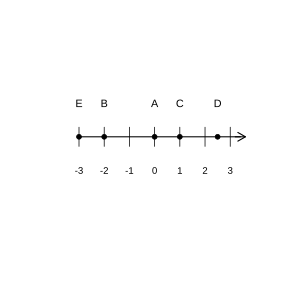
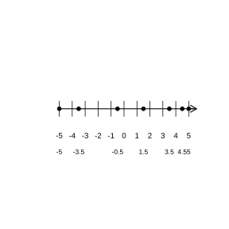
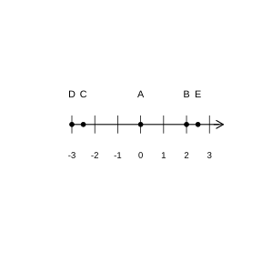
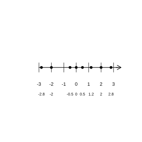

# Assignment 2

> **Definition 1.2.1** (Integers and Fractions)  Positive integers, $0$, and negative integers are collectively called integers; positive fractions and negative fractions are collectively called fractions.
>
> **Definition 1.2.2** (Rational Numbers)  Numbers that can be written in fraction form are called rational numbers. Among them, numbers that can be written as positive fractions are positive rational numbers, and numbers that can be written as negative fractions are negative rational numbers.
>
> **Definition 1.2.3** (Number Line)  A straight line on which an origin, a positive direction, and a unit length are specified is called a number line. On the number line, the origin divides the number line (excluding the origin) into the positive half-axis and the negative half-axis.
>
> **Definition 1.2.4** (Opposite Numbers)  Two numbers that differ only in sign are opposites of each other. The opposite number of $0$ is $0$. Prefixing any number with the sign "$-$" gives the opposite number of the original number.
>
> **Definition 1.2.5** (Absolute Value)  The distance on the number line between the point representing a number $a$ and the origin is called the absolute value of the number $a$, denoted by $\left|a\right|$.
>
> **Definition 1.2.6** (Algebraic Meaning of Absolute Value)  The absolute value of a positive number is the number itself; the absolute value of a negative number is its opposite number; the absolute value of $0$ is $0$. That is, if $a>0$, then $\left|a\right|=a$; if $a=0$, then $\left|a\right|=0$; if $a<0$, then $\left|a\right|=-a$.
>
> **Definition 1.2.7** (Comparing the Magnitude of Rational Numbers)  On the number line, the order of rational numbers from left to right is exactly the order from smallest to largest; that is, a number on the left is smaller than a number on the right. In general, a positive number is greater than $0$, $0$ is greater than a negative number, and a positive number is greater than a negative number; for two negative numbers, the one with the larger absolute value is instead the smaller.

### Exercise 1

(Exercise 1.2, Problem 1) All positive rational numbers form the set of positive rational numbers, and all negative rational numbers form the set of negative rational numbers. Place the following rational numbers into the sets to which they belong:

$$15,\ -\frac{1}{9},\ -5,\ 7,\ 0.5,\ -80,\ 12,\ -4.2,\ 2.3.$$

Set of positive rational numbers: $\left\{\;\cdots\;\right\}$. Set of negative rational numbers: $\left\{\;\cdots\;\right\}$.

### Solution to Exercise 1

By **Definition 1.2.2** (Rational Numbers), numbers that can be written as positive fractions are positive rational numbers, and numbers that can be written as negative fractions are negative rational numbers.

Among the given numbers, $15>0$, $7>0$, $0.5>0$, $12>0$, $2.3>0$, so they are positive rational numbers.

Also, $-\frac{1}{9}$, $-5$, $-80$, $-4.2$ all have the sign "$-$" prefixed to positive numbers, so they are negative rational numbers.

Hence the set of positive rational numbers is $\left\{15,\ 7,\ 0.5,\ 12,\ 2.3,\ \cdots\right\}$; the set of negative rational numbers is $\left\{-\frac{1}{9},\ -5,\ -80,\ -4.2,\ \cdots\right\}$. $\blacksquare$

### Exercise 2

(Exercise 1.2, Problem 2) Identify the positive rational numbers, negative rational numbers, and integers among the following:

$$-15,\ +6,\ -2,\ -0.\dot{4},\ 1,\ \frac{3}{5},\ 0,\ 3\frac{1}{4},\ 0.63,\ -\frac{10}{3}.$$

### Solution to Exercise 2

By **Definition 1.2.2** (Rational Numbers), numbers greater than $0$ are positive rational numbers, and numbers obtained by prefixing a positive number with the sign "$-$" are negative rational numbers. By **Definition 1.2.1** (Integers and Fractions), positive integers, $0$, and negative integers are collectively called integers.

Among the given numbers, $+6$, $1$, $\frac{3}{5}$, $3\frac{1}{4}$, $0.63$ are all greater than $0$, so they are positive rational numbers.

Also, $-15$, $-2$, $-0.\dot{4}$, $-\frac{10}{3}$ all have the sign "$-$" prefixed to positive numbers, so they are negative rational numbers.

Among them, $-15$, $+6$, $-2$, $1$, $0$ are integers. $\blacksquare$

### Exercise 3

(Exercise 1.2, Problem 3) Among $-12$, $\frac{4}{7}$, $19\%$, $50$, $-3.\dot{1}\dot{2}$, $-11$, $-5\%$, $6.3$, $2022$, the number of positive rational numbers is $\;\_\_\;$, among which the number of positive integers is $\;\_\_\;$; the number of negative rational numbers is $\;\_\_\;$, among which the number of negative integers is $\;\_\_\;$.

### Solution to Exercise 3

By **Definition 1.2.2** (Rational Numbers) and **Definition 1.2.1** (Integers and Fractions).

Among the given numbers, those greater than $0$ are $\frac{4}{7}$, $19\%$, $50$, $6.3$, $2022$, totaling $5$, so there are $5$ positive rational numbers; among them, the positive integers are $50$, $2022$, totaling $2$.

Those obtained by prefixing a positive number with the sign "$-$" are $-12$, $-3.\dot{1}\dot{2}$, $-11$, $-5\%$, totaling $4$, so there are $4$ negative rational numbers; among them, the negative integers are $-12$, $-11$, totaling $2$. $\blacksquare$

### Exercise 4

(Exercise 1.2, Problem 1) As shown in the figure, write down the numbers represented by the points $A$, $B$, $C$, $D$, $E$ on the number line.

{width=50%}

### Solution to Exercise 4

By **Definition 1.2.3** (Number Line), the origin on the number line represents $0$, to the right of the origin is the positive direction, to the left is the negative direction, and each grid is $1$ unit length.

From the figure, point $A$ is at the origin and represents $0$; point $B$ is to the left of the origin, $2$ unit lengths away, and represents $-2$; point $C$ is to the right of the origin, $1$ unit length away, and represents $1$; point $D$ is to the left of the origin, $3$ unit lengths away, and represents $-3$; point $E$ is to the right of the origin, $2.5$ unit lengths away, and represents $2.5$.

Hence the numbers represented by points $A$, $B$, $C$, $D$, $E$ are $0$, $-2$, $1$, $-3$, $2.5$ respectively. $\blacksquare$

### Exercise 5

(Exercise 1.2, Problem 2) Draw a number line and represent the following rational numbers on it:

$$-5,\ 3.5,\ -\frac{7}{2},\ -\frac{1}{2},\ \frac{3}{2},\ 5,\ \frac{9}{2}.$$

{width=50%}

### Solution to Exercise 5

By **Definition 1.2.3** (Number Line), take the origin $0$, specify rightward as the positive direction, and choose an appropriate unit length. The positions of the numbers on the number line are: $-\frac{7}{2}=-3.5$, $-\frac{1}{2}=-0.5$, $\frac{3}{2}=1.5$, $\frac{9}{2}=4.5$.

The corresponding points of the numbers on the number line are: $-5$ is $5$ grids to the left of the origin, $-3.5$ is $3.5$ grids to the left of the origin, $-0.5$ is $0.5$ grids to the left of the origin, $1.5$ is $1.5$ grids to the right of the origin, $3.5$ is $3.5$ grids to the right of the origin, $4.5$ is $4.5$ grids to the right of the origin, and $5$ is $5$ grids to the right of the origin, as shown in the figure. $\blacksquare$

### Exercise 6

(Exercise 1.2, Problem 3) On the number line, between the points representing $-2$ and $4$ (including these two points), there are $\;\_\_\;$ points whose represented numbers are integers; the numbers they represent are respectively $\;\_\_\;$, among which there are $\;\_\_\;$ negative integers.

### Solution to Exercise 6

By **Definition 1.2.3** (Number Line), the integer points on the number line are arranged in order. The integers between $-2$ and $4$ (including the endpoints) are

$$-2,\ -1,\ 0,\ 1,\ 2,\ 3,\ 4.$$

There are $7$ in total. Among them, the negative integers are $-2$, $-1$, totaling $2$.

Hence fill in in turn: $7$; $-2$, $-1$, $0$, $1$, $2$, $3$, $4$; $2$. $\blacksquare$

### Exercise 7

(Exercise 1.2, Problem 4) On the number line, point $A$ represents the number $-3$. Starting from point $A$, one moves $4$ unit lengths along the number line in a certain direction to reach point $B$. What number does point $B$ represent?

### Solution to Exercise 7

By **Definition 1.2.3** (Number Line), moving rightward increases the number, and moving leftward decreases the number.

Point $A$ represents $-3$. If one moves rightward by $4$ unit lengths, then point $B$ represents $-3+4=1$; if one moves leftward by $4$ unit lengths, then point $B$ represents $-3-4=-7$.

Hence the number represented by point $B$ is $1$ or $-7$. $\blacksquare$

### Exercise 8

(Exercise 1.2, Problem 1) True or false:

(1) $-6$ is an opposite number;

(2) $+6$ is an opposite number;

(3) $6$ is the opposite number of $-6$;

(4) $-6$ and $+6$ are opposites of each other;

(5) a positive number and a negative number are opposites of each other;

(6) every number has an opposite number.

### Solution to Exercise 8

By **Definition 1.2.4** (Opposite Numbers), an opposite number is a relationship between two numbers, and one cannot say of a single number in isolation that it is an opposite number.

(1) $-6$ is a single number in isolation, and one cannot say it is an opposite number; hence it is false.

(2) $+6$ is a single number in isolation, and one cannot say it is an opposite number; hence it is false.

(3) $6$ and $-6$ differ only in sign, so $6$ is the opposite number of $-6$; hence it is true.

(4) $-6$ and $+6$ differ only in sign, so the two are opposites of each other; hence it is true.

(5) a positive number and a negative number do not necessarily differ only in sign; for example, $1$ and $-2$ are not opposites of each other; hence it is false.

(6) any number $a$ has the opposite number $-a$; hence it is true. $\blacksquare$

### Exercise 9

(Exercise 1.2, Problem 2) Write down the opposite number of each of the following:

$$-\frac{9}{4},\ 6,\ -8,\ -3.5,\ \frac{5}{2},\ 10,\ -100,\ \frac{1}{3}.$$

### Solution to Exercise 9

By **Definition 1.2.4** (Opposite Numbers), prefixing a number with the sign "$-$" gives its opposite number.

The opposite number of $-\frac{9}{4}$ is $\frac{9}{4}$; the opposite number of $6$ is $-6$; the opposite number of $-8$ is $8$; the opposite number of $-3.5$ is $3.5$; the opposite number of $\frac{5}{2}$ is $-\frac{5}{2}$; the opposite number of $10$ is $-10$; the opposite number of $-100$ is $100$; the opposite number of $\frac{1}{3}$ is $-\frac{1}{3}$. $\blacksquare$

### Exercise 10

(Exercise 1.2, Problem 3) If $a=-a$, then where is the point representing the number $a$ located on the number line?

### Solution to Exercise 10

By **Definition 1.2.4** (Opposite Numbers), $a$ and $-a$ are opposites of each other.

If $a=-a$, then $a$ equals its own opposite number. By **Definition 1.2.4** (Opposite Numbers), the opposite number of $0$ is $0$, that is, $-0=0$. Hence the only number satisfying $a=-a$ is $a=0$.

By **Definition 1.2.3** (Number Line), the point representing $0$ is the origin, so the point representing the number $a$ is at the origin of the number line. $\blacksquare$

### Exercise 11

(Exercise 1.2, Problem 4) Simplify each of the following:

$$-\left(-7\right),\ -\left(+0.5\right),\ -\left(-68\right),\ -\left(+3.8\right).$$

### Solution to Exercise 11

By **Definition 1.2.4** (Opposite Numbers), prefixing a number with the sign "$-$" gives the opposite number of the original number.

$-\left(-7\right)$ represents the opposite number of $-7$, namely $7$; $-\left(+0.5\right)$ represents the opposite number of $+0.5$, namely $-0.5$; $-\left(-68\right)$ represents the opposite number of $-68$, namely $68$; $-\left(+3.8\right)$ represents the opposite number of $+3.8$, namely $-3.8$.

Hence the expressions simplify respectively to $7$, $-0.5$, $68$, $-3.8$. $\blacksquare$

### Exercise 12

(Exercise 1.2, Problem 1) Write down the absolute value of each of the following:

$$8,\ -3.9,\ -\frac{2}{11},\ 100,\ 7.5,\ 0,\ -\left(-13\right),\ -\left(+18\right).$$

### Solution to Exercise 12

By **Definition 1.2.6** (Algebraic Meaning of Absolute Value), the absolute value of a positive number is itself, the absolute value of a negative number is its opposite number, and the absolute value of $0$ is $0$.

$8$ is positive, so $\left|8\right|=8$; $-3.9$ is negative, so $\left|-3.9\right|=3.9$; $-\frac{2}{11}$ is negative, so $\left|-\frac{2}{11}\right|=\frac{2}{11}$; $100$ is positive, so $\left|100\right|=100$; $7.5$ is positive, so $\left|7.5\right|=7.5$; $\left|0\right|=0$.

Also, $-\left(-13\right)=13$, so $\left|-\left(-13\right)\right|=\left|13\right|=13$; $-\left(+18\right)=-18$, so $\left|-\left(+18\right)\right|=\left|-18\right|=18$. $\blacksquare$

### Exercise 13

(Exercise 1.2, Problem 2) True or false:

(1) a number whose absolute value is itself is a positive number;

(2) when $a\ne0$, $\left|a\right|$ is always greater than $0$;

(3) the integers whose absolute value is less than $2$ are $1$ and $-1$.

### Solution to Exercise 13

By **Definition 1.2.5** (Absolute Value) and **Definition 1.2.6** (Algebraic Meaning of Absolute Value).

(1) The absolute value of $0$ is $0$, that is, the absolute value of $0$ is also itself, but $0$ is not a positive number; hence it is false.

(2) When $a\ne0$, $a$ is a positive or negative number. By **Definition 1.2.6** (Algebraic Meaning of Absolute Value), the absolute value of both a positive and a negative number is greater than $0$; hence it is true.

(3) The integers whose absolute value is less than $2$ satisfy $\left|a\right|<2$, that is, $-2<a<2$; the integers among them are $-1$, $0$, $1$, which are more than just $1$ and $-1$; hence it is false. $\blacksquare$

### Exercise 14

(Exercise 1.2, Problem 3) If $\left|a\right|=\left|-2\right|$, then $a=\;\_\_\;$; if $m$ is a negative number and $\left|m\right|=10$, then $m=\;\_\_\;$.

### Solution to Exercise 14

By **Definition 1.2.6** (Algebraic Meaning of Absolute Value), $\left|-2\right|=2$, so $\left|a\right|=2$.

On the number line there are two points whose distance from the origin is $2$ unit lengths, representing $2$ and $-2$ respectively, so $a=2$ or $a=-2$.

Also, $m$ is a negative number and $\left|m\right|=10$. By **Definition 1.2.6** (Algebraic Meaning of Absolute Value), the absolute value of a negative number is its opposite number, so $m=-10$. $\blacksquare$

### Exercise 15

(Exercise 1.2, Problem 4) Simplify each of the following:

$$+\left|-3.5\right|,\ -\left|+\frac{5}{6}\right|,\ -\left|-11\right|,\ \left|+\left(-15\right)\right|,\ \left|-\left(-7\right)\right|,\ \left|-\left(+9\right)\right|.$$

### Solution to Exercise 15

By **Definition 1.2.6** (Algebraic Meaning of Absolute Value) and **Definition 1.2.4** (Opposite Numbers).

$+\left|-3.5\right|=\left|3.5\right|=3.5$; $-\left|+\frac{5}{6}\right|=-\left|\frac{5}{6}\right|=-\frac{5}{6}$; $-\left|-11\right|=-\left|11\right|=-11$; $\left|+\left(-15\right)\right|=\left|-15\right|=15$; $\left|-\left(-7\right)\right|=\left|7\right|=7$; $\left|-\left(+9\right)\right|=\left|-9\right|=9$. $\blacksquare$

### Exercise 16

(Exercise 1.2, Problem 1) Compare the magnitudes of each pair of numbers below:

(1) $3$ and $-5$;

(2) $-3$ and $-5$;

(3) $-2.5$ and $-\left|-2\frac{1}{4}\right|$;

(4) $-\frac{3}{5}$ and $-\frac{3}{4}$;

(5) $-\left(+8\right)$ and $-\left(-9\right)$;

(6) $-\left(-0.3\right)$ and $\left|-\frac{1}{3}\right|$.

### Solution to Exercise 16

By **Definition 1.2.7** (Comparing the Magnitude of Rational Numbers), a positive number is greater than a negative number; for two negative numbers, the one with the larger absolute value is instead the smaller.

(1) $3$ is positive and $-5$ is negative, so $3>-5$.

(2) $\left|-3\right|=3$, $\left|-5\right|=5$; since $3<5$, we get $-3>-5$.

(3) $-\left|-2\frac{1}{4}\right|=-\left|2\frac{1}{4}\right|=-2.25$. $\left|-2.5\right|=2.5$, $\left|-2.25\right|=2.25$; since $2.5>2.25$, we get $-2.5<-2.25$, so $-2.5<-\left|-2\frac{1}{4}\right|$.

(4) $\left|-\frac{3}{5}\right|=\frac{3}{5}=\frac{12}{20}$, $\left|-\frac{3}{4}\right|=\frac{3}{4}=\frac{15}{20}$; since $\frac{12}{20}<\frac{15}{20}$, we get $-\frac{3}{5}>-\frac{3}{4}$.

(5) $-\left(+8\right)=-8$, $-\left(-9\right)=9$; a positive number is greater than a negative number, so $-8<9$, that is, $-\left(+8\right)<-\left(-9\right)$.

(6) $-\left(-0.3\right)=0.3$, $\left|-\frac{1}{3}\right|=\frac{1}{3}$. Since $0.3<\frac{1}{3}$, we get $-\left(-0.3\right)<\left|-\frac{1}{3}\right|$. $\blacksquare$

### Exercise 17

(Exercise 1.2, Problem 2) Arrange each group of numbers below in order from smallest to largest, and connect them with "$<$":

(1) $-3$, $+2$, $+5$, $0$, $-10$, $8$;

(2) $-\frac{1}{4}$, $+2.3$, $-0.3$, $0$, $-\frac{3}{2}$, $-\frac{1}{2}$.

### Solution to Exercise 17

By **Definition 1.2.7** (Comparing the Magnitude of Rational Numbers), a negative number is less than $0$, and $0$ is less than a positive number; for two negative numbers, the one with the larger absolute value is instead the smaller.

(1) Among the negative numbers, $\left|-10\right|=10>\left|-3\right|=3$, so $-10<-3$; the positive numbers satisfy $0<2<5<8$. Hence arranged from smallest to largest:

$$-10<-3<0<+2<+5<8.$$

(2) The negative numbers are $-\frac{3}{2}=-1.5$, $-\frac{1}{2}=-0.5$, $-0.3$, $-\frac{1}{4}=-0.25$. Comparing absolute values: $1.5>0.5>0.3>0.25$, so $-1.5<-0.5<-0.3<-0.25$. Also $0<2.3$. Hence arranged from smallest to largest:

$$-\frac{3}{2}<-\frac{1}{2}<-0.3<-\frac{1}{4}<0<+2.3.$$

$\blacksquare$

### Exercise 18

(Exercise 1.2, Problem 3) Below are the average January temperatures of several cities in China in a certain year. Arrange these temperatures in order from highest to lowest.

Beijing $-4.6\,^\circ\text{C}$, Wuhan $3.8\,^\circ\text{C}$, Guangzhou $13.1\,^\circ\text{C}$, Harbin $-19.4\,^\circ\text{C}$, Nanjing $2.4\,^\circ\text{C}$.

### Solution to Exercise 18

By **Definition 1.2.7** (Comparing the Magnitude of Rational Numbers), a positive number is greater than $0$, $0$ is greater than a negative number; for two negative numbers, the one with the larger absolute value is instead the smaller.

The positive numbers are $3.8$, $13.1$, $2.4$, with $13.1>3.8>2.4$. The negative numbers are $-4.6$, $-19.4$; since $\left|-4.6\right|=4.6<\left|-19.4\right|=19.4$, we get $-4.6>-19.4$.

Hence arranged from highest to lowest:

$$13.1>3.8>2.4>-4.6>-19.4.$$

That is, Guangzhou $>$ Wuhan $>$ Nanjing $>$ Beijing $>$ Harbin. $\blacksquare$

### Problem 1

(Exercise 1.2, Review and Consolidation, Problem 1) Place the following rational numbers into the corresponding sets:

$$3,\ -\frac{4}{5},\ 0,\ 1\frac{3}{4},\ 0.45,\ 120,\ -77,\ -2.56,\ -123\frac{1}{2},\ 0.\dot{3}.$$

Set of positive rational numbers: $\left\{\;\cdots\;\right\}$. Set of negative rational numbers: $\left\{\;\cdots\;\right\}$. Set of integers: $\left\{\;\cdots\;\right\}$.

### Solution to Problem 1

By **Definition 1.2.2** (Rational Numbers) and **Definition 1.2.1** (Integers and Fractions).

The numbers greater than $0$ are $3$, $1\frac{3}{4}$, $0.45$, $120$, $0.\dot{3}$; they are positive rational numbers.

The numbers obtained by prefixing a positive number with the sign "$-$" are $-\frac{4}{5}$, $-77$, $-2.56$, $-123\frac{1}{2}$; they are negative rational numbers.

Among them, the integers are $3$, $0$, $120$, $-77$.

Hence the set of positive rational numbers is $\left\{3,\ 1\frac{3}{4},\ 0.45,\ 120,\ 0.\dot{3},\ \cdots\right\}$; the set of negative rational numbers is $\left\{-\frac{4}{5},\ -77,\ -2.56,\ -123\frac{1}{2},\ \cdots\right\}$; the set of integers is $\left\{3,\ 0,\ 120,\ -77,\ \cdots\right\}$. $\blacksquare$

### Problem 2

(Exercise 1.2, Review and Consolidation, Problem 2) As shown in the figure, on the number line the number represented by point $A$ is $\;\_\_\;$, the number represented by point $B$ is $\;\_\_\;$, the number represented by point $C$ is $\;\_\_\;$, the number represented by point $D$ is $\;\_\_\;$, the number represented by point $E$ is $\;\_\_\;$.

{width=50%}

### Solution to Problem 2

By **Definition 1.2.3** (Number Line), the origin represents $0$, to the right is positive, to the left is negative.

From the figure, point $A$ is at the origin and represents $0$; point $B$ is to the right of the origin, $2$ unit lengths away, and represents $2$; point $C$ is to the left of the origin, $2.5$ unit lengths away, and represents $-2.5$; point $D$ is to the left of the origin, $3$ unit lengths away, and represents $-3$; point $E$ is to the right of the origin, $2.5$ unit lengths away, and represents $2.5$.

Hence fill in in turn: $0$; $2$; $-2.5$; $-3$; $2.5$. $\blacksquare$

### Problem 3

(Exercise 1.2, Review and Consolidation, Problem 3) The opposite number of $7$ is $\;\_\_\;$, $-\frac{1}{4}$ is the opposite number of $\;\_\_\;$, and the number whose opposite number is itself is $\;\_\_\;$.

### Solution to Problem 3

By **Definition 1.2.4** (Opposite Numbers), prefixing a number with the sign "$-$" gives its opposite number.

The opposite number of $7$ is $-7$. $-\frac{1}{4}$ and $\frac{1}{4}$ are opposites of each other, so $-\frac{1}{4}$ is the opposite number of $\frac{1}{4}$. Also, the opposite number of $0$ is $0$, so the number whose opposite number is itself is $0$.

Hence fill in in turn: $-7$; $\frac{1}{4}$; $0$. $\blacksquare$

### Problem 4

(Exercise 1.2, Review and Consolidation, Problem 4) Write down the absolute value of each of the following, and indicate which number has the largest absolute value and which has the smallest:

$$-9,\ 3.75,\ 0,\ \frac{4}{3},\ -0.001,\ -1.$$

### Solution to Problem 4

By **Definition 1.2.6** (Algebraic Meaning of Absolute Value).

$\left|-9\right|=9$; $\left|3.75\right|=3.75$; $\left|0\right|=0$; $\left|\frac{4}{3}\right|=\frac{4}{3}$; $\left|-0.001\right|=0.001$; $\left|-1\right|=1$.

Comparing the absolute values: $9>3.75>1>\frac{4}{3}>0.001>0$. Hence $-9$ has the largest absolute value and $0$ has the smallest. $\blacksquare$

### Problem 5

(Exercise 1.2, Review and Consolidation, Problem 5) Compare the magnitudes:

(1) $-\frac{2}{7}$ $\;\_\_\;$ $-\frac{4}{7}$;

(2) $-10$ $\;\_\_\;$ $-5$;

(3) $-\frac{2}{7}$ $\;\_\_\;$ $-\frac{4}{7}$;

(4) $-3$ $\;\_\_\;$ $-\frac{22}{7}$;

(5) $-\frac{5}{6}$ $\;\_\_\;$ $-\frac{6}{7}$;

(6) $-\left(-3\right)$ $\;\_\_\;$ $-\left|-3.01\right|$.

### Solution to Problem 5

By **Definition 1.2.7** (Comparing the Magnitude of Rational Numbers), for two negative numbers, the one with the larger absolute value is instead the smaller.

(1) $\left|-\frac{2}{7}\right|=\frac{2}{7}<\left|-\frac{4}{7}\right|=\frac{4}{7}$, so $-\frac{2}{7}>-\frac{4}{7}$.

(2) $\left|-10\right|=10>\left|-5\right|=5$, so $-10<-5$.

(3) $\left|-\frac{2}{7}\right|=\frac{2}{7}<\left|-\frac{4}{7}\right|=\frac{4}{7}$, so $-\frac{2}{7}>-\frac{4}{7}$.

(4) $\left|-3\right|=3=\frac{21}{7}$, $\left|-\frac{22}{7}\right|=\frac{22}{7}$; since $\frac{21}{7}<\frac{22}{7}$, we get $-3>-\frac{22}{7}$.

(5) $\left|-\frac{5}{6}\right|=\frac{5}{6}=\frac{35}{42}$, $\left|-\frac{6}{7}\right|=\frac{6}{7}=\frac{36}{42}$; since $\frac{35}{42}<\frac{36}{42}$, we get $-\frac{5}{6}>-\frac{6}{7}$.

(6) $-\left(-3\right)=3$, $-\left|-3.01\right|=-3.01$; a positive number is greater than a negative number, so $3>-3.01$, that is, $-\left(-3\right)>-\left|-3.01\right|$. $\blacksquare$

### Problem 6

(Exercise 1.2, Comprehensive Application, Problem 6) Represent the following numbers on the number line:

$$2,\ 2\frac{4}{5},\ -0.5,\ -2,\ 0,\ -2\frac{4}{5},\ \frac{1}{2},\ 1.2.$$

{width=50%}

### Solution to Problem 6

By **Definition 1.2.3** (Number Line), take the origin $0$, take rightward as the positive direction, and choose a unit length. Among them, $2\frac{4}{5}=2.8$, $-2\frac{4}{5}=-2.8$, $\frac{1}{2}=0.5$.

The corresponding points of the numbers on the number line are: $-2.8$ is $2.8$ grids to the left of the origin, $-2$ is $2$ grids to the left of the origin, $-0.5$ is $0.5$ grids to the left of the origin, $0$ is the origin, $0.5$ is $0.5$ grids to the right of the origin, $1.2$ is $1.2$ grids to the right of the origin, $2$ is $2$ grids to the right of the origin, and $2.8$ is $2.8$ grids to the right of the origin, as shown in the figure. $\blacksquare$

### Problem 7

(Exercise 1.2, Comprehensive Application, Problem 7) If one does not take care of one's eyes, nearsightedness may develop. During an eye examination, optometrists often record the degree of nearsightedness in the form "$\times\times\times\text{D}$"; for example, $50$ degrees of nearsightedness is recorded as "$-0.50\text{D}$", and $100$ degrees as "$-1.00\text{D}$", and so on. The eye-examination records of $6$ students are as follows:

$$-0.50\text{D},\ -1.25\text{D},\ -2.50\text{D},\ -0.75\text{D},\ -1.75\text{D},\ -2.25\text{D}.$$

Usually, when nearsightedness exceeds $200$ degrees, one must continuously wear glasses for vision correction. Among these $6$ students, how many need to continuously wear glasses?

### Solution to Problem 7

According to the problem, the records of nearsightedness degrees are negative numbers, and their absolute values are precisely the degrees of nearsightedness. By **Definition 1.2.6** (Algebraic Meaning of Absolute Value).

The absolute values of the records are respectively

$$0.50,\ 1.25,\ 2.50,\ 0.75,\ 1.75,\ 2.25.$$

Nearsightedness exceeding $200$ degrees means the absolute value is greater than $2.00$. Among them, $2.50>2.00$ and $2.25>2.00$, totaling $2$.

Hence $2$ students need to continuously wear glasses. $\blacksquare$

### Problem 8

(Exercise 1.2, Extension and Exploration, Problem 8) On the number line, if points $A$ and $B$ represent two numbers that are opposites of each other, and the distance between these two points is $5$, then what are the numbers represented by these two points?

### Solution to Problem 8

By **Definition 1.2.4** (Opposite Numbers), two numbers $a$ and $-a$ that are opposites of each other are symmetric about the origin on the number line and are equidistant from the origin.

Let point $A$ represent $a$; then point $B$ represents $-a$. The distance between the two points is $\left|a-\left(-a\right)\right|=\left|2a\right|=5$.

Hence $\left|a\right|=\frac{5}{2}=2.5$, that is, $a=2.5$ or $a=-2.5$.

Hence the numbers represented by these two points are $2.5$ and $-2.5$. $\blacksquare$

### Problem 9

(Exercise 1.2, Extension and Exploration, Problem 9) If $a$ is a rational number, then under what condition on $a$ do the following hold:

(1) $a=-a$?

(2) $-a>a$?

(3) $-a<a$?

### Solution to Problem 9

By **Definition 1.2.4** (Opposite Numbers) and **Definition 1.2.7** (Comparing the Magnitude of Rational Numbers).

(1) If $a=-a$, then $2a=0$, so $a=0$.

(2) If $-a>a$, rearranging gives $0>2a$, that is, $a<0$, so $a$ is a negative number.

(3) If $-a<a$, rearranging gives $0<2a$, that is, $a>0$, so $a$ is a positive number.

Hence (1) $a=0$; (2) $a$ is a negative number; (3) $a$ is a positive number. $\blacksquare$

### Illustrated History of Mathematics 1

(Illustrated History of Mathematics, The Long Road to Understanding Negative Numbers) Reading material: The "Equations" chapter of China's Nine Chapters on the Mathematical Art first proposed the "positive-negative method"; Liu Hui's commentary distinguished positive and negative numbers by the colors of counting rods; in India, Brahmagupta used negative numbers in arithmetic operations; in Europe, negative numbers were gradually accepted only through Fibonacci, Descartes, and others. This column is reading material on the history of mathematics and has no exercises.

### Solution to Illustrated History of Mathematics 1

As can be seen from the material, ancient China understood positive and negative numbers from a "relative" perspective in the context of equations, and naturally introduced negative numbers; in Europe, because of the notion that $0$ represents "nothing at all", negative numbers were questioned for a long time, and a rigorous theory of numbers was finally established only after the development of abstract operations. The introduction of negative numbers expanded the range of numbers to the rational numbers, reflecting the process of extending the number system. $\blacksquare$
