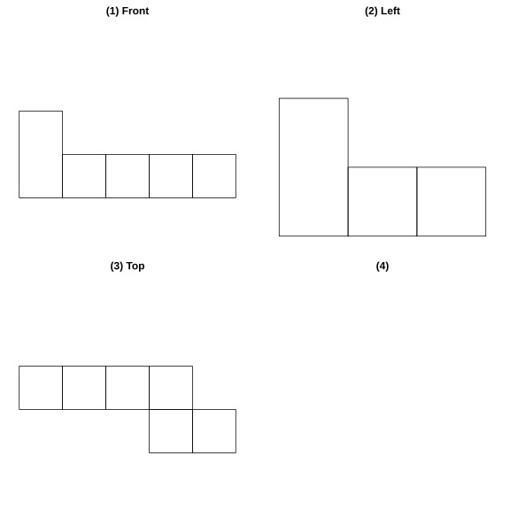
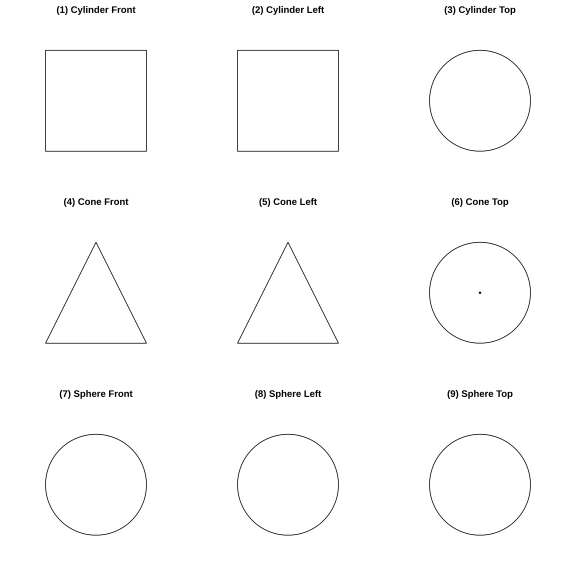
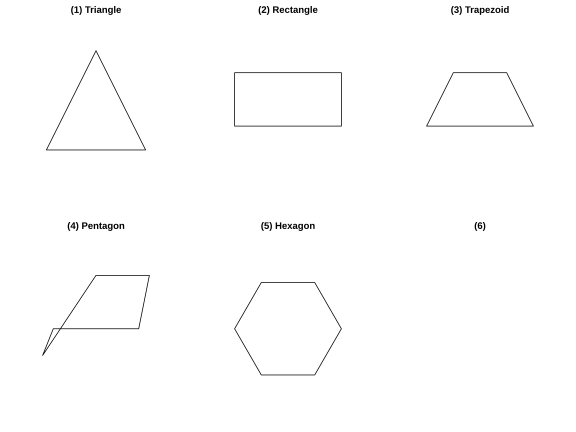

# Assignment 24

> **Definition 6.1.1** (Solid Figure)  A geometric figure whose parts do not all lie in the same plane is called a solid figure.
>
> **Definition 6.1.2** (Plane Figure)  A geometric figure whose parts all lie in the same plane is called a plane figure.
>
> **Definition 6.1.3** (Net)  Some solid figures are enclosed by several plane figures; if their surfaces are cut open appropriately, they can be unfolded into plane figures. Such a plane figure is called the net of the corresponding solid figure.
>
> **Definition 6.1.4** (Points, Lines, Planes, and Solids)  A geometric solid is also called a solid for short. What encloses a solid is a surface; where two surfaces intersect forms a line; where two lines intersect is a point.
>
> **Definition 6.1.5** (A Moving Point Forms a Line, a Moving Line Forms a Plane, a Moving Plane Forms a Solid)  A moving point forms a line, a moving line forms a plane, and a moving plane forms a solid.

### Exercise 1

(Exercise 6.1, Problem 1) Name the solid figure that each of the following objects resembles: a math textbook resembles $\;\_\_\;$, a pyramid resembles $\;\_\_\;$, a watermelon resembles $\;\_\_\;$, a fluorescent lamp resembles $\;\_\_\;$.

### Solution to Exercise 1

By **Definition 6.1.1** (Solid Figure), judge the corresponding solid figure from the object's outer shape.

A math textbook's parts do not all lie in the same plane; it has six faces and resembles a rectangular prism. A pyramid has one base and four triangular faces and resembles a square pyramid. A watermelon is round and resembles a sphere. A fluorescent lamp is long and thin and resembles a cylinder. $\blacksquare$

### Exercise 2

(Exercise 6.1, Problem 2) Match the following solid figures with their names by drawing lines: sphere, cylinder, cone, cube, triangular prism.

### Solution to Exercise 2

By **Definition 6.1.1** (Solid Figure), match the names according to the features of each solid figure.

A sphere is a solid enclosed entirely by a curved surface; a cylinder consists of two circular bases and one lateral surface; a cone consists of one circular base and one curved lateral surface; a cube consists of six square faces; a triangular prism consists of two triangular bases and three rectangular faces. Draw lines matching each solid figure with its name as shown. $\blacksquare$

### Exercise 3

(Exercise 6.1, Problem 1) As shown, a solid figure made of $9$ identical cubes; viewing it from the front, the left, and the top respectively, what plane figures do you obtain?

### Solution to Exercise 3

By **Definition 6.1.2** (Plane Figure) and the method of viewing a solid figure from different directions.

This solid figure is an L-shaped staircase made of $9$ cubes. From the front: the leftmost column has $2$ squares (stacked), and the four right columns each have $1$ square; the front view is a step shape with the left column height $2$ and the four right columns height $1$.

From the left: the leftmost column has $2$ squares, and the two right columns each have $1$ square; the left view is a step shape with the left column height $2$ and the two right columns height $1$.

From the top: the first row has $4$ squares (in a horizontal row), and the second row has $2$ squares at the far right; the top view is L-shaped (upper row $4$, lower row right $2$).

{width=100%}

$\blacksquare$

### Exercise 4

(Exercise 6.1, Problem 2) A triangular prism is shown; the three figures on the right, (1) an inverted triangle, (2) two adjacent rectangles, (3) one rectangle, are each obtained by viewing the prism from which direction?

### Solution to Exercise 4

By **Definition 6.1.2** (Plane Figure), view the triangular prism from different directions.

The triangular prism has triangular bases and three rectangular lateral faces.

(1) Inverted triangle: from the top (along the direction perpendicular to the base), what is seen is the triangular base, i.e. viewing from the top gives an inverted triangle.

(2) Two adjacent rectangles: from the front, two adjacent lateral rectangles are seen, i.e. viewing from the front gives two adjacent rectangles.

(3) One rectangle: from the left, one lateral rectangle is seen, i.e. viewing from the left gives one rectangle.

$\blacksquare$

### Exercise 5

(Exercise 6.1, Problem 3) Viewing the following solid figures (cylinder, cone, sphere) from the front, the left, and the top respectively, what plane figures do you obtain?

### Solution to Exercise 5

By **Definition 6.1.2** (Plane Figure), view each solid figure from the three directions.

(1) Cylinder: both front and left are rectangles (height is the rectangle's height, width is the base diameter), and the top is a circle.

(2) Cone: both front and left are isosceles triangles, and the top is a circle (including the center point).

(3) Sphere: front, left, and top are all circles of the same size.

{width=100%}

$\blacksquare$

### Exercise 6

(Exercise 6.1, Problem 2) Match each solid figure (cylinder, cone, triangular prism) with its net (figure (1) rectangle with two circles below, figure (2) sector with a circle below, figure (3) rectangle with triangles on two sides, figure (4) rectangle with circles on two sides, figure (5) three rectangles with two triangles above, figure (6) sector with a circle on the side) by drawing lines.

### Solution to Exercise 6

By **Definition 6.1.3** (Net), match according to the unfolded shape of each solid figure.

The net of a cylinder is one rectangle and two equal circles: figure (1) (rectangle with two circles below) and figure (4) (rectangle with circles on two sides) are both nets of a cylinder.

The net of a cone is one sector and one circle: figure (2) (sector with a circle below) and figure (6) (sector with a circle on the side) are both nets of a cone.

The net of a triangular prism is two triangles and three rectangles: figure (3) (rectangle with triangles on two sides) and figure (5) (three rectangles with two triangles above) are both nets of a triangular prism.

$\blacksquare$

### Problem 1

(Problem 6.1, Review and Consolidation, Problem 1) Match each solid figure (triangular prism, cone, cube, cylinder) with its net (figures: rectangle with triangles on two sides, sector plus circle, cross of six squares, rectangle plus circles on two sides) by drawing lines.

### Solution to Problem 1

By **Definition 6.1.3** (Net), match according to the unfolded shape of each solid figure.

The net of a triangular prism is two triangles and three rectangles → match with the rectangle-with-triangles-on-two-sides figure.

The net of a cone is one sector and one circle → match with the sector-plus-circle figure.

The net of a cube is six squares → match with the cross-of-six-squares figure.

The net of a cylinder is one rectangle and two circles → match with the rectangle-plus-circles-on-two-sides figure.

$\blacksquare$

### Problem 2

(Problem 6.1, Review and Consolidation, Problem 2) Viewing the cylinder, cone, and sphere from the front, the left, and the top respectively, what plane figures do you obtain?

### Solution to Problem 2

By **Definition 6.1.2** (Plane Figure), view each solid figure from the three directions.

(1) Cylinder: front and left are rectangles, top is a circle.

(2) Cone: front and left are isosceles triangles, top is a circle with its center.

(3) Sphere: all three directions are circles.

$\blacksquare$

### Problem 3

(Problem 6.1, Review and Consolidation, Problem 3) Which of the following plane figures, when rotated one full turn about an axis, produces the solid figure shown (a frustum of a cone)? (A: trapezoid with concave curved sides, B: trapezoid with convex curved sides, C: right trapezoid, D: hyperbola-shaped concave strip)

### Solution to Problem 3

By **Definition 6.1.5** (A Moving Plane Forms a Solid), a plane figure rotated about an axis forms a solid figure.

The target solid is a frustum of a cone (circular truncated cone), whose lateral side is a straight line. The plane figure that, rotated about the axis, produces a circular truncated cone should be a right trapezoid (one side perpendicular to the axis, one side parallel to the axis, and one slanted side). Hence figure (C), the right trapezoid, rotated one full turn about the axis, produces a circular truncated cone.

$\blacksquare$

### Problem 4

(Problem 6.1, Review and Consolidation, Problem 4) Match each solid figure with its net by drawing lines.

### Solution to Problem 4

By **Definition 6.1.3** (Net), match according to the unfolded shape of each solid figure.

The nets in the top row, left to right: rectangle with triangles on two sides (net of triangular prism), sector plus small circle (net of cone), cross of six squares (net of cube), rectangle with circles on two sides (net of cylinder).

The solids in the bottom row, left to right: cylinder, cube, triangular prism, cone.

Corresponding matches: triangular prism ↔ rectangle with triangles on two sides; cone ↔ sector plus circle; cube ↔ six squares; cylinder ↔ rectangle plus circles on two sides. $\blacksquare$

### Problem 5

(Problem 6.1, Review and Consolidation, Problem 5) As shown, a square of side $5\ \text{cm}$ is rotated one full turn about the line of one of its sides; what is the resulting geometric solid? Viewed from the front, what is the shape of the figure obtained? What is its area?

### Solution to Problem 5

By **Definition 6.1.5** (A Moving Plane Forms a Solid) and **Definition 6.1.2** (Plane Figure).

The square rotated about one side as axis produces a cylinder, with base radius $5\ \text{cm}$ and height $5\ \text{cm}$.

Viewing this cylinder from the front gives a rectangle of sides $5\ \text{cm}$ and $10\ \text{cm}$ (one side of the rectangle is the cylinder height $5\ \text{cm}$, the other is the base diameter $10\ \text{cm}$).

The area of this rectangle $=5\times10=50\ \text{cm}^{2}$.

$\blacksquare$

### Problem 6

(Problem 6.1, Review and Consolidation, Problem 6) As shown in figures (1) to (6), are these all nets of a cube?

### Solution to Problem 6

By **Definition 6.1.3** (Net), judge whether each figure can be folded into a cube.

A cube's net has $11$ basic types; a field-shaped or L-shaped four-cell structure must not appear.

Figure (1) cross shape (four cells in a horizontal row in the middle, one cell above and one below) → is a net of a cube (1-4-1 type).

Figure (2) step shape (two cells protruding right on top, two cells in a horizontal row in the middle, one cell protruding left below) → is a net of a cube (1-3-2 type).

Figure (3) T shape (three cells vertically, four cells horizontally below) → is not; three vertical cells plus four horizontal cells total $7$ cells, exceeding six faces.

Figure (4) slanted step shape (four cells arranged diagonally) → is a net of a cube (2-2-2 type).

Figure (5) offset cross shape → is a net of a cube (1-3-2 type).

Figure (6) cross shape (four cells in a horizontal row in the middle, one above and two below) → is a net of a cube (1-4-1 type).

Hence figure (3) is not a net of a cube, while the rest (1)(2)(4)(5)(6) all are. $\blacksquare$

### Problem 7

(Problem 6.1, Comprehensive Application, Problem 8) As shown, in a cube net the first row writes "China" "country" "dream", and the second row writes "I" "my" "dream" (the second row starts from the second column). After folding into a cube, what is the character on the face opposite to the face with "my"?

### Solution to Problem 7

By **Definition 6.1.3** (Net), determine the opposite relations among the faces in the net.

Net layout: the three cells of the first row are "China" "country" "dream"; the three cells of the second row are "I" "my" "dream" (starting from the second column).

After folding into a cube, "country" and "my" are opposite (same column, separated by one row), "China" and "dream" (third cell of the first row) are opposite, and "I" and "dream" (third cell of the second row) are opposite. Hence the character on the face opposite to the "my" face is "country". $\blacksquare$

### Problem 8

(Problem 6.1, Comprehensive Application, Problem 9) As shown, what can each of the following figures be folded into? (Four nets: rectangle with a circle at each end, rectangle with a pentagon at each end, semicircle plus circle, Y-shape of three quadrilaterals)

### Solution to Problem 8

By **Definition 6.1.3** (Net), judge the folded solid figure from each net.

The first (rectangle with a circle at each end): folds into a cylinder.

The second (rectangle with a pentagon at each end): folds into a pentagonal prism.

The third (semicircle plus circle): folds into a cone.

The fourth (Y-shape of three quadrilaterals sharing a vertex): folds into a triangular prism.

$\blacksquare$

### Problem 9

(Problem 6.1, Comprehensive Application, Problem 9) As shown, a rectangular box has length, width, and height $a$, $b$, and $c$ respectively. An ant crawls along the surface from vertex $A$ to the opposite vertex $B$; find the length of the shortest path.

### Solution to Problem 9

By **Definition 6.1.3** (Net), unfold the sides of the box into a plane figure and then find the shortest path.

Unfold two adjacent faces of the box into the same plane; then the shortest path is the hypotenuse of a right triangle. There are three ways to unfold:

(1) Unfold the front and top: the legs are $\left(a+b\right)$ and $c$, and the path is $\sqrt{\left(a+b\right)^{2}+c^{2}}$.

(2) Unfold the front and right side: the legs are $a$ and $\left(b+c\right)$, and the path is $\sqrt{a^{2}+\left(b+c\right)^{2}}$.

(3) Unfold the left side and top: the legs are $\left(a+c\right)$ and $b$, and the path is $\sqrt{\left(a+c\right)^{2}+b^{2}}$.

Taking the smallest of the three gives the shortest path. $\blacksquare$

### Problem 10

(Problem 6.1, Extension and Exploration, Problem 10) Can you fold a square piece of paper into a triangular pyramid? Try it by hand.

### Solution to Problem 10

By **Definition 6.1.3** (Net) and the symmetry of folding.

Fold the four corners of the square paper toward the center so that the four corner vertices meet at the center of the square. After folding, the four triangular faces form the lateral faces of a square pyramid with the center as the apex and the four sides of the square as the bases. If the square is folded twice along its two diagonals, then cut along the creases and unfolded, one obtains a net made of four triangular faces forming a triangular pyramid.

$\blacksquare$

### Problem 11

(Problem 6.1, Extension and Exploration, Problem 11) Cutting a cube with a plane, how many sides can the cross section have? Draw the shape of the cross section.

### Solution to Problem 11

By **Definition 6.1.2** (Plane Figure), the cross section is the plane figure obtained by the intersection of the plane with the cube's surface.

The plane intersects the cube's faces; each face it intersects gives one edge. The cube has six faces, so the cross section intersects at most six faces and is at most a hexagon. The cross section can be a triangle (equilateral, isosceles, or scalene), a quadrilateral (square, rectangle, or trapezoid), a pentagon, or a hexagon.

{width=100%}

$\blacksquare$

### Problem 12

(Problem 6.1, Extension and Exploration, Problem 11) As in figure (1), the net has four cells in a vertical column on the left (the third cell bears a red star), and three cells in a horizontal row on the right. Of the three cubes on the right (A: red star at upper-left of the front face, B: front face has a horizontal center line, C: front face has both horizontal and vertical center lines), which could be folded from this net?

### Solution to Problem 12

By **Definition 6.1.3** (Net), judge the visible faces of the folded cube from the pattern on the net.

In the net, the red star is in the third cell of the left vertical column. After folding, the face bearing the star is adjacent to the three horizontal cells. Since the left vertical column has four cells, after folding they form a set of lateral faces of the cube, and the star lies in the middle of a lateral face.

Option A has the star at the upper-left of the front face, which does not match the star's position in the net (middle of a lateral face), so it is ruled out.

Option B has a horizontal center line on the front face, corresponding to the edge formed after the common boundary of adjacent faces is folded. Option C has both a horizontal and a vertical center line, corresponding to the common edge of two adjacent faces.

After this net is folded, the two faces adjacent to the star face have edges along the fold lines, so a horizontal edge line can be seen from the front. Hence both options B and C could be folded from this net.

$\blacksquare$

### Picture-Telling Math History 1

(Picture-Telling Math History: The Origins of Geometry) How did geometric knowledge arise from human production and daily life?

### Solution to Picture-Telling Math History 1

By **Definition 6.1.4** (Points, Lines, Planes, and Solids), geometry originates from human abstraction of the shapes, sizes, and positional relations of objects in the real world.

After the Nile flooded in ancient Egypt, land had to be re-surveyed, giving rise to methods of land measurement; in ancient China, farming required measuring field areas and setting calendars, accumulating rich geometric knowledge. Geometry gradually arose and developed from these practical needs. $\blacksquare$
