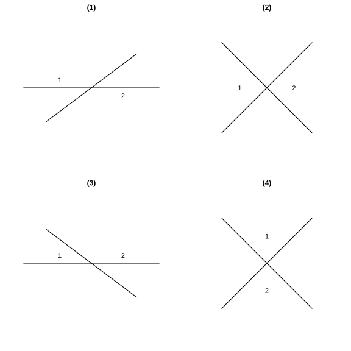
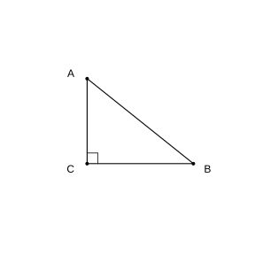
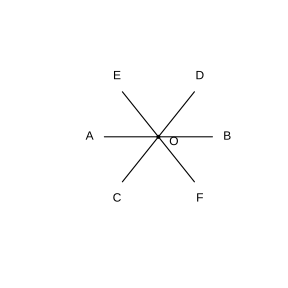
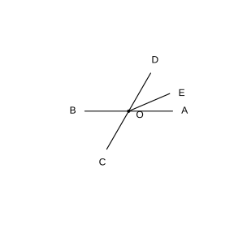
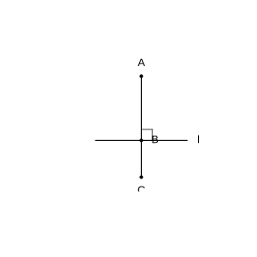
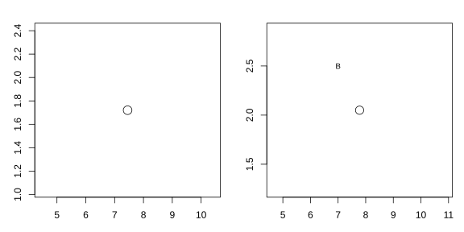

# Assignment 30

> **Definition 7.1.1** (Adjacent Supplementary Angles)  Among the four angles formed by two intersecting lines, two angles that share one common side and whose other sides are opposite extensions of each other are adjacent supplementary angles. Adjacent supplementary angles are supplementary, i.e. their sum is $180^\circ$.
>
> **Definition 7.1.2** (Vertical Angles)  Among the four angles formed by two intersecting lines, two angles that share a common vertex and whose sides are respectively the opposite extensions of each other's sides are vertical angles.
>
> **Theorem 7.1.1** (Vertical Angles Are Equal)  Vertical angles are equal.
>
> **Definition 7.1.3** (Perpendicular)  When one of the four angles formed by two intersecting lines is a right angle, the two lines are said to be perpendicular to each other, written $a\perp b$. One of the lines is called the perpendicular line of the other, and the intersection is called the foot of the perpendicular.
>
> **Basic Fact 7.1.1** (Perpendicular Lines)  In the same plane, through a given point there is exactly one line perpendicular to a given line.
>
> **Theorem 7.1.2** (The Perpendicular Segment Is the Shortest)  Among all segments joining a point outside a line to points on the line, the perpendicular segment is the shortest. Stated briefly: the perpendicular segment is the shortest.
>
> **Definition 7.1.4** (Distance from a Point to a Line)  The length of the perpendicular segment from a point outside a line to the line is called the distance from the point to the line.
>
> **Definition 7.1.5** (Corresponding Angles, Alternate Interior Angles, Consecutive Interior Angles)  When two lines are cut by a third line: a pair of angles on the same side of the two lines and on the same side of the transversal are called corresponding angles; a pair of angles between the two lines and on opposite sides of the transversal are called alternate interior angles; a pair of angles between the two lines and on the same side of the transversal are called consecutive interior angles.

### Exercise 1

(Exercise 7.1, Problem 1) In the following figures, are $\angle 1$ and $\angle 2$ vertical angles?

{width=100%}

### Solution to Exercise 1

By **Definition 7.1.2** (Vertical Angles), for a pair of angles to be vertical angles they must simultaneously satisfy: sharing a common vertex, and the sides of one being respectively the opposite extensions of the sides of the other.

In figure (1), the sides of $\angle 1$ and $\angle 2$ are not opposite extensions of each other, so they are not vertical angles; in figure (2), $\angle 1$ and $\angle 2$ share a common vertex and their sides are respectively opposite extensions of each other, so they are vertical angles; in figure (3), $\angle 1$ and $\angle 2$ do not satisfy the opposite-extension condition, so they are not vertical angles; in figure (4), the sides of $\angle 1$ and $\angle 2$ are not opposite extensions of each other, so they are not vertical angles.

In summary, only the $\angle 1$ and $\angle 2$ in figure (2) are vertical angles. $\blacksquare$

### Exercise 2

(Exercise 7.1, Problem 2) As shown, in a model of intersecting lines, if one of the angles formed by two wooden sticks $a$, $b$ is $\angle\alpha=35^\circ$, what are the other three angles? What if $\angle\alpha$ equals $90^\circ$, $115^\circ$, $m^\circ$?

### Solution to Exercise 2

Two lines intersect to form four angles; the two angles adjacent to $\angle\alpha$ are both its adjacent supplementary angles, and the angle opposite $\angle\alpha$ is its vertical angle. By **Definition 7.1.1** (Adjacent Supplementary Angles), adjacent supplementary angles sum to $180^\circ$; by **Theorem 7.1.1** (Vertical Angles Are Equal), the vertical angle equals $\angle\alpha$.

When $\angle\alpha=35^\circ$, the vertical angle is $35^\circ$, and both adjacent supplementary angles are $180^\circ-35^\circ=145^\circ$, so the other three angles are $145^\circ$, $35^\circ$, $145^\circ$.

When $\angle\alpha=90^\circ$, the vertical angle is $90^\circ$, and both adjacent supplementary angles are $180^\circ-90^\circ=90^\circ$, so the other three angles are all $90^\circ$.

When $\angle\alpha=115^\circ$, the vertical angle is $115^\circ$, and both adjacent supplementary angles are $180^\circ-115^\circ=65^\circ$, so the other three angles are $65^\circ$, $115^\circ$, $65^\circ$.

When $\angle\alpha=m^\circ$, the vertical angle is $m^\circ$, and both adjacent supplementary angles are $(180-m)^\circ$, so the other three angles are $(180-m)^\circ$, $m^\circ$, $(180-m)^\circ$. $\blacksquare$

### Exercise 3

(Exercise 7.1, Problem 3) As shown, lines $AB$, $CD$ intersect at point $O$, and $\angle AOC:\angle BOC=2:7$; then $\angle BOC=\;\_\_\;^\circ$, $\angle AOD=\;\_\_\;^\circ$.

### Solution to Exercise 3

$\angle AOC$ and $\angle BOC$ share side $OC$, and their other sides are opposite extensions of each other; by **Definition 7.1.1** (Adjacent Supplementary Angles), they are supplementary, i.e.

$$
\angle AOC+\angle BOC=180^\circ.
$$

Also $\angle AOC:\angle BOC=2:7$; set $\angle AOC=2k$, $\angle BOC=7k$; then $2k+7k=180^\circ$, giving $k=20^\circ$. Hence $\angle BOC=7k=140^\circ$.

$\angle AOD$ and $\angle BOC$ share vertex $O$, and their sides are opposite extensions of each other; by **Theorem 7.1.1** (Vertical Angles Are Equal), $\angle AOD=\angle BOC=140^\circ$. $\blacksquare$

### Exercise 4

(Exercise 7.1, Problem 1) When the four angles formed by two intersecting lines are all equal, what is the positional relation between the two lines? Why?

### Solution to Exercise 4

The four angles sum to a full angle of $360^\circ$; since they are all equal, each angle is $360^\circ\div 4=90^\circ$.

By **Definition 7.1.3** (Perpendicular), when one of the four angles formed by two intersecting lines is a right angle, the two lines are perpendicular. Here all four angles are $90^\circ$, so the two lines are perpendicular. $\blacksquare$

### Exercise 5

(Exercise 7.1, Problem 2) As shown, through point $P$ draw the perpendiculars to lines $AB$ and $CD$ respectively, and measure the distance from point $P$ to line $AB$.

### Solution to Exercise 5

By **Basic Fact 7.1.1** (Perpendicular Lines), through point $P$ there is exactly one line perpendicular to $AB$, and also exactly one line perpendicular to $CD$. Align one leg of a set square with $AB$, slide the set square along $AB$ until the other leg passes through point $P$, and draw a line along this leg; this gives the line through $P$ perpendicular to $AB$, with foot denoted $H$; draw the line through $P$ perpendicular to $CD$ in the same way.

By **Definition 7.1.4** (Distance from a Point to a Line), the distance from point $P$ to line $AB$ is the length of the perpendicular segment $PH$; measure the length of $PH$ with a ruler to obtain it. $\blacksquare$

### Exercise 6

(Exercise 7.1, Problem 3) As shown, in triangle $ABC$, $\angle C=90^\circ$.

(1) State respectively which segments' lengths are the distance from point $A$ to line $CB$ and from point $B$ to line $AC$;

(2) Among the three sides $AB$, $AC$, $CB$, which is longest? Why?

{width=50%}

### Solution to Exercise 6

By **Definition 7.1.4** (Distance from a Point to a Line), the distance from a point to a line is the length of the perpendicular segment from that point to the line.

(1) In triangle $ABC$, $\angle C=90^\circ$, i.e. $AC\perp BC$. The perpendicular segment from point $A$ to line $CB$ is $AC$, so the distance from $A$ to line $CB$ is the length of segment $AC$; the perpendicular segment from point $B$ to line $AC$ is $BC$, so the distance from $B$ to line $AC$ is the length of segment $BC$.

(2) By **Theorem 7.1.2** (The Perpendicular Segment Is the Shortest), among the segments joining an outside point to points on a line the perpendicular segment is the shortest. For point $A$, $AC$ is the perpendicular segment from $A$ to line $BC$, while $AB$ is an oblique segment, so $AB>AC$; for point $B$, $BC$ is the perpendicular segment from $B$ to line $AC$, while $AB$ is an oblique segment, so $AB>BC$. Therefore $AB$ is the longest of the three sides. $\blacksquare$

### Exercise 7

(Exercise 7.1, Problem 1) Identify respectively the corresponding angles, alternate interior angles, and consecutive interior angles in each of the following figures.

### Solution to Exercise 7

By **Definition 7.1.5** (Corresponding Angles, Alternate Interior Angles, Consecutive Interior Angles), first determine the two lines being cut and the transversal, then judge by the positions of the two angles.

In each figure, the transversal is the line that intersects both lines being cut. A pair of angles on the same side of the two cut lines and on the same side of the transversal are corresponding angles; a pair between the two cut lines and on opposite sides of the transversal are alternate interior angles; a pair between the two cut lines and on the same side of the transversal are consecutive interior angles. Identify each pair by these criteria. $\blacksquare$

### Exercise 8

(Exercise 7.1, Problem 2) As shown, with which angle is $\angle B$ an alternate interior angle? With which is it a consecutive interior angle? Which two lines are cut by which transversal to form them? Carry out the same discussion for $\angle C$.

### Solution to Exercise 8

By **Definition 7.1.5** (Corresponding Angles, Alternate Interior Angles, Consecutive Interior Angles), judge by the positions of the two angles and the transversal.

The lines containing the two sides of $\angle B$ are respectively two cut lines, and the line cutting the other side of $\angle B$ is the transversal: $\angle B$ and the corresponding angle cut out by the other transversal form alternate interior angles or consecutive interior angles. To identify them, first fix the line containing one side of $\angle B$ as the transversal and the line containing the other side as one cut line, then find the corresponding angle formed with the second cut line; this determines $\angle B$'s alternate interior angle and consecutive interior angle; similarly for $\angle C$. $\blacksquare$

### Problem 1

(Problem 7.1, Review and Consolidation, Problem 1) As shown, lines $AB$, $CD$, $EF$ intersect at point $O$.

(1) Write down the adjacent supplementary angles of $\angle AOC$ and $\angle BOE$;

(2) Write down the vertical angles of $\angle DOA$ and $\angle EOC$;

(3) If $\angle AOC=50^\circ$, find the degree measures of $\angle BOD$ and $\angle COB$.

{width=50%}

### Solution to Problem 1

By **Definition 7.1.1** (Adjacent Supplementary Angles) and **Definition 7.1.2** (Vertical Angles), judge by common side and opposite extensions.

(1) The sides of $\angle AOC$ are $OA$, $OC$; its adjacent supplementary angles are $\angle BOC$ (sharing side $OA$, with the other side the opposite extension of $OC$) and $\angle AOD$ (sharing side $OC$, with the other side the opposite extension of $OA$); hence the adjacent supplementary angles of $\angle AOC$ are $\angle BOC$ and $\angle AOD$. The sides of $\angle BOE$ are $OB$, $OE$; its adjacent supplementary angles are $\angle AOE$ and $\angle BOF$.

(2) The sides of $\angle DOA$ are respectively the opposite extensions of the sides of $\angle BOC$, so the vertical angle of $\angle DOA$ is $\angle BOC$; the sides of $\angle EOC$ are respectively the opposite extensions of the sides of $\angle FOD$, so the vertical angle of $\angle EOC$ is $\angle FOD$.

(3) $\angle BOD$ and $\angle AOC$ are vertical angles; by **Theorem 7.1.1** (Vertical Angles Are Equal), $\angle BOD=\angle AOC=50^\circ$. $\angle COB$ and $\angle AOC$ are adjacent supplementary angles; by **Definition 7.1.1** (Adjacent Supplementary Angles), $\angle COB=180^\circ-\angle AOC=180^\circ-50^\circ=130^\circ$. $\blacksquare$

### Problem 2

(Problem 7.1, Review and Consolidation, Problem 2) As shown, draw a line $l$ on a sheet of semi-transparent paper, take any point $P$ on $l$ and any point $Q$ outside $l$, and fold out a line through $P$ perpendicular to $l$. How many such lines can be folded? Why? What about through point $Q$?

### Solution to Problem 2

By **Basic Fact 7.1.1** (Perpendicular Lines), in the same plane, through a given point there is exactly one line perpendicular to a given line.

Point $P$ lies on line $l$; through $P$ there is exactly one line perpendicular to $l$, so only one line perpendicular to $l$ can be folded through $P$. Point $Q$ lies outside line $l$; through $Q$ there is likewise exactly one line perpendicular to $l$, so only one can be folded through $Q$. $\blacksquare$

### Problem 3

(Problem 7.1, Review and Consolidation, Problem 3) As shown, lines $AB$, $CD$ intersect at point $O$, $EO\perp AB$ with foot $O$, and $\angle EOC=35^\circ$; find the degree measure of $\angle AOD$.

### Solution to Problem 3

By **Definition 7.1.3** (Perpendicular), $EO\perp AB$, so $\angle EOB=90^\circ$.

At point $C$, $\angle EOB=\angle EOC+\angle COB$, so $\angle COB=\angle EOB-\angle EOC=90^\circ-35^\circ=55^\circ$.

$\angle AOD$ and $\angle COB$ are vertical angles; by **Theorem 7.1.1** (Vertical Angles Are Equal), $\angle AOD=\angle COB=55^\circ$. $\blacksquare$

### Problem 4

(Problem 7.1, Review and Consolidation, Problem 4) As shown, draw $AE\perp BC$ and $CF\perp AD$, with feet $E$ and $F$ respectively.

### Solution to Problem 4

By **Definition 7.1.3** (Perpendicular) and **Basic Fact 7.1.1** (Perpendicular Lines): align one leg of a set square with $BC$, slide it until the other leg passes through point $A$, and draw a line along this leg meeting $BC$ at $E$; then $AE\perp BC$ with foot $E$. Draw $CF\perp AD$ in the same way, with foot $F$. $\blacksquare$

### Problem 5

(Problem 7.1, Comprehensive Application, Problem 5) As shown, lines $AB$, $CD$ intersect at point $O$, and $OA$ bisects $\angle EOC$.

(1) If $\angle EOC=70^\circ$, find the degree measure of $\angle BOD$;

(2) If $\angle EOC:\angle EOD=2:3$, find the degree measure of $\angle BOD$.

{width=50%}

### Solution to Problem 5

By the meaning of an angle bisector, $OA$ bisects $\angle EOC$, so $\angle AOC=\frac{1}{2}\angle EOC$. Also $\angle BOD$ and $\angle AOC$ are vertical angles; by **Theorem 7.1.1** (Vertical Angles Are Equal), $\angle BOD=\angle AOC$.

(1) $\angle EOC=70^\circ$, so $\angle AOC=\frac{1}{2}\times 70^\circ=35^\circ$, hence $\angle BOD=\angle AOC=35^\circ$.

(2) $\angle EOC$ and $\angle EOD$ share side $OE$, and their other sides are opposite extensions of each other; by **Definition 7.1.1** (Adjacent Supplementary Angles), they are supplementary, i.e. $\angle EOC+\angle EOD=180^\circ$. Also $\angle EOC:\angle EOD=2:3$; set $\angle EOC=2k$, $\angle EOD=3k$; then $2k+3k=180^\circ$, giving $k=36^\circ$. Hence $\angle EOC=2k=72^\circ$, $\angle AOC=\frac{1}{2}\times 72^\circ=36^\circ$, and thus $\angle BOD=\angle AOC=36^\circ$. $\blacksquare$

### Problem 6

(Problem 7.1, Comprehensive Application, Problem 6) As shown, these are the footprints left by student Li Ming after a long jump in PE class. What is his long jump result? (The scale is $1:160$.)

(The accompanying picture is a real photo of footprints in the sand pit; the takeoff line and the footprint heel are marked in the figure. Just measure the drawn length of the perpendicular segment from the heel to the takeoff line.)

### Solution to Problem 6

The long jump result is the distance from the footprint heel to the takeoff line. By **Theorem 7.1.2** (The Perpendicular Segment Is the Shortest), this distance is the length of the perpendicular segment from the heel to the takeoff line.

Measure with a ruler the drawn length of the perpendicular segment from the heel to the takeoff line, denoted $l$ (unit: $\text{cm}$). By the scale $1:160$, the actual result is $160l$ (unit: $\text{cm}$), i.e. $1.6l$ (unit: $\text{m}$). Substitute the measured $l$ from the figure to obtain the actual long jump result. $\blacksquare$

### Problem 7

(Problem 7.1, Comprehensive Application, Problem 7) As shown, which two lines are cut by which transversal to form $\angle 1$ and $\angle 2$, and $\angle 3$ and $\angle 4$ respectively? What positional relation do these angles have?

### Solution to Problem 7

By **Definition 7.1.5** (Corresponding Angles, Alternate Interior Angles, Consecutive Interior Angles), first determine the three lines containing the sides of the two angles; the common line is the transversal, and the other two are the cut lines.

$\angle 1$ and $\angle 2$ share one side on the transversal, while their other sides belong to the two cut lines; by their position between the two cut lines and on opposite sides of the transversal, they are alternate interior angles. Similarly for $\angle 3$ and $\angle 4$; by their position relative to the two cut lines and the transversal, judge them as the corresponding angles (or consecutive interior angles). Simply point out the common transversal in each case. $\blacksquare$

### Problem 8

(Problem 7.1, Extension and Exploration, Problem 8) As shown, $AB\perp l$, $CB\perp l$, with $B$ the foot; then are the three points $A$, $B$, $C$ on the same line? Explain why.

{width=50%}

### Solution to Problem 8

The three points $A$, $B$, $C$ are on the same line.

By **Definition 7.1.3** (Perpendicular), $AB\perp l$ and $CB\perp l$, so $\angle ABL=90^\circ$, $\angle CBL=90^\circ$, where $L$ is any direction on line $l$. Hence

$$
\angle ABC=\angle ABL+\angle CBL=90^\circ+90^\circ=180^\circ.
$$

$\angle ABC=180^\circ$ shows that rays $BA$ and $BC$ are opposite extensions of each other, i.e. $BA$ and $BC$ lie on the same line; hence the three points $A$, $B$, $C$ are on the same line. $\blacksquare$

### Problem 9

(Problem 7.1, Extension and Exploration, Problem 9) Lines $AB$, $CD$ intersect at point $O$.

(1) $OE$, $OF$ are respectively the bisectors of $\angle AOC$, $\angle BOD$. Draw this figure.

(2) Are rays $OE$ and $OF$ on the same line? Why?

### Solution to Problem 9

(1) Draw lines $AB$, $CD$ intersecting at point $O$, then construct respectively the bisector $OE$ of $\angle AOC$ and the bisector $OF$ of $\angle BOD$.

(2) Rays $OE$ and $OF$ are on the same line.

$\angle AOC$ and $\angle BOD$ are vertical angles; by **Theorem 7.1.1** (Vertical Angles Are Equal), $\angle AOC=\angle BOD$. $OE$ bisects $\angle AOC$, so

$$
\angle EOC=\frac{1}{2}\angle AOC.
$$

$OF$ bisects $\angle BOD$, and $\angle BOD$ and $\angle AOC$ are vertical angles; one side $OB$ is the opposite extension of $OA$, and the other side $OD$ is the opposite extension of $OC$, so

$$
\angle DOF=\frac{1}{2}\angle BOD=\frac{1}{2}\angle AOC=\angle EOC.
$$

Hence $\angle EOC=\angle DOF$. Also $OC$ and $OD$ are opposite extensions of each other; $\angle EOC$ and $\angle DOF$ lie on opposite sides of line $CD$ and are equal, showing that rays $OE$ and $OF$ are opposite extensions of each other; hence $OE$ and $OF$ lie on the same line. $\blacksquare$

### Observation and Conjecture 1

(Observation and Conjecture: Illusions when looking at figures)

(1) In each group of Figure 1, which segment is longer, $a$ or $b$?

(2) In each group of Figure 2, which blue circle is larger, $A$ or $B$?

(3) In each group of Figure 3, are the blue segments parallel to each other? How can you check?

{width=100%}

### Solution to Observation and Conjecture 1

Here intuition from naked-eye observation often disagrees with the actual facts; verification by measurement with a ruler or protractor is needed.

(1) Intuitively the segments $a$ and $b$ may seem unequal in length, but measuring with a ruler shows that in each group $a$ and $b$ are actually equal.

(2) Intuitively circles $A$ and $B$ may seem unequal in size, but measuring their diameters with a ruler shows they are actually equal.

(3) In Figure 3, the segments look non-parallel because of the interference of the added patterns, but checking with a straightedge (or using the parallel-line criteria learned later) shows they are actually parallel.

Thus conjectures obtained by observation are not necessarily correct; they must also be verified through experiments (measurements) and the like. $\blacksquare$
