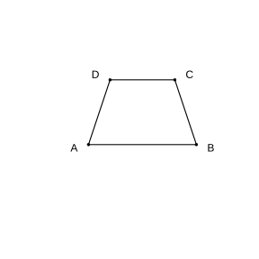

# Assignment 32

> **Definition 7.3.1** (Definition)  A clear, explicit description of a mathematical object that reveals its essential features is called a definition of the mathematical object.
>
> **Definition 7.3.2** (Proposition)  A declarative statement that can be judged to be true (correct) or false (incorrect) is called a proposition. A proposition judged true is called a true proposition, and one judged false is called a false proposition. A proposition is often written in the form "If …, then …"; after "if" comes the hypothesis, and after "then" comes the conclusion.
>
> **Definition 7.3.3** (Theorem)  A true proposition whose correctness has been confirmed through reasoning is called a theorem. A theorem can also serve as a basis for further reasoning.
>
> **Definition 7.3.4** (Proof)  When the correctness of a proposition can be judged only through reasoning, this process of reasoning is called a proof.
>
> **Method 7.3.1** (Giving a Counterexample)  To judge that a proposition is false, it suffices to give a counterexample: one that satisfies the hypothesis of the proposition but does not satisfy the conclusion.

### Exercise 1

(Exercise 7.3, Problem 1) Give some examples of definitions you have learned.

### Solution to Exercise 1

By **Definition 7.3.1** (Definition), a definition is a clear description of the essential features of a mathematical object. For example: "A line with a specified origin, positive direction, and unit length is called a number line"; "A ray starting from the vertex of an angle and dividing the angle into two equal angles is called the angle bisector of the angle"; "The length of the perpendicular segment from a point outside a line to the line is called the distance from the point to the line." These are all definitions you have learned. $\blacksquare$

### Exercise 2

(Exercise 7.3, Problem 2) Give some examples of true propositions you have learned.

### Solution to Exercise 2

By **Definition 7.3.2** (Proposition), a true proposition is a proposition judged to be correct. For example: "Vertical angles are equal"; "If two lines are both parallel to a third line, then these two lines are also parallel to each other"; "Parallel lines give equal corresponding angles." These are all true propositions you have learned. $\blacksquare$

### Exercise 3

(Exercise 7.3, Problem 3) Identify the hypothesis and conclusion of the following propositions:

(1) If $a=b$, then $5a=5b$;

(2) If $AB\perp CD$, with foot at $O$, then $\angle AOC=90^\circ$;

(3) If $\angle 1=\angle 2$, $\angle 2=\angle 3$, then $\angle 1=\angle 3$;

(4) Parallel lines give equal corresponding angles.

### Solution to Exercise 3

By **Definition 7.3.2** (Proposition), the part after "if" is the hypothesis and the part after "then" is the conclusion; if the hypothesis and conclusion are not obvious, first rewrite it in the form "If …, then …".

(1) Hypothesis: $a=b$; conclusion: $5a=5b$.

(2) Hypothesis: $AB\perp CD$, with foot at $O$; conclusion: $\angle AOC=90^\circ$.

(3) Hypothesis: $\angle 1=\angle 2$ and $\angle 2=\angle 3$; conclusion: $\angle 1=\angle 3$.

(4) Rewrite as "If two lines are parallel, then the corresponding angles are equal." Hypothesis: two lines are parallel; conclusion: corresponding angles are equal. $\blacksquare$

### Exercise 4

(Exercise 7.3, Problem 1) In the parentheses below, fill in the basis for the reasoning.

As shown in the figure, $\angle A+\angle B=180^\circ$. Prove that $\angle C+\angle D=180^\circ$.

Proof: $\because\angle A+\angle B=180^\circ$,

$\therefore AD\parallel BC$ (_______).

$\therefore\angle C+\angle D=180^\circ$ (_______).

{width=50%}

### Solution to Exercise 4

By **Theorem 7.2.3** (Criterion 3), supplementary consecutive interior angles imply parallel lines; by **Property 7.2.3** (Property 3), parallel lines give supplementary consecutive interior angles.

$\angle A$ and $\angle B$ are the consecutive interior angles formed when lines $AD$, $BC$ are cut by line $AB$; $\angle A+\angle B=180^\circ$, so $AD\parallel BC$ (supplementary consecutive interior angles imply parallel lines).

Then from $AD\parallel BC$, $\angle C$ and $\angle D$ are the consecutive interior angles formed when lines $AD$, $BC$ are cut by line $CD$, so $\angle C+\angle D=180^\circ$ (parallel lines give supplementary consecutive interior angles). $\blacksquare$

### Exercise 5

(Exercise 7.3, Problem 2) Is the proposition "corresponding angles are equal" correct? If yes, state the reason; if not, give a counterexample.

### Solution to Exercise 5

By **Method 7.3.1** (Giving a Counterexample), it suffices to give an example that satisfies the hypothesis but does not satisfy the conclusion to show that the proposition is false.

The proposition "corresponding angles are equal" is false. Corresponding angles are equal only when the two lines being cut are parallel; when the two lines being cut are not parallel, the corresponding angles are not equal.

Counterexample: draw two non-parallel lines cut by a third line; the pair of corresponding angles cut off are clearly unequal in size—they are corresponding angles but are not equal. Thus the proposition "corresponding angles are equal" is a false proposition. $\blacksquare$

### Problem 1

(Exercise 7.3, Review and Consolidation, Problem 1) Which of the following statements are propositions? Which are true propositions?

(1) If $a=b$, $b=c$, then $a=c$;

(2) The supplementary angles of equal angles are equal;

(3) Through a point draw the perpendicular to line $l$;

(4) The sum of two acute angles is an obtuse angle.

### Solution to Problem 1

By **Definition 7.3.2** (Proposition), a proposition is a declarative statement that can be judged true or false.

(1) "If $a=b$, $b=c$, then $a=c$" is a declarative statement that can be judged true or false; it is a proposition, and by transitivity of equality it is true, so it is a true proposition.

(2) "The supplementary angles of equal angles are equal" is a declarative statement that can be judged true or false; it is a proposition, and the supplementary angles of equal angles are indeed equal, so it is a true proposition.

(3) "Through a point draw the perpendicular to line $l$" is merely an operational instruction and cannot be judged true or false, so it is not a proposition.

(4) "The sum of two acute angles is an obtuse angle" is a declarative statement that can be judged true or false; it is a proposition. But the sum of the two acute angles $30^\circ$ and $30^\circ$ is $60^\circ$, which is still an acute angle, so by **Method 7.3.1** (Giving a Counterexample), it is a false proposition.

In summary, (1)(2)(4) are propositions, among which (1)(2) are true propositions. $\blacksquare$

### Problem 2

(Exercise 7.3, Review and Consolidation, Problem 2) As shown in the figure, express the following reasoning processes using symbols:

(1) Since $\angle 1$ and $\angle 2$ are equal, by "equal alternate interior angles imply parallel lines", $AB$ and $EF$ are parallel;

(2) Since $DE$ and $BC$ are parallel, by "parallel lines give equal corresponding angles", $\angle 1=\angle B$, $\angle 3=\angle C$.

### Solution to Problem 2

By **Theorem 7.2.2** (Criterion 2) and **Property 7.2.1** (Property 1), use $\because$ to mean "since" and $\therefore$ to mean "therefore".

(1) $\because\angle 1=\angle 2$, $\therefore AB\parallel EF$ (equal alternate interior angles imply parallel lines).

(2) $\because DE\parallel BC$, $\therefore\angle 1=\angle B$, $\angle 3=\angle C$ (parallel lines give equal corresponding angles). $\blacksquare$

### Problem 3

(Exercise 7.3, Review and Consolidation, Problem 3) Complete the following proofs.

(1) As shown in figure (1), $AB\parallel CD$, $BC\parallel ED$. Prove that $\angle B+\angle D=180^\circ$.

(2) As shown in figure (2), $\angle ABC=\angle A'B'C'$, and $BD$, $B'D'$ are the angle bisectors of $\angle ABC$, $\angle A'B'C'$ respectively. Prove that $\angle 1=\angle 2$.

### Solution to Problem 3

(1) Proof: $\because AB\parallel CD$, $\therefore\angle B=\angle C$ (parallel lines give equal alternate interior angles).

$\because BC\parallel ED$, $\therefore\angle C+\angle D=180^\circ$ (parallel lines give supplementary consecutive interior angles).

Substituting $\angle B=\angle C$, we get $\angle B+\angle D=180^\circ$. $\blacksquare$

(2) Proof: $\because BD$, $B'D'$ are the angle bisectors of $\angle ABC$, $\angle A'B'C'$ respectively,

$\therefore\angle 1=\frac{1}{2}\angle ABC$, $\angle 2=\frac{1}{2}\angle A'B'C'$.

Also $\because\angle ABC=\angle A'B'C'$,

$\therefore\frac{1}{2}\angle ABC=\frac{1}{2}\angle A'B'C'$ (halves of equal quantities are equal).

$\therefore\angle 1=\angle 2$. $\blacksquare$

### Problem 4

(Exercise 7.3, Comprehensive Application, Problem 4) As shown in the figure, parallel lines $AB$, $CD$ intersect $EF$ at points $E$, $F$ respectively; $EG$ bisects $\angle AEF$, $FH$ bisects $\angle EFD$. Are $EG$ and $FH$ parallel? Why?

### Solution to Problem 4

$EG\parallel FH$.

$\because AB\parallel CD$, $\therefore\angle AEF=\angle EFD$ (parallel lines give equal alternate interior angles).

$\because EG$ bisects $\angle AEF$, $FH$ bisects $\angle EFD$,

$\therefore\angle GEF=\frac{1}{2}\angle AEF$, $\angle EFH=\frac{1}{2}\angle EFD$.

From $\angle AEF=\angle EFD$, we get $\frac{1}{2}\angle AEF=\frac{1}{2}\angle EFD$, i.e. $\angle GEF=\angle EFH$.

$\angle GEF$ and $\angle EFH$ are the alternate interior angles formed when lines $EG$, $FH$ are cut by line $EF$; by **Theorem 7.2.2** (Criterion 2), equal alternate interior angles imply parallel lines, so $EG\parallel FH$. $\blacksquare$
