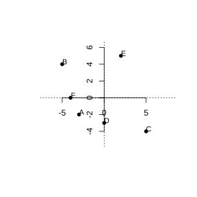
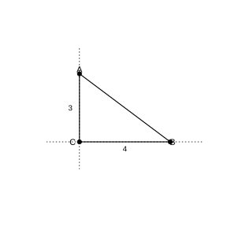
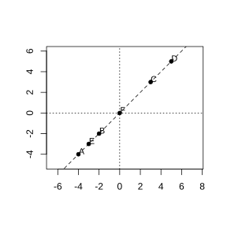
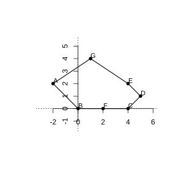
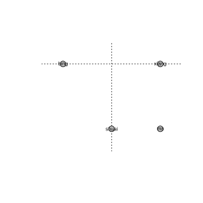
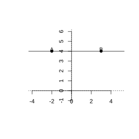
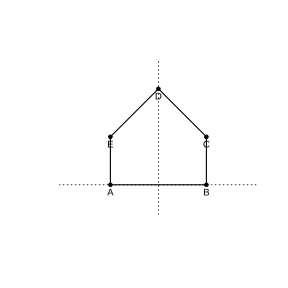

# Assignment 41

> **Definition 9.1.1** (Rectangular Coordinate System)  Draw two number lines perpendicular to each other in a plane with the same origin; together they form a rectangular coordinate system. The horizontal number line is called the $x$-axis, with right taken as the positive direction; the vertical number line is called the $y$-axis, with up taken as the positive direction; the intersection of the two axes is called the origin.
>
> **Definition 9.1.2** (Coordinates of a Point)  Through a point in the plane draw perpendiculars to the $x$-axis and $y$-axis respectively; the coordinate of the foot on the $x$-axis is the x-coordinate of the point, and the coordinate of the foot on the $y$-axis is the y-coordinate of the point. The ordered pair $\left(x,y\right)$ is called the coordinates of this point.
>
> **Property 9.1.1** (One-to-One Correspondence Between Points and Coordinates)  Points in the coordinate plane are in one-to-one correspondence with ordered pairs of real numbers.
>
> **Definition 9.1.3** (Quadrants)  The coordinate plane is divided by the two coordinate axes into four parts, called in order starting from the upper right the first, second, third, and fourth quadrants. The first quadrant $\left(+,+\right)$, the second quadrant $\left(-,+\right)$, the third quadrant $\left(-,-\right)$, the fourth quadrant $\left(+,-\right)$. Points on the coordinate axes do not belong to any quadrant.

### Exercise 1

(Exercise 9.1, Problem 1) Write down the coordinates of points $A$, $B$, $C$, $D$, $E$, $F$ in the figure.

{width=50%}

### Solution to Exercise 1

By **Definition 9.1.2** (Coordinates of a Point), draw a perpendicular from the point to the $x$-axis to get the x-coordinate, and to the $y$-axis to get the y-coordinate. Reading off the coordinates of the points,

$$
A\left(-3,-2\right),\ B\left(-5,4\right),\ C\left(5,-4\right),\ D\left(0,-3\right),\ E\left(2,5\right),\ F\left(-4,0\right).
$$

Among them, $D$ is on the $y$-axis (x-coordinate $0$), and $F$ is on the $x$-axis (y-coordinate $0$). $\blacksquare$

### Exercise 2

(Exercise 9.1, Problem 2) In the rectangular coordinate system shown, plot the following points: $L\left(-5,-3\right)$, $M\left(4,0\right)$, $N\left(-6,2\right)$, $P\left(5,-3.5\right)$, $Q\left(0,5\right)$, $R\left(6,2\right)$.

### Solution to Exercise 2

By **Definition 9.1.2** (Coordinates of a Point), first find the x-coordinate on the $x$-axis, then find the y-coordinate on the $y$-axis; the intersection of the two perpendiculars is the point. Plot $L\left(-5,-3\right)$, $M\left(4,0\right)$, $N\left(-6,2\right)$, $P\left(5,-3.5\right)$, $Q\left(0,5\right)$, $R\left(6,2\right)$ in order. Among them, $M\left(4,0\right)$ is on the $x$-axis, and $Q\left(0,5\right)$ is on the $y$-axis. $\blacksquare$

### Exercise 3

(Exercise 9.1, Problem 3) According to the position of the point, fill in the table using "$+$" and "$-$".

### Solution to Exercise 3

By **Definition 9.1.3** (Quadrants), in the first quadrant both x- and y-coordinates are positive, in the second quadrant the x-coordinate is negative and the y-coordinate positive, in the third quadrant both are negative, and in the fourth quadrant the x-coordinate is positive and the y-coordinate negative.

First quadrant: x-coordinate $+$, y-coordinate $+$; second quadrant: x-coordinate $-$, y-coordinate $+$; third quadrant: x-coordinate $-$, y-coordinate $-$; fourth quadrant: x-coordinate $+$, y-coordinate $-$. $\blacksquare$

### Exercise 4

(Exercise 9.1, Problem 1) On grid paper there are two points $A$, $B$. If a rectangular coordinate system is established with point $B$ as the origin, then the coordinates of point $A$ are $\left(-2,1\right)$. If a rectangular coordinate system is established with point $A$ as the origin, then the coordinates of point $B$ are (　　).

(1) $\left(-2,1\right)$　(2) $\left(2,-1\right)$　(3) $\left(-2,-1\right)$　(4) $\left(2,1\right)$

### Solution to Exercise 4

By **Property 9.1.1** (One-to-One Correspondence Between Points and Coordinates), the relative positions of the two points do not change; only the origin moves from $B$ to $A$.

With $B$ as the origin, $A\left(-2,1\right)$, which means $A$ is $2$ units to the left of $B$ and $1$ unit above. Conversely, with $A$ as the origin, $B$ is $2$ units to the right of $A$ and $1$ unit below, so the coordinates of $B$ are $\left(2,-1\right)$. Choose (2). $\blacksquare$

### Exercise 5

(Exercise 9.1, Problem 2) As shown in the figure, in right triangle $ABC$, $\angle C=90^\circ$, $AC=3$, $BC=4$. Establish a rectangular coordinate system and write down the coordinates of the three vertices of triangle $ABC$.

{width=50%}

### Solution to Exercise 5

By **Definition 9.1.1** (Rectangular Coordinate System), choose point $C$ as the origin, the line on which $CA$ lies as the $y$-axis, and the line on which $CB$ lies as the $x$-axis.

Then $C\left(0,0\right)$. $AC=3$ in the positive $y$-axis direction, so $A\left(0,3\right)$. $BC=4$ in the positive $x$-axis direction, so $B\left(4,0\right)$.

That is, $A\left(0,3\right)$, $B\left(4,0\right)$, $C\left(0,0\right)$. (With a different coordinate system, the coordinates change accordingly.) $\blacksquare$

### Exercise 6

(Exercise 9.1, Problem 3) The figure shows the cross-section of a piece of angle steel. Establish an appropriate rectangular coordinate system and use coordinates to represent the positions of the vertices of the angle steel (the side length of each small square in the figure represents $10\,cm$).

### Solution to Exercise 6

By **Definition 9.1.1** (Rectangular Coordinate System), choose one right-angle vertex of the angle steel as the origin, and take the lines on which the two sides lie as the positive directions of the $x$-axis and $y$-axis respectively. Each small grid represents $10\,cm$; according to the number of grids of each vertex relative to the origin, write down its coordinates (x-coordinate, y-coordinate, in units of $10\,cm$). $\blacksquare$

### Problem 1

(Exercise 9.1, Review and Consolidation, Problem 1) As shown in the figure, write down the coordinates of each point labeled with a letter, and indicate its x-coordinate and y-coordinate.

### Solution to Problem 1

By **Definition 9.1.2** (Coordinates of a Point), through each point draw perpendiculars to the $x$-axis and $y$-axis respectively, and read off the number corresponding to the foot. The coordinates of the points are

$$
A\left(-5,4\right),\ B\left(-2,2\right),\ C\left(4,4\right),\ D\left(2,1\right),\ E\left(5,-3\right),\ F\left(0,-2\right),\ G\left(-4,-4\right),\ H\left(-3,-1\right).
$$

The first number of each point is the x-coordinate, and the second number is the y-coordinate. $\blacksquare$

### Problem 2

(Exercise 9.1, Review and Consolidation, Problem 2) In the rectangular coordinate system, plot the following points: point $A$ is on the $y$-axis, above the origin, $2$ units of length from the origin; point $B$ is on the $x$-axis, to the right of the origin, $1$ unit of length from the origin; point $C$ is above the $x$-axis and to the right of the $y$-axis, at distance $2$ units of length from each coordinate axis; point $D$ is on the $x$-axis, to the right of the origin, $3$ units of length from the origin; point $E$ is above the $x$-axis and to the right of the $y$-axis, at distance $2$ units of length from the $x$-axis and $4$ units of length from the $y$-axis. Connect these points in order. What figure do you get?

### Solution to Problem 2

By **Definition 9.1.2** (Coordinates of a Point), the distance to the $x$-axis is the absolute value of the y-coordinate, and the distance to the $y$-axis is the absolute value of the x-coordinate.

$A$ on the $y$-axis, $2$ from the origin (up): $A\left(0,2\right)$. $B$ on the $x$-axis, $1$ from the origin (right): $B\left(1,0\right)$. $C$ in the first quadrant, $2$ from both axes: $C\left(2,2\right)$. $D$ on the $x$-axis, $3$ from the origin (right): $D\left(3,0\right)$. $E$ at distance $2$ from the $x$-axis and $4$ from the $y$-axis (first quadrant): $E\left(4,2\right)$.

Connect $A$, $B$, $C$, $D$, $E$ in order; a figure resembling an arrow (or a small house) is obtained. $\blacksquare$

### Problem 3

(Exercise 9.1, Review and Consolidation, Problem 3) As shown in the figure, in the given rectangular coordinate system plot points $A\left(-4,-4\right)$, $B\left(-2,-2\right)$, $C\left(3,3\right)$, $D\left(5,5\right)$, $E\left(-3,-3\right)$, $F\left(0,0\right)$. What is the relationship among these points? Can you find some other similar points?

{width=50%}

### Solution to Problem 3

By **Definition 9.1.2** (Coordinates of a Point), plot the points. Observing, the x-coordinate of each point equals its y-coordinate: $-4=-4$, $-2=-2$, $3=3$, $5=5$, $-3=-3$, $0=0$.

Thus all these points lie on the line $y=x$. Similar points, such as $\left(1,1\right)$, $\left(2,2\right)$, $\left(-1,-1\right)$, $\left(4,4\right)$, etc., whose x-coordinate equals y-coordinate, all lie on this line. $\blacksquare$

### Problem 4

(Exercise 9.1, Review and Consolidation, Problem 4) As shown in the figure, establish a rectangular coordinate system so that the coordinates of points $B$, $C$ are $\left(0,0\right)$ and $\left(4,0\right)$ respectively. Write down the coordinates of points $A$, $D$, $E$, $F$, $G$, and indicate the quadrant in which they lie.

{width=50%}

### Solution to Problem 4

With $B$ as the origin and the line on which $BC$ lies as the $x$-axis, $C\left(4,0\right)$. By **Definition 9.1.2** (Coordinates of a Point), read off the coordinates:

$$
A\left(-2,2\right),\ D\left(5,1\right),\ E\left(4,2\right),\ F\left(2,0\right),\ G\left(1,4\right).
$$

Judge by **Definition 9.1.3** (Quadrants): $A\left(-2,2\right)$ has negative x and positive y, in the second quadrant; $D\left(5,1\right)$, $E\left(4,2\right)$, $G\left(1,4\right)$ have both x and y positive, in the first quadrant; $F\left(2,0\right)$ is on the $x$-axis, belonging to no quadrant; $B\left(0,0\right)$ is the origin, and $C\left(4,0\right)$ is on the $x$-axis. $\blacksquare$

### Problem 5

(Exercise 9.1, Review and Consolidation, Problem 5) The figure is a schematic diagram of part of a Chinese chess board. Establish a rectangular coordinate system so that the piece "Shuai" is at point $\left(0,-4\right)$ and the piece "Ma" is at point $\left(3,-4\right)$; then the piece "Bing" is at point _______. If the "Ma" takes one more step, then the new position of the "Ma" is at point _______.

{width=50%}

### Solution to Problem 5

By **Definition 9.1.2** (Coordinates of a Point), determine the coordinate system with Shuai $\left(0,-4\right)$ and Ma $\left(3,-4\right)$: they have the same y-coordinate and differ by $3$ in x-coordinate, so each small grid is $1$ unit, with the $x$-axis to the right and the $y$-axis upward.

Reading off by the grids of the board, "Bing" is at $\left(-3,0\right)$ and "Xiang" is at $\left(3,0\right)$.

The "Ma" moves along the diagonal of an "L" shape; from $\left(3,-4\right)$ it can move along the board lines to $\left(1,-3\right)$ (it can also move to $\left(5,-3\right)$, $\left(2,-2\right)$, $\left(4,-2\right)$, etc.; any legal step within the board works). Take the new position of the "Ma" as $\left(1,-3\right)$.

Thus "Bing" is at $\left(-3,0\right)$, and after one more step the "Ma" can be at $\left(1,-3\right)$. $\blacksquare$

### Problem 6

(Exercise 9.1, Review and Consolidation, Problem 6) In the rectangular coordinate system, plot each of the following groups of points, and connect the points within each group in order with segments.

(1) $\left(0,4\right)$, $\left(-2,2\right)$, $\left(-1,2\right)$, $\left(-3,0\right)$, $\left(-1,0\right)$, $\left(-4,-2\right)$, $\left(-1,-2\right)$, $\left(-1,-4\right)$, $\left(1,-4\right)$, $\left(1,-2\right)$, $\left(4,-2\right)$, $\left(1,0\right)$, $\left(3,0\right)$, $\left(1,2\right)$, $\left(2,2\right)$, $\left(0,4\right)$;

(2) $\left(-2,2\right)$, $\left(0,2\right)$, $\left(0,1\right)$, $\left(-1,0\right)$, $\left(-1,-2\right)$, $\left(0,-3\right)$, $\left(4,-3\right)$, $\left(3,-2\right)$, $\left(6,0\right)$, $\left(0,0\right)$, $\left(1,1\right)$, $\left(1,2.5\right)$, $\left(0,3\right)$, $\left(-2,2\right)$.

Observe the resulting figures. What do they resemble? Find the areas of the resulting figures.

### Solution to Problem 6

By **Definition 9.1.2** (Coordinates of a Point), plot the points and connect them. Plot and connect in order according to the given coordinates; a pattern drawn with coordinates is obtained (such as an animal and a vehicle). The area can be found by dividing the pattern into several triangles and rectangles, computing each separately, and adding them up. $\blacksquare$

### Problem 7

(Exercise 9.1, Review and Consolidation, Problem 7) Establish a rectangular coordinate system, plot points $A\left(-2,4\right)$, $B\left(3,4\right)$, and draw line $AB$. If point $C$ is any point on line $AB$, what is the y-coordinate of point $C$? Think about it:

(1) If some points lie on a line parallel to the $x$-axis, what is characteristic of their y-coordinates?

(2) If some points lie on a line parallel to the $y$-axis, what is characteristic of their x-coordinates?

{width=50%}

### Solution to Problem 7

Both $A\left(-2,4\right)$ and $B\left(3,4\right)$ have y-coordinate $4$, and all points on line $AB$ determined by the two points have y-coordinate $4$. Thus the y-coordinate of point $C$ is $4$.

(1) By **Definition 9.1.2** (Coordinates of a Point), all points on a line parallel to the $x$-axis are at the same distance from the $x$-axis, so their y-coordinates are all equal.

(2) All points on a line parallel to the $y$-axis are at the same distance from the $y$-axis, so their x-coordinates are all equal. $\blacksquare$

### Problem 8

(Exercise 9.1, Review and Consolidation, Problem 8) In the rectangular coordinate system, choose some points whose x- and y-coordinates satisfy the following conditions, mark their positions, and see in which quadrant or on which coordinate axis they lie:

(1) The coordinates of point $P\left(x,y\right)$ satisfy $xy>0$;

(2) The coordinates of point $P\left(x,y\right)$ satisfy $xy<0$;

(3) The coordinates of point $P\left(x,y\right)$ satisfy $xy=0$.

### Solution to Problem 8

By the signs of the x- and y-coordinates in each quadrant in **Definition 9.1.3** (Quadrants).

(1) $xy>0$ means $x$, $y$ have the same sign: both positive is the first quadrant, both negative is the third quadrant. Thus these points lie in the first or third quadrant.

(2) $xy<0$ means $x$, $y$ have opposite signs: $x$ positive and $y$ negative is the fourth quadrant, $x$ negative and $y$ positive is the second quadrant. Thus these points lie in the second or fourth quadrant.

(3) $xy=0$ means $x=0$ or $y=0$: points with $x=0$ lie on the $y$-axis, and points with $y=0$ lie on the $x$-axis. Thus these points lie on the coordinate axes. $\blacksquare$

### Problem 9

(Exercise 9.1, Comprehensive Application, Problem 9) Given points $O\left(0,0\right)$, $B\left(1,2\right)$, point $A$ lies on a coordinate axis, and $S_{\triangle OAB}=2$. Find the coordinates of point $A$ satisfying the conditions.

### Solution to Problem 9

Point $A$ lies on a coordinate axis; there are two cases.

If $A$ is on the $x$-axis, let $A\left(a,0\right)$. Taking $OA$ as the base, of length $\left|a\right|$, the height is the distance from point $B$ to the $x$-axis, namely the y-coordinate of $B$, which is $2$. By the triangle area formula,

$$
S_{\triangle OAB}=\frac{1}{2}\left|a\right|\cdot 2=\left|a\right|=2,
$$

so $a=\pm 2$, i.e. $A\left(2,0\right)$ or $A\left(-2,0\right)$.

If $A$ is on the $y$-axis, let $A\left(0,b\right)$. Taking $OA$ as the base, of length $\left|b\right|$, the height is the distance from point $B$ to the $y$-axis, namely the x-coordinate of $B$, which is $1$. Then

$$
S_{\triangle OAB}=\frac{1}{2}\left|b\right|\cdot 1=2,
$$

so $\left|b\right|=4$, $b=\pm 4$, i.e. $A\left(0,4\right)$ or $A\left(0,-4\right)$.

In summary, the points $A$ satisfying the conditions are $\left(2,0\right)$, $\left(-2,0\right)$, $\left(0,4\right)$, $\left(0,-4\right)$. $\blacksquare$

### Problem 10

(Exercise 9.1, Extension and Exploration, Problem 10) Design a figure that can be drawn using the coordinates of its vertices, tell these coordinates to your classmate, and see whether he can draw the figure you designed.

{width=50%}

### Solution to Problem 10

By **Property 9.1.1** (One-to-One Correspondence Between Points and Coordinates), choose several key points of the figure, write down the coordinates of each point, and then specify the connecting order. For example, design a "house" figure whose vertex coordinates in order are $A\left(-2,0\right)$, $B\left(2,0\right)$, $C\left(2,2\right)$, $D\left(0,4\right)$, $E\left(-2,2\right)$, connected in the order $A\to B\to C\to D\to E\to A$. The classmate plots the points and connects them according to the coordinates to draw the figure. $\blacksquare$
