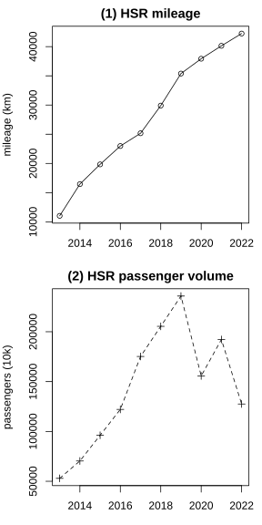
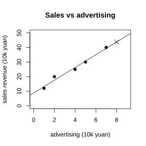

# Assignment 59

> **Definition 12.1.1** (Comprehensive Survey)  A survey conducted on the entire population of objects.
>
> **Definition 12.1.3** (Sample Survey)  Surveying only a part of the objects and inferring the whole from the data.
>
> **Definition 12.1.6** (Simple Random Sampling)  Every individual in the population has an equal chance of being selected.
>
> **Definition 12.2.1** (Pie Chart)  The size of a sector represents each part's percentage of the population.
>
> **Definition 12.2.2** (Bar Chart)  The height of a small rectangle represents the quantity of each category.
>
> **Definition 12.2.3** (Line Chart)  The rise or fall of a broken line represents the change of data over time.
>
> **Definition 12.2.6** (Frequency Distribution Histogram)  The area of a small rectangle represents the frequency of each group.
>
> **Definition 12.2.7** (Trend Chart)  A line describing the relationship between two quantities.

### Review Problem 1

(Review Problems, Review and Consolidation, Problem 1) What shortcomings exist in the cinema survey questionnaire?

Questionnaire: name, age; 1. the film watched tonight; 2. was the film good (very good / good / not good); 3. did you buy popcorn; 4. rate on a ten-point scale; 5. compare with the previous session.

### Solution to Review Problem 1

Shortcomings: (1) requiring the name involves personal privacy and may affect truthful answers; (2) question 2 has only three levels, lacking middle options such as "average / not good"; (3) question 3 about "buying popcorn" is unrelated to surveying the film's popularity and deviates from the theme; (4) the survey targets people who came to the cinema "tonight", so the sample is biased toward those already watching films and cannot represent all viewers. $\blacksquare$

### Review Problem 2

(Review Problems, Review and Consolidation, Problem 2) For the following questions, use a comprehensive survey or a sample survey?

(1) The air quality of a certain city;

(2) The eyesight and eye-care habits of middle school students nationwide;

(3) The technical level of a batch of applicants;

(4) The current number of fish in a certain pond.

### Solution to Review Problem 2

(1) Sample survey; multi-point monitoring is needed and it cannot be comprehensive.

(2) Sample survey; there are a large number of middle school students nationwide.

(3) Comprehensive survey; applicants must be assessed one by one.

(4) Sample survey; fish in water cannot be counted comprehensively. $\blacksquare$

### Review Problem 3

(Review Problems, Review and Consolidation, Problem 3) Are the following samples representative?

(1) To understand the courses liked by the whole school, survey only the boys of a certain class;

(2) To understand the fire-prevention awareness of community residents, survey only the students of this class;

(3) To understand the average daily sales of a mall, survey only on weekends.

### Solution to Review Problem 3

(1) Not representative; girls are not included.

(2) Not representative; the students of this class are not community residents.

(3) Not representative; weekend sales are high and cannot represent weekdays. $\blacksquare$

### Review Problem 4

(Review Problems, Review and Consolidation, Problem 4) The school clinic surveyed $30$ seventh-grade boys and found an average weight of $48\ \text{kg}$. Can this serve as an estimate of the average weight of seventh-grade students?

### Solution to Review Problem 4

It cannot. The sample contains only seventh-grade boys, includes neither girls nor other grades, and is not representative; it cannot represent the average weight of all seventh-grade students. $\blacksquare$

### Review Problem 5

(Review Problems, Review and Consolidation, Problem 5) A survey of students' weekly housework time divides them into four groups, A ($x<60$), B ($60\le x<90$), C ($90\le x<120$), D ($x\ge120$). It is known that group B has $70$ people, accounting for $35\%$, and group D accounts for $40\%$.

(1) How many students were surveyed in total?

(2) There are $1500$ students in the school; estimate about how many students have a weekly housework time of no less than $90\ \text{min}$?

### Solution to Review Problem 5

(1) Since group B's $70$ people account for $35\%$, the total is $\frac{70}{35\%}=200$ people.

(2) Group D accounts for $40\%$, namely $80$ people. Groups A and C together account for $100\%-35\%-40\%=25\%$; from the bar chart, group A has $20$ people, $10\%$, so group C accounts for $15\%$, namely $30$ people. Those with no less than $90\ \text{min}$ are groups C and D, together accounting for $15\%+40\%=55\%$. The school-wide estimate is $1500\times55\%=825$ people. $\blacksquare$

### Review Problem 6

(Review Problems, Review and Consolidation, Problem 6) Randomly sample the shoe sizes of $38$ girls: $35,37,41,35,37,36,37,38,36,37,37,38,35,34,39,35,40,36,37,36,38,39,37,39,36,35,36,37,38,34,40,37,35,38,40,36,37,36$.

(1) Organize the data and draw a pie chart to show the percentage of each shoe size;

(2) Make suggestions for the school's purchase of girls' sports shoes.

### Solution to Review Problem 6

(1) Counting: size 34: $2$ people, size 35: $5$ people, size 36: $8$ people, size 37: $10$ people, size 38: $5$ people, size 39: $3$ people, size 40: $3$ people, size 41: $1$ person. The percentages are $5.3\%,13.2\%,21.1\%,26.3\%,13.2\%,7.9\%,7.9\%,2.6\%$.

(2) Sizes 36 and 37 together account for $47.4\%$; the school should buy more sizes 36 and 37, and fewer sizes 34 and 41. $\blacksquare$

### Review Problem 7

(Review Problems, Comprehensive Application, Problem 7) The operating mileage (km) of high-speed rail from 2013 to 2022 was $11028,16456,19838,22980,25164,29904,35388,37929,40139,42241$; the passenger volume (ten thousand people) was $52962,70378,96139,122128,175216,205430,235833,155707,192236,127533$. Choose an appropriate statistical chart to describe the changes.

{width=50%}

### Solution to Review Problem 7

By **Definition 12.2.3** (Line Chart), draw a composite line chart as shown. The operating mileage grows steadily year by year; the passenger volume rose rapidly before 2019, fell from 2020 due to the pandemic, and had not recovered to the 2019 level by 2022. $\blacksquare$

### Review Problem 8

(Review Problems, Comprehensive Application, Problem 8) The average monthly water consumption (t) of 50 families last year: from $1.5$ to $24.8$.

(1) Group appropriately, list a frequency distribution table and draw a histogram;

(2) To keep the water-fee expenditure of $60\%$ of families unaffected, what should the water-consumption standard be?

### Solution to Review Problem 8

(1) The range is $24.8-1.5=23.3$; take a class width of $3$ and divide into about $8$ groups. Most families' average monthly water consumption falls between $3\sim12\ \text{t}$, and a few exceed $18\ \text{t}$.

(2) To keep $60\%$ of families unaffected, i.e. the water consumption corresponding to a cumulative relative frequency of $60\%$. Cumulating from the frequency distribution table, the water consumption of the $30$th family is about $9\ \text{t}$. Hence set the standard at $9\ \text{t}$, charging $1.5$ times for the excess, which keeps the water fee of the first $60\%$ of families unaffected. $\blacksquare$

### Review Problem 9

(Review Problems, Comprehensive Application, Problem 9) The fuel consumption per hundred kilometers (L) of 30 cars of the same model: from $6.9$ to $8.3$. Statistically analyze the fuel consumption of this batch of cars.

### Solution to Review Problem 9

Maximum $8.3$, minimum $6.9$, range $1.4$. Take a class width of $0.2$ for grouping. Most cars' fuel consumption falls between $7.2\sim7.8\ \text{L}$, averaging about $7.5\ \text{L}$; the consumption is relatively concentrated, with a few vehicles on the high side. $\blacksquare$

### Review Problem 10

(Review Problems, Extension and Exploration, Problem 10) Advertising expenditure and sales revenue (ten thousand yuan): $\left(1,12\right),\left(2,20\right),\left(4,25\right),\left(5,30\right),\left(7,40\right)$. Draw a trend chart and predict the sales revenue when the advertising expenditure is $8$ ten-thousand yuan.

{width=50%}

### Solution to Review Problem 10

By **Definition 12.2.7** (Trend Chart), take advertising expenditure as the horizontal axis and sales revenue as the vertical axis; plot the points and draw the trend line as shown. The points show an upward trend. Extrapolating from the trend line, when the advertising expenditure is $8$ ten-thousand yuan, the sales revenue is about $44$ ten-thousand yuan. $\blacksquare$

### Review Problem 11

(Review Problems, Extension and Exploration, Problem 11) Design a survey plan to understand the after-school reading situation of students in this school, and compare the differences between boys and girls in reading preferences and reading volume.

### Solution to Review Problem 11

Use a sample survey: randomly draw several boys and girls in proportion to the number in each grade, design a questionnaire covering weekly reading time, usual book types, reading volume, etc. After collection, group by gender, use a bar chart to compare boys' and girls' reading volume, a pie chart to compare reading types, and analyze the differences. $\blacksquare$
