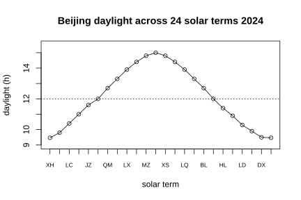

# Assignment 60

> **Definition 12.2.3** (Line Chart)  The rise or fall of a broken line represents the change of data over time.
>
> **Definition 12.2.7** (Trend Chart)  A statistical chart using a line to describe the relationship between one quantity and another.
>
> **Formula 12.5.1** (Daylight Duration)  Daylight duration $=$ (noon time $-$ sunrise time) $\times2=$ (sunset time $-$ noon time) $\times2$.

### Inquiry 1

(Comprehensive and Practical Activity, Activity 1, Problem 1) Investigate the changing pattern of daylight duration in Beijing in 2024. It is known that on Minor Cold (January 6) sunrise is $7:36$, sunset is $17:04$, and daylight is $9\ \text{h}\ 28\ \text{min}$; at the spring equinox daylight is about $12\ \text{h}$; at the summer solstice about $15\ \text{h}$; at the winter solstice about $9\ \text{h}\ 28\ \text{min}$.

(1) Calculate the daylight duration on Minor Cold;

(2) Draw a line chart of the daylight duration on the 24 solar terms in Beijing;

(3) Infer the changing pattern of daylight duration in Beijing, and determine which day has the longest daylight.

{width=50%}

### Solution to Inquiry 1

(1) By **Formula 12.5.1**, daylight duration $=$ (sunset $-$ noon) $\times2=\left(17:04-12:00\right)\times2=5\ \text{h}\ 04\ \text{min}\times2=10\ \text{h}\ 08\ \text{min}$. The table directly gives $9\ \text{h}\ 28\ \text{min}$; since noon is not exactly Beijing time $12:00$, there is a longitude error.

(2) Taking the order of the solar terms as the horizontal axis and daylight duration as the vertical axis, draw the line chart as shown.

(3) From the line chart, the daylight duration in Beijing gradually lengthens from the winter solstice to the summer solstice, and gradually shortens from the summer solstice to the winter solstice. The longest day is the summer solstice (June 21), about $15\ \text{h}$; the shortest day is the winter solstice, about $9\ \text{h}\ 28\ \text{min}$. $\blacksquare$

### Inquiry 2

(Comprehensive and Practical Activity, Activity 2, Problem 1) Compare the daylight duration on the 24 solar terms in 2024 among three places: Beijing, Artux in Xinjiang, and Jieyang in Guangdong.

(1) Observe the change of daylight duration in the three places and explain it with a statistical chart;

(2) What factors affect the change of daylight duration?

(3) If a place's daylight lengthens day by day, how do the sunrise and sunset times change?

### Solution to Inquiry 2

(1) The daylight duration of all three places shows an annual cycle of "short at the winter solstice, long at the summer solstice", but with different amplitudes: Artux is at a similar latitude to Beijing, and its daylight curve is similar in shape but overall delayed due to the different longitude; Jieyang is at a low latitude, and the difference between summer-solstice and winter-solstice daylight is small.

(2) The main factors affecting daylight duration are latitude (which determines the difference between summer-solstice and winter-solstice daylight) and date (which determines the position of the sun's direct rays). On the same date, the higher the latitude, the longer the summer-solstice daylight and the shorter the winter-solstice daylight.

(3) By **Formula 12.5.1**, daylight duration $=($ noon $-$ sunrise $)\times2$. If daylight lengthens day by day, then (noon $-$ sunrise) grows, i.e. sunrise advances day by day; at the same time (sunset $-$ noon) grows, i.e. sunset is delayed day by day. $\blacksquare$

### Inquiry 3

(Comprehensive and Practical Activity, Activity 2, Problem 2) Given the daylight duration of a place, how can one infer the sunrise and sunset times? If the next day's sunrise time is known, how does one calculate the nighttime duration between the two days?

### Solution to Inquiry 3

By **Formula 12.5.1**, given the daylight duration $T$ and taking noon as $12:00$, sunrise $=12:00-\frac{T}{2}$, and sunset $=12:00+\frac{T}{2}$.

The nighttime duration $=24\ \text{h}-T$. If the next day's sunrise time $t_{\text{出}}'$ is known, then the next day's nighttime duration $=t_{\text{出}}'$ (from the previous day's sunset to the next day's sunrise), i.e. $t_{\text{出}}'-$ the previous day's sunset time. $\blacksquare$

### Inquiry 4

(Comprehensive and Practical Activity, Activity 3, Problem 1, optional) How does a smartphone intelligently recognize the change of sunrise and sunset times?

### Solution to Inquiry 4

The phone obtains the user's latitude and longitude through positioning, and then uses an astronomical formula to calculate that day's sunrise and sunset times based on the date (the position of the sun's direct rays), thereby automatically turning the eye-care mode on or off. This is precisely the application of **Formula 12.5.1** and the laws of the earth's revolution in daily life. $\blacksquare$
