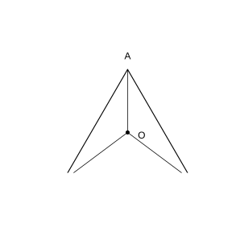
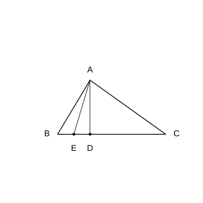
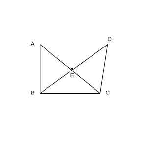
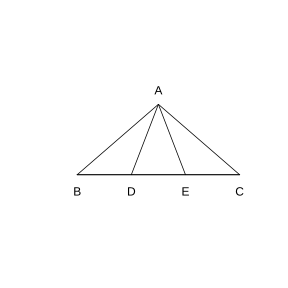
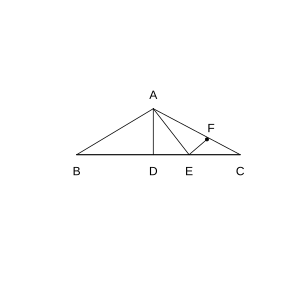
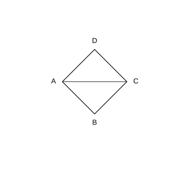
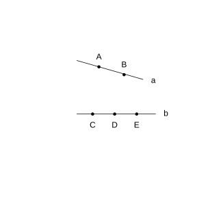

# Assignment 61

> **Definition 13.1.1** (Triangle)  The figure formed by three segments not on the same line, joined end to end in order, is called a triangle.
>
> **Definition 13.1.2** (Sides, Vertices and Interior Angles)  The segments making up a triangle are called the sides of the triangle; the common endpoint of two adjacent sides is called a vertex of the triangle; the angle formed by two adjacent sides is called an interior angle of the triangle, briefly an angle of the triangle. A triangle with vertices $A,B,C$ is denoted $\triangle ABC$.
>
> **Definition 13.1.3** (Isosceles Triangle)  A triangle with two equal sides is called an isosceles triangle; the two equal sides are called the legs, the other side is called the base, the angle between the two legs is called the vertex angle, and the angle between a leg and the base is called a base angle.
>
> **Definition 13.1.4** (Equilateral Triangle)  A triangle with all three sides equal is called an equilateral triangle; an equilateral triangle is a special isosceles triangle.
>
> **Definition 13.1.5** (Classification of Triangles by Sides)  By the equality relation of sides, triangles are first divided into scalene triangles and isosceles triangles; isosceles triangles are further divided into isosceles triangles whose base and legs are unequal and equilateral triangles.

### Exercise 1

(Exercise 13.1, Problem 1) As shown, in $\triangle ABC$, $AB=BC=CA$, and point $O$ is inside $\triangle ABC$ with $OA=OB=OC$. Find the isosceles triangles and equilateral triangles in the figure.

{width=100%}

### Solution to Exercise 1

By **Definition 13.1.3** (Isosceles Triangle), a triangle with two equal sides is isosceles; by **Definition 13.1.4** (Equilateral Triangle), a triangle with all three sides equal is equilateral.

The triangles in the figure are $\triangle ABC$, $\triangle OAB$, $\triangle OBC$, $\triangle OCA$.

From $AB=BC=CA$, all three sides of $\triangle ABC$ are equal, so $\triangle ABC$ is equilateral. Also, from $OA=OB$, $\triangle OAB$ is isosceles; from $OB=OC$, $\triangle OBC$ is isosceles; from $OC=OA$, $\triangle OCA$ is isosceles.

Hence the isosceles triangles are $\triangle OAB$, $\triangle OBC$, $\triangle OCA$, and the equilateral triangle is $\triangle ABC$. $\blacksquare$

### Exercise 2

(Exercise 13.1, Problem 2) As shown, in $\triangle ABC$, $\angle BAC$ is a right angle, $AD\perp BC$ with foot at $D$, and point $E$ lies on segment $BD$. Find the acute triangles, right triangles and obtuse triangles in the figure.

{width=50%}

### Solution to Exercise 2

The triangles in the figure are $\triangle ABC$, $\triangle ABD$, $\triangle ADE$, $\triangle ADC$, $\triangle ABE$, $\triangle AEC$.

From $\angle BAC=90^\circ$, $\triangle ABC$ is a right triangle; from $AD\perp BC$, $\angle ADB=\angle ADE=\angle ADC=90^\circ$, so $\triangle ABD$, $\triangle ADE$, $\triangle ADC$ are all right triangles.

In $\triangle ADE$, $\angle ADE=90^\circ$, so the other two angles $\angle DAE$ and $\angle AED$ are both acute. The points $B,E,D,C$ lie in order on line $BC$; the direction from $E$ to $B$ is the same as the direction from $E$ to $D$, so $\angle AEB=\angle AED$ is acute, while $\angle AEC=180^\circ-\angle AED$ is obtuse.

In $\triangle ABE$, $\angle ABE=\angle ABC$ is acute ($\triangle ABC$ is a right triangle), and $\angle BAE$ and $\angle AEB$ are both acute, so $\triangle ABE$ is an acute triangle. In $\triangle AEC$, $\angle AEC$ is obtuse, so $\triangle AEC$ is an obtuse triangle.

In summary, the right triangles are $\triangle ABC$, $\triangle ABD$, $\triangle ADE$, $\triangle ADC$; the acute triangle is $\triangle ABE$; the obtuse triangle is $\triangle AEC$. $\blacksquare$

### Problem 1

(Exercise 13.1, Review and Consolidation, Problem 1) As shown, write the triangles having $\angle A$ as an angle, and write the triangles having $BC$ as a side.

{width=50%}

### Solution to Problem 1

The segments drawn in the left figure are $AB$, $BC$, $CA$, $BD$ (point $E$ is the intersection of $AC$ and $BD$), $DC$. The triangles having $\angle A$ as an angle, i.e. whose vertex contains $A$, are $\triangle ABC$, $\triangle ABE$; the triangles having $BC$ as a side are $\triangle ABC$, $\triangle BEC$, $\triangle BCD$.

Hence the triangles having $\angle A$ as an angle are $\triangle ABC$, $\triangle ABE$; the triangles having $BC$ as a side are $\triangle ABC$, $\triangle BEC$, $\triangle BCD$. $\blacksquare$

### Problem 2

(Exercise 13.1, Review and Consolidation, Problem 2) How many triangles are in the figure? Denote these triangles with symbols.

{width=50%}

### Solution to Problem 2

In the right figure, points $B,D,E,C$ lie on the same line, point $A$ is outside this line, and $AB$, $AD$, $AE$, $AC$ are all drawn. Choosing any two points on line $BC$ together with point $A$ forms a triangle, giving $\binom{4}{2}=6$ in total.

They are $\triangle ABC$, $\triangle ABD$, $\triangle ABE$, $\triangle ADE$, $\triangle ADC$, $\triangle AEC$. Hence there are $6$ triangles in the figure. $\blacksquare$

### Problem 3

(Exercise 13.1, Comprehensive Application, Problem 3) As shown, in $\triangle ABC$, $AD\perp BC$ with foot at $D$, $\angle BAC$ is obtuse, $E$ is a point on $DC$, $\angle BAE$ is acute, and $EF\perp AC$ with foot at $F$.

(1) How many triangles are in the figure? Denote these triangles with symbols.

(2) Find the acute triangles, right triangles and obtuse triangles in the figure.

{width=50%}

### Solution to Problem 3

(1) Since $B,D,E,C$ lie in order on line $BC$ and $AB$, $AD$, $AE$, $AC$ are all drawn, we have $\triangle ABD$, $\triangle ABE$, $\triangle ADE$, $\triangle ADC$, $\triangle AEC$, $\triangle ABC$; also $EF\perp AC$ divides the interior of $\triangle AEC$ into $\triangle AEF$ and $\triangle EFC$, which are themselves triangles. Hence there are $8$ triangles in total: $\triangle ABD$, $\triangle ABE$, $\triangle ADE$, $\triangle ADC$, $\triangle AEC$, $\triangle ABC$, $\triangle AEF$, $\triangle EFC$.

(2) From $AD\perp BC$, $\angle ADB=\angle ADE=\angle ADC=90^\circ$, so $\triangle ABD$, $\triangle ADE$, $\triangle ADC$ are right triangles; from $EF\perp AC$, $\angle AFE=\angle CFE=90^\circ$, so $\triangle AEF$, $\triangle EFC$ are right triangles.

Since $\angle BAC$ is obtuse, $\triangle ABC$ is an obtuse triangle. By the same reasoning as in Exercise 2, the angle of $\triangle AEC$ at point $E$ is obtuse, so $\triangle AEC$ is an obtuse triangle. The remaining $\triangle ABE$ has all three angles acute, so it is an acute triangle.

In summary, the right triangles are $\triangle ABD$, $\triangle ADE$, $\triangle ADC$, $\triangle AEF$, $\triangle EFC$; the obtuse triangles are $\triangle ABC$, $\triangle AEC$; the acute triangle is $\triangle ABE$. $\blacksquare$

### Problem 4

(Exercise 13.1, Comprehensive Application, Problem 4) As shown, $AB=BC=CD=DA=AC$. Find the isosceles triangles and equilateral triangles in the figure.

{width=50%}

### Solution to Problem 4

By **Definition 13.1.3** (Isosceles Triangle) and **Definition 13.1.4** (Equilateral Triangle), the triangles in the figure are $\triangle ABC$ and $\triangle ADC$, sharing $AC$ as a common side, with vertices on opposite sides of $AC$.

From $AB=BC=AC$, all three sides of $\triangle ABC$ are equal, so it is equilateral; from $AD=DC=AC$, all three sides of $\triangle ADC$ are equal, so it is also equilateral.

Hence the isosceles triangles are $\triangle ABC$, $\triangle ADC$; the equilateral triangles are $\triangle ABC$, $\triangle ADC$. $\blacksquare$

### Problem 5

(Exercise 13.1, Extension and Exploration, Problem 5) As shown, points $A,B$ lie on line $a$, and points $C,D,E$ lie on line $b$. Taking any three of the points $A,B,C,D,E$ as the vertices of a triangle, how many triangles can be formed in total? Write out these triangles.

{width=50%}

### Solution to Problem 5

Choosing any $3$ of the $5$ points gives $\binom{5}{3}=10$ choices. Among them, the three points $C,D,E$ lie on line $b$ and cannot form a triangle, so $1$ choice is removed; while $A,B$ lie on line $a$ but are only two points, so there is no case of three collinear points.

Hence a total of $10-1=9$ triangles can be formed: $\triangle ABC$, $\triangle ABD$, $\triangle ABE$, $\triangle ACD$, $\triangle ACE$, $\triangle ADE$, $\triangle BCD$, $\triangle BCE$, $\triangle BDE$. $\blacksquare$
