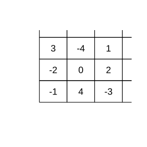

# Assignment 8

> **Definition 2.1.1** (Rules for Addition of Rational Numbers)  When two numbers of the same sign are added, the sum takes the same sign; when two numbers of opposite signs are added, the sum takes the sign of the addend with the larger absolute value; adding two numbers that are opposites of each other gives $0$.
>
> **Definition 2.1.4** (Rules for Subtraction of Rational Numbers)  Subtracting a number is equivalent to adding the opposite number of that number.
>
> **Definition 2.2.1** (Rules for Multiplication of Rational Numbers)  When two numbers are multiplied, like signs give positive and opposite signs give negative, and the absolute value of the product equals the product of the absolute values of the factors.
>
> **Definition 2.2.7** (Rules for Division of Rational Numbers)  Dividing by a number not equal to $0$ is equivalent to multiplying by the reciprocal of that number.
>
> **Definition 2.3.4** (Scientific Notation)  Expressing a number greater than $10$ in the form $a\times 10^{n}$ ($1\le a<10$, where $n$ is a positive integer).

### Activity 1

(Math Activity, Activity 1, Organizing Household Income and Expenditure Accounts, Problem 1) Help a family record one month (or one week) of living income and expenditure accounts, recording income as positive and expenditure as negative; compute the total income, total expenditure, total balance, and average daily expenditure for the month (or week), and make reasonable suggestions for the family's expenditure.

### Solution to Activity 1

By **Definition 2.1.1** (Rules for Addition of Rational Numbers), the total income, total expenditure, and total balance are respectively the algebraic sums of the income and expenditure data.

Let the daily income/expenditure of a certain week be in turn $a_{1}$, $a_{2}$, $\cdots$, $a_{7}$ (income positive, expenditure negative). The total income is the sum of all the positive numbers, the total expenditure is the sum of the absolute values of all the negative numbers, and the total balance is the sum of the seven numbers. The average daily expenditure equals the total expenditure divided by the number of days, $7$. Comparing the proportions of the various expenditures, one can make reasonable suggestions for the family's expenditure. $\blacksquare$

### Activity 2

(Math Activity, Activity 2, Filling in a Magic Square, Problem 1) Please fill the $9$ numbers $-4$, $-3$, $-2$, $-1$, $0$, $1$, $2$, $3$, $4$ into the $9$ empty cells of the magic square respectively, so that the sum of the numbers in each horizontal row, each vertical column, and the two diagonals are all equal.

{width=50%}

### Solution to Activity 2

By **Definition 2.1.1** (Rules for Addition of Rational Numbers).

The sum of the nine numbers is $-4+\left(-3\right)+\cdots+4=0$; since the sums of the three rows are equal, the sum of the three numbers in each row is $0\div 3=0$. The number in the center cell appears a total of $4$ times in the horizontal, vertical, and the two diagonals, so it should be the middle number of the nine, $0$. Pair the nine numbers about $0$ as $-4$ with $4$, $-3$ with $3$, $-2$ with $2$, $-1$ with $1$, so that the two numbers on each line through the center are opposites of each other, that is, their sum is $0$. The filled magic square is as shown in the figure, and the sum of each row, each column, and each diagonal is $0$. $\blacksquare$
