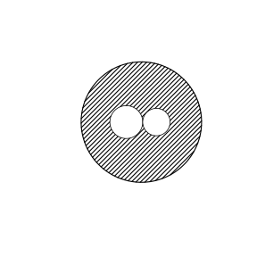

# Assignment 80

> **Definition 16.3.1** (Difference of Squares Formula)  The product of the sum of two numbers and the difference of the same two numbers equals the difference of their squares, i.e. $\left(a+b\right)\left(a-b\right)=a^2-b^2$.

> **Definition 16.3.2** (Perfect Square Formula)  The square of the sum (or difference) of two numbers equals the sum of their squares plus (or minus) $2$ times their product, i.e. $\left(a+b\right)^2=a^2+2ab+b^2$, $\left(a-b\right)^2=a^2-2ab+b^2$.

> **Definition 16.3.3** (Rule for Adding Parentheses)  When the sign before the parentheses is positive, all terms enclosed keep their signs; when the sign before the parentheses is negative, all terms enclosed change their signs, i.e. $a+b+c=a+\left(b+c\right)$, $a-b-c=a-\left(b+c\right)$.

### Exercise 1

(Exercise 16.3, Problem 1) Is each of the following calculations correct? If not, how should it be corrected?

(1) $\left(x+2\right)\left(x-2\right)=x^2-2$;

(2) $\left(2a-5\right)\left(2a+5\right)=4a^2-25$;

(3) $\left(-3ab-1\right)\left(3ab-1\right)=1-9a^2 b^2$.

### Solution to Exercise 1

By **Definition 16.3.1** (Difference of Squares Formula).

(1) Incorrect. $\left(x+2\right)\left(x-2\right)=x^2-4$; the square of $2$ was mistakenly omitted.

(2) Correct, $\left(2a-5\right)\left(2a+5\right)=\left(2a\right)^2-5^2=4a^2-25$.

(3) Correct, taking $-1$ as the common term and $3ab$ as the opposite term, $\left(-1\right)^2-\left(3ab\right)^2=1-9a^2 b^2$. $\blacksquare$

### Exercise 2

(Exercise 16.3, Problem 2) Calculate:

(1) $\left(a+3b\right)\left(a-3b\right)$;

(2) $\left(3+2a\right)\left(-3+2a\right)$;

(3) $\left(2x^2-y\right)\left(2x^2+y\right)$;

(4) $51\times49$.

### Solution to Exercise 2

By **Definition 16.3.1**.

(1) $\left(a+3b\right)\left(a-3b\right)=a^2-9b^2$.

(2) $\left(3+2a\right)\left(-3+2a\right)=\left(2a\right)^2-3^2=4a^2-9$.

(3) $\left(2x^2-y\right)\left(2x^2+y\right)=4x^4-y^2$.

(4) $51\times49=\left(50+1\right)\left(50-1\right)=2500-1=2499$. $\blacksquare$

### Exercise 3

(Exercise 16.3, Problem 3) Calculate:

(1) $102\times98$;

(2) $\left(y+2\right)\left(y-2\right)\left(y^2+4\right)$.

### Solution to Exercise 3

By **Definition 16.3.1**.

(1) $102\times98=\left(100+2\right)\left(100-2\right)=10000-4=9996$.

(2) $\left(y+2\right)\left(y-2\right)\left(y^2+4\right)=\left(y^2-4\right)\left(y^2+4\right)=y^4-16$. $\blacksquare$

### Exercise 4

(Exercise 16.3, Problem 1) Is each of the following calculations correct? If not, how should it be corrected?

(1) $\left(x+y\right)^2=x^2+y^2$;

(2) $\left(x-y\right)^2=x^2-y^2$.

### Solution to Exercise 4

By **Definition 16.3.2** (Perfect Square Formula).

(1) Incorrect. $\left(x+y\right)^2=x^2+2xy+y^2$; the $2$ times the product term was omitted.

(2) Incorrect. $\left(x-y\right)^2=x^2-2xy+y^2$; the perfect square was mistakenly treated as a difference of squares. $\blacksquare$

### Exercise 5

(Exercise 16.3, Problem 2) Calculate:

(1) $\left(2a+5b\right)^2$;

(2) $\left(4x-3y\right)^2$;

(3) $\left(-2m+n\right)^2$;

(4) $\left(1.5a-\frac23 b\right)^2$.

### Solution to Exercise 5

By **Definition 16.3.2**.

(1) $\left(2a+5b\right)^2=4a^2+20ab+25b^2$.

(2) $\left(4x-3y\right)^2=16x^2-24xy+9y^2$.

(3) $\left(-2m+n\right)^2=4m^2-4mn+n^2$.

(4) $\left(1.5a-\frac23 b\right)^2=\frac94 a^2-2ab+\frac49 b^2$. $\blacksquare$

### Exercise 6

(Exercise 16.3, Problem 3) Calculate:

(1) $102^2$;

(2) $99^2$.

### Solution to Exercise 6

By **Definition 16.3.2**.

(1) $102^2=\left(100+2\right)^2=10000+400+4=10404$.

(2) $99^2=\left(100-1\right)^2=10000-200+1=9801$. $\blacksquare$

### Exercise 7

(Exercise 16.3, Problem 1) Fill in the appropriate terms in the parentheses:

(1) $a+2b-c=a+\left(\;\;\right)$;

(2) $a-b-c+d=a-\left(\;\;\right)$;

(3) $a-b+c=a-\left(\;\;\right)$;

(4) $a+b-c=a-\left(\;\;\right)$.

### Solution to Exercise 7

By **Definition 16.3.3** (Rule for Adding Parentheses).

(1) $a+2b-c=a+\left(2b-c\right)$.

(2) $a-b-c+d=a-\left(b+c-d\right)$.

(3) $a-b+c=a-\left(b-c\right)$.

(4) $a+b-c=a-\left(c-b\right)$. $\blacksquare$

### Exercise 8

(Exercise 16.3, Problem 2) Remove the parentheses:

(1) $a-\left(b-c\right)$;

(2) $a-\left(-b-c\right)$.

### Solution to Exercise 8

By the reverse removal of parentheses from **Definition 16.3.3**.

(1) $a-\left(b-c\right)=a-b+c$.

(2) $a-\left(-b-c\right)=a+b+c$. $\blacksquare$

### Exercise 9

(Exercise 16.3, Problem 3) Is each of the following transformations correct? If not, how should it be corrected?

(1) $a+b-c=a-\left(b-c\right)$;

(2) $a-b+c=a-\left(b+c\right)$.

### Solution to Exercise 9

By **Definition 16.3.3**.

(1) Incorrect. $a+b-c=a-\left(-b+c\right)=a-\left(c-b\right)$.

(2) Incorrect. $a-b+c=a-\left(b-c\right)$. $\blacksquare$

### Exercise 10

(Exercise 16.3, Problem 4) Calculate:

(1) $\left(a+2b-1\right)^2$;

(2) $\left(2x+y+z\right)\left(2x-y-z\right)$.

### Solution to Exercise 10

First group, then apply the formula.

(1) $\left(a+2b-1\right)^2=\left[a+\left(2b-1\right)\right]^2=a^2+2a\left(2b-1\right)+\left(2b-1\right)^2=a^2+4ab-2a+4b^2-4b+1$.

(2) $\left(2x+y+z\right)\left(2x-y-z\right)=\left[2x+\left(y+z\right)\right]\left[2x-\left(y+z\right)\right]=4x^2-\left(y+z\right)^2=4x^2-y^2-2yz-z^2$. $\blacksquare$

### Problem 1

(Exercise 16.3, Review and Consolidation, Problem 1) Can each of the following expressions be computed by the difference of squares formula? If so, write out the result:

(1) $\left(x+y\right)\left(x-y\right)$;

(2) $\left(x-y\right)\left(y-x\right)$;

(3) $\left(x+y\right)\left(-x-y\right)$;

(4) $\left(x-y\right)\left(-x-y\right)$.

### Solution to Problem 1

By **Definition 16.3.1**, the difference of squares formula requires one pair of identical and one pair of opposite terms among the two factors.

(1) Yes, $\left(x+y\right)\left(x-y\right)=x^2-y^2$.

(2) No; both terms are opposite, $-\left(x-y\right)^2$.

(3) No; both terms are opposite, $-\left(x+y\right)^2$.

(4) Yes, $\left(x-y\right)\left(-x-y\right)=\left(-y+x\right)\left(-y-x\right)=\left(-y\right)^2-x^2=y^2-x^2$. $\blacksquare$

### Problem 2

(Exercise 16.3, Review and Consolidation, Problem 2) Calculate:

(1) $\left(2m+3\right)\left(2m-3\right)$;

(2) $\left(-\frac14 x-2y\right)\left(\frac14 x-2y\right)$;

(3) $\left(a+2b\right)\left(a-2b\right)$;

(4) $1003\times997$.

### Solution to Problem 2

By **Definition 16.3.1**.

(1) $\left(2m+3\right)\left(2m-3\right)=4m^2-9$.

(2) $\left(-\frac14 x-2y\right)\left(\frac14 x-2y\right)=\left(-2y\right)^2-\left(\frac14 x\right)^2=4y^2-\frac{1}{16}x^2$.

(3) $\left(a+2b\right)\left(a-2b\right)=a^2-4b^2$.

(4) $1003\times997=\left(1000+3\right)\left(1000-3\right)=1000000-9=999991$. $\blacksquare$

### Problem 3

(Exercise 16.3, Review and Consolidation, Problem 3) Calculate:

(1) $\left(2a+5b\right)^2$;

(2) $\frac34 x-\frac23 y\right)^2$;

(3) $\left(-2m-7n\right)^2$;

(4) $101^2$.

### Solution to Problem 3

By **Definition 16.3.2**.

(1) $\left(2a+5b\right)^2=4a^2+20ab+25b^2$.

(2) $\left(\frac34 x-\frac23 y\right)^2=\frac{9}{16}x^2-xy+\frac49 y^2$.

(3) $\left(-2m-7n\right)^2=4m^2+28mn+49n^2$.

(4) $101^2=\left(100+1\right)^2=10201$. $\blacksquare$

### Problem 4

(Exercise 16.3, Review and Consolidation, Problem 4) Calculate:

(1) $\left(2a+5b\right)\left(2a-5b\right)$;

(2) $\left(\frac12 x-3y\right)^2$;

(3) $\left(ab+1\right)^2-\left(ab-1\right)^2$;

(4) $\left(3x-5\right)^2-\left(2x+7\right)^2$;

(5) $\left(-2x-5y\right)^2$;

(6) $\left(a-\frac12 b^2\right)^2$.

### Solution to Problem 4

By **Definition 16.3.1** and **Definition 16.3.2**.

(1) $\left(2a+5b\right)\left(2a-5b\right)=4a^2-25b^2$.

(2) $\left(\frac12 x-3y\right)^2=\frac14 x^2-3xy+9y^2$.

(3) $\left(ab+1\right)^2-\left(ab-1\right)^2=\left(a^2 b^2+2ab+1\right)-\left(a^2 b^2-2ab+1\right)=4ab$.

(4) $\left(3x-5\right)^2-\left(2x+7\right)^2=\left(9x^2-30x+25\right)-\left(4x^2+28x+49\right)=5x^2-58x-24$.

(5) $\left(-2x-5y\right)^2=4x^2+20xy+25y^2$.

(6) $\left(a-\frac12 b^2\right)^2=a^2-ab^2+\frac14 b^4$. $\blacksquare$

### Problem 5

(Exercise 16.3, Comprehensive Application, Problem 5) Calculate:

(1) $\left(2a+3b\right)^2-\left(2a-3b\right)^2$;

(2) $\left(x+2y-3\right)\left(x-2y+3\right)$;

(3) $\left(2x+3\right)^2-\left(2x-3\right)\left(2x+3\right)$.

### Solution to Problem 5

(1) $\left(2a+3b\right)^2-\left(2a-3b\right)^2=\left(4a^2+12ab+9b^2\right)-\left(4a^2-12ab+9b^2\right)=24ab$.

(2) $\left(x+2y-3\right)\left(x-2y+3\right)=\left[x+\left(2y-3\right)\right]\left[x-\left(2y-3\right)\right]=x^2-\left(2y-3\right)^2=x^2-4y^2+12y-9$.

(3) $\left(2x+3\right)^2-\left(2x-3\right)\left(2x+3\right)=\left(4x^2+12x+9\right)-\left(4x^2-9\right)=12x+18$. $\blacksquare$

### Problem 6

(Exercise 16.3, Comprehensive Application, Problem 6) As shown in the figure, a circular steel plate of diameter $a+b$ has two circles of diameters $a$ and $b$ cut out from it. Find the area of the remaining steel plate.

{width=50%}

### Solution to Problem 6

The large circle has diameter $a+b$, radius $\frac{a+b}{2}$, and area $\pi\left(\frac{a+b}{2}\right)^2$. The two cut-out circles have radii $\frac a2$ and $\frac b2$, with total area $\pi\left(\frac a2\right)^2+\pi\left(\frac b2\right)^2$.

The remaining area is

$$S=\pi\frac{\left(a+b\right)^2}{4}-\pi\frac{a^2}{4}-\pi\frac{b^2}{4}=\pi\frac{a^2+2ab+b^2-a^2-b^2}{4}=\frac{\pi ab}{2}.$$

$\blacksquare$

### Problem 7

(Exercise 16.3, Comprehensive Application, Problem 7) First simplify, then evaluate: $\left(2x-y\right)\left(y+2x\right)-\left(2y+x\right)\left(2y-x\right)$, where $x=1$, $y=2$.

### Solution to Problem 7

By **Definition 16.3.1**.

$$\left(2x-y\right)\left(2x+y\right)-\left(2y+x\right)\left(2y-x\right)=\left(4x^2-y^2\right)-\left(4y^2-x^2\right)=5x^2-5y^2.$$

Substituting $x=1,y=2$, we get $5-20=-15$. $\blacksquare$

### Problem 8

(Exercise 16.3, Extension and Exploration, Problem 8) Given $a+b=5$, $ab=3$, find the value of $a^2+b^2$.

### Solution to Problem 8

By **Definition 16.3.2**, $\left(a+b\right)^2=a^2+2ab+b^2$.

$$a^2+b^2=\left(a+b\right)^2-2ab=25-6=19.$$

$\blacksquare$

### Problem 9

(Exercise 16.3, Extension and Exploration, Problem 9) Calculate: $2\left(3+1\right)\left(3^2+1\right)\left(3^4+1\right)\cdots\left(3^{32}+1\right)+1$.

### Solution to Problem 9

Repeatedly apply **Definition 16.3.1** (Difference of Squares Formula). Write the leading $2$ as $\left(3-1\right)$, then

$$\left(3-1\right)\left(3+1\right)=3^2-1,$$

$$\left(3^2-1\right)\left(3^2+1\right)=3^4-1,$$

and so on repeatedly; finally,

$$\left(3^{32}-1\right)\left(3^{32}+1\right)=3^{64}-1.$$

Hence the original expression $=\left(3^{64}-1\right)+1=3^{64}$. $\blacksquare$
