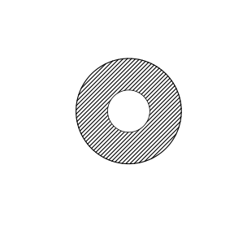

# Assignment 82

> **Definition 16.1.1** (Multiplication of Powers with the Same Base)  $a^m\cdot a^n=a^{m+n}$ ($m,n$ are positive integers).

> **Definition 16.1.2** (Power of a Power)  $(a^m)^n=a^{mn}$ ($m,n$ are positive integers).

> **Definition 16.1.3** (Power of a Product)  $(ab)^n=a^n b^n$ ($n$ is a positive integer).

> **Definition 16.2.4** (Division of Powers with the Same Base)  $a^m\div a^n=a^{m-n}$ ($a\ne0$, $m,n$ are positive integers, $m>n$).

> **Definition 16.3.1** (Difference of Squares Formula)  $(a+b)(a-b)=a^2-b^2$.

> **Definition 16.3.2** (Perfect Square Formula)  $(a\pm b)^2=a^2\pm2ab+b^2$.

### Review Problem 1

(Review Problems, Review and Consolidation, Problem 1) Calculate:

(1) $100\times10^3\times10^2$;

(2) $[(-2)^2]^3$;

(3) $(-x)^2\cdot x^3$;

(4) $x\cdot x^2\cdot x^3+(x^3)^2$.

### Solution to Review Problem 1

By **Definition 16.1.1** and **Definition 16.1.2**.

(1) $100\times10^3\times10^2=10^2\times10^3\times10^2=10^7$.

(2) $[(-2)^2]^3=4^3=64$.

(3) $(-x)^2\cdot x^3=x^2\cdot x^3=x^5$.

(4) $x\cdot x^2\cdot x^3+(x^3)^2=x^6+x^6=2x^6$. $\blacksquare$

### Review Problem 2

(Review Problems, Review and Consolidation, Problem 2) Calculate:

(1) $(-2x^2 y^3)^2(xy)^3$;

(2) $(2a+3b)(2a-b)$;

(3) $5x^2(x+1)(x-1)$;

(4) $(2x+y-1)^2$;

(5) $59.8\times60.2$;

(6) $198^2$.

### Solution to Review Problem 2

(1) $(-2x^2 y^3)^2(xy)^3=4x^4 y^6\cdot x^3 y^3=4x^7 y^9$.

(2) $(2a+3b)(2a-b)=4a^2-2ab+6ab-3b^2=4a^2+4ab-3b^2$.

(3) $5x^2(x+1)(x-1)=5x^2(x^2-1)=5x^4-5x^2$.

(4) $(2x+y-1)^2=[2x+(y-1)]^2=4x^2+4x(y-1)+(y-1)^2=4x^2+4xy-4x+y^2-2y+1$.

(5) $59.8\times60.2=(60-0.2)(60+0.2)=3600-0.04=3599.96$.

(6) $198^2=(200-2)^2=40000-800+4=39204$. $\blacksquare$

### Review Problem 3

(Review Problems, Review and Consolidation, Problem 3) Calculate:

(1) $(2a)^3\cdot b^4\div(12a^3 b^2)$;

(2) $-27a^7 b^5\div(\frac32 a^2 b^5)$;

(3) $(\frac65 a^3 x^4-0.9ax^3)\div(\frac35 ax^3)$;

(4) $(7x^2 y^3-8x^3 y^2 z)\div(8x^2 y^2)$.

### Solution to Review Problem 3

By the rules for division of monomials and polynomials.

(1) $(2a)^3\cdot b^4\div(12a^3 b^2)=8a^3 b^4\div(12a^3 b^2)=\frac23 b^2$.

(2) $-27a^7 b^5\div(\frac32 a^2 b^5)=-18a^5$.

(3) $(\frac65 a^3 x^4-0.9ax^3)\div(\frac35 ax^3)=2a^2 x-1.5$.

(4) $(7x^2 y^3-8x^3 y^2 z)\div(8x^2 y^2)=\frac78 y-xz$. $\blacksquare$

### Review Problem 4

(Review Problems, Review and Consolidation, Problem 4) Calculate:

(1) $2x(x^2-1)-x(x^2+2)$;

(2) $[(x-3)(x+3)]^2-(x^2+1)^2$.

### Solution to Review Problem 4

(1) $2x(x^2-1)-x(x^2+2)=2x^3-2x-x^3-2x=x^3-4x$.

(2) $[(x-3)(x+3)]^2-(x^2+1)^2=(x^2-9)^2-(x^2+1)^2=(x^4-18x^2+81)-(x^4+2x^2+1)=-20x^2+80$. $\blacksquare$

### Review Problem 5

(Review Problems, Review and Consolidation, Problem 5) First simplify, then evaluate: $(x+2y)^2+(x+y)(x-y)-y^2$, where $x=3$, $y=2$.

### Solution to Review Problem 5

$$(x+2y)^2+(x+y)(x-y)-y^2=x^2+4xy+4y^2+x^2-y^2-y^2=2x^2+4xy+2y^2.$$

Substituting $x=3,y=2$, we get $2\cdot9+4\cdot6+2\cdot4=18+24+8=50$. $\blacksquare$

### Review Problem 6

(Review Problems, Comprehensive Application, Problem 6) Calculate:

(1) $4(x+1)^2-2(x+5)(2x-10)$;

(2) $3(y-z)^2-(2y+z)(-z+2y)$;

(3) $(2x^2+1)^2-(x+2)(x^2+4)(x-2)$;

(4) $[x(x^2 y^2-xy)-y(x^2-x^3 y)]\div(3x^2 y)$.

### Solution to Review Problem 6

(1) $4(x+1)^2-2(x+5)(2x-10)=4(x^2+2x+1)-2(2x^2-50)=4x^2+8x+4-4x^2+100=8x+104$.

(2) $3(y-z)^2-(2y+z)(2y-z)=3(y^2-2yz+z^2)-(4y^2-z^2)=3y^2-6yz+3z^2-4y^2+z^2=-y^2-6yz+4z^2$.

(3) $(2x^2+1)^2-(x+2)(x-2)(x^2+4)=(4x^4+4x^2+1)-(x^2-4)(x^2+4)=4x^4+4x^2+1-(x^4-16)=3x^4+4x^2+17$.

(4) $[x^3 y^2-x^2 y-x^2 y+x^3 y^2]\div(3x^2 y)=(2x^3 y^2-2x^2 y)\div(3x^2 y)=\frac23 xy-\frac23$. $\blacksquare$

### Review Problem 7

(Review Problems, Comprehensive Application, Problem 7) Given $m=12$, $n=35$, find the value of the algebraic expression $(m-2n)(m+2n)+(m+2n)^2-4mn$.

### Solution to Review Problem 7

$$(m-2n)(m+2n)+(m+2n)^2-4mn=m^2-4n^2+(m^2+4mn+4n^2)-4mn=2m^2.$$

Substituting $m=12$, we get $2\cdot144=288$. $\blacksquare$

### Review Problem 8

(Review Problems, Comprehensive Application, Problem 8) Given $(x+y)^2=25$, $(x-y)^2=9$, find the values of $xy$ and $x^2+y^2$.

### Solution to Review Problem 8

Expanding: $(x+y)^2=x^2+2xy+y^2=25$, $(x-y)^2=x^2-2xy+y^2=9$.

Subtracting the two equations: $4xy=16$, hence $xy=4$.

Adding the two equations: $2(x^2+y^2)=34$, hence $x^2+y^2=17$. $\blacksquare$

### Review Problem 9

(Review Problems, Comprehensive Application, Problem 9) When the side length of a square sheet is reduced by $2\ \text{cm}$, its area decreases by $20\ \text{cm}^2$. What is the side length of this square sheet?

### Solution to Review Problem 9

Let the original side length be $x\ \text{cm}$; then the original area is $x^2$, the reduced side length is $x-2$, and the area is $(x-2)^2$.

$$x^2-(x-2)^2=20,$$

$$x^2-(x^2-4x+4)=4x-4=20,$$

Solving gives $x=6$. That is, the original side length of the square is $6\ \text{cm}$. $\blacksquare$

### Review Problem 10

(Review Problems, Comprehensive Application, Problem 10) As shown in the figure is a schematic diagram of a hollow steel column of a hydraulic press. If its height $h$ is $18\ \text{m}$, its outer diameter $D$ is $1\ \text{m}$, its inner diameter $d$ is $0.4\ \text{m}$, and the mass of steel per cubic meter is $7.8\ \text{t}$, find the mass of this column. (Take $\pi$ as $3.14$, and keep the result to two decimal places.)

{width=50%}

### Solution to Review Problem 10

The base area of the hollow column is the area of the annulus $\pi\left(\frac D2\right)^2-\pi\left(\frac d2\right)^2$. The volume is the base area multiplied by the height.

$$V=\pi\left(\frac{D^2}{4}-\frac{d^2}{4}\right)h=3.14\times\frac{1-0.16}{4}\times18=3.14\times0.21\times18=11.8692\ (\text{m}^3).$$

The mass is $11.8692\times7.8\approx92.58\ (\text{t})$. $\blacksquare$

### Review Problem 11

(Review Problems, Extension and Exploration, Problem 11) Given $x^m=64$, $x^n=8$, find the value of $x^{m-n}$.

### Solution to Review Problem 11

By **Definition 16.2.4** (Division of Powers with the Same Base), $x^{m-n}=x^m\div x^n=64\div8=8$. $\blacksquare$

### Review Problem 12

(Review Problems, Extension and Exploration, Problem 12) The raw materials for a certain product have risen in price, so the manufacturer decides to raise the product's price. There are three schemes:

(1) first raise the price by $p\%$, then by $q\%$;

(2) first raise the price by $q\%$, then by $p\%$;

(3) both the first and second raises are $\frac{p+q}{2}\%$.

Here $p,q$ are unequal positive numbers. Which of the three schemes gives the largest price increase?

### Solution to Review Problem 12

Let the original price be $1$; the final price under each scheme:

(1) $P_1=(1+p\%)(1+q\%)=1+p\%+q\%+pq\%^2$.

(2) $P_2=(1+q\%)(1+p\%)$, the same as $P_1$.

(3) $P_3=\left(1+\frac{p+q}{2}\%\right)^2=1+(p+q)\%+\frac{(p+q)^2}{4}\%^2$.

Compare the difference between $P_3$ and $P_1$:

$$P_3-P_1=\left[\frac{(p+q)^2}{4}-pq\right]\%^2=\frac{(p-q)^2}{4}\%^2>0.$$

Since $p\ne q$, we have $P_3>P_1=P_2$, so scheme (3) gives the largest price increase. $\blacksquare$
