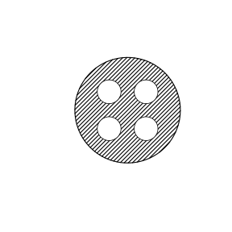

# Assignment 86

> **Definition 17.1.3** (Method of Extracting the Common Factor)  Extract the common factor of the terms of the polynomial, writing the polynomial as the product of the common factor and another factor.

> **Definition 17.2.1** (Method Using the Difference of Squares Formula)  $a^2-b^2=\left(a+b\right)\left(a-b\right)$.

> **Definition 17.2.3** (Method Using the Perfect Square Formula)  $a^2\pm2ab+b^2=\left(a\pm b\right)^2$.

### Review Problem 1

(Review Problems, Review and Consolidation, Problem 1) Factor:

(1) $15a^3+10a^2$;

(2) $12abc-3bc^2$;

(3) $6p\left(p+q\right)-4q\left(p+q\right)$;

(4) $m\left(a-3\right)+2\left(3-a\right)$.

### Solution to Review Problem 1

By **Definition 17.1.3**.

(1) $15a^3+10a^2=5a^2\left(3a+2\right)$.

(2) $12abc-3bc^2=3bc\left(4a-c\right)$.

(3) $6p\left(p+q\right)-4q\left(p+q\right)=2\left(p+q\right)\left(3p-2q\right)$.

(4) $m\left(a-3\right)+2\left(3-a\right)=m\left(a-3\right)-2\left(a-3\right)=\left(a-3\right)\left(m-2\right)$. $\blacksquare$

### Review Problem 2

(Review Problems, Review and Consolidation, Problem 2) Factor:

(1) $1-36b^2$;

(2) $12x^2-3y^2$;

(3) $0.49p^2-144$;

(4) $\left(2x+y\right)^2-\left(x+2y\right)^2$.

### Solution to Review Problem 2

By **Definition 17.2.1**.

(1) $1-36b^2=\left(1+6b\right)\left(1-6b\right)$.

(2) $12x^2-3y^2=3\left(4x^2-y^2\right)=3\left(2x+y\right)\left(2x-y\right)$.

(3) $0.49p^2-144=\left(0.7p+12\right)\left(0.7p-12\right)$.

(4) $\left(2x+y\right)^2-\left(x+2y\right)^2=\left[\left(2x+y\right)+\left(x+2y\right)\right]\left[\left(2x+y\right)-\left(x+2y\right)\right]=\left(3x+3y\right)\left(x-y\right)=3\left(x+y\right)\left(x-y\right)$. $\blacksquare$

### Review Problem 3

(Review Problems, Review and Consolidation, Problem 3) Factor:

(1) $1+10t+25t^2$;

(2) $m^2-14m+49$;

(3) $y^2+y+\frac14$;

(4) $25a^2-80a+64$;

(5) $\left(m+n\right)^2-4m\left(m+n\right)+4m^2$;

(6) $a^2+2a\left(b+c\right)+\left(b+c\right)^2$.

### Solution to Review Problem 3

By **Definition 17.2.3**.

(1) $1+10t+25t^2=\left(1+5t\right)^2$.

(2) $m^2-14m+49=\left(m-7\right)^2$.

(3) $y^2+y+\frac14=\left(y+\frac12\right)^2$.

(4) $25a^2-80a+64=\left(5a-8\right)^2$.

(5) $\left(m+n\right)^2-4m\left(m+n\right)+4m^2=\left[\left(m+n\right)-2m\right]^2=\left(n-m\right)^2$.

(6) $a^2+2a\left(b+c\right)+\left(b+c\right)^2=\left[a+\left(b+c\right)\right]^2=\left(a+b+c\right)^2$. $\blacksquare$

### Review Problem 4

(Review Problems, Comprehensive Application, Problem 4) Calculate using factoring:

(1) $21\times3.14+62\times3.14+17\times3.14$;

(2) $758^2-258^2$.

### Solution to Review Problem 4

(1) $21\times3.14+62\times3.14+17\times3.14=3.14\left(21+62+17\right)=3.14\times100=314$.

(2) $758^2-258^2=\left(758+258\right)\left(758-258\right)=1016\times500=508000$. $\blacksquare$

### Review Problem 5

(Review Problems, Comprehensive Application, Problem 5) Factor:

(1) $3ax^2-3ay^2$;

(2) $4xy^2-4x^2 y-y^3$.

### Solution to Review Problem 5

(1) $3ax^2-3ay^2=3a\left(x^2-y^2\right)=3a\left(x+y\right)\left(x-y\right)$.

(2) $4xy^2-4x^2 y-y^3=-y\left(y^2-4xy+4x^2\right)=-y\left(y-2x\right)^2$. $\blacksquare$

### Review Problem 6

(Review Problems, Comprehensive Application, Problem 6) As shown in the figure, on a circular steel plate of radius $R$, four small circles of radius $r$ are cut out. Calculate the area of the remaining part when $R=5.6\ \text{cm}$ and $r=1.2\ \text{cm}$ (take $\pi$ as $3.14$).

{width=50%}

### Solution to Review Problem 6

The remaining area equals the area of the large circle minus the areas of the four small circles:

$$S=\pi R^2-4\pi r^2=\pi\left(R^2-4r^2\right).$$

Substituting $R=5.6$, $r=1.2$: $R^2=31.36$, $4r^2=4\times1.44=5.76$, $R^2-4r^2=25.6$.

$$S=3.14\times25.6=80.384\ \left(\text{cm}^2\right).$$

$\blacksquare$

### Review Problem 7

(Review Problems, Extension and Exploration, Problem 7) Prove that when $n$ is an integer, the difference of the squares of two consecutive odd numbers, $\left(2n+1\right)^2-\left(2n-1\right)^2$, is a multiple of $8$.

### Solution to Review Problem 7

By the difference of squares formula:

$$\left(2n+1\right)^2-\left(2n-1\right)^2=\left[\left(2n+1\right)+\left(2n-1\right)\right]\left[\left(2n+1\right)-\left(2n-1\right)\right]=\left(4n\right)\left(2\right)=8n.$$

Since $n$ is an integer, $8n$ is a multiple of $8$. This completes the proof. $\blacksquare$

### Review Problem 8

(Review Problems, Extension and Exploration, Problem 8) Read the following factoring process:

$$p^2-1+q^2+2pq=\left(p^2+2pq+q^2\right)-1=\left(p+q\right)^2-1=\left(p+q+1\right)\left(p+q-1\right).$$

Using the above factoring method, prove that if $a,b,c$ are the lengths of the three sides of $\triangle ABC$, then $a^2-b^2+c^2-2ac<0$.

### Solution to Review Problem 8

Factor by grouping:

$$a^2-b^2+c^2-2ac=\left(a^2-2ac+c^2\right)-b^2=\left(a-c\right)^2-b^2=\left(a-c+b\right)\left(a-c-b\right).$$

Since the sum of two sides of a triangle is greater than the third side, $a+b>c$, i.e. $a-c+b>0$; also $a<b+c$, i.e. $a-c-b<0$. The two factors have opposite signs, hence

$$a^2-b^2+c^2-2ac=\left(a+b-c\right)\left(a-b-c\right)<0.$$

$\blacksquare$
