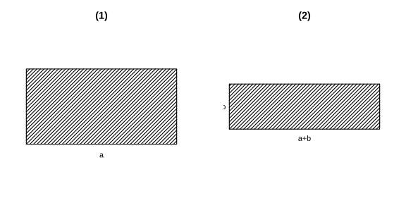

# Assignment 88

> **Definition 18.2.1** (Rule for Multiplying Fractions)  To multiply a fraction by a fraction, take the product of the numerators as the numerator of the result and the product of the denominators as the denominator, i.e. $\frac{a}{b}\cdot\frac{c}{d}=\frac{ac}{bd}$.

> **Definition 18.2.2** (Rule for Dividing Fractions)  To divide a fraction by a fraction, invert the numerator and denominator of the divisor and multiply by the dividend, i.e. $\frac{a}{b}\div\frac{c}{d}=\frac{ad}{bc}$.

> **Definition 18.2.3** (Power of a Fraction)  When $n$ is a positive integer, $\left(\frac{a}{b}\right)^n=\frac{a^n}{b^n}$, i.e. to raise a fraction to a power, raise both the numerator and denominator to that power.

### Exercise 1

(Exercise 18.2, Problem 1) Calculate:

(1) $\frac{3a}{4b}\cdot\frac{2b}{a^2}$;

(2) $\frac{6 x^2 y}{4 x y^2}\cdot\frac{2 x}{3 y}$;

(3) $\frac{n^2}{2 m}\cdot\frac{4 m}{5 n^3}$;

(4) $\frac{a+b}{2 ab}\cdot\frac{4 a^2 b}{\left(a+b\right)^2}$.

### Solution to Exercise 1

By **Definition 18.2.1**.

(1) $\frac{3a}{4b}\cdot\frac{2b}{a^2}=\frac{6ab}{4a^2 b}=\frac{3}{2a}$.

(2) $\frac{6x^2 y}{4xy^2}\cdot\frac{2x}{3y}=\frac{12x^3 y}{12x y^3}=\frac{x^2}{y^2}$.

(3) $\frac{n^2}{2m}\cdot\frac{4m}{5n^3}=\frac{4m n^2}{10m n^3}=\frac{2}{5n}$.

(4) $\frac{a+b}{2ab}\cdot\frac{4a^2 b}{\left(a+b\right)^2}=\frac{4a^2 b\left(a+b\right)}{2ab\left(a+b\right)^2}=\frac{2a}{a+b}$. $\blacksquare$

### Exercise 2

(Exercise 18.2, Problem 2) Calculate:

(1) $\frac{4 x}{3 y}\cdot\frac{y}{2 x^3}$;

(2) $\frac{a^2 b}{2 c^2}\cdot\frac{-4 c}{5 a b}$.

### Solution to Exercise 2

By **Definition 18.2.1**.

(1) $\frac{4x}{3y}\cdot\frac{y}{2x^3}=\frac{4xy}{6x^3 y}=\frac{2}{3x^2}$.

(2) $\frac{a^2 b}{2c^2}\cdot\frac{-4c}{5ab}=-\frac{4a^2 bc}{10abc^2}=-\frac{2a}{5c}$. $\blacksquare$

### Exercise 3

(Exercise 18.2, Problem 1) Calculate:

(1) $\frac{2}{x}\div\frac{4}{x}$;

(2) $\frac{5}{x y}\div\left(-\frac{15}{x}\right)$;

(3) $\frac{4}{3 x y}\div\frac{2}{3 x y^2}$;

(4) $\frac{a^2-4}{a^2+4 a+4}\div\left(a+2\right)$.

### Solution to Exercise 3

By **Definition 18.2.2**.

(1) $\frac{2}{x}\div\frac{4}{x}=\frac{2}{x}\cdot\frac{x}{4}=\frac12$.

(2) $\frac{5}{xy}\div\left(-\frac{15}{x}\right)=\frac{5}{xy}\cdot\left(-\frac{x}{15}\right)=-\frac{1}{3y}$.

(3) $\frac{4}{3xy}\div\frac{2}{3xy^2}=\frac{4}{3xy}\cdot\frac{3xy^2}{2}=2y$.

(4) $\frac{a^2-4}{a^2+4a+4}\div\left(a+2\right)=\frac{\left(a+2\right)\left(a-2\right)}{\left(a+2\right)^2}\cdot\frac{1}{a+2}=\frac{a-2}{\left(a+2\right)^2}$. $\blacksquare$

### Exercise 4

(Exercise 18.2, Problem 2) Calculate:

(1) $\frac{3 x}{4 y}\cdot\frac{16 y}{9 x^2}$;

(2) $\left(xy-x^2\right)\div\frac{x-y}{xy}$.

### Solution to Exercise 4

(1) $\frac{3x}{4y}\cdot\frac{16y}{9x^2}=\frac{48xy}{36x^2 y}=\frac{4}{3x}$.

(2) $\left(xy-x^2\right)\div\frac{x-y}{xy}=x\left(y-x\right)\cdot\frac{xy}{x-y}=-x\left(x-y\right)\cdot\frac{xy}{x-y}=-x^2 y$. $\blacksquare$

### Exercise 5

(Exercise 18.2, Problem 1) Are the following expressions correct? Why?

(1) $\left(\frac{b^2}{a}\right)^3=\frac{b^6}{a^3}$;

(2) $\left(-\frac{b^2}{a}\right)^3=-\frac{b^6}{a^3}$;

(3) $\left(\frac{2 a}{a+b}\right)^2=\frac{4 a^2}{a^2+b^2}$.

### Solution to Exercise 5

By **Definition 18.2.3**.

(1) Correct; $\left(\frac{b^2}{a}\right)^3=\frac{\left(b^2\right)^3}{a^3}=\frac{b^6}{a^3}$.

(2) Correct; $\left(-\frac{b^2}{a}\right)^3=-\frac{b^6}{a^3}$.

(3) Incorrect; $\left(\frac{2a}{a+b}\right)^2=\frac{4a^2}{\left(a+b\right)^2}$, the denominator should also be squared. $\blacksquare$

### Exercise 6

(Exercise 18.2, Problem 2) Calculate:

(1) $\left(\frac{2 x}{-y}\right)^2$;

(2) $\left(\frac{a^2 b}{-c}\right)^3\div\left(\frac{a b}{c^2}\right)^2$.

### Solution to Exercise 6

By **Definition 18.2.3**.

(1) $\left(\frac{2x}{-y}\right)^2=\frac{4x^2}{y^2}$.

(2) $\frac{a^6 b^3}{-c^3}\div\frac{a^2 b^2}{c^4}=-\frac{a^6 b^3}{c^3}\cdot\frac{c^4}{a^2 b^2}=-a^4 b c$. $\blacksquare$

### Problem 1

(Exercise 18.2, Review and Consolidation, Problem 1) Calculate:

(1) $\frac{3}{a}\cdot\frac{a^2}{9}$;

(2) $\frac{3 y}{6 x^2}\div\frac{y^2}{10 x}$;

(3) $\frac{3}{4 x y^3}\cdot\frac{2 x^2 y}{27}$;

(4) $\frac{6 a b^2}{c^2 d}\div\frac{3 a b}{2 c d^2}$.

### Solution to Problem 1

(1) $\frac{3}{a}\cdot\frac{a^2}{9}=\frac{a}{3}$.

(2) $\frac{3y}{6x^2}\div\frac{y^2}{10x}=\frac{3y}{6x^2}\cdot\frac{10x}{y^2}=\frac{5}{xy}$.

(3) $\frac{3}{4xy^3}\cdot\frac{2x^2 y}{27}=\frac{6x^2 y}{108xy^3}=\frac{x}{18y^2}$.

(4) $\frac{6ab^2}{c^2 d}\div\frac{3ab}{2cd^2}=\frac{6ab^2}{c^2 d}\cdot\frac{2cd^2}{3ab}=\frac{4bd}{c}$. $\blacksquare$

### Problem 2

(Exercise 18.2, Review and Consolidation, Problem 2) Calculate:

(1) $\frac{2 a}{a+1}+\frac{a^2}{a+1}$;

(2) $\frac{m^2-16}{12-3 m}\div\frac{m+4}{m^2-4 m}$;

(3) $\frac{x^2+x}{x-1}\div\frac{x}{x-1}$;

(4) $\frac{2 x}{x-1}\div\frac{x}{x-1}$.

### Solution to Problem 2

(1) Note that this is addition; $\frac{2a}{a+1}+\frac{a^2}{a+1}=\frac{a^2+2a}{a+1}=\frac{a\left(a+2\right)}{a+1}$.

(2) $\frac{m^2-16}{12-3m}\div\frac{m+4}{m^2-4m}=\frac{\left(m+4\right)\left(m-4\right)}{3\left(4-m\right)}\cdot\frac{m\left(m-4\right)}{m+4}=\frac{\left(m-4\right)}{3\left(-\left(m-4\right)\right)}\cdot m\left(m-4\right)=-\frac{m\left(m-4\right)}{3}$.

(3) $\frac{x^2+x}{x-1}\div\frac{x}{x-1}=\frac{x\left(x+1\right)}{x-1}\cdot\frac{x-1}{x}=x+1$.

(4) $\frac{2x}{x-1}\div\frac{x}{x-1}=\frac{2x}{x-1}\cdot\frac{x-1}{x}=2$. $\blacksquare$

### Problem 3

(Exercise 18.2, Review and Consolidation, Problem 3) Calculate:

(1) $\left(\frac{-2 a^2 b}{3 c}\right)^3$;

(2) $\left(\frac{2 x}{-y}\right)^2$;

(3) $\left(\frac{a^2 b}{-c}\right)^3\div\left(\frac{a b^2}{c^2}\right)^2$;

(4) $\left(\frac{x^2}{y}\right)^2\cdot\left(-\frac{y^2}{x}\right)^3$.

### Solution to Problem 3

By **Definition 18.2.3**.

(1) $\left(\frac{-2a^2 b}{3c}\right)^3=-\frac{8a^6 b^3}{27c^3}$.

(2) $\left(\frac{2x}{-y}\right)^2=\frac{4x^2}{y^2}$.

(3) $\frac{-a^6 b^3}{c^3}\div\frac{a^2 b^4}{c^4}=-\frac{a^6 b^3}{c^3}\cdot\frac{c^4}{a^2 b^4}=-\frac{a^4 c}{b}$.

(4) $\frac{x^4}{y^2}\cdot\left(-\frac{y^6}{x^3}\right)=-x y^4$. $\blacksquare$

### Problem 4

(Exercise 18.2, Comprehensive Application, Problem 4) Calculate:

(1) $\left(\frac{a^2 b}{-c}\right)^2\cdot\left(\frac{c^2}{-ab}\right)^3\div\left(\frac{bc}{a}\right)^4$;

(2) $\frac{a-b}{a^2+a b}\div\frac{a^2-a b}{a^2-b^2}$.

### Solution to Problem 4

(1) $\frac{a^4 b^2}{c^2}\cdot\left(-\frac{c^6}{a^3 b^3}\right)\div\frac{b^4 c^4}{a^4}=-\frac{a^4 b^2 c^6}{a^3 b^3 c^2}\cdot\frac{a^4}{b^4 c^4}=-\frac{a^5}{b^5}$.

(2) $\frac{a-b}{a\left(a+b\right)}\div\frac{a\left(a-b\right)}{\left(a+b\right)\left(a-b\right)}=\frac{a-b}{a\left(a+b\right)}\cdot\frac{\left(a+b\right)\left(a-b\right)}{a\left(a-b\right)}=\frac{a-b}{a^2}$. $\blacksquare$

### Problem 5

(Exercise 18.2, Comprehensive Application, Problem 5) Calculate:

(1) $\frac{m}{3 n}\div\frac{n}{9 m}\cdot\frac{3 m}{n^2}$;

(2) $\left(\frac{2 x}{x+y}-\frac{x}{x-y}\right)\cdot\frac{x^2-y^2}{x}$.

### Solution to Problem 5

(1) $\frac{m}{3n}\cdot\frac{9m}{n}\cdot\frac{3m}{n^2}=\frac{27m^3}{3n^4}=\frac{9m^3}{n^4}$.

(2) $\left(\frac{2x}{x+y}-\frac{x}{x-y}\right)\cdot\frac{\left(x+y\right)\left(x-y\right)}{x}=\frac{2x\left(x-y\right)-x\left(x+y\right)}{\left(x+y\right)\left(x-y\right)}\cdot\frac{\left(x+y\right)\left(x-y\right)}{x}=2\left(x-y\right)-\left(x+y\right)=x-3y$. $\blacksquare$

### Problem 6

(Exercise 18.2, Comprehensive Application, Problem 6) As shown in the figure, there are two rectangular flower beds, A and B. Flower bed A has length $a$ and width $b$; flower bed B has length $\left(a+b\right)$ and width $\left(a-b\right)$ ($a>b$). Which flower bed has the larger area? By how much?

{width=50%}

### Solution to Problem 6

The area of flower bed A is $S_1=ab$, and the area of flower bed B is $S_2=\left(a+b\right)\left(a-b\right)=a^2-b^2$.

Compare $S_2-S_1=a^2-b^2-ab$. Since $a>b>0$, for example when $a=2,b=1$, we have $S_2=3$, $S_1=2$, so $S_2>S_1$. In general, the question asks "which is larger and by how much":

$$S_2-S_1=a^2-b^2-ab.$$

When $a^2-ab-b^2>0$, i.e. $a>\frac{1+\sqrt5}{2}b$, flower bed B is larger. Under the textbook setup, the area of flower bed B is $a^2-b^2$ and that of A is $ab$, so B is larger than A by $\left(a^2-b^2-ab\right)$. $\blacksquare$

### Problem 7

(Exercise 18.2, Comprehensive Application, Problem 7) A car makes a round trip between two places A and B $a\ \text{km}$ apart; the speed going is $v_1\ \text{km/h}$ and the speed returning is $v_2\ \text{km/h}$. Find the average speed for the round trip.

### Solution to Problem 7

The time going is $\frac{a}{v_1}$, and the time returning is $\frac{a}{v_2}$. The total distance is $2a$, and the total time is $\frac{a}{v_1}+\frac{a}{v_2}$.

Average speed

$$\bar v=\frac{2a}{\frac{a}{v_1}+\frac{a}{v_2}}=\frac{2a}{a\frac{v_1+v_2}{v_1 v_2}}=\frac{2v_1 v_2}{v_1+v_2}\ \left(\text{km/h}\right).$$

$\blacksquare$

### Problem 8

(Exercise 18.2, Extension and Exploration, Problem 8) Calculate: $\frac{x^2-4 y^2}{x^2+2 x y+y^2}\div\frac{x+2 y}{x^2+xy}\cdot\frac{x}{x-2 y}$.

### Solution to Problem 8

$$\frac{\left(x+2y\right)\left(x-2y\right)}{\left(x+y\right)^2}\div\frac{x+2y}{x\left(x+y\right)}\cdot\frac{x}{x-2y}=\frac{\left(x+2y\right)\left(x-2y\right)}{\left(x+y\right)^2}\cdot\frac{x\left(x+y\right)}{x+2y}\cdot\frac{x}{x-2y}=\frac{x^2}{x+y}.$$

$\blacksquare$
