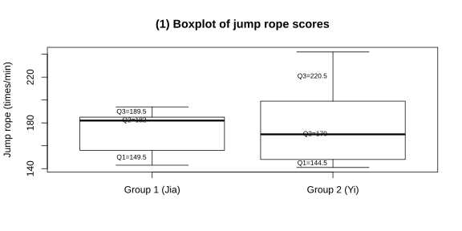

# 作业 121

> **定义 24.3.1** (四分位数)  把一组按从小到大顺序排列的数据分成四等份的三个分点, 从小到大分别称为第一四分位数 $Q_1$、第二四分位数 $Q_2$ (中位数)、第三四分位数 $Q_3$.
>
> **定义 24.3.2** (箱线图)  用一组数据的最小值、第一四分位数、中位数、第三四分位数和最大值这五个数值画出的图称为箱线图.
>
> **定义 24.3.3** (四分位距)  第三四分位数减去第一四分位数的差称为四分位距.

### 练习一

(练习 24.3 第 1 题) 某城市 $9$ 月份空气质量指数的箱线图如图所示.

(1) 这个月空气质量指数的最大值、最小值及四分位数分别是多少?

(2) 请分析这个月空气质量的特点.

### 解答 练习一

(1) 由箱线图可知, 最小值约为 $20$, 最大值约为 $100$, $Q_1$ 约为 $40$, $Q_2$ (中位数) 约为 $55$, $Q_3$ 约为 $75$.

(2) 由**定义 24.3.3** (四分位距), 四分位距为 $75-40=35$, 说明中间 $50\%$ 的数据分布在 $40$ 到 $75$ 之间. 中位数 $55$ 说明一半天数的空气质量指数低于 $55$. 箱体偏右, 说明数据分布右偏, 即有少数天数空气质量指数较高. $\blacksquare$

### 练习二

(练习 24.3 第 2 题) 计算第 $149$ 页"问题 $1$"中每组数据的四分位数, 在同一幅图中画出箱线图, 据此比较两个小组的跳绳成绩特点.

### 解答 练习二

甲组跳绳成绩为 $182$, $194$, $143$, $185$, $156$. 按从小到大排列为 $143$, $156$, $182$, $185$, $194$.

乙组跳绳成绩为 $199$, $148$, $242$, $170$, $141$. 按从小到大排列为 $141$, $148$, $170$, $199$, $242$.

由**定义 24.3.1** (四分位数), 甲组共 $5$ 个数据, 中位数 $Q_2=182$ (第 $3$ 个数). 左半部分 $143$, $156$ 的中位数 $Q_1=\dfrac{143+156}{2}=149.5$. 右半部分 $185$, $194$ 的中位数 $Q_3=\dfrac{185+194}{2}=189.5$. 最小值为 $143$, 最大值为 $194$.

乙组共 $5$ 个数据, 中位数 $Q_2=170$ (第 $3$ 个数). 左半部分 $141$, $148$ 的中位数 $Q_1=\dfrac{141+148}{2}=144.5$. 右半部分 $199$, $242$ 的中位数 $Q_3=\dfrac{199+242}{2}=220.5$. 最小值为 $141$, 最大值为 $242$.

由**定义 24.3.2** (箱线图), 在同一幅图中画出两组数据的箱线图.

{width=100%}

由箱线图可知: 甲组的中位数 $182$ 高于乙组的中位数 $170$, 说明甲组整体跳绳成绩较好. 甲组的四分位距为 $189.5-149.5=40$, 乙组的四分位距为 $220.5-144.5=76$, 甲组四分位距较小, 说明甲组成绩更集中; 乙组四分位距较大, 说明乙组成绩分布较分散, 两极差异明显. 乙组最大值 $242$ 远高于甲组最大值 $194$, 但最小值也更低, 说明乙组个别同学成绩突出, 同时也有同学成绩较差. $\blacksquare$

### 习题一

(习题 24.3 复习巩固第 1 题) 一家汽车零售店的 $9$ 名销售人员 $10$ 月份销售的汽车数量 (单位: 辆) 如下: $12$, $10$, $3$, $9$, $10$, $12$, $2$, $6$, $14$.

(1) 计算汽车销售数量的四分位数;

(2) 画箱线图并分析汽车销售数量的特点.

### 解答 习题一

(1) 将数据按从小到大排列: $2$, $3$, $6$, $9$, $10$, $10$, $12$, $12$, $14$. 共 $9$ 个数据.

由**定义 24.3.1** (四分位数), $Q_2$ (中位数) 为第 $5$ 个数, 即 $10$. 左半部分为 $2$, $3$, $6$, $9$, 中位数 $Q_1=\dfrac{3+6}{2}=4.5$. 右半部分为 $10$, $12$, $12$, $14$, 中位数 $Q_3=\dfrac{12+12}{2}=12$.

(2) 最小值为 $2$, 最大值为 $14$. 四分位距为 $12-4.5=7.5$. 箱体较长, 说明销售数量分布较分散. $\blacksquare$

### 习题二

(习题 24.3 综合运用第 2 题) 某班有 $40$ 名同学, 一次测试的成绩 (百分制) 如下: $32$, $44$, $54$, $55$, $58$, $62$, $65$, $65$, $68$, $69$, $69$, $69$, $70$, $71$, $71$, $72$, $73$, $74$, $75$, $75$, $75$, $76$, $77$, $77$, $78$, $79$, $80$, $80$, $81$, $83$, $85$, $85$, $87$, $87$, $89$, $90$, $92$, $94$, $99$, $99$. 请结合测试成绩的四分位数和箱线图分析这个班这次测试成绩的特点.

### 解答 习题二

由**定义 24.3.1** (四分位数), $40$ 个数据的中位数 $Q_2=\dfrac{75+75}{2}=75$. $Q_1$ 为前 $20$ 个数的中位数, 即第 $10$ 和 $11$ 个数的平均, $\dfrac{69+69}{2}=69$. $Q_3$ 为后 $20$ 个数的中位数, 即第 $30$ 和 $31$ 个数的平均, $\dfrac{83+85}{2}=84$.

四分位距为 $84-69=15$. 中位数 $75$ 说明一半同学成绩在 $75$ 分以上. 最小值 $32$, 最大值 $99$, 成绩跨度大. $\blacksquare$
