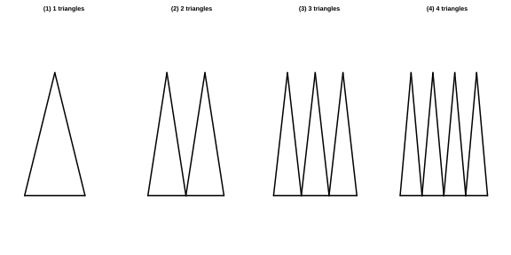
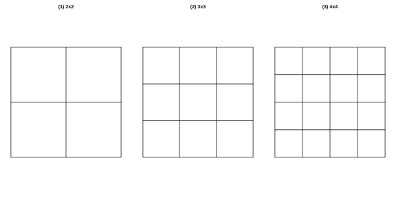

# 作业 13

> **定义 3.1.2** (列代数式)  把问题中的数量关系用含有数、字母和运算符号的式子表示出来.
>
> **定义 3.2.1** (代数式的值)  用数值代替代数式中的字母, 按照代数式中的运算关系计算得出的结果.

### 活动一

(数学活动 活动 1 拼图小游戏第 (1) 题) 如图, 用火柴棍拼成一排由三角形组成的图形, 如果图形中含有 $2$, $3$ 或 $4$ 个三角形, 分别需要多少根火柴棍? 如果图形中含有 $n$ 个三角形, 需要多少根火柴棍?

{width=100%}

### 解答 活动一

由**定义 3.1.2** (列代数式).

$1$ 个三角形需要 $3$ 根火柴棍; 每增加一个三角形, 因与前一个三角形共用一条边, 只需增加 $2$ 根. 故 $2$ 个三角形需要 $3+2=5$ 根, $3$ 个三角形需要 $5+2=7$ 根, $4$ 个三角形需要 $7+2=9$ 根.

由此规律, $n$ 个三角形需要 $3+2\left(n-1\right)=2n+1$ 根火柴棍. $\blacksquare$

### 活动二

(数学活动 活动 1 拼图小游戏第 (2) 题) 如图, 用相同的小正方形拼大正方形, 拼第 $1$ 个正方形需要 $4$ 个小正方形, 拼第 $2$ 个正方形需要 $9$ 个小正方形, 拼第 $3$ 个正方形需要 $16$ 个小正方形. 拼一拼, 想一想, 按照这样的方法拼成的第 $n$ 个正方形比第 $\left(n-1\right)$ 个正方形多几个小正方形?

{width=100%}

### 解答 活动二

由**定义 3.1.2** (列代数式) 与**定义 3.2.1** (代数式的值).

第 $1$ 个正方形是 $2\times 2=4$ 个小正方形, 第 $2$ 个是 $3\times 3=9$ 个, 第 $3$ 个是 $4\times 4=16$ 个. 故第 $n$ 个正方形由 $\left(n+1\right)^{2}$ 个小正方形组成, 第 $\left(n-1\right)$ 个正方形由 $n^{2}$ 个小正方形组成.

二者相差

$$\left(n+1\right)^{2}-n^{2}=n^{2}+2n+1-n^{2}=2n+1.$$

故第 $n$ 个正方形比第 $\left(n-1\right)$ 个正方形多 $2n+1$ 个小正方形. $\blacksquare$

### 活动三

(数学活动 活动 2 密码中的数学第 (1) 题) 将 $26$ 个英文字母 $a$, $b$, $c$, $\cdots$, $z$ 依次对应自然数 $1$, $2$, $3$, $\cdots$, $26$. 对于密文 "$26\ \ 2\ \ 19\ \ 7$", 给出密文与明文之间的关系如下: 当密文中的数 $x$ 为奇数时, 明文对应的序号为 $x+1$; 当密文中的数 $x$ 为偶数时, 明文对应的序号为 $\dfrac{x}{2}$. 请将密文破译成用英文字母表示的明文.

### 解答 活动三

由**定义 3.2.1** (代数式的值).

密文 $26$ 为偶数, 明文序号 $\dfrac{26}{2}=13$, 对应字母 $m$;

密文 $2$ 为偶数, 明文序号 $\dfrac{2}{2}=1$, 对应字母 $a$;

密文 $19$ 为奇数, 明文序号 $19+1=20$, 对应字母 $t$;

密文 $7$ 为奇数, 明文序号 $7+1=8$, 对应字母 $h$.

故密文 "$26\ 2\ 19\ 7$" 破译为明文 "$math$". $\blacksquare$
