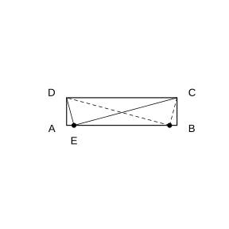

# 作业 130

> **结论 25.3.1** (列方程解应用题)  列一元二次方程解实际问题的一般步骤: 审题、设未知数、根据等量关系列方程、解方程、检验根是否符合实际意义并作答.
>
> **结论 25.3.2** (增长率与下降率模型)  设原来的量为 $a$, 平均增长率为 $x$, 则两次变化后为 $a(1+x)^2$; 若为平均下降率 $x$, 则两次变化后为 $a(1-x)^2$.
>
> **结论 25.3.3** (传播模型)  开始有 $1$ 人, 每轮平均 $1$ 人传染 $x$ 人, 则两轮后共有 $(1+x)^2$ 人被传染.
>
> **结论 25.3.4** (比赛场次模型)  $n$ 支球队单循环比赛共 $\dfrac{n(n-1)}2$ 场; 主客场双循环比赛共 $n(n-1)$ 场.
>
> **结论 25.3.5** (凸多边形对角线数)  一个凸 $n$ 边形共有 $\dfrac{n(n-3)}2$ 条对角线.

### 练习一

(练习 25.3 第 1 题) 怎样用一根长为 $40\ \text{m}$ 的细绳围成一个面积为 $75\ \text{m}^2$ 的矩形区域? 能围成一个面积为 $101\ \text{m}^2$ 的矩形区域吗? 如果能, 说明围法; 如果不能, 说明理由.

### 解答 练习一

由细绳长 $40\ \text{m}$ 知矩形周长为 $40\ \text{m}$. 设矩形一边长为 $x\ \text{m}$, 则邻边长为 $(20-x)\ \text{m}$, 面积为 $x(20-x)$.

要围成面积 $75\ \text{m}^2$ 的矩形, 列方程

$$
x(20-x)=75.
$$

整理, 得 $x^2-20x+75=0$, 即 $(x-5)(x-15)=0$, 解得 $x=5$ 或 $x=15$, 两邻边长为 $5\ \text{m}$ 和 $15\ \text{m}$. 故可围成边长为 $5\ \text{m}$ 与 $15\ \text{m}$ 的矩形.

要围成面积 $101\ \text{m}^2$ 的矩形, 列方程

$$
x(20-x)=101.
$$

整理, 得 $x^2-20x+101=0$, 其判别式 $\Delta=(-20)^2-4\times101=400-404=-4<0$, 方程无实数根. 故不能围成面积为 $101\ \text{m}^2$ 的矩形区域. $\blacksquare$

### 练习二

(练习 25.3 第 2 题) 如图, 矩形 $ABCD$ 的两条邻边 $AD=1$, $CD=4$, $AB$ 上是否存在点 $E$, 使得 $\angle DEC$ 为直角?

{width=50%}

### 解答 练习二

以 $A$ 为原点, $AB$ 所在直线为 $x$ 轴建立平面直角坐标系, 则 $A(0,0)$, $B(4,0)$, $C(4,1)$, $D(0,1)$. 设 $E(x,0)$, 其中 $0\le x\le4$.

$\angle DEC$ 为直角, 即 $\triangle DEC$ 为直角三角形且直角在 $E$, 由勾股定理的逆定理, 需 $DE^2+CE^2=DC^2$. 而

$$
DE^2=x^2+1,\quad CE^2=(4-x)^2+1,\quad DC^2=16.
$$

列方程

$$
x^2+1+(4-x)^2+1=16.
$$

整理, 得 $2x^2-8x+2=0$, 即 $x^2-4x+1=0$, 解得

$$
x=\frac{4\pm\sqrt{12}}2=2\pm\sqrt3.
$$

两值 $2-\sqrt3\approx0.27$ 和 $2+\sqrt3\approx3.73$ 都在 $[0,4]$ 内. 故 $AB$ 上存在这样的点 $E$, 且有两个. $\blacksquare$

### 练习三

(练习 25.3 第 3 题第 (1) 小题) 某种植物的主干长出若干数目的支干, 每个支干又长出与这些支干同样数目的小分支. 如果主干、支干和小分支的总数是 $91$, 那么每个支干长出多少个小分支?

### 解答 练习三

设每个支干长出 $x$ 个小分支, 则主干长出 $x$ 个支干, 小分支共有 $x\cdot x=x^2$ 个. 由总数为 $91$, 列方程

$$
1+x+x^2=91.
$$

整理, 得 $x^2+x-90=0$, 即 $(x+10)(x-9)=0$, 解得 $x=9$ 或 $x=-10$. 分支数为正, 舍去 $x=-10$. 故每个支干长出 $9$ 个小分支. $\blacksquare$

### 练习四

(练习 25.3 第 3 题第 (2) 小题) 青山村所种水稻 $2020$ 年平均每公顷产 $15000\ \text{kg}$, $2022$ 年平均每公顷产 $18000\ \text{kg}$. 求水稻每公顷产量的年平均增长率 (结果写成 $a\%$ 的形式, 其中 $a$ 保留小数点后两位).

### 解答 练习四

由**结论 25.3.2** (增长率模型), 设年平均增长率为 $x$, 经过两年, 得

$$
15000(1+x)^2=18000.
$$

于是 $(1+x)^2=\dfrac{18000}{15000}=1.2$, 因增长率为正, $1+x=\sqrt{1.2}\approx1.0954$, 故

$$
x\approx0.0954=9.54\%.
$$

即水稻每公顷产量的年平均增长率约为 $9.54\%$. $\blacksquare$

### 练习五

(练习 25.3 第 4 题第 (1) 小题) $n$ 个人参加聚会, 每两人都握 $1$ 次手, 所有人共握手 $10$ 次, 共有多少人?

### 解答 练习五

每两人握一次手, 相当于从 $n$ 个人中任取 $2$ 人, 握手次数为 $\dfrac{n(n-1)}2$. 由共握手 $10$ 次, 列方程

$$
\frac{n(n-1)}2=10.
$$

即 $n(n-1)=20$, $n^2-n-20=0$, 即 $(n-5)(n+4)=0$, 解得 $n=5$ 或 $n=-4$. 人数为正, 舍去 $n=-4$. 故共有 $5$ 人. $\blacksquare$

### 练习六

(练习 25.3 第 4 题第 (2) 小题) 一个凸多边形共有 $20$ 条对角线, 它是几边形? 是否存在有 $18$ 条对角线的多边形? 如果存在, 它是几边形? 如果不存在, 说明理由.

### 解答 练习六

由**结论 25.3.5** (凸多边形对角线数), 凸 $n$ 边形对角线为 $\dfrac{n(n-3)}2$.

对角线为 $20$ 条时, 列方程 $\dfrac{n(n-3)}2=20$, 即 $n(n-3)=40$, $n^2-3n-40=0$, 即 $(n-8)(n+5)=0$, 解得 $n=8$ (舍去负根). 故它是八边形.

若对角线为 $18$ 条, 列方程 $\dfrac{n(n-3)}2=18$, 即 $n(n-3)=36$, $n^2-3n-36=0$, 其判别式 $\Delta=(-3)^2+144=153$, 不是完全平方数, 故 $n$ 不是整数. 因此不存在恰有 $18$ 条对角线的多边形. $\blacksquare$

### 习题一

(习题 25.3 复习巩固第 1 题) 两个数的和是 $26$, 积是 $168$, 求这两个数.

### 解答 习题一

设其中一个数为 $x$, 则另一个数为 $26-x$. 由积为 $168$, 列方程

$$
x(26-x)=168.
$$

整理, 得 $x^2-26x+168=0$, 其判别式 $\Delta=26^2-4\times168=676-672=4$, 故 $x=\dfrac{26\pm2}{2}$, 即 $x=14$ 或 $x=12$. 故这两个数为 $12$ 和 $14$. $\blacksquare$

### 习题二

(习题 25.3 复习巩固第 2 题) 一个直角三角形的两条直角边的和是 $14$, 面积是 $24$, 求这两条直角边的长.

### 解答 习题二

设一条直角边长为 $x$, 则另一条为 $14-x$. 由直角三角形面积为两直角边积的一半, 列方程

$$
\frac12 x(14-x)=24.
$$

即 $x(14-x)=48$, $x^2-14x+48=0$, 即 $(x-6)(x-8)=0$, 解得 $x=6$ 或 $x=8$. 故两条直角边的长分别为 $6$ 和 $8$. $\blacksquare$

### 习题三

(习题 25.3 复习巩固第 3 题) 某足球联赛采用双循环赛制, 如果赛季结束后共比赛 $90$ 场, 那么共有多少支球队参加比赛?

### 解答 习题三

由**结论 25.3.4** (比赛场次模型), $n$ 支球队双循环共 $n(n-1)$ 场. 列方程

$$
n(n-1)=90.
$$

即 $n^2-n-90=0$, 即 $(n-10)(n+9)=0$, 解得 $n=10$ (舍去负根). 故共有 $10$ 支球队参加比赛. $\blacksquare$

### 习题四

(习题 25.3 复习巩固第 4 题) $2019$ 年我国快递业务量是 $635.2$ 亿件, $2021$ 年增至 $1083.0$ 亿件, 这两年的年平均增长率是多少 (结果写成 $a\%$ 的形式, 其中 $a$ 保留小数点后一位)?

### 解答 习题四

由**结论 25.3.2** (增长率模型), 设年平均增长率为 $x$, 两年后业务量为 $635.2(1+x)^2$, 列方程

$$
635.2(1+x)^2=1083.0.
$$

于是 $(1+x)^2=\dfrac{1083.0}{635.2}\approx1.705$, 因增长率为正, $1+x\approx\sqrt{1.705}\approx1.306$, 故

$$
x\approx0.306=30.6\%.
$$

即这两年的年平均增长率约为 $30.6\%$. $\blacksquare$

### 习题五

(习题 25.3 综合运用第 5 题) 一个菱形的两条对角线长之和是 $10$, 面积是 $12$, 求这个菱形的周长.

### 解答 习题五

设菱形两条对角线的长分别为 $d_1,d_2$. 由对角线长之和为 $10$, 得 $d_1+d_2=10$. 菱形面积等于两对角线乘积的一半, 由面积为 $12$, 得 $\dfrac12 d_1d_2=12$, 即 $d_1d_2=24$.

设 $d_1=x$, 则 $d_2=10-x$, 列方程 $x(10-x)=24$, 即 $x^2-10x+24=0$, 亦即 $(x-4)(x-6)=0$, 解得两对角线长为 $4$ 和 $6$.

菱形的对角线互相垂直平分, 故边长为 $\sqrt{\left(\dfrac42\right)^2+\left(\dfrac62\right)^2}=\sqrt{4+9}=\sqrt{13}$, 周长为

$$
4\sqrt{13}. \blacksquare
$$

### 习题六

(习题 25.3 综合运用第 6 题) 如图, 要为长 $22\ \text{cm}$, 宽 $29\ \text{cm}$ 的照片配相框, 要求相框的四条边宽度相等, 并且相框边的面积是照片面积的四分之一, 相框边的宽度应是多少厘米 (结果保留小数点后一位)?

### 解答 习题六

照片面积为 $22\times29=638\ \text{cm}^2$. 设相框边宽为 $x\ \text{cm}$, 则含相框的整体尺寸为 $(22+2x)$ 与 $(29+2x)$, 相框边的面积为整体面积减去照片面积. 由相框边面积是照片面积的四分之一, 列方程

$$
(22+2x)(29+2x)-638=\frac14\times638.
$$

展开左边: $638+44x+58x+4x^2-638=4x^2+102x$, 右边为 $159.5$, 故

$$
4x^2+102x-159.5=0.
$$

由求根公式, $x=\dfrac{-102\pm\sqrt{102^2+4\times4\times159.5}}{8}=\dfrac{-102\pm\sqrt{12956}}8$. 取正根, $\sqrt{12956}\approx113.8$, 故

$$
x\approx\frac{-102+113.8}{8}\approx1.5\ \text{cm}.
$$

即相框边的宽度约为 $1.5\ \text{cm}$. $\blacksquare$

### 习题七

(习题 25.3 综合运用第 7 题) 一个直角三角形的三边长均为正整数, 斜边的长比一直角边的长大 $1$, 比另一直角边的长大 $8$, 这样的直角三角形存在吗? 如果存在, 有多少个?

### 解答 习题七

设斜边长为 $c$, 则两条直角边分别为 $c-1$ 和 $c-8$. 由勾股定理, 列方程

$$
(c-1)^2+(c-8)^2=c^2.
$$

展开, 得 $c^2-2c+1+c^2-16c+64=c^2$, 即 $c^2-18c+65=0$, 亦即 $(c-5)(c-13)=0$, 解得 $c=5$ 或 $c=13$.

当 $c=5$ 时, 另一直角边 $c-8=-3<0$, 不合题意, 舍去. 当 $c=13$ 时, 两条直角边为 $12$ 和 $5$, 均为正整数. 故这样的直角三角形存在, 且只有一个, 三边长为 $5,12,13$. $\blacksquare$

### 习题八

(习题 25.3 拓广探索第 8 题) 如图, 要设计一幅宽 $20\ \text{cm}$, 长 $30\ \text{cm}$ 的图案, 其中有两横两竖的彩条, 横、竖彩条的宽度比为 $3:2$. 如果要使彩条所占面积是图案面积的四分之一, 应如何设计彩条的宽度 (结果保留小数点后一位)?

### 解答 习题八

图案面积为 $20\times30=600\ \text{cm}^2$. 由彩条面积占四分之一, 知空白部分面积为 $\dfrac34\times600=450\ \text{cm}^2$.

设竖彩条宽为 $2y$, 横彩条宽为 $3y$ (宽比 $2:3$). 去掉两条竖彩条后空白宽为 $20-4y$, 去掉两条横彩条后空白长为 $30-6y$, 空白部分为一矩形, 故

$$
(20-4y)(30-6y)=450.
$$

展开, 得 $600-120y-120y+24y^2=450$, 即 $24y^2-240y+150=0$, 亦即 $4y^2-40y+25=0$. 由求根公式,

$$
y=\frac{40\pm\sqrt{1600-400}}8=\frac{40\pm20\sqrt3}{8}.
$$

取较小正根, $y=\dfrac{10-5\sqrt3}{2}\approx0.67$. 故横彩条宽 $3y\approx2.0\ \text{cm}$, 竖彩条宽 $2y\approx1.3\ \text{cm}$. $\blacksquare$

### 习题九

(习题 25.3 拓广探索第 9 题) 如图, 线段 $AB$ 的长为 $1$, 点 $C,D,E$ 在线段 $AB$ 上.

(1) 若 $AC^2=CB\cdot AB$, 求线段 $AC$ 的长;

(2) 在 (1) 的条件下, 若 $AD^2=CD\cdot AC$, 求线段 $AD$ 的长;

(3) 在 (1)(2) 的条件下, 若 $AE^2=DE\cdot AD$, 求线段 $AE$ 的长.

上面各题的结果反映了什么规律?

### 解答 习题九

(1) 设 $AC=x$, 则 $CB=1-x$. 由 $AC^2=CB\cdot AB$, 且 $AB=1$, 列方程

$$
x^2=(1-x)\cdot1.
$$

即 $x^2+x-1=0$, 取正根, 得

$$
AC=x=\frac{\sqrt5-1}{2}\approx0.618.
$$

(2) 设 $AD=y$, 点 $D$ 在 $AC$ 上, 则 $CD=AC-AD$. 由 $AD^2=CD\cdot AC$, 得

$$
y^2=(AC-y)\cdot AC.
$$

即 $y^2+AC\cdot y-AC^2=0$. 把 $AC=\dfrac{\sqrt5-1}{2}$ 代入, 取正根, 得 $AD=y=AC\cdot\dfrac{\sqrt5-1}{2}\approx0.382$.

(3) 同理, 由 $AE^2=DE\cdot AD$, 取正根, 得 $AE=AD\cdot\dfrac{\sqrt5-1}{2}\approx0.236$.

规律: 每次所得线段的长都是前一线段长的 $\dfrac{\sqrt5-1}{2}$ 倍, 即不断按黄金分割数分割. $\blacksquare$
