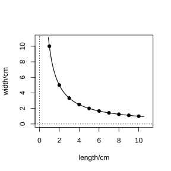
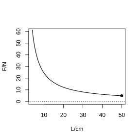

# 作业 160

> **定义 26.1.1** (反比例函数)  形如 $y=\dfrac{k}{x}$（$k$ 为常数，$k\ne0$）的函数叫做反比例函数，自变量 $x$ 的取值范围是不等于 $0$ 的一切实数。

> **定义 26.1.2** (反比例函数的图象与性质)  $y=\dfrac{k}{x}$ 的图象是双曲线。$k>0$ 时两支在第一、第三象限，每象限内 $y$ 随 $x$ 增大而减小；$k<0$ 时两支在第二、第四象限，每象限内 $y$ 随 $x$ 增大而增大。

> **定义 26.2.2** (杠杆原理)  阻力 $\times$ 阻力臂 $=$ 动力 $\times$ 动力臂，即 $F_1l_1=F_2l_2$。

### 活动一

(数学活动 活动 1) 下表是 $10$ 个面积相等的矩形的长与宽，请补齐表格。设 $\angle A$ 为这 $10$ 个矩形的公共角，画出这 $10$ 个矩形，然后取 $\angle A$ 的 $10$ 个对角的顶点，并把这 $10$ 个点用平滑的曲线顺次连接起来。这条曲线是反比例函数图象的一支吗？为什么？

长/cm：$1,2,3,4,5,\;\_\_,\;\_\_,\;\_\_,\;\_\_,\;\_\_$

宽/cm：$\_\_,\_\_,\_\_,\_\_,2,\dfrac{5}{3},\dfrac{10}{7},\dfrac{5}{4},\dfrac{10}{9},1$

{width=50%}

### 解答 活动一

由宽 $=2$ 时长 $=5$，得每个矩形面积为 $10$，故长 $\times$ 宽 $=10$，即宽 $=\dfrac{10}{\text{长}}$。

长为 $1$ 时宽 $=10$；$2$ 时宽 $=5$；$3$ 时宽 $=\dfrac{10}{3}$；$4$ 时宽 $=\dfrac{5}{2}$；$5$ 时宽 $=2$。

宽为 $\dfrac{5}{3}$ 时长 $=6$；$\dfrac{10}{7}$ 时长 $=7$；$\dfrac{5}{4}$ 时长 $=8$；$\dfrac{10}{9}$ 时长 $=9$；$1$ 时长 $=10$。

故长依次补为 $6,7,8,9,10$；宽依次补为 $10,5,\dfrac{10}{3},\dfrac{5}{2}$。

对角顶点坐标为 $(\text{长},\text{宽})$，满足长 $\times$ 宽 $=10$，即 $y=\dfrac{10}{x}$，这是反比例函数 $k=10>0$ 时在第一象限的一支。 $\blacksquare$

### 活动二

(数学活动 活动 2) 取一根长 $100\ \text{cm}$ 的匀质木杆，用细绳绑在木杆的中点 $O$ 并将其吊起来。在中点 $O$ 的左侧距离中点 $O$ $25\ \text{cm}$ 处挂一个重 $9.8\ \text{N}$ 的物体，在中点 $O$ 右侧用一个弹簧秤向下拉，使木杆处于水平状态。改变弹簧秤与中点 $O$ 的距离 $L$ (单位: $\text{cm}$)，看弹簧秤的示数 $F$ (单位: $\text{N}$) 有什么变化，并填写下表：$L=5,10,15,20,25,30,35,40,45$。以 $L$ 为横坐标，$F$ 为纵坐标描点连线。这条曲线是反比例函数图象的一支吗？点 $(50,4.9)$ 在这条曲线上吗？

{width=50%}

### 解答 活动二

由**定义 26.2.2** (杠杆原理)，左侧力矩为 $9.8\times25=245$，平衡时 $F\cdot L=245$，即 $F=\dfrac{245}{L}$。

$L=5\Rightarrow F=49$；$10\Rightarrow24.5$；$15\Rightarrow\dfrac{49}{3}\approx16.33$；$20\Rightarrow12.25$；$25\Rightarrow9.8$；$30\Rightarrow\dfrac{49}{6}\approx8.17$；$35\Rightarrow7$；$40\Rightarrow6.125$；$45\Rightarrow\dfrac{49}{9}\approx5.44$。

$F=\dfrac{245}{L}$ 是反比例函数，$k=245>0$，在第一象限的一支。

点 $(50,4.9)$：$F=\dfrac{245}{50}=4.9$，满足解析式，故在曲线上。 $\blacksquare$
