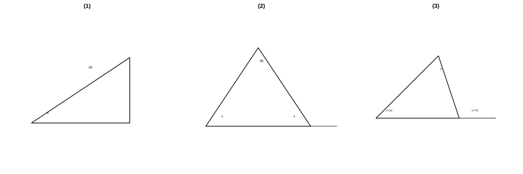
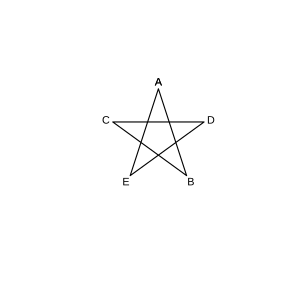

# 作业 65

> **结论 13.2.1** (三角形三边关系)  三角形任意两边的和大于第三边, 任意两边的差小于第三边.
>
> **定义 13.2.1** (中线)  连接顶点与对边中点的线段叫作中线, 三条中线交于重心.
>
> **定义 13.2.2** (角平分线)  角的平分线与对边相交所得线段叫作三角形的角平分线.
>
> **定义 13.2.3** (高)  从顶点向对边所在直线作垂线, 顶点与垂足间的线段叫作高.
>
> **定理 13.3.1** (三角形内角和定理)  三角形的内角和等于 $180^\circ$.
>
> **结论 13.3.1** (直角三角形锐角互余)  直角三角形的两个锐角互余; 有两个角互余的三角形是直角三角形.
>
> **推论 13.3.1** (外角与不相邻内角的关系)  三角形的外角等于与它不相邻的两个内角的和, 三个外角和为 $360^\circ$.

### 复习题一

(复习题 复习巩固第 1 题) 下列四个条件:

(1) 在 $\triangle ABC$ 中, $\angle A$, $\angle B$ 都是锐角;

(2) $\triangle ABC$ 的三个内角的度数之比是 $1:2:3$;

(3) 在 $\triangle ABC$ 中, $\angle A-\angle B=\angle C$;

(4) $\triangle ABC$ 的三个外角的度数之比是 $3:4:5$.

其中能确定 $\triangle ABC$ 是直角三角形的是 $\;\_\_\;$ (只填序号).

### 解答 复习题一

由**定理 13.3.1** (三角形内角和定理) 及**结论 13.3.1** (直角三角形锐角互余) 逐一判断.

条件 (1): 两个角为锐角不能确定第三个角是否为直角, 不能确定.

条件 (2): 三内角比为 $1:2:3$, 最大角为 $\frac{3}{1+2+3}\times180^\circ=90^\circ$, 能确定.

条件 (3): $\angle A-\angle B=\angle C$, 即 $\angle A=\angle B+\angle C$. 又 $\angle A+\angle B+\angle C=180^\circ$, 故 $2\angle A=180^\circ$, $\angle A=90^\circ$, 能确定.

条件 (4): 三外角比为 $3:4:5$, 外角和为 $360^\circ$, 故三个外角为 $90^\circ$, $120^\circ$, $150^\circ$, 相应内角为 $90^\circ$, $60^\circ$, $30^\circ$, 有一个内角为 $90^\circ$, 能确定.

故能确定的是 (2)(3)(4). $\blacksquare$

### 复习题二

(复习题 复习巩固第 2 题) 如图, 在 $\triangle ABC$ 中, $AD$, $AE$ 分别是边 $BC$ 上的中线和高, $AE=2$, $S_{\triangle ABD}=1.5$. 求 $BC$ 和 $DC$ 的长.

### 解答 复习题二

由**定义 13.2.3** (高), 以 $BD$ 为底时高为 $AE$. 由三角形面积公式,

$$
S_{\triangle ABD}=\frac{1}{2}\cdot BD\cdot AE=\frac{1}{2}\times BD\times2=1.5.
$$

解得 $BD=1.5$. 由**定义 13.2.1** (中线), $D$ 是 $BC$ 的中点, 故 $BC=2BD=3$, $DC=BD=1.5$. $\blacksquare$

### 复习题三

(复习题 复习巩固第 3 题) 填空: 由三角形两边的和大于第三边, 得 $AB+AD>\;\_\_\;$, $PD+CD>\;\_\_\;$; 将左右两边分别相加, 得 $AB+AD+PD+CD>\;\_\_\;$, 即 $AB+AC>\;\_\_\;$.

### 解答 复习题三

由**结论 13.2.1** (三角形三边关系), 在 $\triangle ABD$ 中,

$$
AB+AD>BD.
$$

在 $\triangle PCD$ 中,

$$
PD+CD>PC.
$$

将两式左右分别相加:

$$
AB+AD+PD+CD>BD+PC.
$$

左边即 $AB+AC$, 右边即 $BC$, 故 $AB+AC>BC$. 依次填 $BD$, $PC$, $BD+PC$, $BC$. $\blacksquare$

### 复习题四

(复习题 复习巩固第 4 题) 求出下列各图形中 $x$ 的值.

{width=100%}

### 解答 复习题四

由**定理 13.3.1** (三角形内角和定理) 及**推论 13.3.1** (外角与不相邻内角的关系).

图 (1): 直角三角形中一锐角为 $50^\circ$, 故 $x=90^\circ-50^\circ=40^\circ$.

图 (2): 顶角为 $40^\circ$, 两底角相等, 故 $x=\frac{180^\circ-40^\circ}{2}=70^\circ$.

图 (3): 外角 $(x+70^\circ)$ 等于不相邻两内角 $x^\circ$ 与 $(x+10^\circ)$ 的和, 故

$$
x+70=x+(x+10),
$$

解得 $x=60$. $\blacksquare$

### 复习题五

(复习题 综合运用第 5 题) 如图, $\angle B=42^\circ$, $\angle A$ 比 $\angle 1$ 小 $10^\circ$, $\angle ACD=64^\circ$. 求证 $AB\parallel CD$.

### 解答 复习题五

由**定理 13.3.1** (三角形内角和定理), 在 $\triangle ABC$ 中, $\angle A+\angle B+\angle 1=180^\circ$. 又 $\angle A=\angle 1-10^\circ$, $\angle B=42^\circ$, 代入:

$$
(\angle 1-10^\circ)+42^\circ+\angle 1=180^\circ,
$$

解得 $2\angle 1=148^\circ$, $\angle 1=74^\circ$, 从而 $\angle A=64^\circ$.

于是 $\angle A=\angle ACD=64^\circ$, 这两个角是直线 $AB$, $CD$ 被直线 $AC$ 所截得的内错角, 内错角相等, 故 $AB\parallel CD$. $\blacksquare$

### 复习题六

(复习题 综合运用第 6 题) 如图, 在 $\triangle ABC$ 中, $\angle C=\angle ABC=2\angle A$, $BD$ 是边 $AC$ 上的高. 求 $\angle DBC$ 的度数.

### 解答 复习题六

由**定理 13.3.1** (三角形内角和定理),

$$
\angle A+2\angle A+2\angle A=180^\circ,
$$

解得 $\angle A=36^\circ$, 故 $\angle C=72^\circ$.

由**定义 13.2.3** (高), $BD\perp AC$, 在 $\text{Rt}\triangle BDC$ 中, 由**结论 13.3.1** (直角三角形锐角互余),

$$
\angle DBC=90^\circ-\angle C=90^\circ-72^\circ=18^\circ.
$$

$\blacksquare$

### 复习题七

(复习题 综合运用第 7 题) 如图, 在 $\triangle ABC$ 中, $AD$ 是高, $AE$, $BF$ 是角平分线, 且 $AE$, $BF$ 相交于点 $O$, $\angle BAC=50^\circ$, $\angle C=70^\circ$. 求 $\angle DAC$ 和 $\angle BOA$ 的度数.

### 解答 复习题七

由**定理 13.3.1** (三角形内角和定理),

$$
\angle ABC=180^\circ-50^\circ-70^\circ=60^\circ.
$$

由**定义 13.2.3** (高), $AD\perp BC$, 在 $\text{Rt}\triangle ADC$ 中, $\angle DAC=90^\circ-\angle C=90^\circ-70^\circ=20^\circ$.

由**定义 13.2.2** (角平分线), $AE$ 平分 $\angle BAC$, 故 $\angle BAO=25^\circ$; $BF$ 平分 $\angle ABC$, 故 $\angle ABO=30^\circ$. 在 $\triangle ABO$ 中,

$$
\angle BOA=180^\circ-\angle BAO-\angle ABO=180^\circ-25^\circ-30^\circ=125^\circ.
$$

$\blacksquare$

### 复习题八

(复习题 拓广探索第 8 题) 如图, 在 $\triangle ABC$ 中, $BE$, $CF$ 是角平分线, 且 $BE$, $CF$ 相交于点 $G$. 求证:

(1) $\angle BGC=180^\circ-\dfrac{1}{2}(\angle ABC+\angle ACB)$;

(2) $\angle BGC=90^\circ+\dfrac{1}{2}\angle A$.

### 解答 复习题八

由**定义 13.2.2** (角平分线), $BE$ 平分 $\angle ABC$, $CF$ 平分 $\angle ACB$, 故

$$
\angle GBC=\frac{1}{2}\angle ABC,\qquad \angle GCB=\frac{1}{2}\angle ACB.
$$

(1) 在 $\triangle BGC$ 中, 由**定理 13.3.1** (三角形内角和定理),

$$
\angle BGC=180^\circ-\angle GBC-\angle GCB=180^\circ-\frac{1}{2}(\angle ABC+\angle ACB).
$$

(2) 又在 $\triangle ABC$ 中, $\angle ABC+\angle ACB=180^\circ-\angle A$, 代入上式:

$$
\angle BGC=180^\circ-\frac{1}{2}(180^\circ-\angle A)=90^\circ+\frac{1}{2}\angle A.
$$

$\blacksquare$

### 复习题九

(复习题 拓广探索第 9 题) 如图, 连接 $AC$, $AD$, $BD$, $BE$, $CE$, 求证 $\angle A+\angle B+\angle C+\angle D+\angle E=180^\circ$.

{width=50%}

### 解答 复习题九

设线段 $BE$ 与 $CD$, $AD$ 相交. 由**推论 13.3.1** (外角与不相邻内角的关系), 五角星中间形成的三角形中, 两个不相邻内角之和等于相应外角, 这些外角又可转化为中央三角形的两个内角之和.

中央三角形的三个内角之和为 $180^\circ$, 而五个尖角 $\angle A$, $\angle B$, $\angle C$, $\angle D$, $\angle E$ 恰好分别等于这三个内角通过外角关系转化后的各个不相邻内角之和. 故

$$
\angle A+\angle B+\angle C+\angle D+\angle E=180^\circ.
$$

$\blacksquare$
