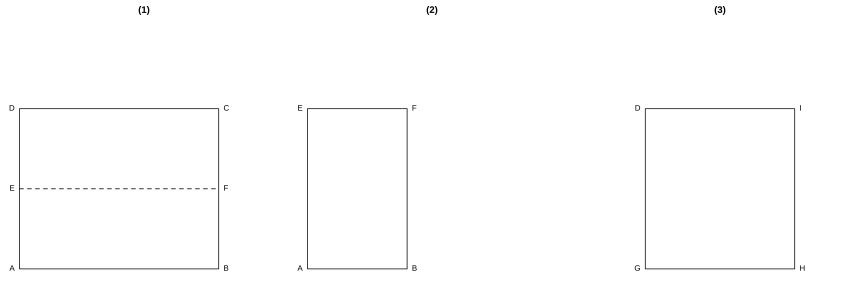

# 作业 97

> **法则 19.2.2** (乘法逆用)   \(\sqrt{ab}=\sqrt{a}\cdot\sqrt{b}\)（\(a\ge 0,\ b\ge 0\)）。
>
> **法则 19.2.4** (除法逆用)   \(\sqrt{\dfrac{a}{b}}=\dfrac{\sqrt{a}}{\sqrt{b}}\)（\(a\ge 0,\ b>0\)）。

### 活动一

(数学活动 活动 1 第 1 题)

书籍和纸张的长与宽都有固定的规格。使用计算器求出表 1、表 2 中各规格纸张长与宽的比值，你有什么发现？各规格纸张的长与宽的比有什么关系？

把每张纸的长除以宽计算：

$$
\frac{210}{148}\approx 1.419,\quad \frac{297}{210}\approx 1.414,\quad \frac{420}{297}\approx 1.414,
$$

$$
\frac{594}{420}\approx 1.414,\quad \frac{841}{594}\approx 1.416.
$$

同理 B 型纸 \(\dfrac{257}{182}\approx 1.412\)、\(\dfrac{364}{257}\approx 1.416\) 等也都约为 \(1.414\)。

由**法则 19.2.4**，\(\sqrt{2}\approx 1.414\)。

可见各规格纸张长与宽的比都约等于 \(\sqrt{2}\)，即它们都是形状相同的长方形，只是按比例缩放。

\(\blacksquare\)

(数学活动 活动 1 第 2 题)

如图 1，长方形纸片 \(ABCD\) 的长与宽的比值为 \(\sqrt{2}\)。

(1) 如图 2，若 \(E,F\) 分别是长边 \(AD,BC\) 的中点，将纸片 \(ABCD\) 沿直线 \(EF\) 对折，得到的长方形 \(ABFE\) 是否仍为“长与宽的比值为 \(\sqrt{2}\) 的长方形”？为什么？

(2) 若按图 3 所示的方式折叠纸片 \(ABCD\)，长方形 \(GHID\) 是否仍为“长与宽的比值为 \(\sqrt{2}\) 的长方形”？为什么？

{width=100%}

(1) 设原长方形宽为 \(a\)、长为 \(b\)，由题意 \(\dfrac{b}{a}=\sqrt{2}\)。

对折后，长方形 \(ABFE\) 的宽为原宽 \(a\)，长为原长的一半 \(\dfrac{b}{2}\)。

于是新长方形长与宽之比为

$$
\frac{a}{b/2}=\frac{2a}{b}=\frac{2}{\sqrt{2}}=\sqrt{2}.
$$

故 \(ABFE\) 仍为长与宽之比为 \(\sqrt{2}\) 的长方形。

(2) 按图 3 折叠后，新长方形 \(GHID\) 的一边仍为原宽 \(a\)，另一边由原长 \(b\) 减去 \(a\) 得到，即 \(b-a\)。

由 \(\dfrac{b}{a}=\sqrt{2}\)，得 \(b=\sqrt{2}a\)，故另一边为 \((\sqrt{2}-1)a\)。

于是

$$
\frac{a}{b-a}=\frac{a}{(\sqrt{2}-1)a}=\frac{1}{\sqrt{2}-1}=\sqrt{2}+1.
$$

它不等于 \(\sqrt{2}\)，故 \(GHID\) 不是长与宽之比为 \(\sqrt{2}\) 的长方形。

\(\blacksquare\)
